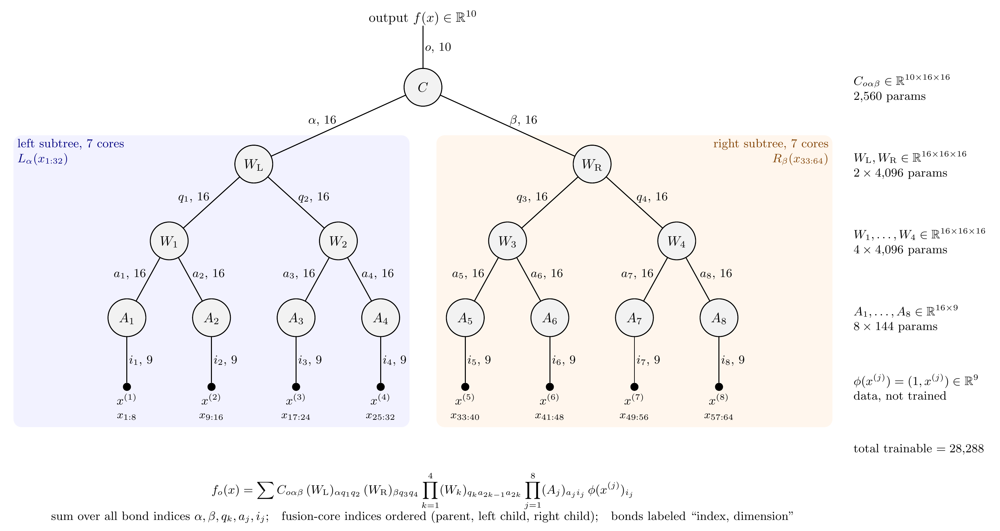

# Overshoot in the shared-feature TTN

Numerical tests of the overshoot prediction in the note "Learning dynamics when two tensor
components share a feature". Model: $T_{oij}=u_i(RB)_{oj}$, teacher $s_1 e_1\otimes g\otimes h_1 +
s_2 e_2\otimes g\otimes h_2$, with $\rho=s_2/s_1$ and $c_k=\langle T, e_k\otimes g\otimes h_k\rangle$.
Fixing $s_1=1$ loses nothing because the balanced flow is scale invariant (checked in `checks.py`).

The control unshares only the left feature: each output gets its own $u$, and $R$, $B$, the optimizer
and the init scale stay the same. Any gap between the arms is therefore due to sharing $u$.



Eight-leaf binary TTN with 64 inputs, bond dimension 16 and 10 outputs (28,288 trainable
parameters). Source in `figures/ttn8_diagram.tex`, drawn with
[tensor-network.sty](https://github.com/mptoolkit/tikz-diagrams).

## Reproducing

```bash
uv venv --python 3.12 .venv && uv pip install --python .venv/bin/python numpy scipy matplotlib
.venv/bin/python checks.py        # gradients, note's numbers, reductions (seconds)
.venv/bin/python experiments.py   # writes results/ (several minutes on 14 processes)
.venv/bin/python plot.py          # writes figures/ from results/ only
.venv/bin/python hierarchy_checks.py       # hierarchy reduction, gradients, solvers (a few minutes)
.venv/bin/python hierarchy_experiments.py order race scaling overshoot loss dense rerun signs stages   # hours on 14 processes
.venv/bin/python hierarchy_score.py        # results/h_score.json
.venv/bin/python hierarchy_plot.py         # fig7 to fig9
```

`results/source/` holds the source snapshot for the stored results. Seeds are derived from the grid
coordinates inside each experiment.

## Experiments and results

**E1, anatomy (`fig1_anatomy.png`).** Train and track $c_1,c_2$ and the per-component loss.
At $\delta=0.01$, $c_1$ overshoots by 1.72% at $\rho=0.5$ and 0.31% at $\rho=0.2$. GD on all 10
parameters at $\eta=0.02$ gives 1.72% and 0.31%, and the independent modes give $2\times10^{-16}$.
$\epsilon_1^2/2$ regrows while $\mathcal L$ stays monotone, and it never exceeds 4.3% of $\mathcal L$ at
$\rho=0.5$ (0.5% at $\rho=0.2$). That maximum is the late-time value $r^2/(1+r^2)$, with $r$ the slow-eigenvector
ratio from E3.

**E2, size (`fig2_scaling.png`).** Sweep of $\rho\times\delta$, plus the $\delta\to0$ limit obtained by
integrating the saddle connection from $(s_1,0)$ to $(s_1,s_2)$.

- The limit rises monotonically to 5.55% at $\rho=1$. $\rho^2/12$ is good to 7% at $\rho=0.2$ but 21%
  high at $\rho=0.5$; the note's untruncated adiabatic form stays within 5% up to $\rho=0.5$.
- For $\rho\lesssim0.5$ the overshoot is essentially independent of $\delta$ for $\delta\le0.03$.
- At fixed $\delta$ the overshoot goes to zero as $\rho\to1$, so the limits don't commute. Near
  degeneracy, $O/O_{\delta\to0}$ collapses onto one curve in $(1-\rho)\log(1/\delta)$. That variable is
  half the log-ratio $\log(p_1/p_2)$ with which the modes reach macroscopic size under the note's
  early-time law. The collapse is an empirical observation; I have no derivation of the curve.
- The delay between half-times follows $\frac{1-\rho}{\rho}\log(1/\delta)/s_1^{4/3}$ heuristically. Fitted slopes from `e2.npz` for
  $\delta\le0.01$ are 9.002, 4.001, 1.002, 0.252 at $\rho=0.1,0.2,0.5,0.8$, against 9, 4, 1, 0.25. Independent modes have
  $\frac{1-\rho}{\rho}/(s_1\delta)$ instead.

**E3, genericity (`fig3_genericity.png`).** The note calls overshoot conditional, but on the balanced
aligned sector it is generic.

1. $\{c_1>s_1,\ c_2<s_2\}$ is forward invariant, since $\dot c_1=K_{12}\epsilon_2>0$ on $c_1=s_1$ and
   $\dot c_2=K_{12}\epsilon_1<0$ on $c_2=s_2$. The mirror region is invariant too.
2. $K(s)$ has positive off-diagonals, so its slow eigenvector has mixed signs. Trajectories therefore
   reach the solution with one coefficient above target and one below.
3. The only exceptions lie on the strong stable manifold, a single curve in the $(c_1,c_2)$ plane, and
   this curve decides which component overshoots.

This is a proof sketch, not yet written out carefully. Numerically, across 1200 random inits at
$\rho\in\{0.2,0.5,0.8\}$: 1200 overshoot, 0 have both components overshoot, the side of the curve
predicts the winner in 1200/1200, and none leaves the mixed-sign region once in it. The late ratio
$\epsilon_1/\epsilon_2$ has median $-0.0691,-0.2122,-0.5297$ against eigenvector values
$-0.0691,-0.2122,-0.5315$. Near the origin the curve has slope 0.198, 0.49996, 0.80000 in
$\log p_2$ vs $\log p_1$, confirming the note's $p_2\propto p_1^\rho$. So the weaker component can
overshoot, but only with a large head start: equal-amplitude small inits always favour $c_1$.

**E4, effect on loss (`fig4_loss.png`).** Three arms start from the same state at the moment
$c_1=s_1$: full training, freeze $u$ (kills $K_{12}$), and project out motion of $c_1$ (no overshoot,
sharing intact). Values are relative to full training, $\delta=0.01$.

| $\rho$ | clamp $c_1$: $\int\mathcal L$ | clamp: $t_{\mathcal L\downarrow10^{-6}}$ | freeze $u$: $\int\mathcal L$ | freeze: $t_{\mathcal L\downarrow10^{-6}}$ | weak half-time, independent to shared |
|---|---|---|---|---|---|
| 0.1 | +0.01% | -0.1% | +0.75% | +3.5% | 982 to 116 |
| 0.2 | +0.04% | -0.2% | +1.7% | +6.9% | 493 to 100 |
| 0.5 | +0.31% | -1.0% | +7.4% | +18.6% | 198 to 86 |
| 0.8 | +0.35% | -5.0% | +16.7% | +16.0% | 124 to 77 |

Overshoot itself barely changes the loss, while sharing changes it a lot. Decomposing
$\dot{\mathcal L}=-\epsilon^\top K\epsilon$, the cross term helps before crossing (0.01% to 10.5% of the
drop to crossing) and brakes after it (1% to 5% of the remaining loss). The budget closes to
$3\times10^{-8}$.

**E5, controls (`fig5_controls.png`).** Could real training fake or hide it?

- **Step size:** the control has no crossing up to $\eta=0.33$ and crosses at $0.36$, matching
  $\eta K(s_1)=1$ at $\eta=1/3$. Past that, GD overshoots with no sharing at all.
- **Random dense init (exact flow, 50 seeds per cell):** at $\sigma\le0.03$ the median overshoot reaches
  the aligned value at $\rho=0.2,0.5$, and the control is below the $10^{-6}$ threshold in all seeds.
  $\rho=0.8$ is much broader (IQR 0.84% to 3.19% at $\sigma=0.01$), and $c_2$ overshoots in 4% of seeds,
  which is consistent with inits landing near the separatrix (not tested directly). At $\sigma=1$ both arms are messy and $c_2$ can simply start
  above target.
- **Finite data (full batch, noiseless teacher, $\rho=0.5$, $\sigma=0.1$, 24 seeds):** median drops from
  about 1.6% to 0.05% at $N=16$ with wide scatter, while the control stays below 0.006% in the upper
  quartile. So small samples hide the overshoot but don't manufacture it.
- **SGD ($\eta=0.005$):** at $\rho=0.5$ raw overshoot is close to population at every batch size. At
  $\rho=0.2$, where the signal is smaller, batch 8 inflates it from 0.31% to 0.37%. The control's jitter
  reaches 0.07% at batch 8 and is nonzero in nearly every seed, so overshoot has to be judged by
  magnitude against the control rather than by its sign.

**E6, momentum and Adam (`fig6_optimizers.png`).** Aligned $\delta=0.03$, shared vs control, with
random dense $\sigma=0.03$ at four settings (24 seeds). Both predictions were written in
`experiments.py` before the sweep ran.

- **Heavy ball:** the control starts crossing at $\eta K(s_1)=(1-\sqrt\beta)^2$, as predicted from the
  linearized recurrence, and its overshoot then depends only on that ratio (about 6% at ratio 3.5 for
  every $\beta$). Below the line, shared overshoot stays near the flow value (1.70% to 1.74% at
  $\rho=0.5$) and the control is below 0.01%, including random init. Above it the arms are close: at
  $\beta=0.9,\eta=0.01$, $\rho=0.5$ they read 26.1% and 24.9%, so the sharing signal is lost.
- **Sharing's speedup survives momentum:** below the line the control takes 2.0 times ($\rho=0.5$) and
  3.5 times ($\rho=0.2$) as long to reach $10^{-6}$ of the starting loss, the same as plain GD.
- **Adam reverses the overshoot:** normalization makes all factors rise at about lr per step, so $c_2$
  reaches its target first. At lr $10^{-4}$ to $10^{-3}$ the shared model overshoots in $c_2$ (2.7% to 3.9% at
  $\rho=0.5$, 5.0% to 8.7% at $\rho=0.2$, at $\beta_1=0.9$) with no $c_1$ overshoot, and the control
  reads below 0.001%.
- **Adam's size is a memory effect:** with $\beta_1=0$, $c_2$'s overshoot depends on lr$/(1-\beta_2)$ and
  goes to zero with it, at least up to a ratio of about 0.03; the curves separate above that. $\beta_2=0.9$ and $0.999$ agree to 2.3% over 0.001 to 0.03 (for example
  0.690% and 0.691% at 0.01, $\rho=0.5$), which fits a sliding mode in the limit where the update
  becomes lr$\cdot\mathrm{sign}(g)$. That explanation is a hypothesis; the collapse is measured.
- **Adam removes the speedup:** steps to $10^{-6}$ of the starting loss are within 1% to 6% across arms,
  with the control slightly faster. Normalization has already removed the plateau that sharing rescued
  the weak mode from under gradient flow.
- **Limits:** at Adam lr $=10^{-2}$, $\beta_1=0.9$ the control overshoots by 13% to 22%, and the arms
  can't be separated. With random init at lr $=10^{-3}$, which component overshoots varies by seed at
  $\rho=0.5$ ($c_1$ median 1.0%, $c_2$ upper quartile 4.2%), while $\rho=0.2$ is mostly $c_2$ (median 9.4%).
  The control is zero at $\rho=0.5$ and at most 0.37% in the upper quartile at $\rho=0.2$.

All thresholds in absolute $\eta$ or lr assume $s_1=1$ and move with target scale.

## Hierarchy: four components in two groups

$T_{oijl}=u_iF_{gj}P_{ag}R_{oab}B_{bl}$, with teacher $\sum_k s_k\,e_k\otimes g\otimes h_{G(k)}\otimes w_k$ and groups
$\{1,2\},\{3,4\}$. All components share $u$, and siblings also share $F,P$. On the balanced aligned sector
$c_k=af_Gp_Gr_kb_k$ closes exactly, with $\dot c=K(c)\epsilon$ and
$K_{ij}=c_ic_j[1/a^2+\mathbb 1_{\rm same\ group}\,2/q_G^2+\delta_{ij}2/p_i]$. `hierarchy_checks.py` confirms this
against the 58-parameter tensor (trajectories agree to $4\times10^{-5}$, half-times to about $10^{-5}$). Predictions P1 to P6 are in the
docstring of `hierarchy_experiments.py`, written before the sweeps. One prefactor there was corrected after one number, as the
docstring says. Scores are in `results/h_score.json`.

| Prediction | Verdict | Evidence |
|---|---|---|
| P1: group with smaller $\tau_G=I(x)/(2s_{\rm top}\delta^2)$ learns first | Confirmed | 500/500 at each of $\delta=0.01,0.003,0.001$; "stronger top first" gets 87.6%, and $\tau_G$ is right on all 62 teachers where the rules differ |
| P2: cousin delay $(\tau_B-\tau_A)/C_A^{1/5}$ | Confirmed | Median measured/predicted 0.9984, 0.9998, 1.0000 on those teachers; exponent $-2.001$ on $s=(1,0.3,0.8,0.25)$ |
| P3: sibling delay $\frac{1-x}{x}\log(1/\delta)$ | **Failed as written** | Right only for a first group with $s_{\rm top}=1$; $c_4$ after $c_3$ has slope 2.671 against 2.2, because it omits $s_{\rm top}$ and the shared factor $a$ |
| P4: weak sibling beats stronger cousin unless the race flips; group sharing causes this | Confirmed | Below |
| P5: escape laws | Confirmed | Sibling rate 0.5996 vs 0.6 (only 23 samples in the window); cousin coefficient 3.293 vs 3.285 over $c_3\in(10^{-7},10^{-3})$ |
| P6a: late signs follow the slowest eigenvector of $K(s)$ | Not settled | 85.4% at $\mathcal L\sim10^{-10}$; of 219 misses, 121 match at $\mathcal L\sim10^{-20}$, giving 93.5%. The other 98 span eigenvalue gaps 0.03 to 0.71 and may just need a longer decay, which double precision can't reach |
| P6b: adiabatic stage overshoot | Mostly confirmed | Within 2.3% in 9 of 12 stage entries; 6%, 11% and 33% too high for the three where a weak $c_2$ responds to a comparable or faster transition |

**P3 refined (after the miss, so not a prediction).** Once a group's top saturates, $aq^2=\sqrt{s_{\rm top}a}$, so the slope is
$(1-x)/(s_{\rm sib}\sqrt{s_{\rm top}a})$, with $a=(\sqrt{C_{\rm other}}+\sqrt{s_{\rm top}})^{2/5}$ and $C_{\rm other}=0$ for the first
group. Against slopes fitted from the 500 random teachers with $x\le0.8$, median error is 0.36% (first group) and 0.32% (second group),
where the original gives 22% and 42%. For $x>0.8$ it is 17% to 28% off at these $\delta$, where the original is also poor.

**Order (`fig7_hierarchy_order.png`).** Among grid cells with sibling weaker than cousin ($x<y$), the sibling finishes first in
88.9% at $\delta\le0.003$, and $\tau_A<\tau_B$ predicts which in 72/72. The arms isolate the cause at $\delta=0.01$:
group sharing alone gives 87.5%, while $u$ sharing alone and independent modes give 0% and order strictly by strength. Sharing $u$
then shortens the wait: on $s=(1,0.3,0.8,0.25)$ the gap between groups is 757 in the hierarchy and 38,928 with group sharing only.
Time to $10^{-6}$ of the starting loss is 118,473 (hierarchy), 198,039 (group only), 204,067 ($u$ only) and 1,333,344 (independent).

**Overshoot (`fig9_hierarchy_overshoot.png`).** On 1500 random teachers at $\delta=0.01$, the component learned last never
overshoots above the $10^{-5}$ floor, and 1494 teachers have exactly the other three overshooting. Six have two; I don't have an
explanation for them. The two-component "exactly one" is therefore "all but the last" here, empirically. Overshoot comes in stages:
on $s=(1,0.3,0.8,0.25)$, $c_1$ reaches 1.25% while its sibling learns, then $c_1$ and $c_2$ reach 1.71% and 4.21% while the
cousin learns, then $c_3$ reaches 1.22% while its sibling learns. The largest overshoot belongs to a weak component and needs both kinds of sharing: $c_2$
reads 0% with group sharing only and 0.67% with $u$ sharing only. These peaks don't change from $\delta=0.01$ to $0.001$ beyond 0.01%. Independent
modes read 0%.

**Escape and delay laws (`fig8_hierarchy_laws.png`).** Sibling growth is exponential and cousin growth is a power law, so sibling
delays scale as $\log(1/\delta)$ and cousin delays as $\delta^{-2}$.

**Loss.** $\int\epsilon^\top K\epsilon\,dt$ closes the loss to $5\times10^{-7}$. Cross terms net to only $-1.5\%$ to $-2.0\%$ of the starting
loss, and the cross-group part is almost entirely negative because it acts when one group has overshot and the other is below target. So the speedup
isn't carried by direct cross-term dissipation. My reading, untested, is that sharing works by raising each component's diagonal mobility.

**Random dense init (24 seeds per cell).** The hierarchy's signature weakens but survives. The first two finishers are siblings in 83% to 100% of
seeds, against 25% to 42% for one independent network per output. The aligned ordering, weak sibling before strong cousin, is less
reliable at 42% to 79% against 12.5% to 38%, because the group that wins varies by seed. I'd guess initial overlaps set that race, but I
haven't tested it. At $\sigma=0.05$, $s=(1,0.3,0.8,0.25)$, median overshoot is 1.58%, 3.51%, 1.22%, 0% against aligned 1.71%, 4.21%,
1.22%, 0%, and the control's upper quartile is 0.0000% in every cell. 135 of 144 control runs stopped at the step budget before reaching $\mathcal L=10^{-14}$. All
have finite half-times, but their overshoot is only measured up to where they stopped.

**Numerics.** 174 runs (142 in the order map, 32 in the race) and the independent arm on $s=(1,0.3,0.8,0.25)$ ran out of DOP853's 400,000 steps, because a converged
component limits an explicit solver to steps near 0.2 during the wait for the next one. They are rerun with Radau in `results/h_rerun.json`, which
the scoring overlays. All finished. On runs that had already converged, Radau moved half-times by at most $1.3\times10^{-7}$ relatively, moved gaps by at most
$1.2\times10^{-4}$, and changed no orderings. `h_loss.json` and `h_overshoot.json` still hold the bad independent-arm entries (`t_L=0`, `nan`)
and `h_overshoot.json`'s `stages` uses overlapping windows; `h_rerun.json` and `h_stages.json` replace them. The log's overflow warnings look like rejected trial steps, since
all stored states are finite, though I didn't trace which run produced them.

## Not tested

A sweep of unbalanced aligned inits, noisy labels, and full deeper trees. Heavy ball and Adam ran only
on the exact population loss, so optimizer and finite-data effects haven't been combined. All of E5's
$\sigma=0.1$ runs are at moderate init, which already lowers the $\rho=0.5$ median from 1.72% to about 1.6%.

Hierarchy results are all at balanced aligned or random dense init under exact flow, with two teachers for random init. Unequal bond
inits, optimizers, finite data and trees deeper than this one haven't been run on the hierarchy.

## Interactive

`interactive/index.html` shows every tensor entry over training, with an editable target, on the two-component
model. It integrates exact gradient flow in the browser with `interactive/core.js`.
`.venv/bin/python interactive/check_core.py` compares that integrator with `model.py` (gradients on general targets,
overshoot and half-times on the published grid, conserved balances, closed-form loss floors). Open it locally with
`.venv/bin/python -m http.server 8765 --directory interactive`.
