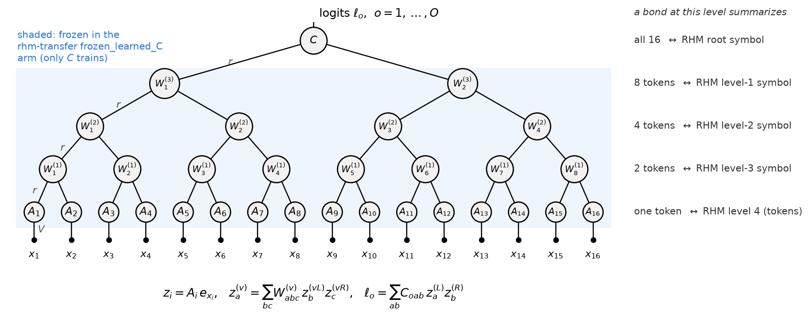
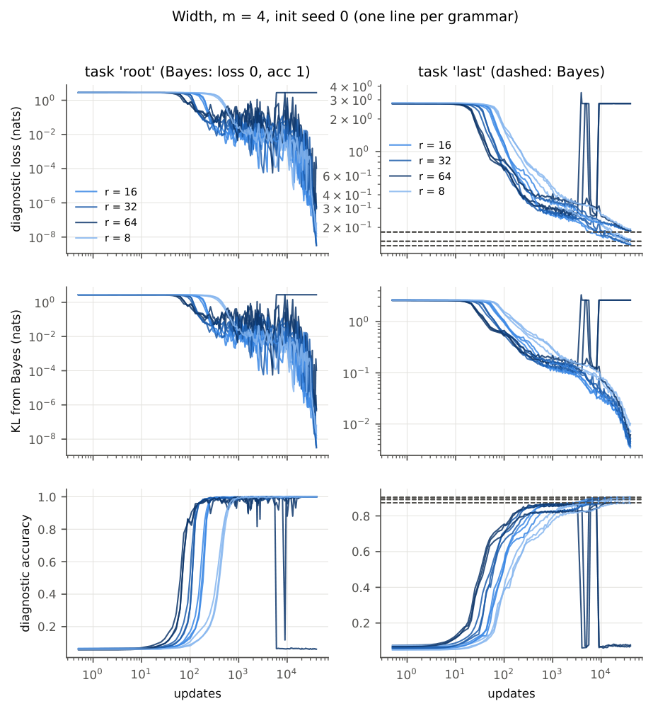
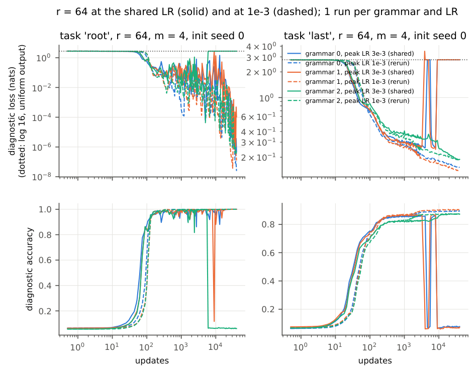
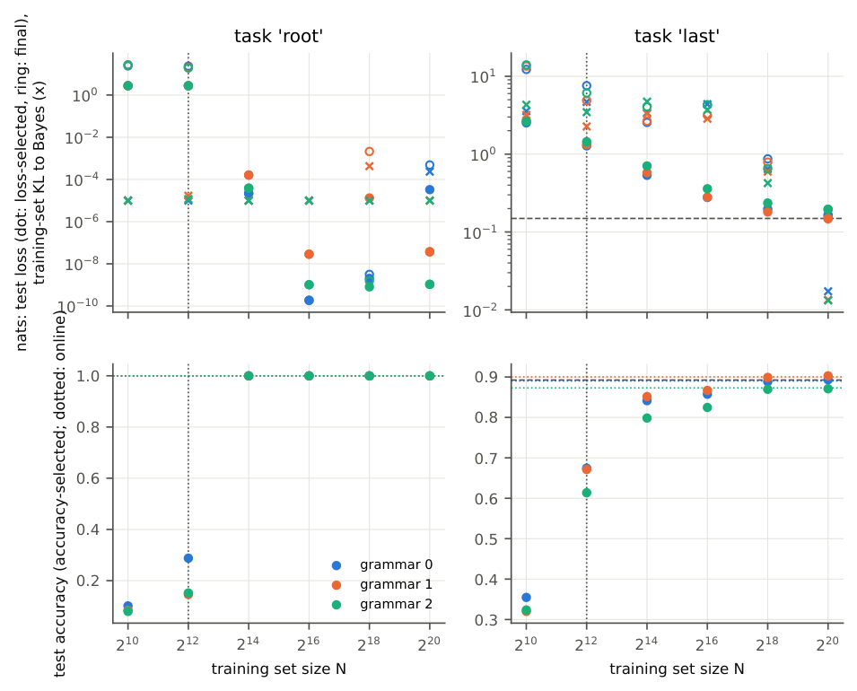
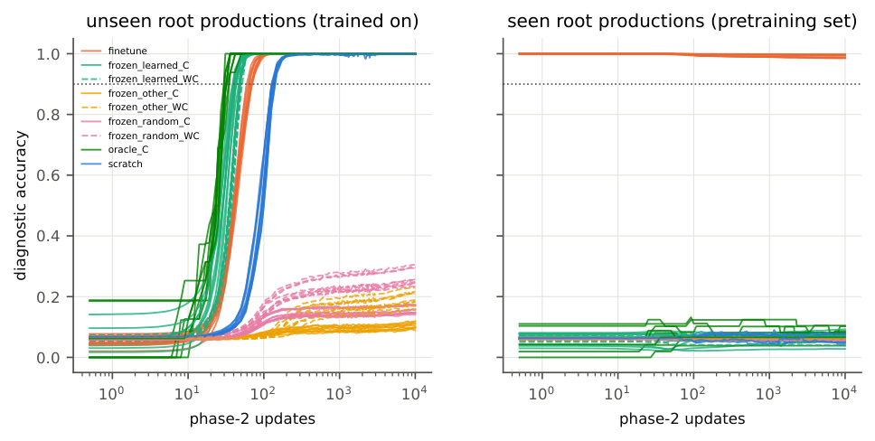
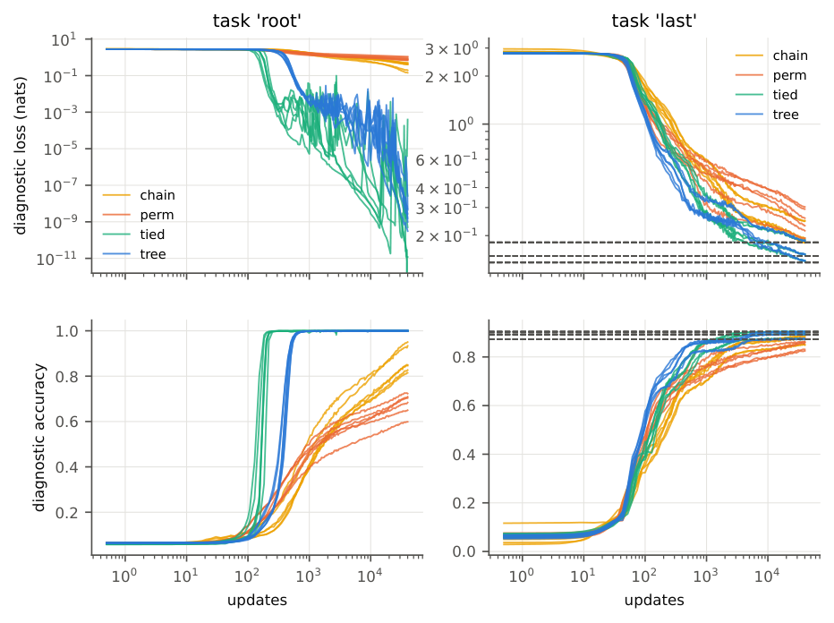
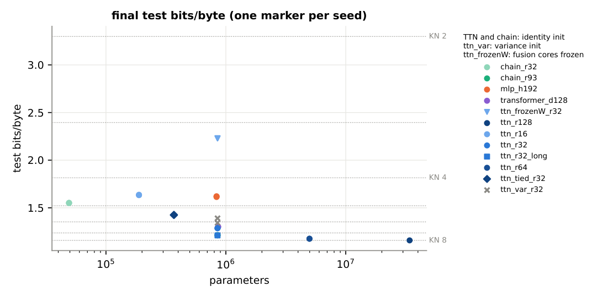
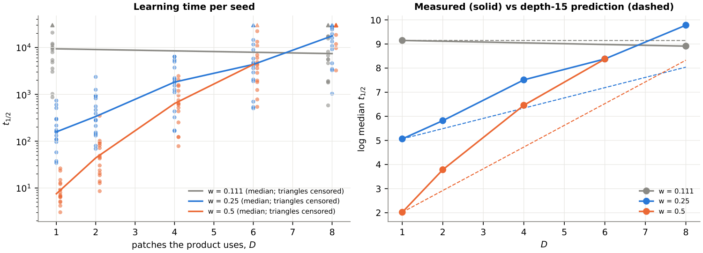
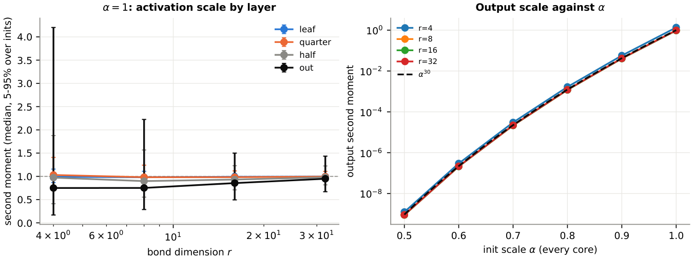

**What nine GPU experiments say about learning in tree tensor networks**

*A research note on the Random Hierarchy Model, byte-level language modelling, and the escape dynamics of the eight-leaf TTN, from the runs of 12 and 13 November 2026.*

Tree tensor networks (TTNs) are multilinear models whose computation is organized as a balanced binary tree. That structure makes them a natural candidate for data that is itself generated by a tree, and a natural test bed for theories of how a deep multiplicative model escapes from small initial coefficients. Over one night we ran nine experiments on rented GPUs to probe both sides: four on the Random Hierarchy Model (RHM), a synthetic grammar with exactly computable Bayes predictions; one on next-byte prediction for real text; and four on the escape dynamics of an eight-leaf TTN trained by exact gradient descent on planted product teachers.

Six experiments answered their questions and three did not. **On hierarchical data, a TTN with a matched tree and an identity-like initialization reaches the Bayes-optimal predictor, learns from within a factor of four of the deep-CNN sample complexity, and reuses its lower subtrees when the root task changes. Matching the tree to the data matters more than parameter count. On bytes the TTN is competitive but does not win: it ties a same-size transformer and loses to a shared-core chain and to an order-8 n-gram.** On the dynamics side, the time to learn a product teacher grows exponentially with the number of patches it uses, as predicted, but 35 to 41% faster than the depth-15 escape law predicts, and the experiment designed to test that law directly lost its training data. All three failures share one cause in the training loop, which is fixable.

Every result below is conditional on the stated learning rate, which in most RHM comparisons sat at the top edge of the pilot grid. The numbers come from each experiment's `README.md` and `results/analysis.json`; paths are given so each claim can be traced.

| Experiment | Question | Outcome | Cost (USD) |
|---|---|---|---|
| `rhm-dynamics` | Does a TreeTN learn the RHM, and how does width change it? | supported, conditional on one shared LR | 3.19 |
| `rhm-sample-efficiency` | How many training trees does it need? | supported: between $P^\star$ and $4P^\star$ | 0.63 |
| `rhm-transfer` | Do pretrained subtrees transfer to unseen root productions? | supported, 9 of 9 pairs | 0.26 |
| `rhm-controls` | Does the tree's alignment with the data matter? | supported for alignment; tying neutral | 0.36 |
| `lm-bytes` | How does a TTN compare on next-byte prediction? | beats short n-grams; not the best model | 1.13 |
| `degree` | Does product degree set learning time under a biased init? | direction supported; magnitude off | 8.93 |
| `init-scale` | Does escape follow the depth-15 law? | failed: training data lost | 11.72 |
| `sequential` | Does a new output reuse an old one's subtree? | failed: phase 2 lost | 11.90 |
| `sharing-location` | Does sharing a subtree speed joint learning? | failed: 1 of 6 families saved | 11.71 |

## Setup

**The discrete-input TreeTN is a multilinear function of one-hot tokens.** Take a sequence of $n = 2^D$ tokens $x_1, \dots, x_n$ from a vocabulary of size $V$. Each leaf $i$ embeds its token with its own matrix $A_i \in \mathbb{R}^{r \times V}$, each internal node $v$ fuses the bonds of its two children with a three-index core $W^{(v)} \in \mathbb{R}^{r \times r \times r}$, and a root core $C \in \mathbb{R}^{O \times r \times r}$ maps the two top bonds to $O$ logits:

$$
z_i = A_i\, e_{x_i}, \qquad
z^{(v)}_a = \sum_{b,c=1}^{r} W^{(v)}_{abc}\, z^{(vL)}_b\, z^{(vR)}_c, \qquad
\ell_o = \sum_{a,b=1}^{r} C_{oab}\, z^{(L)}_a\, z^{(R)}_b .
$$

Here $e_{x}$ is the one-hot vector of token $x$, $r$ is the bond dimension, and $vL, vR$ are the children of $v$. There are no biases and no nonlinearities, so each logit is linear in every core separately. With $n = 16$, as in all the RHM and byte experiments, the tree has 16 leaf embeddings, $8 + 4 + 2 = 14$ fusion cores and one root core (Figure 1). The untied model has $nVr + (n-2)r^3 + Or^2$ parameters, which for $n = V = O = r = 16$ is $4096 + 57344 + 4096 = 65{,}536$. The level-tied variant shares one $A$ across leaves and one $W$ per level, and the shared-core chain (a matrix product state read left to right) replaces the tree with $h_t = W(h_{t-1}, A e_{x_t})$ and one $W$ for all positions.

<figure id="fig-1">

<figcaption><strong>Figure 1.</strong> The 16-leaf TreeTN used in the RHM and byte experiments. A bond at level $l$ is a function of $2^l$ consecutive tokens, so when the tree is aligned with the data it can carry the RHM symbol that generated those tokens (right column). The shaded region is what the <code>rhm-transfer</code> experiment freezes when it trains only a fresh root core. The eight-leaf TTN of the dynamics experiments has the same shape with three levels, real-valued patch features at the leaves and 15 cores.</figcaption>
</figure>

**The variance initialization starts training near a saddle that is slow or impossible to leave.** The default draws leaf entries from $\mathcal N(0,1)$ and fusion and root entries from $\mathcal N(0, 1/r^2)$, which gives every bond entry unit second moment at initialization, since $\operatorname{Var} z_a = r^2 \cdot r^{-2} \cdot 1 \cdot 1$. In every RHM and byte run with this initialization, training drifted toward the point where all cores shrink and the output is uniform: the RHM runs stayed at loss $\log 16$ for all 5,000 updates, and the byte runs sat near 7.9 bits/byte for 2,000 updates before escaping around update 7,000. A product of 31 cores has small gradients near that point, because the gradient with respect to one core is a product of all the others.

**The identity initialization starts the network near its additive part.** It reserves bond channel 0 for a constant. Each leaf embedding is $A_i = e_0 \mathbf 1^\top + \epsilon\, \Xi_i$, so $z_i = e_0 + \epsilon\, \xi_i(x_i)$ with $\epsilon = 0.1$ and $\xi_i$ the noise column for token $x_i$. Each fusion core is $W = T + \epsilon\, \Xi$, where the fixed tensor $T$ has

$$
T_{000} = 1, \qquad T_{aa0} = T_{a0a} = 1 \quad (a \ge 1),
$$

and zero elsewhere. To see what this computes, feed $T$ two children that are each a constant plus a small perturbation, $z^{L} = e_0 + u$ and $z^{R} = e_0 + w$:

$$
\begin{aligned}
(T z^L z^R)_0 &= (1 + u_0)(1 + w_0) = 1 + u_0 + w_0 + u_0 w_0, \\
(T z^L z^R)_a &= u_a (1 + w_0) + (1 + u_0)\, w_a = u_a + w_a + u_a w_0 + u_0 w_a \quad (a \ge 1).
\end{aligned}
$$

To first order in the perturbations, $T z^L z^R = e_0 + u + w$: the constant times the constant stays constant, and a signal on one side passes through when the other side is constant. Applying this at every node, the bond above any subtree is $e_0$ plus the sum of its leaves' perturbations, up to input-independent $O(\epsilon)$ shifts from the $\epsilon\,\Xi$ part of each core. The root core keeps its variance initialization, so the logits start as

$$
\ell_o \approx C_{o00} + \epsilon \sum_{i \in L} \sum_{a} C_{oa0}\, \xi_{i,a}(x_i) + \epsilon \sum_{i \in R} \sum_{b} C_{o0b}\, \xi_{i,b}(x_i),
$$

a sum of per-token responses. The network is still multilinear, but the gradient on each leaf embedding is now of order one, so training starts far from the saddle. Every TreeTN and chain in the RHM and byte experiments used this initialization unless stated otherwise.

**The Random Hierarchy Model generates sequences from a random context-free grammar with a unique parse.** Following Petrini, Cagnetta, Tomasini, Favero and Wyart (2023), a root symbol is drawn uniformly from $n_c = 16$ classes and expanded through $L = 4$ levels. At each level, a symbol picks one of its $m$ productions uniformly, and each production is a pair ($s = 2$) of symbols from a vocabulary of $v = 16$. The productions at each level are distinct pairs drawn without replacement, so each pair has at most one parent and every sequence of $s^L = 16$ tokens parses uniquely. Two tasks are used. The *root* task predicts the root symbol from all 16 tokens; because the parse is unique, the Bayes predictor is exact, with loss 0 and accuracy 1. The *last* task predicts token 16 from tokens 1 to 15; its Bayes cross-entropy is 0.137 to 0.182 nats, depending on the grammar, and is computed exactly by an upward pass through the possible parses. The reference sample complexity for deep CNNs on this grammar is

$$
P^\star = n_c\, m^L = 16 \cdot 4^4 = 4096 \text{ trees}.
$$

When the TreeTN's leaf order matches the data, the bond above a pair of tokens can encode the level-3 symbol that produced them, and so on up the tree (Figure 1, right column).

**The byte task uses the same TreeTN on 16 bytes of context.** The data is the UTF-8 text of TinyStories, split by story into 100 MB of training data and 5 MB each for validation and test. A training example is the 16 bytes before a uniformly sampled target, so $n = 16$ and $V = O = 256$. Performance is cross-entropy in bits per byte, $-\frac{1}{N}\sum_t \log_2 p(x_t \mid x_{t-16:t-1})$, where uniform guessing gives 8. The baselines are interpolated modified Kneser–Ney n-grams of order 1 to 8, an MLP with 192 ReLU units, a four-layer transformer and the chain, each matched to the TTN's 852k parameters where noted.

**The eight-leaf TTN of the dynamics experiments acts on real-valued patches and is trained on its exact population loss.** The input is eight patches $x^{(j)} \in \{\pm 1\}^d$ with $d = 8$, drawn uniformly. Each leaf sees the feature vector $\phi_j = (1, x^{(j)}) \in \mathbb{R}^{9}$, and the network computes

$$
z^{(j)} = A_j \phi_j, \qquad
z^{(v)}_a = \sum_{bc} W^{(v)}_{abc}\, z^{(vL)}_b z^{(vR)}_c, \qquad
f_o = \sum_{bc} C_{obc}\, z^{(L)}_b z^{(R)}_c,
$$

with four quarter nodes, two half nodes and the root: 15 cores in all. Teachers are sums of products, $y_o = \sum_{k: o_k = o} s_k\, g_k(x)$ with $g_k(x) = \prod_{(p,i) \in k} x^{(p)}_i$. Distinct coordinate sets make the $g_k$ orthonormal under the uniform distribution, so the student's coefficient on component $k$,

$$
c_k = \mathbb{E}_x\!\left[f_{o_k}(x)\, g_k(x)\right],
$$

equals $s_k$ at the teacher. Training is full-batch gradient descent on

$$
\mathcal L = \tfrac12 \sum_o \mathbb{E}_x\!\left[(f_o(x) - y_o(x))^2\right],
$$

evaluated exactly from the cores without sampling, with step $\eta = 0.05$. Time is measured as gradient-flow time $t = \eta \times \text{steps}$. The learning time of a component is $t_{1/2}$, the first time $c_k$ reaches $s_k/2$.

**Under the isotropic initialization, the constant feature is not special.** Leaf entries are drawn with variance $1/9$ on all nine entries of $\phi_j$, and fusion and root entries with variance $1/r^2$. A permutation of the nine basis directions at any leaf, applied to both the teacher and the initialization distribution, leaves the dynamics unchanged in distribution. So a product over $D$ patches (with the constant on the rest) is exactly as hard as a product over all 8. The `degree` experiment breaks this symmetry on purpose by putting a fraction $w$ of each leaf row's variance on $\phi_0$ and $(1-w)/8$ on each coordinate, which keeps the leaf second moment at 1 and reduces to the isotropic case at $w = 1/9$.

**A heuristic escape law predicts how learning time depends on the initial coefficient.** Suppose a component is carried by a product of $n$ factors that stay balanced, each of size $c^{1/n}$, while $c \ll s$. The derivative of $c$ with respect to each factor is the product of the other $n - 1$, of size $c^{(n-1)/n}$, so gradient flow on $\frac12 (s - c)^2$ gives

$$
\frac{dc}{dt} = \sum_{k=1}^{n} \left|\frac{\partial c}{\partial \theta_k}\right|^2 (s - c) \approx n\, s\, c^{\,2 - 2/n} \qquad (c \ll s).
$$

Separating variables and integrating from the initial value $c_0$ to $s/2$,

$$
\begin{aligned}
t_{1/2} &= \int_{c_0}^{s/2} \frac{dc}{n s\, c^{2-2/n}}
= \frac{1}{n s} \left[ \frac{c^{-(1-2/n)}}{-(1-2/n)} \right]_{c_0}^{s/2} \\
&= \frac{1}{s (n-2)} \left( c_0^{-(n-2)/n} - (s/2)^{-(n-2)/n} \right)
\;\approx\; \frac{c_0^{-(n-2)/n}}{s(n-2)} \quad (c_0 \ll s),
\end{aligned}
$$

so

$$
\boxed{\;\log t_{1/2} = \text{const} - \frac{n-2}{n}\, \log |c_0|\;}
$$

with exponent $13/15 \approx 0.867$ for the 15-core TTN. This is the deep-linear-network escape argument transplanted to the TTN. It assumes the component evolves as a single aligned mode, which the TTN need not respect, and testing it was the main purpose of `init-scale`. The exponent can never exceed 1 for any depth.

**Combined with the biased initialization, the escape law predicts how learning time grows with product degree.** Take the teacher $g_D(x) = \prod_{j \le D} x^{(j)}_1$, which uses coordinate 1 on $D$ patches and the constant on the other $8 - D$. Its initial coefficient picks up a leaf factor of typical size $\sqrt{(1-w)/8}$ from each active patch and $\sqrt{w}$ from each inactive one, while the fusion cores contribute the same factor for every $D$. Relative to $D = 0$,

$$
|c_0(D)| \sim |c_0(0)| \left( \frac{1 - w}{8 w} \right)^{D/2},
$$

and substituting into the escape law with $n = 15$,

$$
\frac{d \log t_{1/2}}{dD} = \frac{13}{15} \cdot \frac12 \log \frac{8w}{1-w}.
$$

This gives 0.425 per patch at $w = 0.25$, 0.901 at $w = 0.5$, and exactly 0 at the isotropic $w = 1/9$, where $8w/(1-w) = 1$. The zero is the symmetry argument above, so the formula passes that check by construction.

**All RHM and byte models were trained online with Adam and compared under rules fixed in advance.** Each update drew 256 fresh examples (or 256 examples from a fixed training set in `rhm-sample-efficiency`), with a 100-update linear warmup and a cosine decay to $0.1\times$ the peak learning rate. The peak learning rate came from a 4,000-update pilot on a grammar and seed that no evaluation run used, over $\{10^{-4}, 3\cdot 10^{-4}, 10^{-3}, 3\cdot 10^{-3}\}$ (per arm in `rhm-controls`). Speed is the first logged update at which accuracy on a fixed 20,000-tree diagnostic set reaches $0.9\times$ the Bayes accuracy, and quality is error rate, then loss, on a separate 50,000-tree test set. Two runs are compared only within a pair that shares the grammar, the initialization seed and the data stream. A pair is a tie when the difference is within the larger of the logging interval and the reference arm's spread over seeds, and a verdict of "supported" needs wins in at least two grammars and losses in none. Every experiment ran its correctness checks on the worker before training (for example, the 26 checks in `studies/rhm/checks.py` compare the Bayes posteriors with brute-force enumeration). These checks validate the implementation and say nothing about the hypotheses.

## The TreeTN learns the RHM, and width buys speed

**At $r = 16$ the TreeTN reaches the Bayes predictor on both tasks** (`studies/rhm/rhm-dynamics`). On 3 of 3 grammars its root test accuracy is 1.0, and its last-token test KL from the exact Bayes posterior is 0.0036 to 0.0055 nats (median 0.0040 over 9 runs), against a Bayes cross-entropy of 0.137 to 0.182. Widths 8, 16 and 32 all end at the Bayes error rate, so width changes how fast the network gets there more than where it ends. Figure 2 shows the ordering: wider trees cross the threshold earlier, at median 600, 250, 150 and 128 updates on the root task and 1150, 400, 219 and 183 on the last-token task, for $r = 8, 16, 32, 64$. The pre-registered prediction that $r = 8$, narrower than the 16 symbols per level, would end worse than $r = 16$ held only partly: $r = 16$ won the three last-token pairs on loss or error, and the three root pairs tied at zero error. Narrowness shows up as a 2 to 3 times slower start and about twice the residual KL.

<figure id="fig-2">

<figcaption><strong>Figure 2.</strong> Diagnostic loss, KL from Bayes and accuracy against updates for $r = 8, 16, 32, 64$ ($m = 4$, initialization seed 0, one line per grammar). Darker lines are wider trees, and they rise earlier. Dashed lines are the Bayes references on the last-token task. The $r = 64$ lines that jump back to $\log 16$ late in training are runs that collapsed.</figcaption>
</figure>

**The widest trees were unstable at the shared learning rate.** All widths used the $r = 16$ pilot's choice of $3\times 10^{-3}$, the top of the grid. Three of the six $r = 64$ runs reached near-Bayes accuracy and then fell back to the uniform output between updates 3,900 and 9,000, two of them twice. Rerunning all six $r = 64$ runs once at $10^{-3}$ removed the collapse and still crossed the threshold before $r = 16$ did (Figure 3). So "wider is faster" survives a lower learning rate for $r = 64$, but it has not been tested with each width at its own best learning rate.

<figure id="fig-3">

<figcaption><strong>Figure 3.</strong> The six $r = 64$ runs at the shared peak LR $3\times10^{-3}$ (solid) and in the rerun at $10^{-3}$ (dashed). The solid lines that return to the dotted $\log 16$ line are the three collapses; none of the dashed lines does.</figcaption>
</figure>

**More synonyms slow the tree down, and the variance initialization never starts.** With $m = 8$ productions per symbol, the root task is still solved, but it takes 1500 to 1650 updates to threshold instead of 219 to 250. The last-token task does not reach threshold in 40,000 updates (test accuracy 0.43 to 0.44 against a Bayes accuracy of 0.54 to 0.57), and its loss was still falling, so this measures speed under a fixed schedule, not a plateau. With the variance initialization, all 6 runs stayed at chance (`figures/init.pdf`), which is why every other run uses the identity initialization. A first look at linear probes on the whitened bonds (`figures/interp_root_m4/`) shows the level-2 and level-3 symbols becoming decodable around update 300 on the root task, together with the drop in loss. That analysis has not gone beyond inspection.

## It needs between $P^\star$ and $4P^\star$ training trees

**The root task switches from failure to success between $2^{12}$ and $2^{14}$ training trees** (`studies/rhm/rhm-sample-efficiency`). With fixed training sets of $N = 2^{10}$ to $2^{20}$ trees (nested within each grammar, so sizes are paired), the median root test accuracy over three grammars is 0.084 at $2^{10}$, 0.152 at $2^{12} = P^\star$, and 0.99996 at $2^{14}$, staying at or above 0.9999 for every larger $N$ (Figure 4, bottom left). The TreeTN's sample complexity is therefore within a factor of 4 of the deep-CNN value, and this run cannot place it more precisely than that factor.

<figure id="fig-4">

<figcaption><strong>Figure 4.</strong> One point per run against training set size $N$, colored by grammar; the vertical dotted line is $P^\star = 2^{12}$. Bottom: test accuracy, with the online (fresh-data) reference as a dotted horizontal line. Top: test loss at the loss-selected checkpoint (dots), final test loss (rings) and final KL to Bayes on the training trees (crosses, clipped at $10^{-5}$). On the root task the accuracy jumps between $2^{12}$ and $2^{14}$ while the training-set KL is tiny at every $N$, so the small-$N$ failures fit their training data.</figcaption>
</figure>

**Every failing run fit its own training set, so the failures come from too little data.** All 12 runs that failed ($N \le 2^{12}$, both tasks) drove their training loss to near zero (root training loss below $10^{-4}$; last-token training loss 0.13 to 0.18 nats below the Bayes loss on the same trees). Their test loss climbed to 19 to 27 nats on the root task, which is what confident wrong predictions on new trees look like. On the last-token task accuracy saturates near Bayes by $2^{18}$, but the KL to Bayes keeps falling by a factor of 2 to 4 for each factor of 4 in $N$, from 2.45 nats at $2^{10}$ to 0.012 at $2^{20}$. Questions about calibration rather than accuracy therefore need the largest sets. The recipe has no regularization, and all runs used one initialization seed, so the spread shown is over grammars only.

## Pretrained subtrees transfer to unseen root productions

**A fresh root core on frozen pretrained subtrees learns new productions about as fast as one handed the true symbols** (`studies/rhm/rhm-transfer`). In each grammar, one of each root class's four productions was held out. The network was pretrained for 5,000 updates on the 48 seen productions and then trained on the 16 unseen ones in several arms. In the main arm everything below the root core is frozen (the shaded region of Figure 1) and only a fresh $C$ trains, with 4,096 parameters. It reached 0.9 accuracy on unseen productions at a median of 42 updates (range 42 to 50, 9 units). Training the whole network from scratch first logged 0.9 at update 148 in every unit; its crossing lies somewhere in $(126, 148]$, because of the logging grid. An oracle root core that reads a fixed code of the true level-1 symbols took 36. The frozen arm beat scratch in 9 of 9 pairs (sign test $p = 0.002$), at 1.17 times the oracle's time, inside the pre-registered factor of 2.

<figure id="fig-5">

<figcaption><strong>Figure 5.</strong> Accuracy on unseen productions (left, the phase-2 training target) and on seen productions (right) against phase-2 updates, one line per unit and arm. The green frozen-learned and oracle curves rise first, then finetune (orange) and scratch (blue). Subtrees from another grammar (yellow) or untrained subtrees (pink) never reach the dotted 0.9 line. The two green families are hard to tell apart in this figure; the table below separates them. On the right, only finetune keeps the seen productions, because the fresh-root arms never saw them.</figcaption>
</figure>

| Arm (median over 9 units) | Trainable params | Updates to 0.9 | Final unseen acc |
|---|---|---|---|
| frozen learned subtrees, fresh $C$ | 4,096 | 42 [42, 50] | 1.00 |
| frozen learned subtrees, fresh $C$ and level-3 cores | 12,288 | 50 [50, 58] | 1.00 |
| oracle code of level-1 symbols, fresh $C$ | 4,096 | 36 [31, 36] | 1.00 |
| finetune everything from pretrained | 65,536 | 75 [68, 75] | 1.00 |
| scratch | 65,536 | 148 [148, 148] | 1.00 |
| frozen subtrees from another grammar | 4,096 | never | 0.10 |
| frozen untrained subtrees | 4,096 | never | 0.16 |

**The transfer is a reuse of per-side symbol codes, not a recombination of unseen conjunctions.** The split was constrained so that every level-1 symbol in an unseen production also appears on the same side of a seen one. An unseen production is a new pair of familiar symbols, and the experiment shows that the frozen bonds already encode those symbols well enough for a freshly trained root core to read them. Two more limits apply. All crossings fall within the first 150 updates, where the logged steps are 4 to 22 updates apart. And all arms used one learning rate at the grid edge, which could change the 3.5-fold ratio, though the sign seems safe, since scratch has to learn the subtrees as well as the readout.

## Matching the tree to the data matters more than parameter count

**Scrambling the leaves costs more than replacing the tree with a chain** (`studies/rhm/rhm-controls`). Four architectures were compared over 12 pairs each (2 tasks, 3 grammars, 2 seeds). The correct tree beat the same tree on permuted leaves in 12 of 12 pairs on both speed and final quality; the permutation was chosen so that no model node covers exactly the leaves of a data node. A level-tied tree with a quarter of the parameters (16,640) beat the parameter-matched chain of width 40 (65,320) in 12 of 12 on both measures. Tying the tree's cores made no difference to final quality (12 ties); it was faster on the root task and slower on the last-token task, 6 pairs each. Figure 6 shows the size of the gaps on the root task: the permuted tree levels off at accuracy 0.60 to 0.72 and the chain is still creeping up at 0.82 to 0.95 after 40,000 updates, while both aligned trees pass 0.99 within about 700 updates.

<figure id="fig-6">

<figcaption><strong>Figure 6.</strong> Diagnostic loss (top) and accuracy (bottom) for the correct tree (blue), level-tied tree (green), permuted tree (red) and shared-core chain (yellow), six runs per arm and task. On the root task only the two aligned trees solve the problem; on the last-token task the four arms separate after about 100 updates and only the aligned trees reach the dashed Bayes lines.</figcaption>
</figure>

**Two qualifications limit how far the controls result goes.** The losing arms' pilots chose the top of the learning-rate grid, with their pilot losses still falling there (permuted tree on both tasks, chain on the root task), so a higher learning rate for the controls has not been ruled out. The gaps are large (zero error against 0.28 to 0.40 excess error for the permuted tree on root), which makes a reversal unlikely but not impossible. On the last-token task the tied tree ran at three times the chain's learning rate, and measured in summed learning rate, $\sum_t \eta_t$, the two reach threshold at about the same point (1.46 to 2.10 against 1.40 to 2.05). There only the final-quality win (excess error near 0 against 0.015 to 0.025) is clear of the learning-rate difference.

## On bytes the TTN is competitive but not the best model

**The $r = 32$ TTN beats short n-grams, ties a transformer, and loses to a chain and to an order-8 n-gram** (`studies/lm/lm-bytes`). After 40,000 updates (10.24M training targets), the untied $r = 32$ TTN reaches 1.286 test bits/byte, with all three seeds within 0.001. That is far below the best Kneser–Ney model of order at most 4 (1.815), which was the pre-registered bar. The comparisons at matched size (about 852k parameters) are less favorable:

| Model | Params | Test bits/byte |
|---|---|---|
| shared-core chain, $r = 93$ | 852k | 1.213 |
| **TTN, untied, $r = 32$** | 852k | **1.286** |
| transformer, 4 layers, $d = 128$ | 861k | 1.301 |
| TTN, level-tied, $r = 32$ | 369k | 1.425 |
| MLP, 192 ReLU units | 836k | 1.619 |
| TTN, $r = 32$, fusion cores frozen at init | 852k (393k trained) | 2.228 |
| Kneser–Ney order 6 / 7 / 8 (100 MB counts) | | 1.352 / 1.236 / 1.158 |

Every chain seed beats every TTN seed, so at this size and budget the tree's hierarchy is not an advantage on bytes, unlike on the RHM. The transformer gap of 0.015 is inside the 0.02 margin, so the rule calls it a tie. Freezing the fusion cores at their identity values, which keeps the model close to the additive start derived above, costs 0.94 bits/byte. That puts it between KN orders 3 and 4, so what lifts the TTN past order 6 comes from training the fusion cores.

<figure id="fig-7">

<figcaption><strong>Figure 7.</strong> Final test bits/byte against parameter count, one marker per seed, with the Kneser–Ney ladder as dotted horizontal lines. Untied TTNs (blue circles, $r = 16$ to 128) improve steadily with diminishing returns and approach KN order 8 only at $r = 128$, with 40 times the parameters of $r = 32$. At 852k parameters the chain (green) sits below the TTN, and the frozen-fusion TTN (triangle) is far above it.</figcaption>
</figure>

**The TTN was still improving when it stopped.** A single run with four times as many updates reached 1.211 bits/byte, close to the matched chain, so the ranking at 40,000 updates may not be the ranking at convergence. Bond dimension helps steadily: 1.634, 1.286, 1.176 and 1.158 bits/byte at $r = 16, 32, 64, 128$. The variance initialization, which on the RHM never escaped, did escape on bytes after about 7,000 updates and ended 0.08 bits/byte worse than the identity initialization, with a 50 times larger seed spread.

## Product degree sets learning time, faster than the escape law predicts

**Under a constant-biased leaf initialization, learning time grows exponentially in the number of patches a product uses** (`studies/ttn/degree`). With the eight-leaf TTN at $r = 8$, 16 seeds per group, and the teacher $g_D$ at strength 1, the symmetry control passed first: at the isotropic $w = 1/9$, $D = 1$ and $D = 8$ give indistinguishable learning times (medians 9388 and 7419, Mann–Whitney $p = 0.97$). Breaking the symmetry then makes degree matter (Figure 8). A least-squares fit of $\log t_{1/2}$ on $D$ over $D = 1$ to 6 gives a slope of 0.60 per patch (95% bootstrap interval 0.47 to 0.73) at $w = 0.25$ and 1.21 (1.09 to 1.33) at $w = 0.5$, about 1.8 and 3.4 times longer per added patch. Both slopes are positive and correctly ordered, as predicted. All runs stopped at $t = 3\times 10^4$ rather than the planned $10^5$ to fit the worker's time cap, so $D = 8$ is too censored to enter the fit.

<figure id="fig-8">

<figcaption><strong>Figure 8.</strong> Left: $t_{1/2}$ for each of 16 seeds against the number of patches $D$ the teacher uses, with the median as a line; triangles are runs that had not learned by $t = 3\times10^4$. Right: log median $t_{1/2}$ (solid) against the escape-law prediction (dashed), anchored at the $D = 1$ median. The isotropic gray line is flat, as the symmetry requires. The blue and orange lines climb more steeply than their predictions; for $w = 0.5$ the gap opens mostly between $D = 1$ and 2.</figcaption>
</figure>

**The measured slopes cannot come from the escape law with this scaling of the initial coefficient, whatever the depth.** The predictions, 0.425 and 0.901, lie outside both intervals, and the measured slopes are 35 to 41% steeper. Dividing each measured slope by its $\frac12 \log(8w/(1-w))$ factor gives the escape exponent the data would need: $0.600/0.490 = 1.22$ at $w = 0.25$ and $1.214/1.040 = 1.17$ at $w = 0.5$. The law's exponent $(n-2)/n$ is below 1 for every $n$, so no choice of effective depth fits. Either the initial coefficient shrinks faster per active patch than the leaf amplitudes alone suggest, or the escape is not the single-mode process the law assumes. This is our reading of the numbers, not a pre-registered test. The excess is also uneven in $D$: at $w = 0.5$ the slope between adjacent degrees falls from 1.77 ($D = 1 \to 2$) to 1.34 ($2 \to 4$) to 0.96 ($4 \to 6$), so the log-linear fit averages a curved relation, and the steep part is at small $D$. The direct per-seed test of the exponent was the job of `init-scale`, which is the subject of the next section.

## Three runs failed for one shared reason

**The training loop turned a deadline into a fixed step count and never looked at the clock again.** The three remaining experiments trained several groups of 16 to 64 seeds concurrently on one A100. Each group timed three gradient steps at startup, $\tau_3$, and set its budget to

$$
N_{\text{steps}} = \frac{T_{\text{deadline}}}{1.15\, \tau_3},
$$

where the 15% is an allowance for logging. The real per-step cost was higher: at least 1.29 times the estimate, margin included, in `sequential`, at least 1.14 times in `init-scale`, and 1.34 times its startup timing in the `sharing-location` rerun. The most likely contributors are the dense measurements taken while any seed is mid-escape and CPU thread oversubscription (each group set about $\lfloor \text{CPUs}/6 \rfloor$ threads on a container whose CPU quota was far below its reported CPU count), but neither was measured. Because a group saved its results only when it finished, every group still running at the worker's 5.5-hour cap lost everything. The three failures cost USD 35.33 of the night's USD 49.84.

**What survived is descriptive and does not test the hypotheses.** In `init-scale`, Part A measured layer second moments at initialization over 64 inits (Figure 9). For $r \ge 8$ the mean is within 5% of 1 at every layer, but the spread across inits grows toward the output (5 to 95% band 0.29 to 2.22 at $r = 8$) and the distribution is right-skewed, so a typical init starts below unit output scale. Scaling every core by $\alpha$ multiplies a layer fed by $m$ cores by $\alpha^{2m}$ exactly, so $\alpha = 0.8$ starts the output about $10^{-3}$ below its $\alpha = 1$ scale; this is an identity, not a measurement. In `sequential`, phase 1 finished: 15 of 16 seeds learned $y_1 = \prod_j x^{(j)}_1$, with a heavy-tailed median $t_{1/2} = 10{,}291$ (95% interval 4,351 to 25,521, escaped seeds ranging from 1,801 to 40,066). Its parameters are saved, so phase 2 can be rerun on its own. In `sharing-location`, only the `leaf` family (one shared core) saved, to $t = 1.78\times 10^4$; without the no-sharing control, none of its comparisons can be computed.

<figure id="fig-9">

<figcaption><strong>Figure 9.</strong> Left: second moment of each layer's activations at $\alpha = 1$ against bond dimension (median with the 5 to 95% band over 64 inits). The means stay near 1, but the output band (black) is wide at small $r$. Right: output second moment against the core scale $\alpha$, parallel to the dashed $\alpha^{30}$ line because the output is homogeneous of degree 15 in the cores, so its ratio to the $\alpha = 1$ value is exactly $\alpha^{30}$.</figcaption>
</figure>

## What follows

The RHM results give a consistent picture. A multilinear tree whose structure matches the generating hierarchy learns that hierarchy's Bayes predictor, learns it with a sample count close to the deep-CNN reference, carries symbol codes in its bonds that a new readout can reuse, and loses most of its advantage when the leaves are scrambled. On bytes, where the hierarchy is not planted, the same model is competitive with a same-size transformer and behind a chain. Each RHM claim currently rests on one learning rate at the edge of the grid, so the cheapest strengthening is to repeat the decisive comparisons at each arm's own tuned rate: a $10^{-2}$ pilot point for the `rhm-controls` losers (under an hour, well under USD 1), per-width tuned rates for the `rhm-dynamics` width ordering, and a grid of $N$ between $2^{12}$ and $2^{14}$ to locate the sample-complexity threshold.

On the dynamics side, the open problem is sharper. The `degree` slopes need an escape exponent above 1, which the single-mode law cannot supply, so either the initial-coefficient scaling or the law is wrong for this network. The discriminating measurement is the one `init-scale` was built to make: per-seed $\log t_{1/2}$ against $\log |c_1(0)|$ at $\alpha = 1$, whose slope should be $-13/15$ if the law holds. That rerun, and the reruns of `sequential` phase 2 and `sharing-location`, first need two changes to the shared training code (`ctn/ttn.py`, `studies/ttn/common.py`): a wall-clock check inside `train()` that saves at the deadline, and periodic checkpoints, so that an overrun loses minutes rather than a run. `sharing-location` additionally needs either more than one worker or $t_{\max} \le 7\times 10^4$ to fit in 4.5 hours.

**Sources.** Per-experiment write-ups with full methods, checks and judgement calls: `studies/rhm/rhm-dynamics/README.md`, `studies/rhm/rhm-sample-efficiency/README.md`, `studies/rhm/rhm-transfer/README.md`, `studies/rhm/rhm-controls/README.md`, `studies/lm/lm-bytes/README.md`, `studies/ttn/degree/README.md`, `studies/ttn/init-scale/README.md`, `studies/ttn/sequential/README.md`, `studies/ttn/sharing-location/README.md`. Costs, hardware and job logs are in `EXPERIMENTS.md`. The RHM is from Petrini, Cagnetta, Tomasini, Favero and Wyart, *How deep neural networks learn compositional data: the Random Hierarchy Model* (2023), whose reference implementation `studies/rhm/grammar.py` adapts; the $P^\star = n_c m^L$ sample complexity is theirs. The escape law is the balanced, aligned deep-linear-network argument of Saxe, McClelland and Ganguli (2014), applied here as a heuristic. Figures are regenerated by `notes/2026-11-12-experiments/make_figures.py`.
