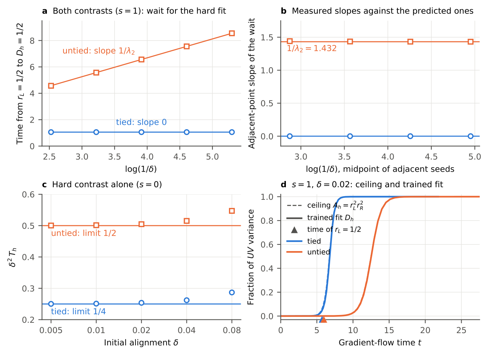
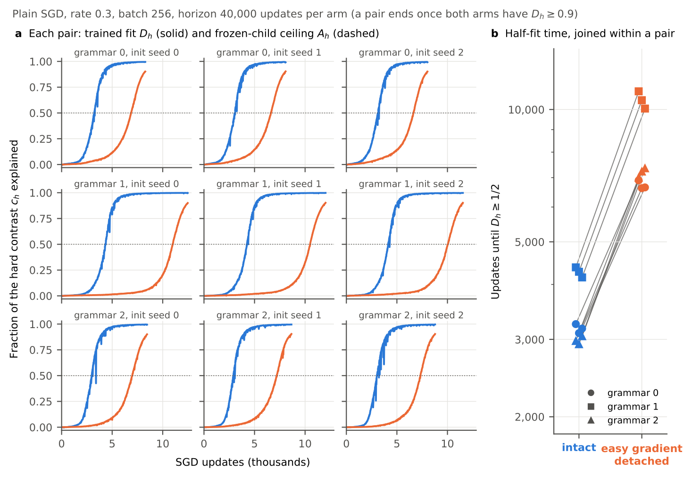
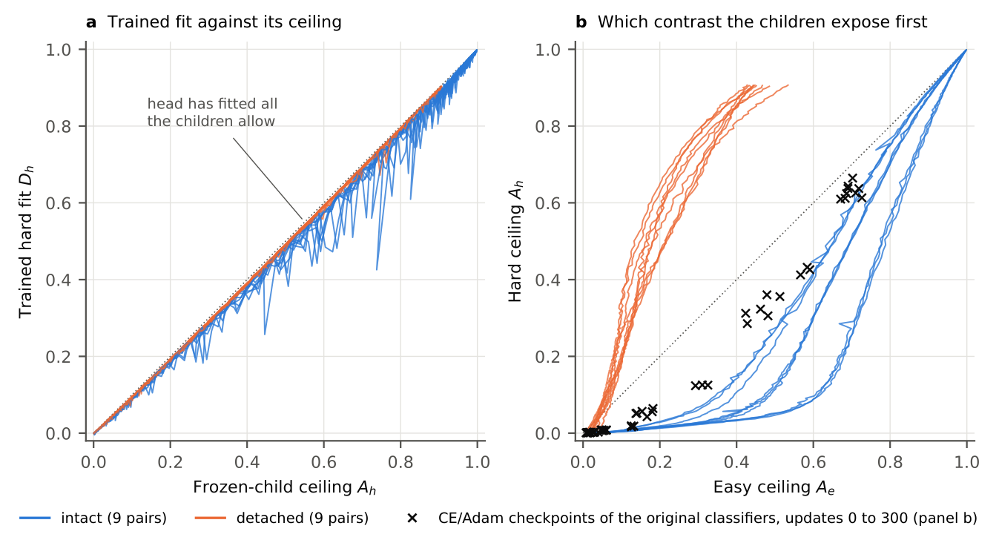

<!--
Draft for #Training Dynamics & Deep Learning. Not posted anywhere yet.

Before posting to Zulip:
- Math: this file uses $...$ and $$...$$ so that GitHub renders it. Zulip wants $$...$$ for inline math and a fenced
  ```math block for display math, so replace each inline $x$ by $$x$$ and each display block by ```math ... ```.
- Images: drag the three PNGs from notes/child-feature-enabling/zulip/ into the compose box and replace the
   lines with the uploaded links.
- The names in the second paragraph are plain text here. Turn them into @-mentions if you want to notify people.
- The repository links point at the branch codex/child-feature-enabling. They only work for readers who can see the
  repository; attach theory.pdf and explorer.html to the post otherwise.
- The interactive page is a Claude artifact that is private until you share it. Open the link below, press Share,
  and paste the share link over it. explorer.html in this folder is the same page as a file, for readers without
  access to the artifact.
- Who did what is yours to state. The theory note was written by a Codex session and the experiments, plots and this
  draft by Claude; the sentence under "Experiments" says so and should be edited to say what you have checked.
-->

*TL;DR: in a planted two-level grammar, an easy root target lowers the escape order of the child feature that a hard root target needs. The hard target's learning time drops from $\sim 1/\delta^2$ to $\sim \log(1/\delta)$, and untying the two children adds a second logarithmic wait with its own rate $\lambda_2$. On depth-four RHM trees, cutting only the easy target's gradient into the lower cores delays the hard target's half fit by 2.4x per pair at the median (range 2.1 to 2.5, 9 of 9 matched pairs). The hard target is still learned without it.*

This is a follow-up to three threads here. Zach's [Predicting saddle escape times](https://alignment-theory.zulipchat.com/#narrow/channel/641363/topic/Predicting.20saddle.20escape.20times/near/642640424) predicts escape time from the order of the first descending term, $\log(1/\delta)$ at order 2 and a power of $1/\delta$ above it. Hamza's [Initialization and staircase behavior in TTNs](https://alignment-theory.zulipchat.com/#narrow/channel/641363/topic/Initialization.20and.20staircase.20behavior.20in.20TTNs/near/643138860) separates small overlap from small norm. Guillaume's [Saddle to saddle TTN](https://alignment-theory.zulipchat.com/#narrow/channel/641363/topic/Saddle.20to.20saddle.20TTN/near/643368691) asks for mode-acquisition times in a tree. The question here is what one supervised target does to another's escape order when they share lower cores, in a setting where the children have unit norm and only their overlap with the right feature is small.

**Setup.** Four root classes are encoded by two signs $(U, UV)$. The left subtree determines $U$ and the right subtree determines $V$, each through a two-leaf table. The student has a scalar child table $h_L, h_R$ on each side and two root readouts: $b\,h_L$ predicts the easy target $U$, and $w\,h_Lh_R$ predicts the hard target $UV$. Write $r_i$ for the normalized overlap of $h_i$ with its sign and start at $r_L = r_R = \delta$, unit child norms, $b = w = 0$. Training is population squared-loss gradient flow. A switch $s \in \{0, 1\}$ removes or keeps the easy target.

With the children frozen, the best root explains exactly

$$A_h = r_L^2\, r_R^2$$

of the hard target's variance. That ceiling is what the trained fit $D_h$ is compared against everywhere below.

**Why the easy target changes the time law.** Near the start, with tied children ($h_L = h_R$, one overlap $r$), the flow is

$$\dot r \approx s\,b + 2wr, \qquad \dot b \approx s\,r - b, \qquad \dot w \approx r^2 - w .$$

Without the easy target, the only force on $r$ is $2wr$, and $w$ itself follows $r^2$. So $\dot r \approx 2r^3$: the first descending term is fourth order in the overlap, and

$$T = \frac{1}{4\delta^2} + \frac52 \log\frac1\delta + O(1).$$

With the easy target, $b$ pushes $r$ at first order and $r$ feeds $b$ back. The pair $(r, b)$ is a linear system with growth rate $\lambda_1 = (\sqrt5 - 1)/2$, an order-2 escape:

$$T = \frac{1}{\lambda_1}\log\frac1\delta + O(1).$$

The hard target then costs almost nothing extra. A tied table gives the right child the feature the easy target taught on the left, so the wait from $r_L = 1/2$ to $D_h = 1/2$ stays bounded as $\delta \to 0$.

**Untying adds a second escape.** With separate tables, the easy target only reaches the left one. When the left table has learned, the right overlap is still of order $\delta$, and it now escapes together with the hard readout:

$$\frac{d}{dt}\begin{pmatrix} r_R \\ w \end{pmatrix} \approx \begin{pmatrix} 0 & \sqrt\phi \\ \sqrt\phi & -\phi \end{pmatrix}\begin{pmatrix} r_R \\ w \end{pmatrix}, \qquad \lambda_2 = \tfrac12\big(\sqrt{\phi^2 + 4\phi} - \phi\big) \approx 0.698,$$

with $\phi$ the golden ratio (it enters through the equilibrium of the easy readout). The hard half-fit time becomes $(1/\lambda_1 + 1/\lambda_2)\log(1/\delta) + O(1)$, and the wait after the left child has learned grows as $\log(1/\delta)/\lambda_2$. Without the easy target the untied law is $1/(2\delta^2) + 3\log(1/\delta) + O(1)$. Proofs are in the [theory note](https://github.com/aniket-desh/coupled-tensor-networks/blob/codex/child-feature-enabling/notes/child-feature-enabling/theory.pdf).



Numerical check of the four laws (deterministic ODE solutions at $\delta$ from 0.08 down to 0.005). The tied wait is 1.0571 at every $\delta$. The untied wait has slopes 1.441, 1.435, 1.433, 1.432 between adjacent $\delta$, against $1/\lambda_2 = 1.4317$. With the hard target alone, $\delta^2 T$ goes to 0.2503 and 0.5004, against 1/4 and 1/2.

**Does any of this happen in the RHM runs?** The depth-four random grammars we train on have no pure interaction among their 16 root labels: every contrast of the root label has some additive signal in the true child symbols. So I took, per grammar, the contrast that an additive function of the two child symbols explains best (easy, 82 to 93% additive) and the one it explains worst (hard, 6 to 11%), put two linear heads on the root's product features of the width-16 TreeTN, and trained both with squared loss and plain SGD from the stored initial weights of the original runs. The two arms of a pair share weights and batches and differ in one line: in the detached arm the easy prediction is computed from $\operatorname{stopgrad}(Z)$, so the easy head still trains but its error never reaches the lower cores. The fit $D_h$ and the ceiling $A_h$ are computed exactly from population moments.

**Experiments** (run and plotted by Claude from the handoff of a theory session; treat as preliminary)



Detaching the easy gradient delays the hard target's half fit in 9 of 9 pairs (3 grammars x 3 inits): a median of 3,175 SGD updates intact against 7,225 detached, and a per-pair ratio of 2.41 at the median (2.09 to 2.51). No arm was censored. The blue curves dip: in 7 of 9 intact arms the fit falls back under 1/2 for a few evaluations after first crossing, and measured to the crossing after which it stays above 1/2 the ratio is 2.26 (2.04 to 2.51).



Left: the trained fit sits on its frozen-child ceiling in both arms (the ceiling crosses 1/2 at most 75 updates before the fit does), so the delay is in the lower cores and the readout is not what is slow. Right: with the easy gradient the easy contrast becomes available first, as in the saved checkpoints of the original cross-entropy classifiers (crosses). Without it the network reaches half fit on the hard contrast while the easy one is only about 19% linearly available.

Interactive page: https://claude.ai/artifact/7Bs2Sho6EVnWJfQ2TM3quE. The first half integrates the planted model in the browser, with a slider for $\delta$ and switches for tied or untied children and for the easy target, and shows the half-fit time next to the leading terms of its law. The second half replays every pair of the intervention.

**What this does and does not show.**
- The planted laws are a checked calculation about that model. They say nothing by themselves about deeper trees.
- The intervention is causal for one path, one optimizer and one init scale on three fixed grammars. The effect is a factor of 2.4, not the divergent $1/\delta^2$ against $\log(1/\delta)$ gap of the planted model, and I have no $\delta$ sweep at depth four.
- The easy gradient is a help and not a prerequisite. On these grammars the hard contrast can be fitted from features in which the easy one is mostly unavailable, unlike the planted model where the ceiling $r_L^2 r_R^2$ forces the child feature first.
- I have not run the control that replaces the easy contrast by a second hard one. The intact arm also just sends more gradient into the lower cores (about 3.5x the hard term's norm early on), so "any second target helps" is not ruled out.
- At equal rate x updates the larger SGD rates are behind the smaller ones, so the update counts are not flow times, and I have no exact gradient-flow run at depth four to compare with. The ratio at rate 0.1 was within 0.07 of the one at rate 0.3 on the three pairs I reran.
- The first protocol I was handed used rates up to 1e-3 for 4,000 updates, where nothing moves. The rate 0.3 was chosen on a separate pilot pair after that.

Write-up with every number, the checks and the protocol amendments: [README](https://github.com/aniket-desh/coupled-tensor-networks/blob/codex/child-feature-enabling/studies/rhm/child_feature_enabling/README.md).
