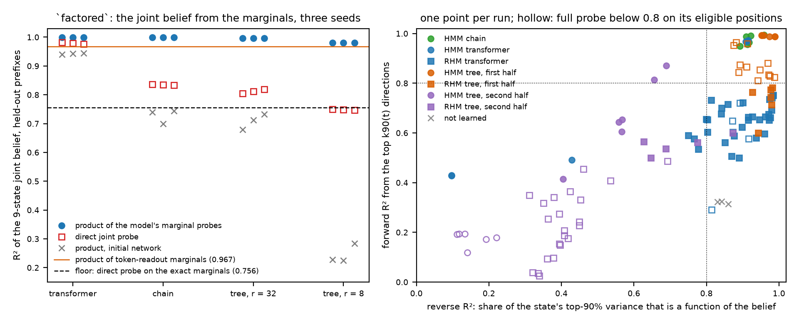
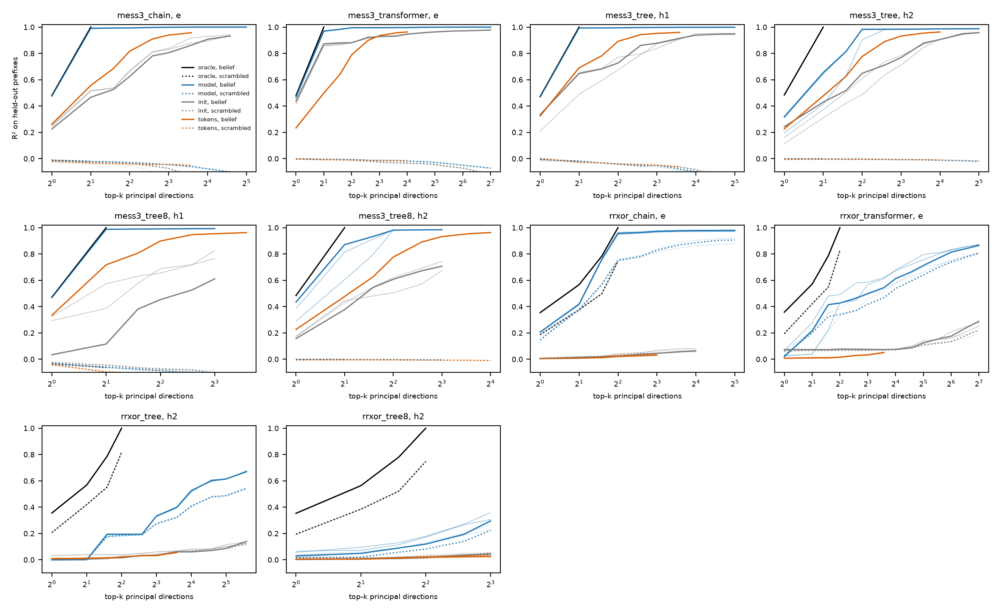
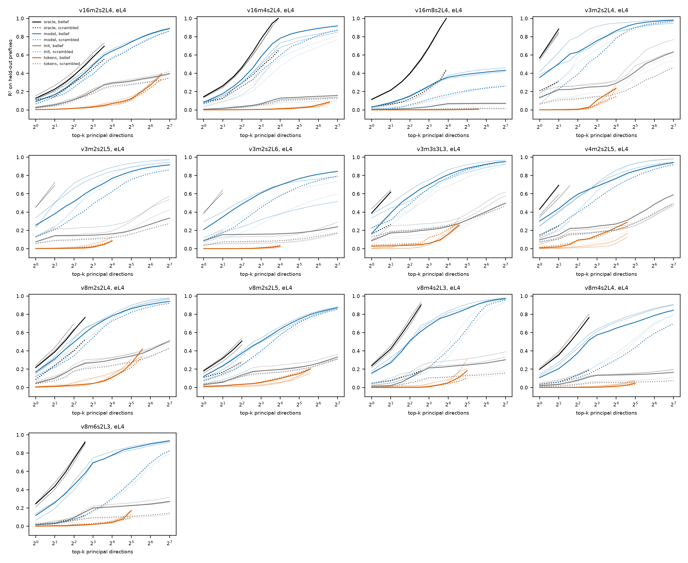

**Is the belief state the main structure of a model's hidden state, or only somewhere in it?**

*A research note on three probe controls run on saved checkpoints: factor codes on a product process, reverse and low-rank probes, and two RRXOR tree cells.*

Earlier experiments in this project trained a transformer, a chain tensor network and a tree tensor network to predict the next token of a hidden Markov process or of a Random Hierarchy Model, and then asked whether the Bayesian belief over the hidden state can be read from the model's state by a linear map. Those probes left three readings open. On a process made of two independent factors, the tensor networks gave each factor's belief almost exactly but the joint belief only at $R^2$ 0.75 to 0.85. The probes used every coordinate of the state, so a high score showed that the belief is somewhere in the state and said nothing about how much of the state it accounts for. And two cells of the tree on the RRXOR process had no usable verdict.

This note reports a reanalysis of the saved checkpoints that addresses all three. The rules were written before the full run, although for several cells the outcome was already known from saved numbers, a pilot on the CPU, or smoke tests on 3,000 sequences and one seed. **On the factored process the chain and the larger tree hold the two factor beliefs exactly, and their low joint score is almost entirely the floor that any such state has under an affine probe; they sit 0.05 to 0.08 above it.** **Whether the belief is the main structure of the state depends on the model and the task: it is on Mess3 for the chain, the transformer and the first half of the tree, and on RRXOR for the chain, and it is not for the transformer on RRXOR, whose belief is linearly readable but lies outside the one or two directions that carry most of the variance.** Under the pre-set rules the $r = 32$ tree cell on RRXOR fails in two of three seeds by about 0.002 with no interval, and the diverged seed at $r = 8$ is not rescued; a pilot on the CPU had already shown both.

**The setting is the one the earlier experiments fixed.** A hidden Markov process emits tokens $x_0, \dots, x_{15}$, and the belief $\eta_t(s) = P(\text{state at time } t = s \mid x_{\lt t})$ is the posterior over the hidden state given the prefix. For the Random Hierarchy Model the belief is the posterior, given the prefix, over the pending symbols of the grammar's derivation: the symbols that are already fixed but whose subtrees have not yet emitted a leaf. Three states are probed: the transformer's last layer, the chain's state vector, and the tree's two top bonds $[h_L, h_R]$, at bond dimension $r = 32$ and $r = 8$. An affine probe $\hat\eta_t = W a_t + c$ is fit by least squares at each position $t$ on 60,000 sequences. The distinct prefixes of each position are split at random into a fit side and a test side, so the probe is always scored on prefixes it never saw. With $\mathrm{SSE}_t$ the squared error on the test rows and $\mathrm{SST}_t$ their squared distance from the fit mean, the score pools positions as

$$
R^2 = 1 - \frac{\sum_t \mathrm{SSE}_t}{\sum_t \mathrm{SST}_t} .
$$

A probe is said to beat a control when it leaves at most half of the control's unexplained variance, $1 - R^2_{\text{probe}} \le \tfrac12 (1 - R^2_{\text{control}})$. The controls are the same probe on the initial network and on the one-hot prefix tokens.

**An affine probe cannot multiply, so a state that holds only the factors has a floor.** The factored process is two independent Mess3 processes $A$ and $B$ run side by side, with 9 joint states and 9 joint tokens. Its joint belief is the outer product of the factors' beliefs, $\eta^{AB}_t(a, b) = \eta^A_t(a) \eta^B_t(b)$. Suppose a state holds exactly $[\eta^A_t, \eta^B_t]$ and nothing else. Write each factor's belief as its mean plus a fluctuation, $\eta^A = \mu_A + \delta_A$ and $\eta^B = \mu_B + \delta_B$, and expand the product:

$$
\eta^A \otimes \eta^B = \underbrace{\mu_A \otimes \mu_B + \delta_A \otimes \mu_B + \mu_A \otimes \delta_B}_{\text{affine in the state}} + \delta_A \otimes \delta_B .
$$

The two factors are independent, so $\delta_A \otimes \delta_B$ has mean zero and is uncorrelated with every affine function of $(\delta_A, \delta_B)$: for example $E[(\delta_A \otimes \delta_B) \delta_A^\top] = E[\delta_A \delta_A^\top] \otimes E[\delta_B] = 0$. The last term is therefore exactly the residual of the best affine probe. With $v_A = E \lVert \delta_A \rVert^2$ and $v_B = E \lVert \delta_B \rVert^2$, the same independence removes the cross terms of the total variance, and at one position

$$
\mathrm{SSE}_t = v_A v_B , \qquad \mathrm{SST}_t = \lVert \mu_B \rVert^2 v_A + \lVert \mu_A \rVert^2 v_B + v_A v_B ,
$$

$$
\boxed{ R^2_{\text{floor}} = 1 - \frac{\sum_t v_A v_B}{\sum_t \bigl( \lVert \mu_B \rVert^2 v_A + \lVert \mu_A \rVert^2 v_B + v_A v_B \bigr)} }
$$

For Mess3 the mean belief is uniform, so $\lVert \mu \rVert^2 = 1/3$. At $t = 15$ an independent sample of 60,000 sequences gives $v_A = 0.497$ and $v_B = 0.138$, and the formula gives $1 - 0.0685 / (0.2115 + 0.0685) = 0.755$. Pooled over each model's positions the formula gives 0.7554 to 0.7559, and the experiment measured 0.7552 to 0.7564 by fitting the affine probe to the exact marginals on held-out prefixes ([`floor_formula.py`](floor_formula.py)). A perfect factor code therefore scores 0.756 on the joint, which is the range in which the tensor networks were found.

**The product of the marginal probes tests the factor code with no new parameter.** If a state holds the factors, the experiment's own marginal probes $\hat\eta^A$ and $\hat\eta^B$ can be multiplied after the fact, $\hat\eta^{AB} = \hat\eta^A \otimes \hat\eta^B$, and scored like the direct joint probe. The rule, per model and in all three seeds: the marginals are *exact* if this product reaches $R^2 \ge 0.99$ and beats the same product built from token-readout marginals and from the initial network. Then, with the gap defined as the direct joint probe minus the floor, the model is a *pure factor code* if the gap is at most 0.03, holds *marginals plus part of the joint* if the gap is larger and the direct probe is below 0.95, and has a *readable joint* if the direct probe is at least 0.95.

| Model | Product of the model's marginal probes | Product from token-readout marginals | Product, initial network | Direct joint probe | Floor | Gap | Class |
|---|---|---|---|---|---|---|---|
| Transformer | 0.999 | 0.967 | 0.941–0.944 | 0.976–0.982 | 0.755 | +0.220 to +0.227 | joint readable |
| Chain | 0.999 | 0.967 | 0.700–0.744 | 0.834–0.836 | 0.756 | +0.078 to +0.080 | marginals plus part of the joint |
| Tree, $r = 32$ | 0.996 | 0.967 | 0.679–0.732 | 0.804–0.819 | 0.755 | +0.049 to +0.064 | marginals plus part of the joint |
| Tree, $r = 8$ | 0.980–0.981 | 0.967 | 0.225–0.284 | 0.747–0.749 | 0.756 | −0.007 to −0.010 | marginals not exact |

*Affine probes, ranges over three seeds, pooled over each model's eligible positions (for the tree, the first half only, $t \le 8$).*

The chain and the tree at $r = 32$ come out as the definition expected from the saved numbers. Their product leaves 0.001 and 0.004 of the variance unexplained against the 0.033 of the token-readout product, and their direct probes are 0.05 to 0.08 above the floor, so the state carries a small part of $\delta_A \otimes \delta_B$ linearly. The transformer carries most of it. Two baselines belong next to these numbers: a linear readout of the one-hot tokens gives the joint at 0.919, above the direct probes of both tensor networks, and the initial transformer gives 0.921 to 0.923. The tree at $r = 8$ sits at the floor, but its marginals miss the 0.99 bar, so it is not classed as a factor code. Figure 1 (left) shows the same numbers. On this process the belief is a function of the exact next-token distribution, so the result describes how the prediction is laid out in the state and shows no information beyond the prediction. The second product process, in which factor $B$ sometimes copies $A$'s state, was not read: the part of its joint belief that the marginals cannot give carries 0.1% of the variance, below the 1% the definition required.

*Figure 1. Left: the factored process, three seeds per model. Filled circles are the product of the model's marginal probes, squares the direct joint probe, crosses the product on the initial network; the orange line is the product from token-readout marginals and the dashed line the floor. Notice that the chain and the tree at $r = 32$ have circles at the top and squares just above the dashed line. Right: one point per run and position group (114 points), the reverse score against the forward score from the top $k_{90}$ directions, both defined below, with the 0.8 bars dotted. Hollow markers have a full forward probe below 0.8. Notice the cluster in the upper right corner, which holds the RRXOR chain and the Mess3 runs other than the second half of the tree, the two RRXOR transformer points at reverse 0.10, and the transformer squares on the Random Hierarchy Model, most of which lie right of the vertical bar (32 of 36 learned runs) and all of which lie below the horizontal one.*

**Reading the belief out of a state does not make it the state's main structure.** A probe on all $p$ coordinates succeeds if an affine image of the belief is anywhere in the state. Two extreme states show what that leaves open. A state $a = [\eta, \xi]$ with a large unrelated part $\xi$ gives the belief perfectly, yet the belief accounts for little of it. A state $a = M\eta$ with an invertible, badly conditioned $M$ contains nothing but the belief, yet its directions of largest variance are not the belief's. Two scores separate these cases. Both use the principal axes of the state at position $t$: center $a_t$ on the fit rows, let $u_1, u_2, \dots$ be the eigenvectors of its covariance by decreasing eigenvalue $\lambda_1 \ge \lambda_2 \ge \dots$, and let $z_i = u_i^\top a_t$ be the principal scores.

The *forward score from the top $k$ directions*, $R^2_k$, is the usual affine probe for the belief, restricted to $(z_1, \dots, z_k)$. To choose $k$ without reference to the model, the same computation is run with the exact belief as the state, $a_t := \eta_t$. Its curve is the most that any state of rank $k$ can give, and by the Eckart–Young theorem it equals

$$
R^2_k(\eta_t) = 1 - \frac{\sum_{i > k} \lambda_i(\eta_t)}{\sum_i \lambda_i(\eta_t)}
$$

in sample. The number of directions the belief needs is $k_{90}(t) = \min \lbrace k : R^2_k(\eta_t) \ge 0.9 \rbrace$. In the computation $k$ runs over a grid (1, 2, 3, 4, 6, 8, 12, 16, 24, …) and the curve is the held-out one, so a $k_{90}$ above 4 is the next grid value at or above the true one. A cell is **compact** if the model's forward score from its top $k_{90}(t)$ directions, pooled over positions, is at least 0.8 and beats the initial network and the tokens restricted in the same way. It is judged on positions where $k_{90}(t)$ is at most half of the state's directions, so that the restriction is a real one.

The *reverse score* runs the regression the other way. Let $m$ be the smallest number of principal scores holding 90% of the state's variance. The scores $(z_1, \dots, z_m)$ are predicted affinely from $\eta_t$ on held-out prefixes, and

$$
R^2_{\text{rev}} = 1 - \frac{\sum_t \sum_{i \le m} \mathrm{SSE}_{t,i}}{\sum_t \sum_{i \le m} \mathrm{SST}_{t,i}}
$$

is the share of that variance which is an affine function of the belief. The scores enter unnormalized, so a direction counts in proportion to its variance. A cell is **dominant** if the reverse score is at least 0.8 and beats the initial network's, and the full forward probe is at least 0.8 on the same positions. The first example state above fails "dominant" and passes the full probe; the second passes "dominant" and can fail "compact". Each label requires all three seeds.

**On Mess3 the belief is the main structure in the chain, the transformer and the first half of the tree, and on RRXOR only in the chain.** Mess3 has three states and its belief needs $k_{90} = 2$ directions at every position. The top two principal directions of the trained state give the belief at 0.99 in the chain and in the first half of both trees, and at 0.97 in the transformer, against 0.47 to 0.52, 0.12 to 0.65 and 0.86 to 0.87 for the respective initial networks. The reverse scores are 0.91 to 0.99, against 0.22 to 0.80 for the initial networks. All four cells are dominant and compact. This comes with the caveat that the Mess3 belief is a function of the next-token distribution, so these directions are also the model's own prediction.

RRXOR is the process where the belief is more than the prediction, and there the architectures differ. Its belief needs $k_{90} = 4$ directions. The chain's top four directions give it at 0.95 to 0.97, and 0.89 to 0.92 of the chain state's top-variance scores are a function of the belief, against 0.02 to 0.04 for the initial chain on both scores. The transformer's last layer gives the belief at 0.86 to 0.87 with all 128 directions, but only 0.43 to 0.49 from the top four and 0.50 to 0.58 from the top eight, and its reverse score is 0.10, 0.10 and 0.43 in the three seeds. Here 90% of the trained layer's variance sits in one principal direction (seed 0) or two (seeds 1 and 2), so the reverse score is a statement about those one or two directions. The initial transformer's reverse score is 0.34 to 0.35, so in two seeds training lowered the share of the top-variance directions that the belief explains. This cell rests on the two eligible positions $t = 14$ and 15. The first half of the RRXOR trees has no eligible position and was not tested. Figure 2 shows the curves.

*Figure 2. Pooled $R^2$ on held-out prefixes against the number $k$ of top principal directions the probe may use, three seeds with seed 0 drawn heavier. Solid lines are the belief and dotted lines a scrambled target. Black is the exact belief used as the state, blue the trained model, gray the initial network, orange the one-hot tokens. Panel titles give the process, the model (`tree8` is the tree at $r = 8$) and the positions (`e` all eligible, `h1` and `h2` the first and second half of the sequence). Notice that the blue curve follows the black one in the Mess3 panels for the chain, the transformer and the first half of the trees, and in the RRXOR chain panel, and that in the RRXOR transformer panel it rises slowly over all 128 directions.*

**The second half of the tree was expected to fail, and every cell does.** Past the midpoint the tree's left top bond summarizes the whole left half of the sequence, which the belief at position $t$ does not determine. A reverse probe from the belief was therefore not expected to explain that bond, and "dominant" was not expected there. The reverse scores there are 0.40 to 0.69 on Mess3 and 0.11 to 0.22 on RRXOR, while the full forward probe on Mess3 is still 0.99.

**On the Random Hierarchy Model the transformer's variance is mostly belief, but the belief does not sit in as few directions as it needs.** Thirteen of seventeen grammars have eligible positions, and twelve of those were learned. The reverse score is 0.75 to 0.98 across all learned runs, against 0.38 to 0.59 for the initial networks, and seven of the twelve grammars are dominant. Of the five that are not, two fail on the full forward probe and three have one or two seeds with a reverse score between 0.75 and 0.80. No grammar is compact: the forward score from the top $k_{90}(t)$ directions is 0.29 to 0.75 over all learned runs, against 0.52 to 0.98 with all directions, and it rises to 0.36 to 0.91 at $2 k_{90}(t)$. The trained state is therefore largely a function of the belief, laid out over more directions than a rank-optimal code would use. Figure 3 shows this as blue curves that lie below the black ones at small $k$ and catch up as $k$ grows.

*Figure 3. As Figure 2, for the last layer of the transformer on thirteen Random Hierarchy Model grammars. A name `vVmMsSLL` means $V$ symbols per level, $M$ synonymous productions per symbol, branching $S$ and depth $L$; `v16m8s2L4` was not learned. A curve stops at the largest $k$ available at every judged position, which is why the black curves are short. Notice that the dotted blue curve, the scrambled target, reaches nearly the solid one's value at $k = 128$ in most panels, while lying 0.2 to 0.6 below it at intermediate $k$ in most of them.*

**On the Random Hierarchy Model the tree splits by half, and no cell has both labels.** In the first half, two grammars are dominant (reverse 0.93 to 0.98, full probe 0.95 to 0.99) and miss "compact" at 0.60 to 0.78. Four other grammars are compact at 0.81 to 0.96, but only one or two of their two to eight eligible positions could be judged, and they miss "dominant" on the forward clause alone: their reverse scores are 0.88 to 0.99 and their full probe over all eligible positions is 0.47 to 0.77. All nine judged cells of the second half have neither label, with reverse scores of 0.31 to 0.87. One seed of `v4m2s2L5` passes "dominant" on its own there (reverse 0.87, full probe 0.88), so the architecture makes the label unlikely and does not forbid it. For every tensor-network cell the principal axes depend on the gauge of the bond, which the affine forward probe does not see, so these labels describe the gauge that training left.

**On RRXOR and the Random Hierarchy Model the scrambled target cannot test geometry, as an earlier check without any network had indicated.** The earlier experiments fit the same probe to a target that assigns an independent random vector to each distinct belief. On the RRXOR chain the top four directions fit that target at 0.75 to 0.76, and the exact belief used as the state fits it at 0.75. A state that is nothing but the belief therefore fits the scrambled labels just as well, and a high scrambled score is no evidence against a belief code. The dotted black curves in Figures 2 and 3 show the same for the other RRXOR cells and for the Random Hierarchy Model. On Mess3 nothing fits the scrambled target: it scores about 0 for the model and the exact belief alike.

**The two RRXOR tree cells stay where the CPU pilot left them.** The tree's probe past the midpoint is projective on the two top bonds and their product, $\hat\eta = q / \sum_s q_s$ with $q$ affine in the features, and a ratio can blow up on test rows whose denominator is near zero. At $r = 8$ and $t = 13$, seed 2 scores $-15.45$, and 146 of its 31,129 test rows carry 99.0% of the squared error. The rule asked whether the seed without those rows scores within 0.05 of the other two. It scores 0.839 against 0.673 and 0.715, so the rule is not met; dropping a probe's worst rows tends to raise its score, which is why the comparison is uneven. The affine probe on the same features drops no rows and scores 0.751 there, and 0.673 to 0.788 over all nine pairs of seed and position, below the 0.8 bar throughout. At $r = 32$ the product has 1,088 features and no position has enough distinct prefixes for it, so the features were standardized and reduced to the largest number of principal scores the eligibility rule admits (91, 142 and 237 at $t = 13$, 14 and 15). The pooled affine score is 0.884, 0.883 and 0.895 in the three seeds, far above the next-token ceiling of 0.466 and the initial network's 0.02 to 0.05. Beating the additive ceiling of 0.772, the best any sum of a function of the left half and a function of the right prefix can do, requires 0.886. Two seeds miss it by 0.002 and 0.003, and no interval was computed.

**What is established, and what is not.** Established under rules written before the full run, with the caveat that for the Mess3 chain and the RRXOR chain the outcome had already been seen in smoke tests on 3,000 sequences and one seed: on the factored process the chain and the tree at $r = 32$ hold both factor beliefs to $R^2$ 0.997 or better and a small linear part of their product, and the floor of 0.756 is a property of the affine probe that follows from the independence of the factors. On Mess3 the belief is the main structure of the state in the chain, the transformer and the first half of the tree (two or three positions), and on RRXOR in the chain. Not established: that the transformer lays out the RRXOR belief as its main structure, which the scores contradict at two positions; that any Random Hierarchy Model state is both dominant and compact; and either RRXOR tree cell. The tensor-network labels of the second kind hold for the gauge left by training and have not been checked in another gauge. The counts of dominant cells depend on pooling positions by variance: with an equal-weight mean over positions, two of the seven dominant transformer grammars would have one seed just under 0.8.

**What would settle the open points.** Three calculations follow, all on the saved checkpoints. A bootstrap over prefixes for the $r = 32$ tree on RRXOR would say whether a miss of 0.002 to 0.003 is distinguishable from a pass. Repeating the reverse and low-rank probes after bringing the chain and tree bonds to a canonical form would show which tensor-network labels survive a change of gauge. And for the transformer on RRXOR, identifying what the top-variance directions of the last layer do encode, for instance the next-token prediction or the position, would turn the negative result into a description of that layer.

**References and where to look.**

- A. Shai, S. Marzen, L. Teixeira, A. Gietelink Oldenziel and P. Riechers, "Transformers represent belief state geometry in their residual stream" (2024), [arXiv:2405.15943](https://arxiv.org/abs/2405.15943). The source of Mess3, RRXOR and the affine probe. The paper was not opened for this note; the processes and probes are those of this project's earlier experiments.
- [`../hmm-belief-geometry/NOTE.md`](../hmm-belief-geometry/NOTE.md) defines the processes, the three models and the original probes, and reports the results that this note reanalyses. The Random Hierarchy Model experiments are [`../../rhm/rhm-belief-geometry`](../../rhm/rhm-belief-geometry/README.md) (transformer) and [`../../rhm/rhm-ttn-belief-geometry`](../../rhm/rhm-ttn-belief-geometry/README.md) (tree).
- [`README.md`](README.md) has the table for every cell, the checks, what was not checked and the judgement calls. [`EXPERIMENT.md`](EXPERIMENT.md) has the rules as fixed before the run. The numbers are in [`results/factor_product.txt`](results/factor_product.txt), [`results/lowdim_summary.txt`](results/lowdim_summary.txt) and [`results/rrxor_tree.txt`](results/rrxor_tree.txt).
