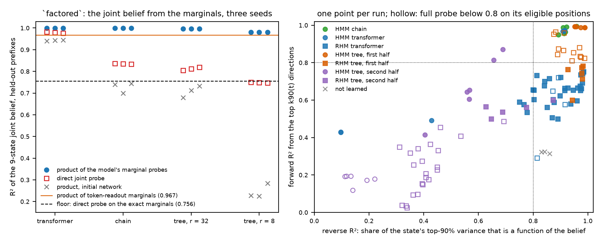
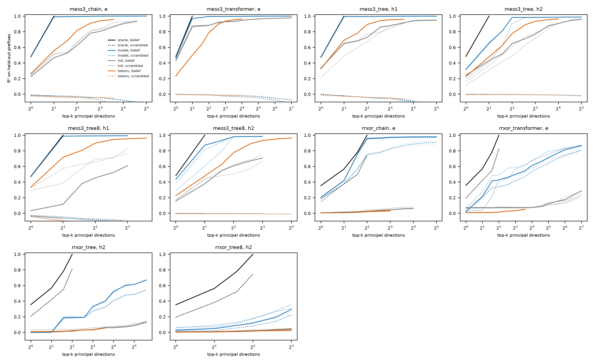

# Probe controls on the saved belief-geometry checkpoints: factor codes and low-dimensional probes

Three readings that the belief-geometry experiments left open were re-examined by reanalysing their saved checkpoints, with nothing trained. The first two got a verdict under rules written down before the run, in [`EXPERIMENT.md`](EXPERIMENT.md), and the two RRXOR tree cells stay open. For some cells the outcome was already known when the rules were written: H1's class follows from saved numbers, H3 had run on the CPU, and H2's labels had been seen in smoke tests on 3,000 sequences and one seed for the Mess3 chain, the RRXOR chain and the second half of the Mess3 tree.

- **H1, factor code (primary): partly supported, the outcome the definition expected.** On `factored`, a process made of two independent Mess3 processes, the chain and the r = 32 tree hold the two factor beliefs exactly and a little of the joint. The product of their own marginal probes, with no further fitted parameter, gives the 9-state joint belief at R² 0.999 (chain) and 0.996 (tree), against 0.967 for the same product built from a linear readout of the tokens. Their direct joint probes score 0.834–0.836 and 0.804–0.819, which is 0.08 and 0.05–0.06 above the 0.756 that a state holding exactly the two marginals and nothing else scores. Both are classed "marginals plus part of the joint" in all three seeds. The transformer is "joint readable" (0.976–0.982), and the r = 8 tree is "marginals not exact" (product 0.980–0.981).
- **H2, is the belief the dominant geometry of the state: it depends on the model and the task.** A cell is *dominant* if most of the state's variance is a linear function of the belief, and *compact* if the belief can be read from as few of the state's top principal directions as the belief itself needs. Among learned cells with three judged seeds:
  - Mess3 and RRXOR: 5 of 10 cells are dominant, and the same 5 are compact. They are Mess3 in the chain, the transformer and the first half of both trees, and RRXOR in the chain.
  - RRXOR in the transformer is neither. Its belief is readable from the full last layer at R² 0.86–0.87, but only 0.10, 0.10 and 0.43 of the variance in the layer's top one or two principal directions, which hold 90% of its variance, is a function of the belief, at or below the initial network's 0.34–0.35 in two seeds.
  - Random Hierarchy Model, transformer: dominant in 7 of 12 grammars, compact in 0 of 12.
  - Random Hierarchy Model, r = 32 tree: dominant in 2 of 15 cells, compact in 4 of 15, and no cell is both. The second half of the tree gets neither label in every process and grammar. For "dominant" the definition expected this from the architecture, but the architecture does not force it: one seed of `v4m2s2L5` passes the per-run rule there (reverse 0.87, full probe 0.88).
- **H3, the two RRXOR tree cells: both recorded rules come out as in the CPU pilot.** (a) The seed with R² −4.55 is not rescued by the rule as written: the blow-up sits in 146 of 31,129 test rows, but without them the seed scores 0.839 against 0.673 and 0.715 for the other two, not within 0.05. The affine probe, which drops no rows, gives 0.751 there. (b) The r = 32 tree with reduced product features scores 0.884, 0.883 and 0.895 against a required 0.886, so it fails in two seeds by 0.002, with no interval computed.

All 105 part-2 runs were produced. The probes covered by the reproduction rule, part 1's direct joint probe and part 2's full probe, matched the saved numbers to within 2.4e-05; one diverged projective fit in part 3 differs from its saved value by 0.19 and enters no verdict. The worker ran 2 h 02 min on one RTX PRO 4500 Blackwell and cost about $1.46, against a 7-hour cap and a $10 budget.

## Evidence

*Left: `factored`, affine probes, pooled R² on held-out prefixes, three seeds per model ([`figures/summary.pdf`](figures/summary.pdf)). The filled circles are the product of the model's own two marginal probes, the squares the direct probe of the 9-state joint, the crosses the same product on the initial network. The orange line is the product of marginals read linearly from the one-hot tokens, and the dashed line is the floor, the direct probe applied to the exact marginals. Right: part 2, one point per run and position group that has a judged position (114 points; the three crosses are the grammar the transformer did not learn). The horizontal axis is the reverse score and the vertical axis the forward score from the top k90(t) directions, both defined below; the dotted lines are the 0.8 bars. A hollow marker means the full forward probe is below 0.8 on the run's eligible positions, which rules out "dominant" whatever the reverse score.*

### H1: the joint belief on `factored`

On `factored` the joint belief is exactly the outer product of the two factor beliefs, b^AB(a, b) = b^A(a) b^B(b). A state that holds [b^A, b^B] linearly has the joint only as a product of its coordinates, which an affine probe cannot form. So the direct joint probe has a floor well below 1 even for a perfect factor code, and the floor was measured by probing the exact marginals as if they were activations.

| Model | Product of the model's marginal probes | Product from token-readout marginals | Product, initial network | Direct joint probe | Floor | Gap = direct − floor | Class |
|---|---|---|---|---|---|---|---|
| transformer | 0.999 | 0.967 | 0.941–0.944 | 0.976–0.982 | 0.755 | +0.220 to +0.227 | joint readable |
| chain | 0.999 | 0.967 | 0.700–0.744 | 0.834–0.836 | 0.756 | +0.078 to +0.080 | marginals plus part of the joint |
| tree, r = 32 | 0.996 | 0.967 | 0.679–0.732 | 0.804–0.819 | 0.755 | +0.049 to +0.064 | marginals plus part of the joint |
| tree, r = 8 | 0.980–0.981 | 0.967 | 0.225–0.284 | 0.747–0.749 | 0.756 | −0.007 to −0.010 | marginals not exact |

*Affine probes, pooled R² over the experiment's eligible positions on held-out prefixes (for the tree, the first half only, t ≤ 8); each range is over three seeds. Source: [`results/factor_product.txt`](results/factor_product.txt).*

The rule, worked through for the chain's seed 0: its product scores 0.999, so it leaves 0.001 of the variance unexplained, less than half of the 0.033 left by the token-readout product and of the 0.260 left by the initial network, and it is above 0.99. That makes the marginals "exact". Its direct probe is 0.836 and the floor 0.756, so the gap is 0.080, which is above the 0.03 tolerance while the direct probe is below 0.95: "marginals plus part of the joint".

The r = 8 tree misses the first clause: its product is 0.980–0.981, and the 0.019–0.020 it leaves unexplained is more than half of the token product's 0.033. Its direct probe sits at the floor.

Two baselines put the direct probes in context. A linear readout of the one-hot tokens gives the joint at 0.919, so the direct probes of the chain and of both trees are below it, as the earlier experiment reported. The initial transformer gives 0.921–0.923, so the trained transformer's 0.976–0.982 is a gain from 0.92.

For the tree's second half, probed on the two top bonds and their product, the products are similar (0.996–0.997 at r = 32 and 0.985–0.986 at r = 8) and the direct probes are higher: 0.884–0.890 and 0.837–0.839 against a floor of 0.755, with the initial network at 0.81–0.83 (r = 32) and 0.39–0.45 (r = 8). This half is descriptive only.

`coupled`, the process where the joint is not a product, was not read. Its residual C = b^AB − b^A ⊗ b^B carries 0.10–0.11% of the joint's variance, below the 1% the definition required, so it cannot test whether correlations beyond the marginals are represented. Its numbers are in the same file.

### H2: reverse and low-dimensional probes

Two scores per run, both on the earlier experiments' sequences, held-out prefix split and eligible positions.

- **Reverse score.** Take the state's top principal scores that hold 90% of its variance and predict them affinely *from* the belief. The R² is the share of that variance that is a function of the belief. *Dominant* needs a reverse score of at least 0.8 that halves the unexplained variance of the initial network's, and a forward probe (belief from all of the state's directions) of at least 0.8 on the same positions.
- **Forward score from the top k90(t) directions.** k90(t) is the number of principal directions that the belief itself needs to give the belief at R² ≥ 0.9 at position t. The probe may use only that many of the state's top principal directions. k runs over a grid (1, 2, 3, 4, 6, 8, 12, 16, 24, 32, 48, …), so a k90 above 4 is the next grid value at or above the true one. *Compact* needs a pooled R² of at least 0.8 that halves the unexplained variance of the initial network and of the one-hot tokens restricted the same way. It is judged on positions where k90(t) is at most half of the state's directions.

For example, on Mess3 the belief needs k90 = 2 directions at every position. The chain's top 2 principal directions give the belief at 0.99 (initial network 0.47–0.52, tokens 0.56), and 0.91–0.96 of the chain state's top-variance scores are a function of the belief (initial network 0.37–0.42), so the cell is both compact and dominant.

A cell gets a label only if all three seeds do. In the tables, "forward, all directions" is pooled over all eligible positions and the three "top k90" columns over the judged positions. Ranges are over three seeds.

**Mess3 and RRXOR** (transformer, chain, tree at r = 32 and r = 8; 24 runs):

| Cell | Positions judged / eligible | Reverse: model | Reverse: initial | Forward, all directions | Forward, top k90: model | at 2·k90 | initial | tokens | Dominant | Compact |
|---|---|---|---|---|---|---|---|---|---|---|
| Mess3, chain | 10/10 | 0.91–0.96 | 0.37–0.42 | 1.00 | 0.99 | 0.99–1.00 | 0.47–0.52 | 0.56 | **yes** | **yes** |
| Mess3, transformer | 8/8 | 0.91–0.92 | 0.71–0.80 | 1.00 | 0.97 | 0.99–1.00 | 0.86–0.87 | 0.50 | **yes** | **yes** |
| Mess3, tree r = 8, first half | 3/3 | 0.97–0.99 | 0.22–0.49 | 0.99 | 0.99 | 0.99 | 0.12–0.57 | 0.72 | **yes** | **yes** |
| Mess3, tree r = 8, second half | 7/7 | 0.57–0.69 | 0.25–0.30 | 0.99 | 0.60–0.87 | 0.98 | 0.38–0.44 | 0.48 | no | no |
| Mess3, tree r = 32, first half | 2/2 | 0.95–0.96 | 0.33–0.42 | 1.00 | 0.99 | 0.99 | 0.49–0.65 | 0.69 | **yes** | **yes** |
| Mess3, tree r = 32, second half | 7/7 | 0.40–0.57 | 0.20–0.26 | 0.99 | 0.41–0.65 | 0.90–0.98 | 0.31–0.43 | 0.48 | no | no |
| RRXOR, chain | 5/5 | 0.89–0.92 | 0.02–0.03 | 0.97–0.98 | 0.95–0.97 | 0.97–0.98 | 0.02–0.04 | 0.02 | **yes** | **yes** |
| RRXOR, transformer | 2/2 | 0.10–0.43 | 0.34–0.35 | 0.86–0.87 | 0.43–0.49 | 0.50–0.58 | 0.08 | 0.02 | no | no |
| RRXOR, tree r = 8, second half | 6/6 | 0.14–0.22 | 0.02–0.04 | 0.43–0.45 | 0.12–0.18 | 0.30–0.36 | 0.01–0.03 | 0.02 | no | no |
| RRXOR, tree r = 32, second half | 3/3 | 0.11–0.13 | 0.02–0.04 | 0.70–0.71 | 0.19 | 0.33 | 0.02–0.04 | 0.02 | no | no |

The first half of both RRXOR trees has no eligible position and is not judged.

**Random Hierarchy Model, transformer** (17 grammars × 3 seeds; a grammar name `vVmMsSLL` means V symbols per level, M synonymous productions per symbol, branching S and depth L):

| Grammar | Positions judged / eligible | Reverse: model | Reverse: initial | Forward, all directions | Forward, top k90: model | at 2·k90 | initial | tokens | Dominant | Compact |
|---|---|---|---|---|---|---|---|---|---|---|
| `v16m2s2L4` | 7/7 | 0.98 | 0.57–0.59 | 0.88–0.89 | 0.69–0.75 | 0.83–0.86 | 0.27–0.31 | 0.09–0.13 | **yes** | no |
| `v16m4s2L4` | 4/11 | 0.87–0.89 | 0.41 | 0.68–0.72 | 0.60–0.72 | 0.72–0.83 | 0.09–0.11 | 0.00–0.01 | no | no |
| `v16m8s2L4` (not learned) | 5/12 | 0.83–0.86 | 0.32–0.33 | 0.42–0.45 | 0.31–0.32 | 0.36–0.40 | 0.05–0.06 | 0.00 | no | no |
| `v3m2s2L4` | 5/5 | 0.78–0.85 | 0.41–0.43 | 0.95–0.98 | 0.54–0.73 | 0.71–0.91 | 0.23–0.26 | 0.00–0.01 | no | no |
| `v3m2s2L5` | 21/21 | 0.84–0.93 | 0.39–0.49 | 0.92–0.97 | 0.50–0.70 | 0.66–0.85 | 0.14–0.23 | 0.01–0.02 | **yes** | no |
| `v3m2s2L6` | 53/53 | 0.81–0.92 | 0.40–0.45 | 0.52–0.84 | 0.29–0.58 | 0.36–0.66 | 0.06–0.16 | 0.00–0.01 | no | no |
| `v3m3s3L3` | 14/14 | 0.75–0.96 | 0.53–0.57 | 0.92–0.97 | 0.59–0.65 | 0.72–0.82 | 0.19–0.26 | 0.03–0.06 | no | no |
| `v4m2s2L5` | 21/21, 22/22 | 0.94–0.97 | 0.47–0.54 | 0.94–0.98 | 0.58–0.67 | 0.73–0.84 | 0.17–0.22 | 0.02–0.09 | **yes** | no |
| `v8m2s2L4` | 7/7 | 0.90–0.98 | 0.53–0.57 | 0.94–0.98 | 0.72–0.74 | 0.87–0.89 | 0.28–0.30 | 0.07–0.11 | **yes** | no |
| `v8m2s2L5` | 23/23 | 0.96–0.98 | 0.54–0.58 | 0.87–0.88 | 0.65–0.67 | 0.78–0.80 | 0.19–0.23 | 0.07–0.10 | **yes** | no |
| `v8m4s2L3` | 3/3 | 0.80–0.86 | 0.41–0.44 | 0.97–0.98 | 0.65–0.72 | 0.80–0.83 | 0.18–0.25 | 0.03–0.06 | **yes** | no |
| `v8m4s2L4` | 11/11 | 0.88–0.91 | 0.38–0.43 | 0.84–0.91 | 0.59–0.66 | 0.70–0.79 | 0.13 | 0.03–0.04 | **yes** | no |
| `v8m6s2L3` | 3/3 | 0.77–0.80 | 0.40–0.41 | 0.92–0.94 | 0.58–0.66 | 0.76–0.81 | 0.16–0.18 | 0.03–0.04 | no | no |

Four grammars (`v3m2s2L3`, `v3m3s3L2`, `v6m3s3L2`, `v8m2s2L3`) have no eligible position. Of the five learned grammars that are not dominant, two fail on the forward probe (`v16m4s2L4` at 0.68–0.72 in all seeds, `v3m2s2L6` at 0.79 and 0.52 in two seeds), and three fail because one or two seeds have a reverse score between 0.75 and 0.80 (`v3m2s2L4` 0.78, `v3m3s3L3` 0.75, `v8m6s2L3` 0.77 and 0.799). No learned grammar reaches 0.8 from its top k90 directions in any seed; the best seed is 0.75.

**Random Hierarchy Model, tree at r = 32** (10 grammars × 3 seeds, the two top bonds, first and second half of the sequence):

| Grammar and half | Positions judged / eligible | Reverse: model | Reverse: initial | Forward, all directions | Forward, top k90: model | at 2·k90 | initial | tokens | Dominant | Compact |
|---|---|---|---|---|---|---|---|---|---|---|
| `v16m2s2L4`, first half | 1/2 | 0.94–0.99 | 0.12–0.16 | 0.66–0.68 | 0.81–0.85 | 1.00 | 0.04–0.06 | 0.05–0.06 | no | **yes** |
| `v16m4s2L4`, first half | 1/4 | 0.88–0.89 | 0.07–0.09 | 0.47–0.48 | 0.84–0.96 | 1.00 | 0.01 | 0.01 | no | **yes** |
| `v3m2s2L5`, first half | 7/7 | 0.93–0.98 | 0.06–0.09 | 0.95–0.99 | 0.60–0.77 | 0.79–0.94 | 0.04–0.09 | 0.02–0.06 | **yes** | no |
| `v4m2s2L5`, first half | 8/8 | 0.98 | 0.07–0.13 | 0.95–0.98 | 0.71–0.78 | 0.89–0.92 | 0.08–0.12 | 0.06–0.15 | **yes** | no |
| `v8m2s2L5`, first half | 2/8 | 0.97 | 0.11–0.14 | 0.73–0.77 | 0.83–0.88 | 0.98–0.99 | 0.06–0.09 | 0.06–0.10 | no | **yes** |
| `v8m4s2L4`, first half | 1/4 | 0.89–0.91 | 0.06–0.09 | 0.70–0.74 | 0.87–0.96 | 1.00 | 0.00–0.01 | 0.00–0.01 | no | **yes** |
| `v16m2s2L4`, second half | 4/7 | 0.41–0.45 | 0.09–0.15 | 0.61–0.64 | 0.19–0.23 | 0.49–0.52 | 0.08 | 0.05–0.10 | no | no |
| `v16m4s2L4`, second half | 3/7 | 0.32–0.38 | 0.03–0.08 | 0.38–0.40 | 0.04–0.10 | 0.32–0.36 | 0.01 | 0.00–0.01 | no | no |
| `v3m2s2L4`, second half | 6/6 | 0.31–0.63 | 0.03–0.06 | 0.67–0.84 | 0.35–0.56 | 0.50–0.80 | 0.00–0.07 | 0.00–0.02 | no | no |
| `v3m2s2L5`, second half | 15/15 | 0.54–0.78 | 0.01–0.04 | 0.72–0.85 | 0.41–0.56 | 0.57–0.74 | 0.00–0.02 | 0.01–0.02 | no | no |
| `v4m2s2L5`, second half | 15/15 | 0.65–0.87 | 0.03–0.05 | 0.81–0.88 | 0.50–0.60 | 0.68–0.77 | 0.01–0.03 | 0.01–0.07 | no | no |
| `v8m2s2L4`, second half | 6/7 | 0.36–0.39 | 0.07–0.08 | 0.72–0.75 | 0.25–0.34 | 0.44–0.61 | 0.07–0.10 | 0.05–0.10 | no | no |
| `v8m2s2L5`, second half | 11/15, 12/15 | 0.35–0.45 | 0.03–0.09 | 0.67–0.71 | 0.32–0.36 | 0.54–0.64 | 0.02–0.06 | 0.03–0.08 | no | no |
| `v8m4s2L3`, second half | 2/3 | 0.34–0.39 | 0.05–0.11 | 0.57–0.63 | 0.03–0.15 | 0.44–0.51 | 0.00–0.05 | 0.00–0.02 | no | no |
| `v8m4s2L4`, second half | 5/7 | 0.40–0.45 | 0.03–0.04 | 0.55–0.63 | 0.15–0.24 | 0.42–0.50 | 0.02 | 0.01–0.02 | no | no |

Five cells have no eligible position (the first half of `v3m2s2L3`, `v3m2s2L4`, `v8m2s2L4` and `v8m4s2L3`, and the second half of `v3m2s2L3`). The four compact first-half cells have reverse scores of 0.88–0.99 and miss "dominant" only through the forward clause: their full probe is 0.47–0.77 over all eligible positions. Their "compact" label rests on one or two judged positions out of two to eight, where the full probe is 0.98–1.00. The per-run table with every column is [`results/lowdim_summary.txt`](results/lowdim_summary.txt), and the curves against the number of directions are in [`figures/lowdim_hmm.pdf`](figures/lowdim_hmm.pdf), [`figures/lowdim_rhm-transformer.pdf`](figures/lowdim_rhm-transformer.pdf) and [`figures/lowdim_rhm-tree.pdf`](figures/lowdim_rhm-tree.pdf).

*Mess3 and RRXOR: pooled R² on held-out prefixes over the judged positions against the number k of top principal directions the probe may use; three seeds, seed 0 drawn heavier. Solid lines are the belief and dotted lines the scrambled target. Black is the exact belief used as the activations, which is the best any rank-k state can do; blue the trained model, gray the initial network, orange the one-hot tokens. Panel titles give the process, the model (`tree8` is the r = 8 tree) and the position group (`e` all eligible positions, `h1` and `h2` the first and second half).*

Three caveats go with these labels, all stated in the definition before the run.

- On Mess3 the belief is a function of the exact next-token distribution, so "dominant" there says the state's main directions are the model's own prediction. RRXOR is the process where the belief is more than that.
- The one-hot token control is close to zero on RRXOR and the Random Hierarchy Model (0.00–0.15 at k90), so there only the initial network is a real control.
- The second half of the tree was not expected to be dominant: its left top bond holds the summary of the left half, which the belief at position t need not determine. The definition says "cannot". No second-half cell is dominant, but one run is (`v4m2s2L5` seed 0, reverse 0.87, full probe 0.88), so the argument is weaker than the definition states. For the tensor networks the principal directions depend on the gauge of the bond, so the result describes the gauge that training left.

The scrambled target behaves as the earlier no-network check predicted. On the RRXOR chain the top 4 directions fit the scrambled target at 0.75–0.76, and the exact belief used as activations fits it at 0.75, so a fit to scrambled labels there says nothing against a belief code.

### H3: the two RRXOR tree cells

**(a) The r = 8 tree, projective probe on the two top bonds and their product, position t = 13:**

| Seed | Projective R² (saved) | Test rows out of range | Share of squared error in those rows | R² without them | Affine R², same features |
|---|---|---|---|---|---|
| 0 | 0.673 (0.673) | 31 of 31,129 | 0.007 | 0.675 | 0.673 |
| 1 | 0.715 (0.715) | 0 of 31,129 | 0 | 0.715 | 0.715 |
| 2 | −15.45 (−15.26) | 146 of 31,129 | 0.990 | 0.839 | 0.751 |

A row is out of range when some component of the predicted belief exceeds 2 in absolute value; the largest in seed 2 is 77. The rule asked whether seed 2 without those rows scores within 0.05 of the other two seeds. It does not: 0.839 is 0.12 and 0.17 above them, which is what dropping a probe's worst rows tends to produce. The affine probe has no denominator and drops no rows; it is below 0.8 at all nine pairs of seed and position (0.673–0.788 at t = 13–15). The earlier experiment's −4.55 was this seed's score pooled over t = 13–15.

**(b) The r = 32 tree, product features standardized and reduced to k = 91, 142 and 237 principal scores at t = 13, 14 and 15:**

| Seed | Affine, pooled | Projective, pooled | Initial network | Additive ceiling | Needed to halve it | Next-token ceiling | Verdict |
|---|---|---|---|---|---|---|---|
| 0 | 0.884 | −4.42 | 0.021 | 0.772 | 0.886 | 0.466 | fail |
| 1 | 0.883 | 0.883 | 0.037 | 0.772 | 0.886 | 0.466 | fail |
| 2 | 0.895 | 0.895 | 0.045 | 0.772 | 0.886 | 0.466 | pass |

The rule takes the better of the two probes. All three seeds are above 0.8 and far above the next-token ceiling, and two miss the halving of the additive ceiling by 0.002 (0.0019 and 0.0024 with the better probe; seed 1's affine probe misses by 0.0032). No interval was computed, so this is a miss at the threshold. Source: [`results/rrxor_tree.txt`](results/rrxor_tree.txt).

## How it was done

The inputs are the saved checkpoints of three finished experiments: [`hmm-belief-geometry`](../hmm-belief-geometry/README.md) (hidden Markov processes; transformer, chain, tree at r = 32 and r = 8), [`rhm-belief-geometry`](../../rhm/rhm-belief-geometry/README.md) (Random Hierarchy Model, transformer) and [`rhm-ttn-belief-geometry`](../../rhm/rhm-ttn-belief-geometry/README.md) (Random Hierarchy Model, tree). Every part uses those experiments' own 60,000 sequences with the same seeds, their held-out prefix split, their eligible positions and their score: R² = 1 − SSE/SST about the fit mean, pooled over positions by summed SSE and SST. The activations are the transformer's last layer, the chain's state, and the tree's two top bonds. Checkpoint 0 is the initial network.

- **Part 1**, [`factor_product.py`](factor_product.py): `factored` and `coupled` × four models × three seeds, 24 runs.
- **Part 2**, [`lowdim.py`](lowdim.py) with [`lowdim_summary.py`](lowdim_summary.py): 24 runs on Mess3 and RRXOR, 30 Random Hierarchy Model tree runs at r = 32, and all 51 Random Hierarchy Model transformer runs.
- **Part 3**, [`rrxor_tree.py`](rrxor_tree.py): the three r = 8 seeds and the three r = 32 seeds on RRXOR.

The exact commands are in [`EXPERIMENT.md`](EXPERIMENT.md), and the figures come from [`plot.py`](plot.py), which reads only the saved results.

## How it was checked

- **Project checks first.** `studies.hmm.checks` passed 29 of 29 and `studies.rhm.checks` 28 of 28 on the worker before anything else ran ([`results/checks_hmm.json`](results/checks_hmm.json), [`results/checks_rhm.json`](results/checks_rhm.json)).
- **The split is the saved one.** Each script asserts that its held-out prefix split has the saved row counts at every position. No assertion failed.
- **The probes reproduce the saved numbers.** Part 1's direct joint probe differs from the saved value by at most 8.2e-08 over 48 numbers. Part 2's full probe differs by at most 2.7e-06 over 159 positions (Mess3 and RRXOR), 1.3e-09 over 575 (transformer) and 2.3e-05 over 345 (tree). The failure threshold was 0.01.
- **Part 3 against its CPU pilot.** Every number that enters a rule agrees with the pilot to 0.001. The only differences are two projective fits that have diverged: −15.45 here, −15.42 in the pilot and −15.26 saved for seed 2 at t = 13, and −4.42 here against −3.82 in the pilot for seed 0 in (b). Both are fits with near-zero denominators, and neither enters a verdict.
- **Checks inside the scripts.** A state that holds the exact marginals gives a product R² of 1.000000 and a direct affine joint of 0.7558 on `factored`, which confirms the index order of the product. That check uses a small sample of its own. The floor in the rule is computed per model on the experiment's sample (0.7552–0.7564), and a closed form evaluated after the run on an independent sample gives 0.7554–0.7559 ([`floor_formula.py`](floor_formula.py); the derivation is in [`NOTE.md`](NOTE.md)). With the target itself as activations, the principal-score probe equals the Eckart–Young value and is unchanged by a rotation that adds weaker directions; `lowdim.py` asserts this at the start of every run.
- **Three out-of-memory failures, rerun.** Three transformer runs failed with CUDA out of memory while three processes shared the 32 GB card. They were rerun one process at a time, as the definition prescribes, and all three completed. The summary and figures were made again afterwards, so they cover all 51 runs.
- **Fact-check.** An independent pass checked this file and the note against the result files, logs and scripts. It confirmed every table cell and asked for 17 rewordings and 5 additions, all applied; they are listed at the end. The files were not checked again after the corrections.

## Not yet checked

- **No interval on H3(b).** Two seeds miss the bar by 0.002. A bootstrap over prefixes would say whether that miss is distinguishable from a pass. It needs minutes of CPU and decides how to read that cell.
- **Gauge of the tensor-network bonds.** The principal directions of a bond depend on its gauge, and the affine forward probe does not. Repeating part 2 for the chain and the trees after bringing the bonds to a canonical form would show whether "not compact" and the trees' reverse scores are properties of the network or of the gauge. That is under an hour on the same worker, and the labels of every tensor-network cell depend on it.
- **How the reverse score pools positions.** It pools by the state's raw variance. With the equal-weight mean over positions instead, two dominant transformer grammars have one seed below 0.8 (`v3m2s2L5` 0.797, `v8m4s2L3` 0.788), which would make the count 5 of 12. Both numbers are in the summary; the rule used the pooled one.
- **The 0.9 in k90.** The number of directions the belief "needs" is defined at R² ≥ 0.9 and was not varied. At 2·k90 the learned transformer grammars score 0.36–0.91 over seeds, with all three seeds at 0.8 or above in 2 of the 12 and at least one seed in 9, so "compact in 0 of 12" depends on that choice.
- **RRXOR in the transformer rests on two positions** (t = 14 and 15) and one architecture. Its reverse score is computed on the one principal direction (seed 0) or two (seeds 1 and 2) that hold 90% of the trained layer's variance, so it says that those few very large directions are not a function of the belief. What they do encode was not examined.
- **`coupled` remains unread.** With 0.1% of the variance in the residual, this process cannot test the question. A process with stronger coupling would be needed.

## Judgement calls

- **Recorded as `inconclusive`.** The definition's own label for H1 is "partly supported", and the result record accepts only supported, not supported, inconclusive or failed. The earlier belief-geometry experiment recorded its mixed outcome the same way. "Not supported" would be wrong by the definition's wording, which reserves it for inexact marginals or a readable joint in the chain or the r = 32 tree.
- **The diverged projective fit in part 3 was not treated as a reproduction failure.** The definition's 0.01 rule names part 1's direct probe and part 2's full probe, and `rrxor_tree.py` enforces none. The fit differs between the saved value, the CPU pilot and this worker, while the row count, the trimmed score and the affine score are identical. The alternative was to stop part 3 and report nothing from it.
- **A summary figure, PNG copies and a floor formula were added after the run.** `plot.py` gained `figures/summary.pdf` and an option that writes PNG copies for the note. Both read the same saved files, and the three figures drawn on the worker were left as they were. `floor_formula.py` evaluates a closed form of the factor-code floor on the coordinator's CPU and writes `results/floor_formula.json`; it enters no rule.

## What this means and what to do next

The low joint-belief scores of the tensor networks on `factored` are mostly a property of the probe. The chain and the r = 32 tree give both factor beliefs at R² 0.999 and 0.997, an affine probe cannot multiply them, and the direct joint score is only 0.05–0.08 above what the two marginals alone give. The transformer is different: its direct joint probe is 0.22 above the floor, at 0.976–0.982 against 0.921–0.923 for its initial network.

The stronger claim, that the belief is the main geometric structure of the state, holds on Mess3 for the chain, the transformer and the first half of the tree (2 or 3 positions; the tree's 7 second-half positions are not dominant, with reverse scores of 0.40–0.69), and on RRXOR for the chain. The first half of the RRXOR trees had no eligible position and was not tested. It does not hold for the transformer on RRXOR, where the belief is linearly readable but is not what the layer's large-variance directions carry. For the Random Hierarchy Model transformer most of the state's variance is a function of the belief in 7 of 12 grammars, but the belief is not readable from as few top directions as it needs in any of them.

Suggested next steps, none of them run: the bootstrap for H3(b), the gauge-fixed repeat of part 2 for the tensor networks, and a look at what the top-variance directions of the RRXOR transformer's last layer do encode.

## Fact-check

A separate fact-checking pass compared about 720 claims in this file and in [`NOTE.md`](NOTE.md) with the result files, the scripts, the worker's logs and the earlier experiments. Every table cell held. It asked for 17 rewordings and 5 additions, all applied. The ones that change the reading:

- The opening said the three readings "were settled"; H3 is not, and it now says so. It also now says which outcomes were already known when the rules were written, including H2's from smoke tests.
- "Mess3 in all three architectures" became "the chain, the transformer and the first half of the tree", since the tree's second half is not dominant.
- "The second half of the tree cannot be dominant by construction" was too strong: one run passes the per-run rule there.
- "Every recomputed probe matched to 2.3e-05" ignored the diverged projective fit in part 3; the sentence now names the probes it covers.
- The H3(b) misses are 0.0019 and 0.0024 with the better of the two probes, not 0.002 and 0.003.
- The tree's second half on `factored` is not "the same picture": its direct probes are 0.08 and 0.13 above the floor.
- Added: the token-readout and initial-transformer baselines for the direct joint probe, the fact that the RRXOR transformer's reverse score rests on one or two principal directions, the grid on which k90 is read, and `floor_formula.py` among the things added after the run.
