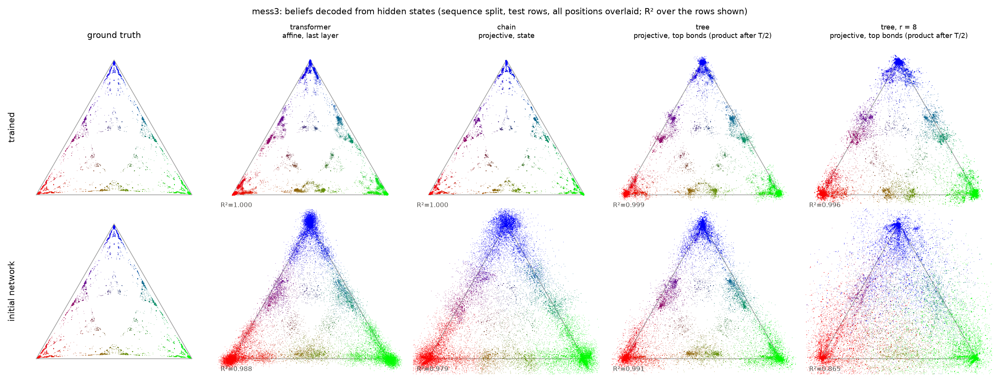
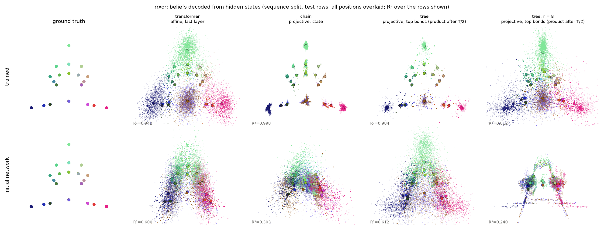
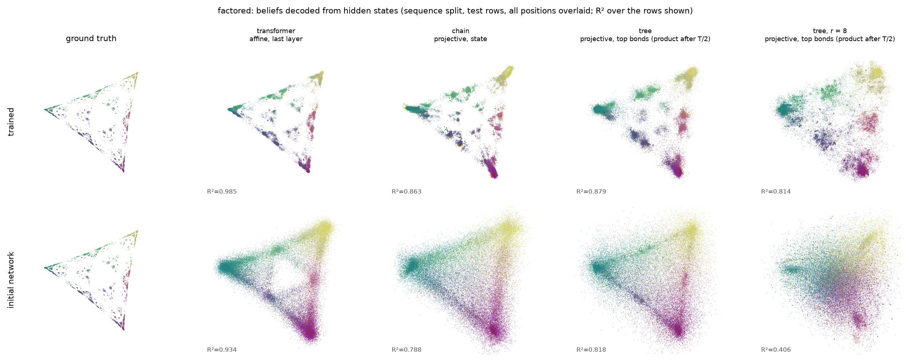
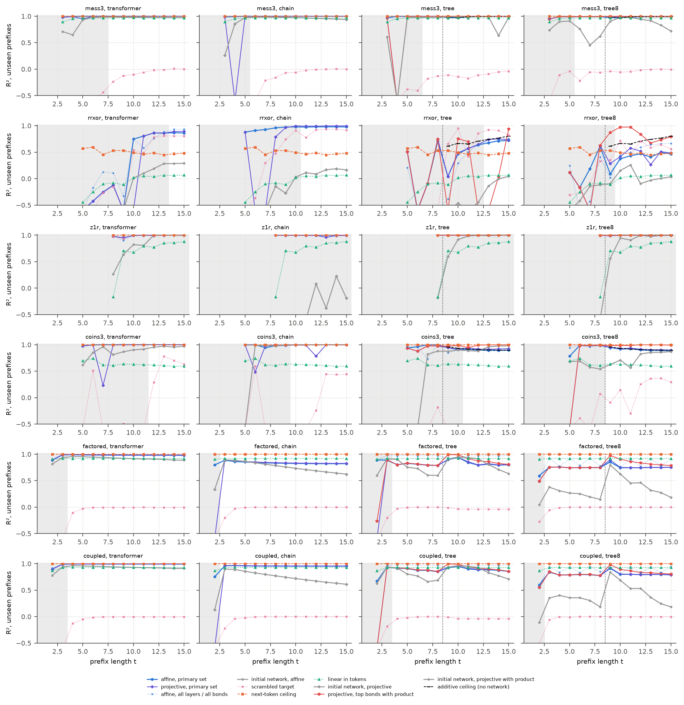
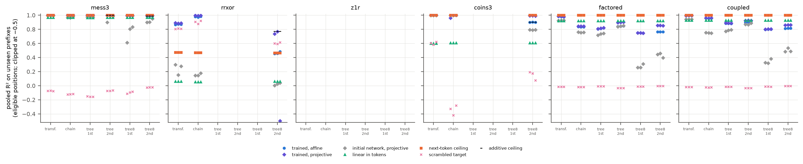

**Do a chain and a tree tensor network hold the belief state of a hidden Markov process the way a transformer does?**

*A research note on a replication of the Simplex belief-geometry result on its own processes, and on the form in which two tensor networks trained on the same task carry the belief.*

Shai et al. (2024) trained small transformers to predict the next token of a hidden Markov process and found that the Bayesian belief over the hidden states can be read out of the residual stream by a linear map: the fractal of Mess3, and the 36 belief states of RRXOR. This note reports the same kind of experiment with three kinds of model trained on the same data: a transformer, a chain tensor network (a matrix product state read left to right) and a binary tree tensor network. The training differs from theirs in several ways: Adam in place of SGD, 30,000 updates in place of about $10^6$, a context of 16 tokens in place of 10, a beginning-of-sequence token, and a larger transformer on Mess3. The tensor networks are of interest because exact filtering has their algebraic form. The filter multiplies a state vector by a matrix chosen by the token, which is what a chain does at each step, and a tree can multiply the matrices of its two halves.

The answer depends on the model and the process, and the criteria were fixed before the run. **The transformer result reproduces on both Mess3 and RRXOR in all three seeds.** **The chain carries the belief on Mess3 and on RRXOR, where a projective probe reads it at $R^2$ 0.994 to 0.997 on prefixes the probe never saw, far above the 0.47 that the next-token distribution determines.** **The tree is mixed: it passes on Mess3 up to the midpoint and, at bond dimension 8, on a mixture of coins past it, and the tree with bond dimension 8 fails on RRXOR, the one process where the test asks for more than the model's own prediction.** On two processes with product structure, the transformer, the chain and the tree with bond dimension 32 carry the two factor marginals at $R^2$ 0.992 or more, and the tree with bond dimension 8 at 0.971 to 0.987, close to the 0.963 to 0.972 of a linear readout of the tokens. Only the transformer halves the token readout's error on the joint belief. The chain scores above the token readout on the coupled process (0.956 to 0.960 against 0.928) without halving its error, and below it on the factored process (0.844 to 0.845 against 0.919). The pooled verdicts under the pre-set rule are: reproduction supported (2 of 2 cells), chain partly supported (2 of 4), tree first half partly supported (2 of 6), tree second half partly supported (1 of 2). One further observation about the larger tree on RRXOR was made after the verdicts and is marked as exploratory where it appears.

The note defines the processes and the belief, derives the form each model's state should take if it implements the filter, states the probes and controls, and then reports the results.

**A hidden Markov process is a set of labelled transition matrices.** A process has $S$ hidden states and $V$ tokens. Its kernel is

$$
T^{(x)}_{s s'} = P\bigl(\text{emit } x \text{ and move to } s' \mid \text{state } s\bigr), \qquad x \in \lbrace 0, \dots, V-1 \rbrace ,
$$

so that $\sum_x T^{(x)}$ is a row-stochastic matrix. The start distribution $\pi$ is the stationary distribution of $\sum_x T^{(x)}$, except for the coin mixture below, where it is uniform. Sequences have $T_{\mathrm{ctx}} = 16$ tokens $x_0, \dots, x_{15}$. Six processes were used:

- **Mess3** (3 states, 3 tokens). The state stays with probability $1 - 2x$ and moves to each other state with probability $x$; the new state $s'$ then emits token $s'$ with probability $\alpha$ and each other token with probability $(1-\alpha)/2$. The parameters are $x = 0.05$ and $\alpha = 0.85$, as in Shai et al.
- **RRXOR** (5 states, 2 tokens): two fair random bits, then their XOR, repeated.
- **Zero-one-random** (3 states, 2 tokens): emit 0, emit 1, emit a fair bit, repeated.
- **Coins** (3 states that never change, 2 tokens): state $k$ emits 1 with probability $0.2$, $0.5$ or $0.8$. The belief is the posterior over which coin generated the sequence.
- **Factored** (9 states, 9 tokens): two independent Mess3 processes, $A$ with $(x, \alpha) = (0.05, 0.85)$ and $B$ with $(0.15, 0.6)$. A joint state is a pair $(a, b)$ and a joint token a pair $(x_a, x_b)$.
- **Coupled** (9 states, 9 tokens): the same, except that with probability $\varepsilon = 0.3$ factor $B$ emits the token equal to $A$'s current state $a$ and jumps to state $a$.

In formulas, with $\delta$ the Kronecker delta, the Mess3 kernel is

$$
T^{(e)}_{s s'} = \Bigl[(1-2x) \delta_{s s'} + x (1 - \delta_{s s'})\Bigr] \Bigl[\alpha \delta_{e s'} + \tfrac{1-\alpha}{2} (1 - \delta_{e s'})\Bigr] ,
$$

the factored kernel is the product of the two factors' kernels $T_A$ and $T_B$,

$$
T^{(x_a, x_b)}_{(a,b),(a',b')} = T^{(x_a)}_{A; a a'}  T^{(x_b)}_{B; b b'} ,
$$

and the coupled kernel mixes factor $B$'s kernel with a copy of $A$'s state:

$$
T^{(x_a, x_b)}_{(a,b),(a',b')} = T^{(x_a)}_{A; a a'} \Bigl[(1-\varepsilon)  T^{(x_b)}_{B; b b'} + \varepsilon  \delta_{x_b, a}  \delta_{b', a}\Bigr].
$$

**The belief is the normalized output of a linear recursion.** Write $x_{\lt t} = (x_0, \dots, x_{t-1})$ and let $\eta_t$ be the row vector $\eta_t(s) = P(\text{state at time } t = s \mid x_{\lt t})$, the posterior over the state that emits $x_t$. Define the unnormalized message $u_t(s) = P(x_{\lt t},\ \text{state at time } t = s)$. Summing over the previous state gives

$$
u_0 = \pi, \qquad u_{t+1} = u_t  T^{(x_t)}, \qquad \eta_t = \frac{u_t}{u_t \mathbf{1}} ,
$$

where $\mathbf{1}$ is the column vector of ones. The next-token distribution is a linear function of the belief,

$$
p_t(x) = P(x_t = x \mid x_{\lt t}) = \eta_t  T^{(x)}  \mathbf{1} .
$$

Two facts about this recursion organize the rest of the note. The update of $u$ is bilinear in the pair (state, one-hot token) and has no normalization, and the belief is a ratio of two linear functions of $u$.

**A chain that implements the filter carries the belief projectively.** The chain has a state $h_t \in \mathbb{R}^r$ with $r = 32$, a learned start $h_0$, and the update

$$
h_{t+1, a} = \sum_{b, c} W_{a b c}  h_{t, b}  \bigl(A  \mathrm{onehot}(x_t)\bigr)_c , \qquad \mathrm{logits}_t = U h_t ,
$$

with one core $W$ for all positions. This update is bilinear in (state, token), like $u_{t+1} = u_t T^{(x_t)}$. Suppose the state is a linear image of the message up to a positive scale that may depend on the prefix, $h_t = c_t  u_t M$ with $M$ an $S \times r$ matrix of rank $S$ and $c_t \gt 0$. Let $M^{+}$ be a right inverse, $M M^{+} = I_S$. Then $h_t M^{+} = c_t u_t$ and

$$
\eta_t = \frac{h_t M^{+}}{h_t M^{+} \mathbf{1}} .
$$

The scale $c_t$ cancels. The belief is a ratio of linear forms in $h_t$, and in general it is not an affine function of $h_t$, because $u_t \mathbf{1} = P(x_{\lt t})$ varies over prefixes by orders of magnitude. A chain built by hand with $h_t = u_t$ confirms this: the projective probe defined below recovers the belief with $R^2 = 1.000000$ at every position and the affine probe scores as low as 0.32. A trained chain need not use this code. It is trained through $\mathrm{softmax}(U h_t)$, which is not the filter's normalization, so the derivation states what the probe would find if the chain filtered in the simplest way, and the experiment asks whether it does.

**A tree can hold the two halves separately, and then the belief needs their product.** The tree has 16 leaves, one per token position, and fuses neighbours pairwise up to two top bonds $h_L$ and $h_R \in \mathbb{R}^r$, which summarize tokens 0 to 7 and 8 to 15. Its logits are a bilinear form in $(h_L, h_R)$. To predict $x_t$ it is given the prefix with all later positions replaced by a mask token. Let $H = 8$. For $t \le H$ only the left half has seen tokens, and the argument for the chain applies to $h_L$. For $t \gt H$, split the product of transfer matrices at the midpoint:

$$
u_t = \underbrace{\pi  T^{(x_0)} \cdots T^{(x_{H-1})}}_{u_H} \ \underbrace{T^{(x_H)} \cdots T^{(x_{t-1})}}_{M_R} , \qquad \eta_t = \frac{u_H M_R}{u_H M_R \mathbf{1}} .
$$

The row vector $u_H$ depends only on the left half and the matrix $M_R$ only on the right prefix. If $h_L$ is an injective linear image of $u_H$ and $h_R$ an injective linear image of the entries of $M_R$, each up to a positive scale, then every entry of $u_H M_R$ is a bilinear form in $(h_L, h_R)$, that is, a linear function of the outer product $h_L \otimes h_R$. The belief is then a ratio of linear forms in the features

$$
\phi_t = \bigl[ h_L,\ h_R,\ h_L \otimes h_R \bigr] \in \mathbb{R}^{2r + r^2} ,
$$

and not of $[h_L, h_R]$ alone. A tree built by hand to multiply transfer matrices behaves this way: on an 8-token Mess3 tree the projective probe scores 1.0000 with the product features at the four positions checked ($t = 2, 4, 5, 7$), and 0.955 and 0.992 without them at the two past the midpoint. With $r = 32$ the product set has 1,088 features, more than the processes with two tokens can support (see the eligibility rule below), so the tree was also trained at $r = 8$, where it has 80.

**Two probe families are fit separately at every position.** For features $a \in \mathbb{R}^p$ and a target belief $b \in \mathbb{R}^S$,

$$
\text{affine:}\quad \hat b = W a + c , \qquad\qquad \text{projective:}\quad \hat b = \frac{q}{\mathbf{1}^{\top} q}, \quad q = W a + c .
$$

The affine probe is least squares. The projective probe minimizes the same squared error by L-BFGS from two starting points and keeps the better fit. The first start is the affine solution. The second is algebraic: an exact projective code satisfies $q_n - b_n (\mathbf{1}^{\top} q_n) = 0$ for every row $n$, which is linear in $(W, c)$, so one minimizes $\sum_n \lVert q_n - b_n (\mathbf{1}^{\top} q_n) \rVert^2$ under the constraint that the mean of $\mathbf{1}^{\top} q_n$ is 1, a single linear solve. A solution whose denominator changes sign on the fit rows is rejected. The features are the last block's output for the transformer (128 numbers), $h_t$ for the chain, and $[h_L, h_R]$ or $\phi_t$ for the tree. The score is

$$
R^2 = 1 - \frac{\sum_n \lVert b_n - \hat b_n \rVert^2}{\sum_n \lVert b_n - \bar b \rVert^2} ,
$$

summed over test rows and over the positions being pooled, with $\bar b$ the mean belief of the fit rows at that position.

**All criteria are evaluated on prefixes the probe never saw.** The analysis set has 60,000 sequences. At each position $t$ the distinct prefixes $x_{\lt t}$ are assigned at random to a fit side or a test side, and every sequence follows its prefix. A position is eligible for a feature set with $p$ features only if it has at least $10 (p+1)$ distinct fit prefixes. This rule decides where each model can be judged. RRXOR has 2,384 distinct fit prefixes at $t = 15$ in this sample, so the transformer's 128 features are eligible at $t = 14$ and 15 only, the chain's 32 at $t = 11$ to 15, and the 80 product features of the small tree at $t = 13$ to 15.

**A probe beats a control when it halves the control's error.** A fixed margin in $R^2$ cannot work on Mess3, where the belief is nearly linear in the tokens already. The rule is

$$
1 - R^2_{\text{probe}} \ \le\ \tfrac{1}{2} \bigl(1 - R^2_{\text{control}}\bigr) .
$$

The controls are the same probe on the initial network, an affine probe on the one-hot prefix (the token readout), and two ceilings: the additive one, computed exactly from the process, and the next-token one, estimated on all analysis rows.

**The next-token ceiling says where recovering the belief shows more than good prediction.** Every model's probed features determine its own prediction: the transformer's logits are a linear readout of its normalized last layer, the chain's are $U h_t$, and the tree's are linear in $h_L \otimes h_R$. A model that predicts well therefore holds the exact next-token distribution $p_t$ to good accuracy, and any function of $p_t$ comes with it. The ceiling is the best such function,

$$
R^2_{\text{next}} = 1 - \frac{E \lVert \eta_t - E[\eta_t \mid p_t] \rVert^2}{E \lVert \eta_t - E \eta_t \rVert^2} .
$$

On Mess3 the map from belief to prediction is $p_t = \eta_t E$ with $E_{s x} = \sum_{s'} T^{(x)}_{s s'}$, a square matrix of full rank, so $\eta_t = p_t E^{-1}$ and the ceiling is 1. The same holds for the factored and coupled processes, and on the coin mixture the belief is a one-to-one function of $p_t$. On those four processes a high probe score describes how the prediction is laid out in the hidden state. RRXOR is different. After the first random bit the hidden state is one of two states that both emit a fair bit, so beliefs differ where predictions agree, and the ceiling is 0.45 to 0.60 on held-out prefixes at $t = 5$ to 15, and 0.45 to 0.48 at $t = 11$ to 15, the positions that enter a verdict. The RRXOR cells are the ones that can show a belief beyond the prediction.

**The additive ceiling says where the tree needs the product.** Past the midpoint, any affine probe on bonds that summarize disjoint spans has the form $f(\text{left half}) + g(\text{right prefix})$. The best predictor of that form,

$$
R^2_{\text{add}} = 1 - \frac{\min_{f, g}\ E \lVert \eta_t - f(x_{\lt H}) - g(x_{H}, \dots, x_{t-1}) \rVert^2}{E \lVert \eta_t - E \eta_t \rVert^2} ,
$$

is computed exactly from the joint table $P(\text{left}, \text{right}, \text{state}) = \pi  T^{(\text{left})}  T^{(\text{right})}$ by alternating conditional means. It is 0.97 or more at every Mess3 position past the midpoint (0.990 pooled over $t = 9$ to 15), because recent tokens nearly determine the belief, so Mess3 cannot test the product. It is 0.897 for the coins at $t = 14$ and 15, and 0.74 to 0.80 for RRXOR at $t = 13$ to 15.

**Two cells and one process leave the counts.** Zero-one-random has at most 37 distinct fit prefixes at any position, so no model has an eligible position there and it appears in figures only. A cell is also set aside as not testable when a control already scores 0.99 or more, because halving so small an error asks for less than the probe's noise. That removes the chain on the coin mixture, whose initial network scores 0.998 to 0.999 with the projective probe, and it is why the chain is judged on four processes.

**Training and the learning gate.** Each of the four models was trained on each process with three seeds, 72 runs in all, on fresh sequences with Adam for 30,000 updates of batch 512. A (process, model) cell counts as learned if its excess test loss over the exact Bayes loss is below $\min(0.02,\ \tfrac12 \Delta_2)$ in all three seeds, where $\Delta_2$ is the excess of the best predictor that sees only the last two tokens. All 24 cells learned. The largest excess in any run was 0.0044 nats per token, on RRXOR for the tree at $r = 8$.

**Result 1: the transformer reproduces Shai et al. on both processes.** Figure 1 shows the Mess3 simplex. Pooled over $t = 8$ to 15, the affine probe on the last layer scores $R^2 = 0.9997$ in each seed, against 0.976 to 0.978 for the initial network and 0.967 for the token readout, so it leaves about one hundredth of the controls' error. On RRXOR at $t = 14$ and 15 it scores 0.865 to 0.872, against 0.25 to 0.29 for the initial network, 0.063 for the tokens and a next-token ceiling of 0.474.

*Figure 1. Mess3, seed 0. Each point is one test sequence at one position, placed by the probe's output and colored by the true belief as RGB; top row trained, bottom row the initial network. The $R^2$ under a panel is over the rows shown on a split by sequence, so it is not a held-out-prefix score and is not comparable with the numbers in the text. Notice that the initial networks already give the coarse triangle and that training resolves the fractal, most sharply in the transformer and the chain.*

**Result 2: the chain carries the RRXOR belief, and its code there is projective.** On Mess3 the projective probe on the chain's state scores 0.9999 over $t = 6$ to 15, and the affine probe 0.9997 to 0.9998, so the two forms cannot be told apart there. On RRXOR over $t = 11$ to 15 the projective probe scores 0.994 to 0.997 and the affine probe 0.971 to 0.983: the projective probe leaves 0.003 to 0.006 of the variance unexplained and the affine probe 0.017 to 0.029, a ratio of 0.15 to 0.22. The pre-set label for the form of the code is "projective" when that ratio is at most one half, which holds in all three seeds. The initial chain scores 0.145 to 0.177, the tokens 0.056, and the next-token ceiling is 0.469. Figure 2 shows the chain's clusters sitting on the true belief states.

*Figure 2. RRXOR, seed 0, on the top two principal components of the true beliefs, with one outlined centroid per distinct belief. All panels use the split by sequence, in which test sequences share prefixes with fit sequences, so the $R^2$ under a panel is not a held-out-prefix score. Notice the tight clusters of the chain against the broad ones of the transformer and of the tree at $r = 8$.*

The RRXOR passes need one qualification. At the eligible positions RRXOR has 17 distinct beliefs. A control fits the same affine probe to a scrambled target, an independent random 8-vector for each distinct belief of the position. It scores 0.81 for the transformer and 0.88 to 0.92 for the chain. A state that separates the 17 belief states fits any labelling of them, so these cells establish that the state identifies the belief state on new prefixes, which the next-token distribution does not. They do not test whether the states are arranged in the geometry of the simplex. Mess3, whose beliefs are nearly all distinct and whose scrambled scores are below zero, tests the geometry, and there the belief is a linear image of the prediction.

**Result 3: on the product processes the tensor networks read the factors better than the joint.** For the factored process the joint belief is the outer product of the two factors' beliefs, $\eta^{AB}_t(a, b) = \eta^{A}_t(a)  \eta^{B}_t(b)$. The same probes were fit to the 9-state joint and to the two marginals, each marginal normalized separately. Projective probe, range over three seeds:

| Model | Factored: joint | Factored: marginals | Coupled: joint | Coupled: marginals |
|---|---|---|---|---|
| Transformer, last layer | 0.980–0.986 | 1.000 | 0.995 | 0.999 |
| Chain, state | 0.844–0.845 | 0.999–1.000 | 0.956–0.960 | 0.997–0.998 |
| Tree $r = 32$, top bonds, $t \le 8$ | 0.806–0.824 | 0.998 | 0.886–0.891 | 0.992–0.993 |
| Tree $r = 8$, top bonds, $t \le 8$ | 0.747–0.750 | 0.985–0.987 | 0.7996–0.804 | 0.971 |
| Linear readout of the tokens | 0.919 | 0.971–0.972 | 0.928 | 0.963–0.964 |

This is why the chain fails its criterion on these two processes and the tree fails its first-half criterion: the probe must leave at most half the token readout's error, and for the joint it does not. The chain on the coupled process scores above the token readout (0.956 to 0.960 against 0.928) but short of the 0.964 that halving requires, every other tensor-network cell scores below the token readout, and the tree at $r = 8$ is also at or below the 0.8 threshold. The reading has a limit. A state that holds $\eta^A$ and $\eta^B$ linearly holds the joint as a product of its coordinates, and neither probe family can form a product. So the table shows that the joint is less readable from the tensor networks, linearly or projectively, than from the transformer, and in all cells but the coupled chain less readable than from the raw tokens. It does not show that the joint is absent. Figure 3 shows the joint belief of the factored process on two principal components.

*Figure 3. Factored process, seed 0, same layout as Figure 2, without centroids. Notice that the transformer's output keeps the fine structure of the true joint belief and that the tensor networks blur it.*

**Result 4: the product of the top bonds is needed for the coins and is not enough at $r = 8$ for RRXOR.** For the coin mixture the posterior is the normalized product of the two halves' likelihoods, so it is the cleanest case for the product features. At $r = 8$ over $t = 11$ to 15 the projective probe on $\phi_t$ scores 0.991 to 0.994, against 0.912 to 0.916 on the bonds alone, 0.791 to 0.793 for the initial tree and 0.606 for the tokens. At $t = 14$ and 15 it scores 0.994 to 0.998 against the additive ceiling of 0.897. This cell passes, and it is one of the four processes where the belief is a function of the prediction.

RRXOR at $r = 8$, over $t = 13$ to 15, fails. The projective probe on $\phi_t$ scores 0.733 and 0.767 in two seeds, below the 0.8 threshold and not above the additive ceiling of 0.772. The affine probe on the same features scores 0.718 to 0.748. In the third seed the projective probe scores $-4.55$, which comes from $t = 13$, where it scores $-15.3$ and the affine probe on the same features 0.751. A score that far below zero is what a ratio gives when its denominator comes close to zero on rows it was not fit on, and the fit only constrains the sign of the denominator on the fit rows; the denominators themselves were not inspected. This is the one score below zero at a position that enters a verdict. A milder case sits at the same position in another seed, where the projective probe on the bonds alone scores 0.26 against 0.41 for the affine probe; that lowers the control the product is compared with, and the cell fails either way. Figure 4 shows seed 0's scores by position.

*Figure 4. $R^2$ on unseen prefixes against prefix length, one row per process and one column per model ("tree8" is the tree at $r = 8$), for seed 0; values below $-0.5$ are off the axis. Gray shading marks positions that are not eligible for the model's primary feature set, and the dashed vertical line is the midpoint. In the RRXOR row, notice the chain's projective curve near 1 at its eligible positions, and in the tree panels the red product curve against the black dashed additive ceiling.*

*Figure 5. The pooled scores behind each criterion, one point per seed, values below $-0.5$ drawn at $-0.5$. "1st" and "2nd" are the two halves of the sequence for the tree.*

**Exploratory: the larger tree may carry the RRXOR belief in the product.** This was examined after the verdicts and no criterion covers it. At $r = 32$ the product features number 1,088 and need 10,890 distinct fit prefixes, and RRXOR offers 923 to 2,384 at $t = 13$ to 15, so these positions are not eligible. The scores on unseen prefixes were still computed. The affine probe on $\phi_t$ scores 0.934 to 0.982 at $t = 13$ to 15 across the three seeds, against an additive ceiling of 0.743 to 0.803, a next-token ceiling of 0.449 to 0.480 and 0.075 to 0.255 for the initial tree. The scrambled target scores 0.816 to 0.924 there, and the projective probe on the same features is unstable, with scores between $-737$ and 0.947. The eligibility rule exists to guard against fits with this many features on this few prefixes, so this is a lead and not a result.

**What is established, and what is not.** Established under criteria fixed in advance: the transformer result of Shai et al. reproduces in this pipeline; a chain tensor network trained on next-token prediction identifies the RRXOR belief state on unseen prefixes, through a projective map that fits better than an affine one; the tree's top bonds carry the Mess3 belief up to the midpoint ($t = 6$ to 8), and at $r = 8$ their product carries the coin posterior at $t = 11$ to 15, where the bonds alone and any additive function of the halves do not. Not established: that the tree carries the RRXOR belief (it fails at $r = 8$ and cannot be judged at $r = 32$); that any model lays out the RRXOR beliefs in their geometry, as opposed to identifying which belief state it is in; that the trained chain's state is the unnormalized filter, since the projective probe fitting better than the affine one is necessary for that and not sufficient. The failures on the product processes are failures of linear and projective readability of the joint, with the marginals read at 0.992 or more except by the tree at $r = 8$.

**What would settle the open points.** Three checks follow directly. First, RRXOR with a context of 32 tokens has enough distinct prefixes to make the product features of a larger tree eligible, which would turn the exploratory observation into a test. Second, a projective probe that is penalized or constrained to keep its denominator away from zero would show whether the blow-ups are a property of the fit and not of the features, and it needs only the saved checkpoints. Third, a probe with products of state coordinates on the chain would test whether the joint belief of the factored process is present as a product of the marginals it holds.

**References and where to look.**

- A. Shai, S. Marzen, L. Teixeira, A. Gietelink Oldenziel and P. Riechers, "Transformers represent belief state geometry in their residual stream" (2024), [arXiv:2405.15943](https://arxiv.org/abs/2405.15943). Mess3 and RRXOR, and the affine probe. The plotting code names their Figures 5 and 7 as the models for Figures 1 and 2 here; the paper was not opened for this note.
- The later Simplex work on factored representations is cited in this experiment's definition as [arXiv:2602.02385](https://arxiv.org/abs/2602.02385); it was not consulted for this note.
- [`README.md`](README.md) has the verdict table for every cell, the checks and the judgement calls. [`EXPERIMENT.md`](EXPERIMENT.md) has the criteria as fixed before the run and the amendments made during it. The numbers are in [`results/summary.txt`](results/summary.txt) and `results/*/analysis.json`.
