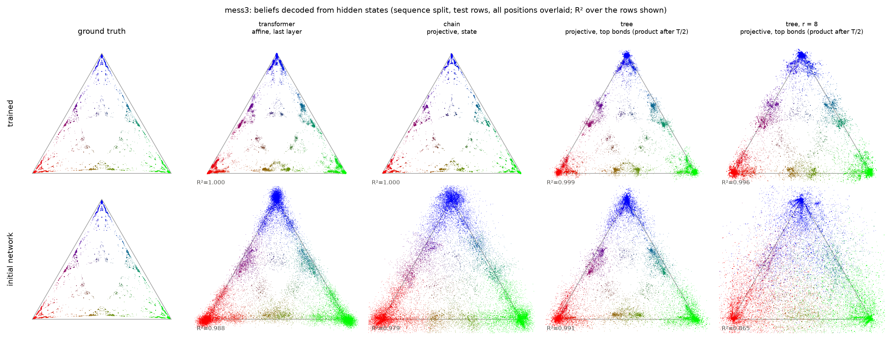
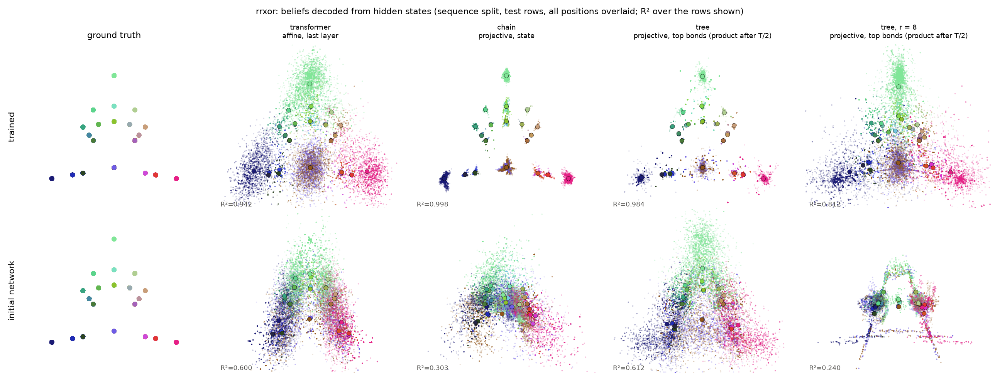
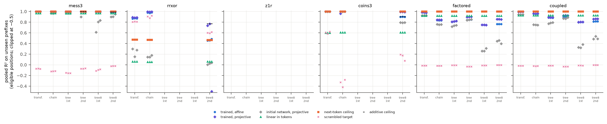

# Belief-state geometry of hidden Markov processes in a transformer, a chain and a tree tensor network

The pre-set reproduction criterion for the transformer result of Shai et al. (2024) is met on both of their processes, and the tensor networks carry the belief on some processes and not on others. On RRXOR the criterion shows that the transformer's last layer identifies the belief state at two positions, not that it lays out the belief geometry. All 72 runs (6 processes × 4 models × 3 seeds) trained and were analyzed, every (process, model) cell learned, and nothing was censored. Scores are R² on prefixes the probe never saw, and a probe "beats" a control when it leaves at most half of the control's unexplained variance.

- **H1, transformer reproduction: supported, 2 of 2 cells.** An affine probe on the last layer recovers the belief with R² 0.9997 on Mess3 (initial network 0.976–0.978, linear readout of the tokens 0.967) and 0.865–0.872 on RRXOR (initial network 0.25–0.29, tokens 0.063, best function of the exact next-token distribution 0.474), in all three seeds.
- **H2, chain, projective probe: partly supported, 2 of 4 judged cells.** It passes on Mess3 (0.9999) and on RRXOR (0.994–0.997 against a next-token ceiling of 0.469). It fails on the two product processes. On `factored` the chain's state gives the 9-state joint belief worse than the tokens do (0.844–0.845 against 0.919). On `coupled` it scores above the tokens (0.956–0.960 against 0.928) but leaves 0.040–0.044 unexplained where the halving rule allows 0.036.
- **H3a, tree, first half: partly supported, 2 of 6 judged cells.** Mess3 passes at both bond dimensions (0.999 at r = 32, 0.992–0.994 at r = 8). `factored` and `coupled` fail at both: the top bonds score 0.75–0.89 for the joint belief, below the token readout at 0.92–0.93.
- **H3b, tree, second half, product of the top bonds: partly supported, 1 of 2 judged cells.** The mixture of three coins passes (0.991–0.994 at t = 11–15, against 0.912–0.916 for the bonds without their product; 0.994–0.998 against an exact additive ceiling of 0.897 at t = 14 and 15). RRXOR fails: 0.733 and 0.767 in two seeds and −4.55 in the third, against an additive ceiling of 0.772.

**The RRXOR cells, which carry the claim about beliefs beyond the model's own prediction, split 2 to 1.** The transformer and the chain both recover the belief far above what the next-token distribution determines. The r = 8 tree fails: in the two seeds without a numerical failure its product probe is above the next-token ceiling (0.733 and 0.767 against 0.466), but below 0.8 and no better than the best sum of a function of the left half and a function of the right prefix (0.772). Two qualifications apply to the two passes. RRXOR has 17 distinct beliefs per position, and an affine probe fits a random vector per belief state with R² 0.81 for the transformer (against 0.865–0.872 for the belief) and 0.88–0.92 for the chain (against 0.971–0.983 affine and 0.994–0.997 projective for the belief). So these cells show that the hidden state identifies the belief state, not that it lays the beliefs out in their simplex geometry. The transformer cell also rests on two positions, t = 14 and 15.

**On the product processes the transformer, the chain and the r = 32 tree carry the two factor marginals well beyond the token readout, the r = 8 tree only slightly beyond it, and only the transformer carries the joint (H4, descriptive).** The marginals score 0.992–1.000 in the transformer, the chain and the r = 32 tree, and 0.97–0.99 in the r = 8 tree. The joint scores 0.98–0.995 in the transformer and 0.75–0.96 in the tensor networks.

The run took 8 h 57 min on one RTX A6000 and cost about $6.18, against a budget raised by the user to $15 during the run.

## Evidence

*Mess3, seed 0 ([`figures/triangle_mess3.pdf`](figures/triangle_mess3.pdf)). Each point is one test sequence at one position, placed by the probe's output and colored by the true belief; the top row is the trained model and the bottom row the initial network. The R² under each panel is over the rows shown, on the sequence split, so it is not the held-out-prefix score used for the verdicts. What to notice: the initial networks already reproduce the coarse triangle (0.87–0.99), because on Mess3 the belief is nearly linear in the tokens, and training sharpens it into the fractal.*

*RRXOR, seed 0 ([`figures/pca_rrxor.pdf`](figures/pca_rrxor.pdf)), same layout on the top two principal components of the true beliefs, with one outlined centroid per distinct belief. The chain's clusters are tight around the true beliefs and the transformer's are broad. All panels use the sequence split, in which test sequences share their prefixes with fit sequences, so the R² under a panel is not a held-out-prefix score. That matters most for the r = 32 tree (0.984 here), which has no eligible held-out position for this probe on RRXOR.*

*Pooled R² on unseen prefixes for every cell that has eligible positions ([`figures/summary.pdf`](figures/summary.pdf)); three points per marker are the three seeds, and values below −0.5 are drawn at −0.5. "tree 1st" and "tree 2nd" are the first and second half of the sequence for the r = 32 tree, "tree8" the same for r = 8. Per-position curves are in [`figures/positions.pdf`](figures/positions.pdf).*

### Verdicts against the pre-set criteria

Each row is one judged cell; a cell passes only if every clause holds in all three seeds. Numbers are the range over the three seeds of the R² pooled over the cell's eligible positions. The worked rule for one case: on RRXOR the chain's projective probe leaves 1 − 0.994 = 0.006 unexplained in its worst seed, and the next-token ceiling leaves 1 − 0.469 = 0.531, so 0.006 ≤ 0.5 × 0.531 and the clause passes.

| Hypothesis | Cell (positions pooled) | Probe | Initial network | Token readout | Ceilings | Verdict |
|---|---|---|---|---|---|---|
| H1, affine on the last layer | Mess3, transformer (t = 8–15) | 0.9997 | 0.976–0.978 | 0.967 | next-token 1 | pass |
| H1 | RRXOR, transformer (t = 14, 15) | 0.865–0.872 | 0.251–0.288 | 0.063 | next-token 0.474 | pass |
| H2, projective on the chain's state | Mess3 (t = 6–15) | 0.9999 | 0.966–0.977 | 0.967 | next-token 1 | pass |
| H2 | RRXOR (t = 11–15) | 0.994–0.997 | 0.145–0.177 | 0.056 | next-token 0.469 | pass |
| H2 | `factored` (t = 3–15) | 0.844–0.845 | 0.754–0.760 | 0.919 | next-token 1 | fail: tokens, initial network |
| H2 | `coupled` (t = 3–15) | 0.956–0.960 | 0.745–0.753 | 0.928 | next-token 1 | fail: tokens |
| H3a, projective on the top bonds, t ≤ 8 | Mess3, r = 32 (t = 7, 8) | 0.999 | 0.971–0.973 | 0.966 | | pass |
| H3a | Mess3, r = 8 (t = 6–8) | 0.992–0.994 | 0.613–0.834 | 0.966 | | pass |
| H3a | `factored`, r = 32 (t = 4–8) | 0.806–0.824 | 0.716–0.744 | 0.919 | | fail: tokens, initial network |
| H3a | `factored`, r = 8 (t = 3–8) | 0.747–0.750 | 0.257–0.309 | 0.919 | | fail: below 0.8, tokens |
| H3a | `coupled`, r = 32 (t = 4–8) | 0.886–0.891 | 0.772–0.793 | 0.928 | | fail: tokens, initial network in 2 of 3 seeds |
| H3a | `coupled`, r = 8 (t = 3–8) | 0.7996–0.804 | 0.321–0.383 | 0.928 | | fail: tokens, below 0.8 in 1 of 3 seeds |
| H3b, projective on the bonds and their product, t > 8 | coins, r = 8 (t = 11–15) | 0.991–0.994 | 0.791–0.793 | 0.606 | bonds alone 0.912–0.916; additive 0.897 at t = 14, 15 (probe 0.994–0.998 there); token products 0.838 at t = 12–15 (probe 0.996–0.998) | pass |
| H3b | RRXOR, r = 8 (t = 13–15) | 0.733, 0.767, −4.554 | 0.003–0.038 | 0.063 | bonds alone 0.420–0.504; additive 0.772; next-token 0.466 | fail: below 0.8, additive ceiling |

Pooled verdicts under the pre-set rule (at least 75% of judged cells for "supported", at most 25% for "not supported"): H1 supported (2 of 2), H2 partly supported (2 of 4), H3a partly supported (2 of 6), H3b partly supported (1 of 2).

Cells that were not judged, and why:

- **Coins, chain: control saturated.** The identity-init chain already scores 0.998–0.999 with the projective probe, so the cell leaves the H2 count, as the definition anticipated. The trained chain scores 0.961, 0.999 and 0.999.
- **Zero-one-random (`z1r`): no eligible position in any model.** It has too few distinct prefixes, so it is figure-only ([`figures/triangle_z1r.pdf`](figures/triangle_z1r.pdf)).
- **RRXOR and coins, tree, first half:** at most 111 distinct fit prefixes at t ≤ 8, below the 170 that the r = 8 top bonds need and the 650 that the r = 32 ones need.
- **Tree at r = 32, second half:** no H3b cell by design. Mess3 has the positions, but its additive ceiling is 0.999 there, and RRXOR and coins never reach the 10,890 fit prefixes that 1,088 product features need.
- **Mess3 at r = 8, second half:** eligible at t = 9–15, but the additive ceiling is 0.990, so there is nothing for the product to add. The product probe scores 0.996.
- **`factored` and `coupled`, tree, second half:** the product features are eligible at t = 9–15 at both bond dimensions, but the exact additive ceiling cannot be computed for 9 tokens (its table has 9^t entries), so the definition sets no H3b cell there. The scores are in the product-process section below.

How the passes on Mess3, coins, `factored` and `coupled` should be read: on those four processes the belief is a function of the exact next-token distribution (their next-token ceiling is 1), and every model's probed features contain its prediction. A pass there shows how the prediction is laid out in the hidden state. Only RRXOR separates the belief from the prediction.

### The RRXOR cells

| Model | Positions | Probe | Affine probe | Next-token ceiling | Scrambled target | Initial network |
|---|---|---|---|---|---|---|
| Transformer, last layer (affine is the criterion) | t = 14, 15 | 0.883–0.891 (projective) | 0.865–0.872 | 0.474 | 0.806–0.812 | 0.251–0.288 |
| Chain, state (projective is the criterion) | t = 11–15 | 0.994–0.997 | 0.971–0.983 | 0.469 | 0.878–0.919 | 0.145–0.177 |
| Tree r = 8, top bonds and product | t = 13–15 | 0.733, 0.767, −4.554 | 0.718–0.748 | 0.466 | 0.593–0.613 | 0.003–0.038 |

- **The chain's code is projective here.** The projective probe leaves 0.003–0.006 unexplained and the affine probe 0.017–0.029, which is the pre-set condition for the label "projective", in all three seeds. One projective map shared by all positions scores 0.993–0.997.
- **The scrambled-target score is high for the transformer and the chain.** The scrambled target assigns an independent random 8-vector to each distinct belief of a position and fits the same affine probe to it. With 17 distinct beliefs per position, a state that separates the 17 belief states fits any labelling. So these two passes establish that the state identifies the belief state on unseen prefixes, which the next-token distribution does not (0.47). They do not test the geometry, which Mess3 does.
- **The r = 8 tree fails on substance, and one seed also fails numerically.** In the two seeds without the blow-up, the product probe is below the additive ceiling (0.733 and 0.767 against 0.772), and the affine probe on the same features is lower still (0.718 and 0.723; 0.748 in the third seed). In the third seed the projective fit returns −15.3 at t = 13, where the affine fit scores 0.751. The projective probe divides by a fitted linear form, and the fit only requires that form to keep its sign on the fit rows, so on new prefixes it can pass close to zero; the denominators themselves were not inspected. This is the only such failure at a position that enters a verdict; at positions with too few prefixes to be eligible it happens often (82 further position-level scores below zero across the 72 runs, counting the fits to the full belief at the final checkpoint).

### Product processes (H4, no verdict)

`factored` is two independent Mess3 processes, so its 9-state joint belief is the outer product of the two factors' beliefs. `coupled` adds a dependence of the second factor on the first, so there the marginals do not determine the joint. Each model's primary probe was fit to the joint belief and to the two factor marginals at the same positions.

| Model | `factored`: joint | `factored`: marginals | `coupled`: joint | `coupled`: marginals |
|---|---|---|---|---|
| Transformer, last layer | 0.980–0.986 | 1.000 | 0.995 | 0.999 |
| Chain, state | 0.844–0.845 | 0.999–1.000 | 0.956–0.960 | 0.997–0.998 |
| Tree r = 32, top bonds, t ≤ 8 | 0.806–0.824 | 0.998 | 0.886–0.891 | 0.992–0.993 |
| Tree r = 8, top bonds, t ≤ 8 | 0.747–0.750 | 0.985–0.987 | 0.7996–0.804 | 0.971 |
| Linear readout of the tokens | 0.919 | 0.971–0.972 | 0.928 | 0.963–0.964 |

Entries are the projective probe, range over three seeds. Every model scores above the token readout on the marginals; the transformer, the chain and the r = 32 tree halve its error, and the r = 8 tree does not (0.971 against 0.963 on `coupled`; 0.985–0.987 against 0.972 on `factored`, halved in one seed of three). On the joint only the transformer halves the token readout's error; the chain scores above it on `coupled` without halving, and every other tensor-network cell is below it. The tensor networks' joint scores sit below the token readout on `factored`, where the joint is a product of two quantities that the state holds almost exactly. An affine or projective probe cannot form that product, so this table shows that the joint is less readable from the tensor networks, linearly or projectively, than from the transformer, and in every cell but the chain on `coupled` less readable than from the raw tokens. It does not show that the joint is absent from the state. In the second half the tree's product features help but do not close the gap: 0.895–0.902 for the joint on `factored` at r = 32 against 0.998 for the marginals.

### Exploratory: the trees on RRXOR outside the judged positions

This was looked at after the verdicts and is outside the criteria. The r = 32 tree has no eligible position for the product features on RRXOR (923 to 2,384 distinct fit prefixes at t = 13–15 against the 10,890 required). The scores on unseen prefixes were still computed. The affine probe on the top bonds and their product scores 0.934–0.982 at t = 13–15 in the three seeds, against an additive ceiling of 0.743–0.803, a next-token ceiling of 0.449–0.480 and 0.075–0.255 for the initial network. The scrambled target scores 0.816–0.924 there. The projective probe on the same features is unstable (scores from −737 to 0.947 at those positions). So the larger tree may carry the RRXOR belief in the product of its top bonds, in a form the affine probe reads; the eligibility rule exists to guard against exactly this many features on this few prefixes, and no criterion was set for it.

Two further numbers bear on the same question. The r = 32 tree's top bonds without their product are eligible at t = 13–15 and score 0.731–0.741 with the projective probe, against the next-token ceiling of 0.466 and below the additive ceiling. And the r = 8 tree does better at earlier positions than at the judged ones: at t = 10–12, which have 219, 331 and 572 fit prefixes against the 810 required, its product projective probe scores 0.82–0.97 on unseen prefixes against additive ceilings of 0.667, 0.657 and 0.709. In the seed with the blow-up at t = 13, the other two judged positions score 0.744 and 0.840 against ceilings of 0.768 and 0.803.

## How it was done

The full method is in [`EXPERIMENT.md`](EXPERIMENT.md).

- **Processes**, context 16 tokens: Mess3 (3 states, 3 tokens, x = 0.05, α = 0.85, as in Shai et al.), RRXOR (two random bits then their XOR; 5 states), zero-one-random, a mixture of three biased coins, `factored` (two independent Mess3 processes, 9 joint states) and `coupled` (the same with a dependence between the factors).
- **Models**, three seeds each: a 4-layer transformer (d = 128, 796,000 to 798,000 parameters), a chain (matrix product state, r = 32, about 33,000 parameters) read causally, and a tree tensor network at r = 32 (462,000 to 473,000 parameters) and at r = 8 (7,700 to 9,000) trained on masked prefixes. All were trained on next-token cross-entropy with fresh sequences, Adam, 30,000 updates of batch 512.
- **Target**: the exact belief η_t = P(state | x_<t) from filtering, on 60,000 analysis sequences.
- **Probes**, fit separately at each position t: affine, b̂ = W a + c, and projective, b̂ = q/Σq with q = W a + c. The features are the transformer's last-layer residual, the chain's state after t tokens, and the tree's two top bonds, with their outer product added for the second-half probe.
- **Held-out prefixes**: at each position the distinct prefixes are split at random into a fit half and a test half. A position is eligible for a feature set when it has at least 10 × (features + 1) distinct fit prefixes.
- **Controls**: the same probe on the initial network; an affine probe on the one-hot prefix; the next-token ceiling E[belief | next-token distribution]; for the tree's second half the exact population ceiling of f(left half) + g(right prefix); a scrambled target; shuffled labels.
- **Learned**: excess test loss below min(0.02, half the excess of the best predictor that sees only the last two tokens). The largest excess in any run was 0.0044 nats/token (RRXOR, tree at r = 8, gate 0.02); on Mess3, `factored` and `coupled`, where the gate is 0.007–0.008, the largest was 0.0026.

## How it was checked

- **Correctness checks before training.** `studies.hmm.checks` passed 29 of 29 on the worker (kernels, the Mess3 matrix of Shai et al., the 36 RRXOR belief states, filtering against enumeration, the sampler, the short-context predictors; [`results/checks.json`](results/checks.json)). `hmm_check.py` passed 7 of 7: causality of each model, a hand-built exact chain (projective R² 1.000000, affine 0.3231), a hand-built exact tree, the additive ceiling against a sampled fit (0.9701 against 0.9701), and the next-token ceiling.
- **Run health.** 72 of 72 runs finished 30,000 updates with status `finished`; none diverged, was skipped or failed analysis. Three of the eight CPU analysis steps ended with exit code 141. Those steps passed the list of pending runs through `head -n 8` to keep a batch to eight runs, and under `pipefail` the listing loop is killed by SIGPIPE once `head` has its eight lines. The eight analyses of each of those steps ran to the end: all 72 analysis logs are complete and contain no error.
- **Shuffled labels.** The pooled R² with shuffled fit labels is between −0.011 and 0.005 in every run, under the 0.05 limit.
- **Fact-check.** A fact-checking pass compared about 290 claims here with `results/summary.json`, the per-run analysis files, the run logs, the worker's job records and the definition. It found 12 that did not fully hold, all corrected here. The largest: the chain scores above the token readout on the `coupled` joint and fails only the halving rule, where the draft said "no better than the tokens"; the r = 8 tree does not halve the token readout's error on the factor marginals, where the draft said every model beats it; the r = 8 tree on RRXOR is above the next-token ceiling in two seeds and fails on the 0.8 threshold and the additive ceiling; and keeping the 4-hour rule would have left 56 finished runs and censored all three r = 32 cells of H3a, not two. The pass also asked for the three non-zero exit codes, the r = 8 tree's scores at ineligible positions and the r = 32 tree's eligible top-bond scores on RRXOR to be reported, and they now are. The research note [`NOTE.md`](NOTE.md) had its own pass, which checked about 120 claims and the derivations against the code and reworded 11. The largest there: the next-token ceiling on RRXOR is 0.45–0.60 on held-out prefixes at t = 5–15, where the note had quoted the definition's pre-run 0.45–0.57, and the hand-built tree check covers four positions of an 8-token tree, not every position. Neither write-up was fact-checked again after its corrections were applied.

## Not yet checked

- **Whether the r = 8 tree's failure on RRXOR is a capacity limit.** The exploratory numbers for r = 32 suggest it is, but they sit at ineligible positions. A larger analysis set would not make them eligible: the 60,000 analysis sequences contain 4,868 distinct RRXOR prefixes at t = 15, of which 2,384 are on the fit side, and the r = 32 product features need 10,890. A longer context (T = 32) has more distinct prefixes and would give eligible positions for a larger r. That needs new training runs, an estimated one to two GPU hours for three seeds. The reading of H3b on RRXOR depends on it.
- **A projective probe that cannot change sign on new rows.** Constraining the denominator to be positive (for example q = exp of an affine form, or a softmax probe) would remove the blow-ups. It needs no new training, only a rerun of the analysis on the saved checkpoints (an estimated half hour). The −4.55 seed in H3b depends on it; the verdict does not, since the other two seeds fail without it.
- **Whether the tensor networks hold the joint belief nonlinearly.** A probe with products of state coordinates on the chain would test it (r = 32 gives 528 distinct products, so 560 features and 5,610 fit prefixes, which `factored` has from t = 5). No new training; the H2 failures on `factored` and `coupled` would be read differently if it passed.
- **RRXOR at more positions for the transformer.** Its verdict rests on t = 14 and 15, because the 128-dimensional last layer needs 1,290 fit prefixes. A probe on a low-rank projection of the layer would make more positions eligible.

## Judgement calls

- **The recorded result is "inconclusive".** The tool takes one of supported, not supported, inconclusive or failed, and the pre-set verdicts are one "supported" and three "partly supported". "Supported" would overstate H2 and H3, so the mixed outcome is recorded as inconclusive with the per-hypothesis verdicts in the note.
- **No STOP at the 4-hour mark, and a longer time cap.** Training took 6 h 11 min, against the 3–3.5 h estimated, because every arm ran slower than estimated with four runs sharing the GPU: about 20 minutes per transformer run (34 for four of them) against 10, 14–17 minutes per r = 8 tree and chain run against 5–10, and 28–30 minutes for most r = 32 tree runs against 17. The definition would have skipped most of the r = 32 tree arm at 4 h. The user raised the budget to $15 and allowed the cutoff to move, and the planning session extended the worker's cap from 8 h to 14:00 UTC. All 72 runs then ran. Had the rule been kept, 56 runs would have finished, fewer than the 62 the definition requires, so the run would have counted as failed, and all three r = 32 cells of H3a would be censored: `factored` and `coupled` untrained, Mess3 one seed short.
- **CPU analysis during training ran one at a time on 3 threads.** The worker's container had 7.65 cores, and the two 8-thread analyses the definition specified halved the training speed during the first batch. This changes when analyses ran, not what they compute. Four transformer runs (RRXOR seeds 1 and 2, coins seeds 0 and 1) trained at 68.5 ms per update during that batch; their results are unaffected.
- **CPU analysis batches were limited to eight runs** from the fifth batch on, by passing the list of pending runs through `head -n 8`, so that a batch took about an hour and the GPU step could start as soon as training ended. This is recorded in the definition's Amendments after the fact. It caused the three exit codes of 141 described above and changed no result.
- **PNG copies of the figures** were added after the run by `hmm_figures_png.py`, which calls the functions of `hmm_plot.py` on the saved results. The PDFs are unchanged.
