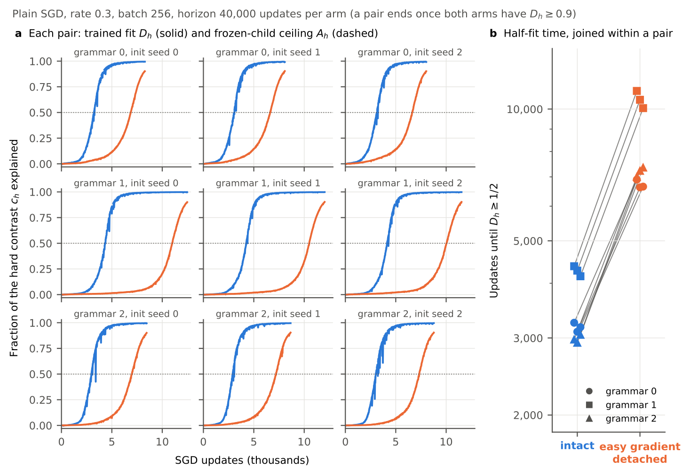
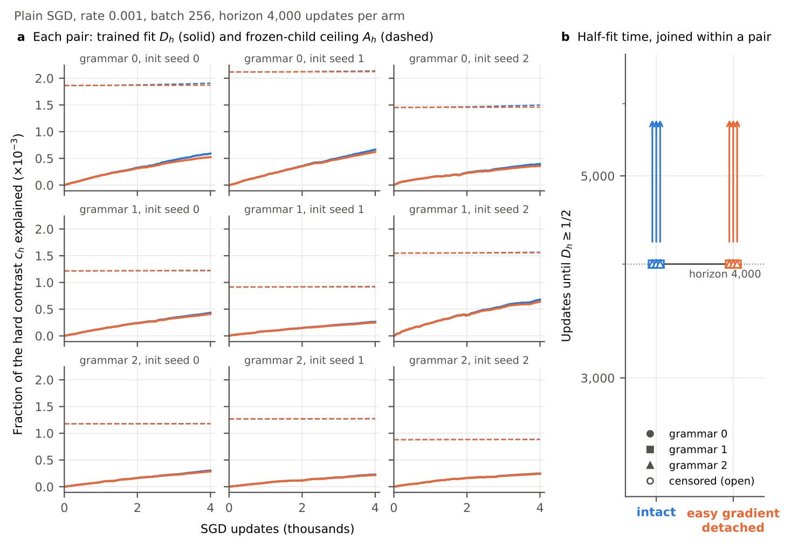
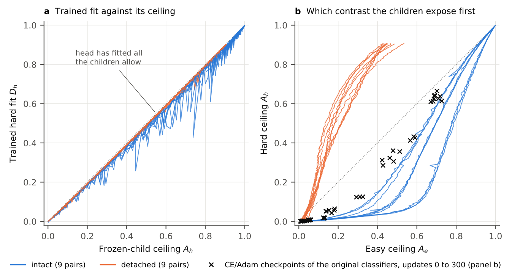
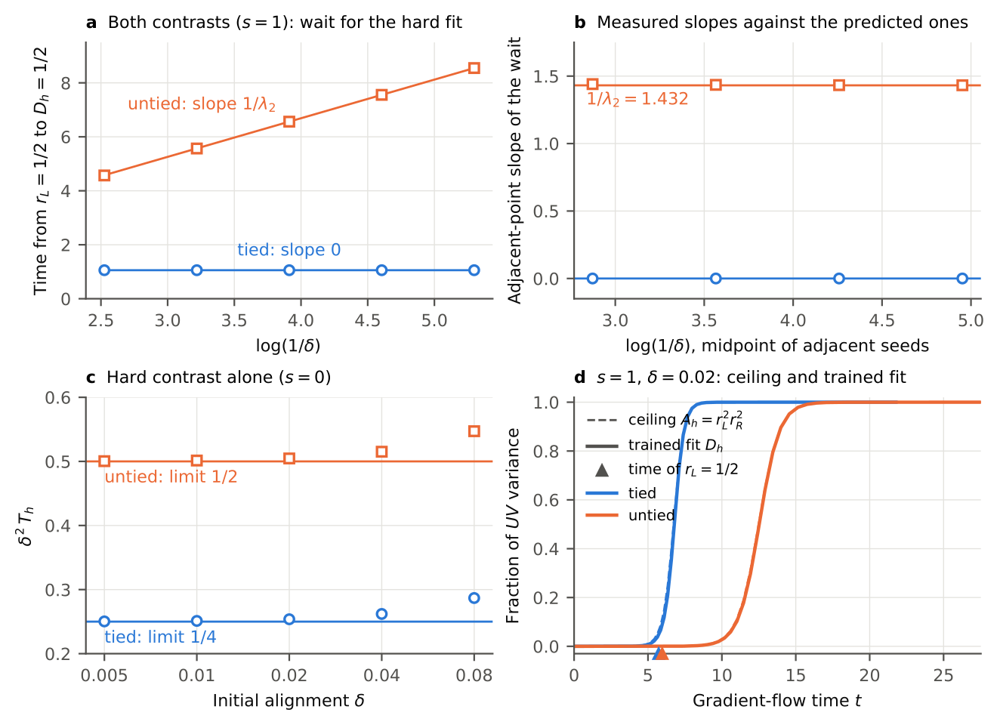
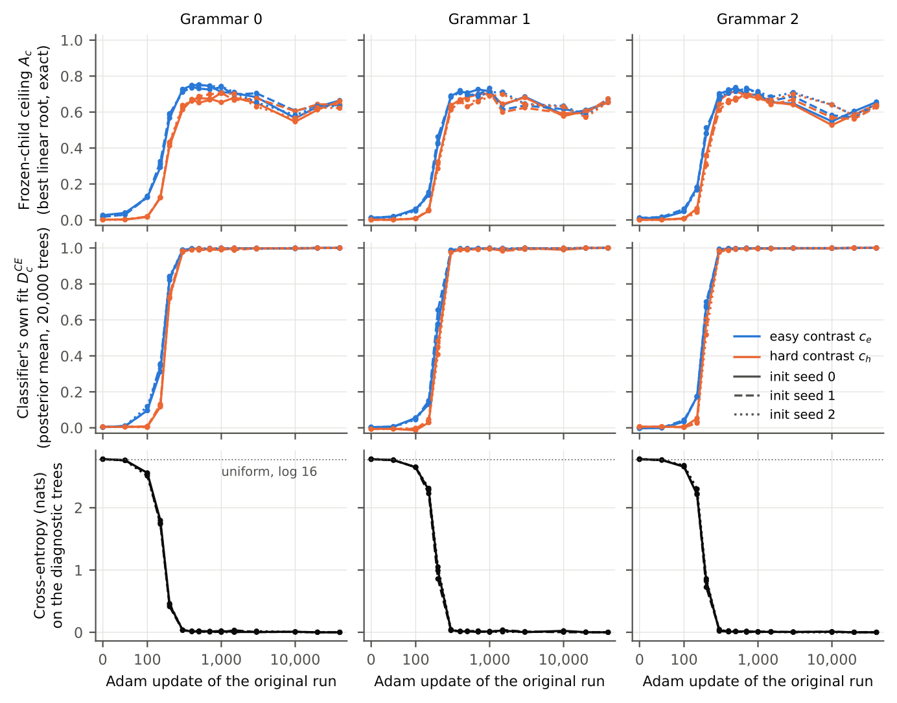

# Does the easy root contrast's gradient speed up the hard one?

Yes, in the two-head regression protocol tested here, and by a factor of about 2.4. Cutting only the path by which the easy contrast's error reaches the lower cores, while its head keeps training and every forward prediction stays the same, delays the hard contrast's half fit from a median of 3,175 SGD updates to 7,225. The per-pair ratio of the two times is 2.41 at the median and lies between 2.09 and 2.51 in all nine matched pairs (three grammars, three initializations each). The intact arm is first in nine of nine pairs, no arm is censored and none went non-finite. In both arms the trained head reaches half fit within 75 updates of the moment the frozen-child ceiling does, so the delay sits in what the lower cores expose and the readout is not what is slow. The detached arm still learns the hard contrast, so the easy gradient is a help and not a requirement.

That answer comes from an amended protocol. The protocol as written used learning rates up to 0.001 for 4,000 updates, and at those rates neither arm of any pair moves the hard fit above 0.0007, so all eighteen arms are censored and the planned endpoint says nothing. The amended pilot rates, pilot length, horizon (40,000 updates) and selection rule were committed after exploratory runs on the pilot pair and before any evaluation pair was started; the rule then chose 0.3 on the pilot pair before any evaluation pair ran at an amended rate. The amendments are A3 to A5 in [EXPERIMENT.md](EXPERIMENT.md).

*Left: each panel is one pair. Solid lines are the trained hard fit $D_h$ and dashed lines the frozen-child ceiling $A_h$, for the intact arm (blue) and the arm with the easy gradient detached (orange); the dotted line is the endpoint's level 1/2. Right: the first evaluation with $D_h\ge1/2$ in each arm, joined within a pair (n = 9 pairs, log scale). Vector version: [figures/intervention-extended.pdf](figures/intervention-extended.pdf).*

| grammar, init seed | updates to half fit, intact | detached | ratio | easy ceiling $A_e$ at half fit, intact | detached |
|---|---|---|---|---|---|
| 0, 0 | 3,250 | 6,900 | 2.12 | 0.80 | 0.19 |
| 0, 1 | 3,100 | 6,625 | 2.14 | 0.80 | 0.16 |
| 0, 2 | 3,175 | 6,650 | 2.09 | 0.80 | 0.19 |
| 1, 0 | 4,375 | 11,000 | 2.51 | 0.72 | 0.17 |
| 1, 1 | 4,275 | 10,500 | 2.46 | 0.71 | 0.14 |
| 1, 2 | 4,150 | 10,050 | 2.42 | 0.71 | 0.16 |
| 2, 0 | 2,975 | 7,000 | 2.35 | 0.66 | 0.23 |
| 2, 1 | 2,925 | 7,225 | 2.47 | 0.68 | 0.23 |
| 2, 2 | 3,050 | 7,350 | 2.41 | 0.67 | 0.22 |

Half-fit times are first scheduled evaluations (every 25 updates), so each is bracketed by the previous evaluation 25 updates earlier. The spread across initializations of one grammar is small next to the spread across grammars: grammar 1 is slower in both arms and has the largest single ratio (2.51), though grammar 2's ratios (2.35 to 2.47) overlap grammar 1's (2.42 to 2.51).

The endpoint is the first crossing, as specified in advance. In seven of the nine intact arms $D_h$ then falls back below 1/2 for one to four evaluations before staying above it, at most 450 updates after the first crossing; no detached arm does this. Measured to the evaluation from which $D_h$ stays at or above 1/2, the per-pair ratio is 2.26 at the median (2.04 to 2.51), so the conclusion does not depend on which crossing is used.

## What each part establishes

The study has three parts that support different kinds of claim, and they should not be merged.

- **The planted sweep checks the theorem.** It integrates the planted model's own gradient flow and compares event times with the derived laws. It is a numerical check of a calculation and says nothing about depth-four networks.
- **The intervention tests transfer to the three fixed grammars.** It is a causal statement about one path, the easy error's gradient into the lower cores, under one optimizer (plain SGD on a summed two-target squared loss) at one initialization scale. Three grammars do not support a statement about random grammars in general.
- **The checkpoint readout is observational.** It reads the two contrasts out of classifiers that were trained earlier with cross-entropy and Adam. It shows which contrast becomes linearly available first, and cannot say what drove the lower cores.

## The intervention

### Setup

Each pair starts both arms from the stored step-0 lower weights of one of the original width-16 root-classification runs (leaf embeddings and fusion cores; the 16-way root is discarded) and gives them two zero linear heads $w_e,w_h$ on the root's 256 product features $Z=z_{\rm left}\otimes z_{\rm right}$. Both arms minimize $\tfrac12\mathbb E[(w_e^\top Z-c_e(Y))^2+(w_h^\top Z-c_h(Y))^2]$ by plain SGD on the same stream of 256-tree batches. The contrasts are functions of the root label with mean 0 and variance 1, chosen from each grammar's top rule table alone: $c_e$ is the contrast that an additive function of the two true child symbols explains best, and $c_h$ the one it explains worst.

| grammar | additive fraction of $c_e$ | of $c_h$ | eigenvalue gap at $c_e$ | at $c_h$ |
|---|---|---|---|---|
| 0 | 0.928 | 0.064 | 0.081 | 0.032 |
| 1 | 0.822 | 0.108 | 0.040 | 0.076 |
| 2 | 0.909 | 0.063 | 0.068 | 0.060 |

The two arms differ in one line. The intact arm differentiates both loss terms through $Z$. The detached arm computes the easy prediction as $w_e^\top\operatorname{stopgrad}(Z)$, so the easy head still fits the current features but its error no longer moves the lower cores. Since nothing about the easy head then reaches the lower cores or the hard head, the detached arm's hard-contrast trajectory is the one that training on the hard contrast alone would give.

Two quantities are tracked every 25 updates, both exactly, from the population moments of $Z$ in float64 (no sampling):

- the **frozen-child ceiling** $A_h=1-\min_w\mathbb E[(c_h(Y)-w^\top Z)^2]$, the most a refitted linear root could explain with the current lower cores frozen;
- the **trained fit** $D_h=1-\mathbb E[(c_h(Y)-w_h^\top Z)^2]$ of the actual head, which can never exceed $A_h$.

The endpoint for an arm is the first evaluation with $D_h\ge1/2$.

### The protocol as written: every arm censored

The written protocol pilots rates $10^{-4}$, $3\times10^{-4}$ and $10^{-3}$ for 300 updates and trains each arm for 4,000. Its pilot chose $10^{-3}$, at which the mean hard squared error after 300 updates was 0.99996 (1 is no fit). After 4,000 updates at that rate the hard fit is between 0.0002 and 0.0007 in every arm of the nine pairs, under ceilings of 0.0009 to 0.0021 that are within 0.0001 of their initial values. All 18 arms are censored ($T>4{,}000$), there were no non-finite runs, and the difference of capped half-fit times is zero in every pair by construction, which says nothing about the order of the arms. The horizon was too short by a wide margin: 4,000 updates at $10^{-3}$ is 4 units of rate times updates, and half fit in the extended runs takes 880 to 1,310 such units in the intact arm.

*Same layout as the first figure, for the protocol as written. The vertical axis is in units of $10^{-3}$: nothing approaches the level 1/2, so every half-fit time is censored at 4,000 (open markers with arrows). [figures/intervention-as-written.pdf](figures/intervention-as-written.pdf)*

### The extended protocol

The extended protocol changes the pilot rates to $\{0.01,0.03,0.1,0.3,1\}$, the pilot length to 4,000 updates and the horizon to 40,000 updates, and ends a pair once both arms have $D_h\ge0.9$. Everything else is as written. The pilot rule (among rates whose population loss stays finite and below 10, the smallest mean final hard error over the two arms) chose 0.3.

The result is the first figure and table: half fit after a median of 3,175 updates intact (range 2,925 to 4,375, n = 9) and 7,225 detached (6,625 to 11,000), a paired difference of 4,300 updates at the median (3,475 to 6,625) and a ratio of 2.41 (2.09 to 2.51).

### The trained fit tracks its ceiling

*(a) Trained hard fit against its frozen-child ceiling at every evaluation of all 18 arms; the dotted diagonal is a head that has fitted everything the current children allow. (b) Hard ceiling against easy ceiling along training, with the first six checkpoints (updates 0 to 300) of the nine original cross-entropy classifiers as crosses. [figures/intervention-ceilings.pdf](figures/intervention-ceilings.pdf)*

Panel (a) answers whether the delay is a slow readout. It is not: the ceiling $A_h$ crosses 1/2 between 25 and 75 updates before the trained fit does in the intact arms and 25 to 50 updates before in the detached arms, against a delay between arms of thousands of updates. The median gap $A_h-D_h$ over a run is below 0.006 in every arm. The intact arm's trained fit is more than 0.05 below its ceiling at 67 of its 3,460 evaluations, by up to 0.31 (2 of 3,460 detached, at most 0.07). These are the dips visible in the first figure, and they are what takes $D_h$ back under 1/2 after its first crossing. The ceiling falls by at most 0.02 at those evaluations, which points to the heads being thrown off and refitting, probably by SGD noise at this rate; the cause was not tested. In the three pairs rerun at rate 0.1 the largest gap is 0.05, against 0.15 to 0.31 for the same pairs at rate 0.3.

Panel (b) shows what the easy gradient changes below the root. With it, the easy contrast becomes linearly available first and the hard one follows: at the intact arm's half fit the easy ceiling is already 0.71 at the median (0.66 to 0.80). Without it, the lower cores build what the hard contrast needs and little else: at the detached arm's half fit the easy ceiling is 0.19 (0.14 to 0.23), and it is still between 0.43 and 0.53 when that arm stops at $D_h=0.9$. So on these grammars the hard contrast can be half fitted from a representation that exposes under a quarter of the easy contrast, and fitted to 0.9 from one that exposes about half of it. This differs from the planted model, where the hard target cannot be fitted at all without the child feature that the easy target teaches.

### The ratio does not depend on the rate between 0.1 and 0.3

The three pairs with init seed 0 were rerun at rate 0.1 with the same 40,000-update horizon.

| grammar, init seed | rate | updates to half fit, intact | detached | ratio | rate × updates, intact | detached |
|---|---|---|---|---|---|---|
| 0, 0 | 0.3 | 3,250 | 6,900 | 2.12 | 975 | 2,070 |
| 0, 0 | 0.1 | 8,325 | 17,650 | 2.12 | 832 | 1,765 |
| 1, 0 | 0.3 | 4,375 | 11,000 | 2.51 | 1,312 | 3,300 |
| 1, 0 | 0.1 | 11,175 | 27,425 | 2.45 | 1,118 | 2,742 |
| 2, 0 | 0.3 | 2,975 | 7,000 | 2.35 | 892 | 2,100 |
| 2, 0 | 0.1 | 7,550 | 17,600 | 2.33 | 755 | 1,760 |

[figures/intervention-extended-lr0.1.pdf](figures/intervention-extended-lr0.1.pdf) shows these three pairs in the layout of the first figure.

The detached-to-intact ratio at rate 0.1 matches the one at rate 0.3 to within 0.07 in each pair (differences of 0.003, 0.060 and 0.022). The times themselves do not scale as one over the rate: measured in rate times updates, half fit comes 15 to 17% earlier at rate 0.1 than at rate 0.3. The pilot pair shows the same thing over a wider range. At rate times updates equal to 120, the intact easy fit is 0.175 at rate 0.03, 0.153 at rate 0.1 and 0.106 at rate 0.3. At equal rate times updates the larger rates are therefore behind the smaller ones, which suggests that minibatch SGD at these rates runs behind gradient flow. No gradient-flow run exists to compare with, so that is an inference, but either way the update counts above should not be read as flow times.

## The planted sweep

*(a) Time from left-child half alignment to hard half fit against $\log(1/\delta)$, with both targets trained; lines have the predicted slopes (0 tied, $1/\lambda_2$ untied) and are anchored at the smallest $\delta$, since the theorem leaves an $O(1)$ offset free. (b) Slopes between adjacent values of $\delta$. (c) $\delta^2T_h$ with the hard target alone, against the predicted limits. (d) Ceiling and trained fit at $\delta=0.02$; triangles mark left half alignment. All points are deterministic ODE solutions, so there are no error bars. [figures/planted-time-laws.pdf](figures/planted-time-laws.pdf)*

The planted model has four root classes encoded by two signs $(U,UV)$, with the left child carrying $U$ and the right child $V$; the easy target is $U$ and the hard target $UV$. Each child table starts at unit norm with alignment $\delta$ to its sign. The sweep integrates population gradient flow for tied or untied child tables, with the easy target present ($s=1$) or absent ($s=0$), at $\delta\in\{0.08,0.04,0.02,0.01,0.005\}$.

The four predictions hold at these finite $\delta$.

- **Tied, both targets.** The wait from left half alignment to hard half fit is 1.0571 at every $\delta$ (predicted: bounded; adjacent slopes are below $4\times10^{-5}$ in absolute value).
- **Untied, both targets.** The wait grows from 4.57 to 8.55, with adjacent slopes 1.4408, 1.4352, 1.4329 and 1.4321 against the predicted $1/\lambda_2=1.4317$.
- **Tied, hard target alone.** $\delta^2T_h$ falls from 0.287 to 0.2503 against the predicted limit 1/4.
- **Untied, hard target alone.** $\delta^2T_h$ falls from 0.547 to 0.5004 against the predicted limit 1/2.

With the easy target the hard half-fit time at $\delta=0.005$ is 9.0 (tied) or 16.8 (untied); without it, 10,013 or 20,016. That thousandfold gap is the planted prediction. The depth-four intervention found a factor of 2.4, at one initialization, and has no analogue of the $\delta$ sweep.

## The checkpoint readout

*Rows: the exact frozen-child ceilings $A_e$ (blue) and $A_h$ (orange); the fit $D_c^{\rm CE}$ of the classifier's own posterior-mean prediction of each contrast on 20,000 diagnostic trees; cross-entropy on the same trees. Columns are grammars and line styles the three initializations. Update 0 is drawn at the left edge of the log axis. [figures/checkpoint-readout.pdf](figures/checkpoint-readout.pdf)*

All 135 checkpoints of the nine original runs (width 16, cross-entropy, Adam, 15 saved updates each) were found and read; none is missing. They came from the published archive of the original experiment, whose `runs.tar` matches the sha256 in its manifest, and each file's hash is in the results.

Both contrasts are almost absent from the root's features at initialization: $A_h$ is between 0.0009 and 0.0021 and $A_e$ between 0.008 and 0.026. Both ceilings rise during the same window in which accuracy rises, updates 100 to 300, and the easy one leads: $A_e>A_h$ at all 54 checkpoints up to update 300, by a factor of 5.8 to 8.2 at update 100 and 2.4 to 3.9 at update 150. The lead closes quickly after that: the factor is 1.33 to 1.58 at update 200 and 1.06 to 1.18 at update 300, and from update 300 on the hard ceiling is at or above the easy one at 6 of the 90 checkpoints (all at update 1,500 or later). So the hard contrast's features are not waiting at initialization for a slow readout, and the order matches the intact arm of the intervention (the crosses in panel (b) of the ceiling figure lie on the intact side of the diagonal).

One property of the ceiling matters for reading it at trained checkpoints. From update 300 on, $A_h$ stays between 0.53 and 0.72 and $A_e$ between 0.55 and 0.75, although the classifiers reach test accuracy 1.000 on 50,000 trees and their own posterior-mean fit $D_h^{\rm CE}$ is above 0.97. One possible reason, not tested here, is that cross-entropy only needs the right logit to be largest while the multilinear features vary in scale from input to input, which a linear least-squares readout cannot absorb. Whatever the reason, $A_c$ measures linear, squared-error availability; it is a ceiling for a linear head and not for the classifier.

## How it was checked

- **Existing checks.** `studies.rhm.checks` (46 of 46), `population --check`, `losses --check` and `toy_check` passed before any new driver ran. Rerunning `toy_check` and `grammar_audit` reproduces the committed JSON to roundoff (differences at the 15th digit, from newer library versions), so the committed files were left as they were.
- **Contrast selection.** The extreme eigenvalues from the new `root_contrasts` equal the committed audit's `additive_fraction_min` and `max` to $10^{-15}$, both extreme eigenspaces are one-dimensional in all three grammars, and each returned vector reproduces its eigenvalue as a Rayleigh quotient.
- **The detach is a path intervention.** With identical parameters, non-zero heads and one batch, the two arms give identical losses and identical head gradients, and their lower-core gradients differ by the easy term's gradient to a relative $10^{-12}$ (`intervene --check`). This would have caught an implementation that dropped the easy label or froze part of the model.
- **Exact fits.** $D$ and $A$ from the moment formulas equal direct enumeration on a grammar with 16 legal strings to $10^{-12}$ and $10^{-10}$. In the real runs $D\le A$ holds at every evaluation of every arm in all three protocols (the largest $D-A$ is $-2.0\times10^{-5}$), the Gram matrix has full rank 256 everywhere, and a tenfold looser pseudoinverse cutoff changes no ceiling.
- **Planted flows.** The full-table velocities match autograd of the 256-string loss to $2\times10^{-16}$ at a generic point with non-zero readouts and unequal tables. Reduced and full-table integrations agree on every event time to $2.4\times10^{-7}$ at worst (on times near 20,000), and dividing both solver tolerances by four at the smallest $\delta$ (0.005, the only one rerun) moves no event time by more than $7.2\times10^{-8}$.
- **Checkpoint evaluation.** The recomputed diagnostic cross-entropy agrees with the value each original run logged at the same update to $1.4\times10^{-7}$, and the regenerated diagnostic trees are identical to the saved ones for all three grammars (compared inline; this comparison is not in a results file).
- **Rate.** The rate-0.1 rerun above. It changed how the times are described (not as flow times) and did not change the ratio.
- **Fact check.** An independent pass recomputed about 185 claims of this README from the result files. All 87 table cells held. It corrected 15 statements in the prose (among them the description of the rate-1 pilot arm, which recovered intermittently and did not stay at zero; the wording on when the amended rate was fixed; the wall-clock time, which omitted the discarded first round; and two explanations stated as fact that are now marked as untested) and added four things that were missing: the discarded first round, the intact arm's fit falling back under 1/2 after its first crossing with the ratio recomputed for the later crossing, the note on medians against per-pair ratios, and how quickly the easy ceiling's lead closes at the checkpoints.
- **Interactive page.** The browser integrator in `notes/child-feature-enabling/explorer/planted.js` reproduces all 60 saved planted event times to a relative $1.1\times10^{-10}$ (`explorer/check.js`, run with Node).
- **Provenance.** Every driver output (the planted sweep, the checkpoint readout, both pilots and all 21 pair files) records the commit it ran from and that no code a driver imports had uncommitted changes. The planted sweep, the checkpoint readout, both pilots and the nine extended pairs ran from `71c8c17`; the rate-0.1 pairs and the nine as-written pairs ran from `bdc976f`, which differs from it only in `plot.py` and `summary.py`. All evaluation pairs started from the stored step-0 checkpoints; the pilot pair (init seed 9) has no stored run and was rebuilt with `common.build`.

## Not yet checked

- **Whether it has to be the easy contrast.** The intact arm sends more gradient into the lower cores, not only a differently directed one: on single batches over the first 1,000 updates the easy term's lower-core gradient has about 3.5 times the norm of the hard term's and is nearly orthogonal to it (median cosine 0.01). A control that replaces $c_e$ by a second poorly additive contrast, with everything else the same, would show whether any second target helps as much. It would cost about what the extended runs did (under an hour of CPU) and the "easy teaches hard" reading depends on it.
- **Gradient-flow time.** The planted theorem is about population gradient flow, and SGD at rate 0.3 is slower per unit of rate times updates than at rate 0.1, so it probably runs behind the flow. The branch already has the exact population gradient of every core, so the same pairs could be run as deterministic gradient descent on the population loss; that would put the depth-four comparison on the theorem's clock.
- **Initialization scale.** The planted speedup diverges as the initial alignment shrinks. Only the identity initialization of the original runs was used, so there is no depth-four analogue of the $\delta$ sweep; the factor 2.4 could be larger or smaller at other scales.
- **More grammars.** Three fixed grammars, with a ratio that already differs between them (2.1 for grammar 0, 2.5 for grammar 1).
- **Cross-entropy and Adam.** The intervention uses a squared loss on two contrasts and plain SGD. Whether cutting one contrast's gradient slows the 16-way classifier under its original training is untested; the checkpoint readout is only compatible with it.
- **Late behaviour.** Pairs stop once both arms pass 0.9, so nothing is known about either arm far beyond that.

## Judgement calls

- **Running an amended intervention at all.** The written protocol's own outcome is reported in full and stands as all censored. The amended rates were chosen after exploratory runs on the pilot pair (grammar 0, init seed 9, which is not an evaluation pair), and the choice of what to change (rates, pilot length, horizon) was made knowing that rate 0.3 separated the arms on that pair. The evaluation pairs had not been run.
- **The pilot's choice of 0.3 was narrow.** Under the written selection rule, rate 1 was eligible and lost by a small margin (mean final hard error 0.526 against 0.514). At rate 1 the pilot's intact arm collapsed between updates 550 and 575, its easy fit falling from 0.17 to 0.00. The easy fit came back intermittently between updates 2,100 and 2,475 (up to 0.37) and was 0.00 again from 2,500 to the end, and the hard fit stayed below 0.01 after the collapse, while the detached arm of the same pilot reached half fit at update 2,800. Had the rule picked rate 1, the evaluation runs would probably have shown instabilities instead of the effect. The rule was not changed to exclude it.
- **Stopping pairs early (A5), and a discarded first round.** The first extended pair, started without an early stop, had both arms far past the endpoint by update 8,500 of 40,000 (hard fits 0.995 and 0.926). It was stopped near update 9,500 and discarded, and every extended and rate-0.1 pair was then run with a stop at $D_h\ge0.9$ in both arms; the endpoint is fixed before a pair can stop. That change of code meant everything was rerun from the new commit, so a first round of 17 minutes was stopped and overwritten: the planted sweep, the checkpoint readout, both pilots, five as-written pairs and that one extended pair. The runs are deterministic, and the first round's log lines agree with the saved results wherever both exist. One consequence for the order of events: the nine saved as-written pairs were the last thing run, after the extended and rate-0.1 pairs, although five of them had been completed once before any extended result existed. `run_all.sh` gives the order to reproduce in, which is not the order executed.
- **An added column in the readout (A2).** $D_c^{\rm CE}$ was not in the plan. Without it the plateau of the ceilings near 0.65 would read as the classifiers failing to learn the contrasts.
- **CPU on the coordinator.** The study is CPU float64 by design and produced the saved results in 66 minutes of wall-clock time as two parallel processes on the coordinator's two virtual CPUs (about 2 hours of process time). With the discarded first round the study used about 83 minutes of wall-clock time, not counting the exploratory pilot-pair runs. No pod was rented, so the study added no pod spend.

## Reproduce

[run_all.sh](run_all.sh) lists every command in order. The pieces:

| step | command (`python -m studies.rhm.child_feature_enabling.…`) | output |
|---|---|---|
| planted sweep | `planted` | `results/planted/planted.json` |
| checkpoint readout | `checkpoints --runs runs/rhm-dynamics` | `results/checkpoints/checkpoints.json` |
| intervention as written | `intervene --pilot`, then `intervene --pairs 0:0 … 2:2` | `results/intervention/` |
| extended | `intervene --pilot --rates 0.01 0.03 0.1 0.3 1.0 --pilot-steps 4000 --out …`, then `--pairs … --steps 40000 --stop-fit 0.9` | `results/intervention-extended/` |
| rate 0.1 | `intervene --pairs 0:0 1:0 2:0 --steps 40000 --stop-fit 0.9 --lr 0.1 --out …` | `results/intervention-extended-lr0.1/` |
| figures, tables | `plot`, `summary` | `figures/*.pdf`, `results/summary.json` |

Each pair file holds the per-evaluation columns of both arms (fits, ceilings, pseudoinverse rank, gradient norms and cosine on the next batch, lower-core displacement), the contrast vectors with their sign convention and eigenvalue gaps, the hash of the top rule table, the step-0 checkpoint's path and hash, the data seed $7{,}000{,}400+1000g+i$, the crossing with its bracketing evaluations, and the commit. Final weights of each arm are in the git-ignored `runs/child-feature-enabling/`. The checkpoints themselves are not in git: unpack the nine `root_m4_g{g}_r16_s{i}` folders from `runs.tar` of the published job `20261112-214354-rhm-dynamics-blghb2am5xkc6n` (sha256 `278cc20b…9817`) into `runs/rhm-dynamics/`.

Figures are PDFs in [figures/](figures/), drawn by [plot.py](plot.py) from the saved results only. The PNG files shown above are renders of those PDFs (`pdftocairo -png -r 200`), kept in `notes/child-feature-enabling/zulip/` for the [draft post](../../../notes/child-feature-enabling/zulip-post.md). The same folder has an interactive page, [explorer.html](../../../notes/child-feature-enabling/explorer.html), built by `explorer/build.py` from the saved pairs; it integrates the planted model in the browser and replays the intervention pairs. Software: Python 3.12.3, NumPy 2.5.4, SciPy 1.18.1, PyTorch 2.11.0 (CPU, float64).
