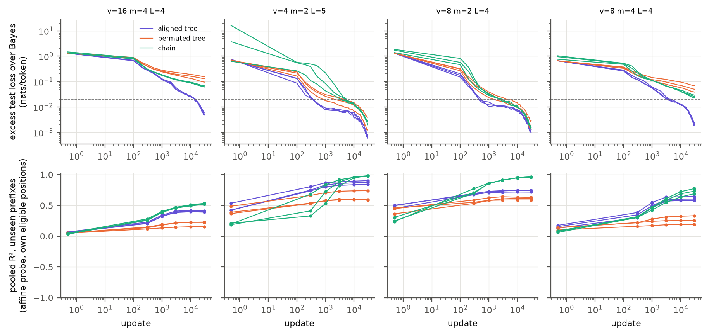
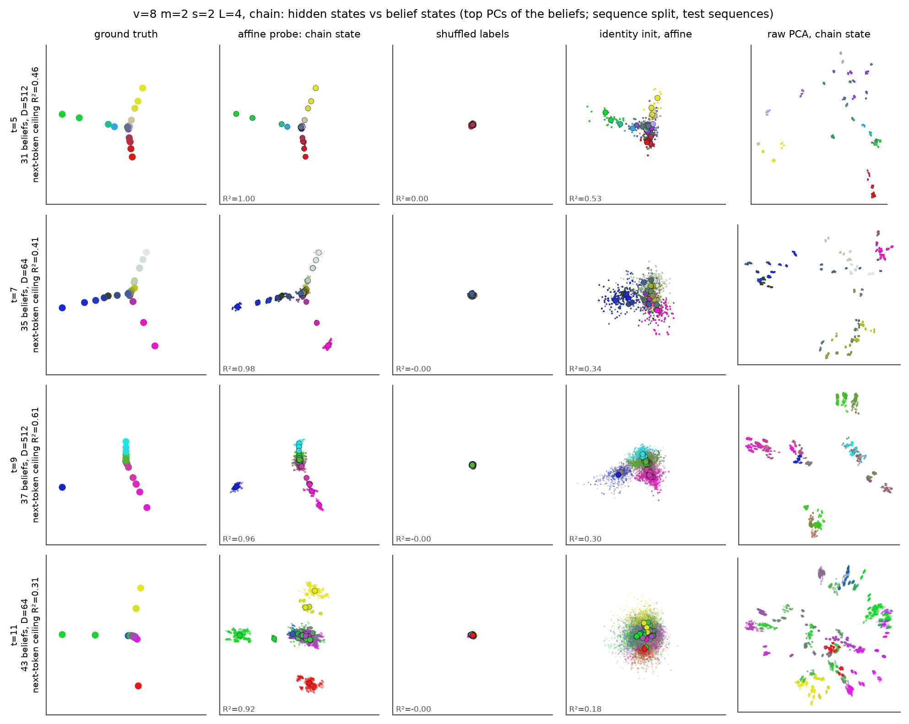
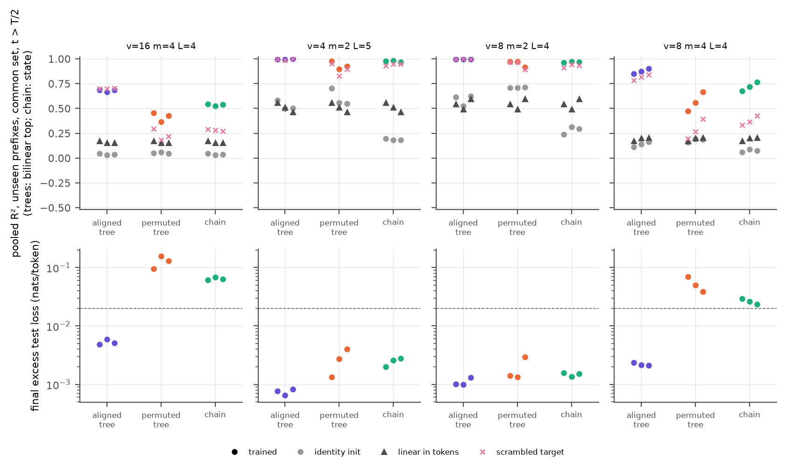
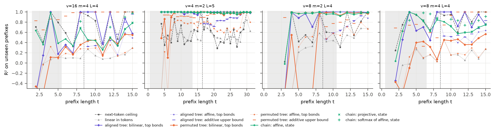
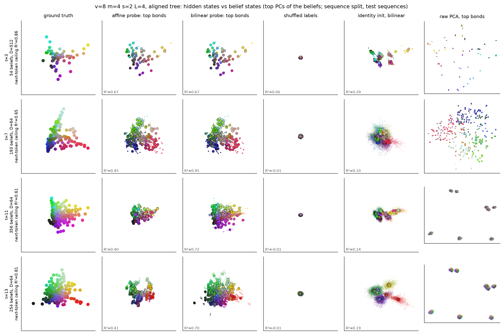

**Does the architecture decide whether a tensor network carries the belief state of a hierarchical grammar?**

*An aligned tree, a permuted tree and a causal chain, trained on next-token prediction for the Random Hierarchy Model and probed for the exact Bayesian belief.*

A network that predicts the next token of a structured source as well as Bayes does must, in some form, track what the source has revealed so far. For the Random Hierarchy Model (RHM) that knowledge is an explicit object, the belief state: the posterior over the symbols of the subtrees that have not been generated yet. Two earlier experiments in this project asked whether a transformer and a tree tensor network hold that belief in a linearly readable form. This note asks what the architecture contributes. We train three tensor networks with matched parameter counts on the same grammars, seeds and data, and score them on the same held-out prefixes with the same controls: a binary tree whose leaves follow the grammar's order, the same tree on scrambled leaves, and a chain that reads the sequence left to right.

The answer is narrower than the question. At the one learning rate tried, the aligned tree learned all four grammars, while the permuted tree and the chain learned only the two easier ones. On the two grammars that all three networks learned, the belief of a prefix it never saw can be read from the hidden state at $R^2$ of about 0.90 or above in every architecture; on the two harder grammars, which only the aligned tree learned, its probe reaches 0.85 and 0.66. Neither pre-registered hypothesis was supported: the chain hypothesis is inconclusive, with two grammars to stand on where its rule requires three, and the alignment hypothesis is "not supported" by its rule, having missed its bar by one pair on one measure and having too few usable pairs on the other. Everything below is conditional on learning rate $10^{-3}$ and 30,000 updates; no other rate and no longer run was tried in the experiment itself.

**The belief state of the RHM is the posterior over the pending subtrees.** The RHM generates a sequence by expanding a tree of depth $L$. A symbol at one level expands into $s = 2$ children at the next by one of $m$ productions chosen uniformly, every level has $v$ symbols, and the $T = 2^L$ leaves are the observed tokens $x_0, \dots, x_{T-1}$. All productions of a level are distinct pairs, so a complete sequence has a unique parse. After $t$ tokens, call a node *pending* if its span of leaves starts at or after position $t$ and its parent's span does not, and let $\mathcal{N}_t$ be the set of pending nodes. The belief is the joint posterior of their symbols,

$$b_t(z) = P\left(z_{\mathcal{N}_t} = z \mid x_0, \dots, x_{t-1}\right), \qquad z \in \prod_{u \in \mathcal{N}_t} \lbrace 1, \dots, v \rbrace, \qquad D_t = v^{|\mathcal{N}_t|}.$$

For $T = 16$ and $v = 8$, the pending nodes at $t = 5$ are the token at position 5, the node above positions 6 and 7, and the node above the right half, so $D_5 = 8^3 = 512$; at $t = 7$ they are the token at position 7 and the right half, so $D_7 = 64$. The next-token distribution is a linear function of the belief, because the next token is the first leaf under the first pending node $u_1$:

$$P(x_t = a \mid x_0, \dots, x_{t-1}) = \sum_{z} b_t(z) P\left(x_t = a \mid z_{u_1}\right).$$

The map from beliefs to next-token distributions is many to one, so a network whose state at $t$ serves only the prediction at $t$, as in the trees, could predict perfectly while keeping less than the belief. The chain's state must determine the belief if it predicts perfectly at every later position, but not necessarily in a linearly readable form. The experiment therefore reports, as a ceiling, how well the belief can be recovered from the exact next-token distribution alone.

**The three networks are multilinear in their inputs; the two trees differ only in how they group positions, and the chain shares one core across positions.** Write $e(x)$ for the one-hot vector of a token. In the tree, leaf $i$ holds $a_i = A_i e(x_{\pi(i)}) \in \mathbb{R}^r$ with bond dimension $r = 32$, each internal node fuses its two children with its own core,

$$h_a = \sum_{b, c} W_{abc} h^{\mathrm{left}}_b h^{\mathrm{right}}_c,$$

and the root turns the two bonds beneath it, $h_A$ and $h_B$, into logits $\ell_o = \sum_{b,c} C_{obc} (h_A)_b (h_B)_c$. To predict $x_t$ the tree is run on the prefix with every position from $t$ on replaced by a mask token. The aligned tree has $\pi(i) = i$, so each bond summarizes a subtree of the grammar and $h_A$, $h_B$ summarize the left and right halves of the sequence. The permuted tree has a fixed random $\pi$, drawn so that no two sibling leaves of the grammar are siblings in the model; its bonds summarize scattered positions, and in all 12 permuted runs no internal model node below the root covers exactly the leaves of a grammar node. The parameter count is $T(v+1)r + (T-2)r^3 + v r^2$ for both trees.

The chain keeps one state and one core for all positions:

$$(h_t)_a = \sum_{b,c} W_{abc} (h_{t-1})_b \left(A e(x_{t-1})\right)_c, \qquad \text{that is} \quad h_t = M(x_{t-1}) h_{t-1}, \qquad \ell_t = U h_t,$$

with $h_0$ learned and $\ell_t$ the logits for $x_t$. Its state after $t$ tokens is a product of token-indexed matrices applied to $h_0$, which is the form of an unnormalized Bayesian filter. Its width $w$ is chosen so that its parameter count $w + 2vw + w^3$ is closest to the tree's: $w = 78$ for $T = 16$ and $w = 100$ for $T = 32$, within 1.4% of the tree in every grammar. No network has biases or nonlinearities, and all start from an identity-like initialization.

**Each probe corresponds to one way the belief could be stored.** All probes are fit by least squares to the exact belief and are unchanged by an invertible linear change of basis of each bond or of the chain state.

- *Affine*, $\hat b = W h + c$, reads a belief stored as an affine image.
- *Projective*, $\hat b = q / \mathbf{1}^\top q$ with $q = W h + c$, reads a belief stored up to a scale that varies from prefix to prefix. If $h = \alpha G b_t$ with a scalar $\alpha \gt 0$ depending on the prefix and $G$ of full column rank, then $W = G^{+}$ and $c = 0$ give $q = \alpha b_t$, and since $\mathbf{1}^\top b_t = 1$ the ratio returns $b_t$ exactly, which an affine map does not do in general when $\alpha$ varies. This is what a chain that filtered without normalizing would hold.
- *Softmax*, $\hat b = \mathrm{softmax}(W h + c)$, reads a belief stored as log-probabilities up to a per-prefix shift. The chain is trained through a softmax of $U h_t$, so this is the form its own readout uses.
- *Bilinear*, for the trees: an affine map of the features $[h_A, h_B, h_A \otimes h_B]$, $2r + r^2 = 1088$ of them.

The projective and softmax probes are fit only at positions with $D_t \le 64$, which is why they are scored on slightly fewer positions than the affine probe.

The bilinear probe is needed because of how the two halves of an aligned tree combine. For $t \gt T/2$ the left half is complete and parses to a single symbol $z_L$, the right half is a partial prefix, and the two are independent given the symbol $z_R$ of the right half. Hence

$$b_t(z) = \frac{\sum_{z_R} P(z_R \mid z_L) P\left(x_{T/2}, \dots, x_{t-1}, z \mid z_R\right)}{P\left(x_{T/2}, \dots, x_{t-1} \mid z_L\right)}.$$

Because the left half enters only through $z_L$, which takes $v$ values, this can be written as $b_t = \sum_{a} \mathbf{1}[z_L = a] g_a(x_{T/2}, \dots, x_{t-1})$: exactly bilinear in the one-hot code of $z_L$ and a function of the right prefix. An affine probe on $[h_A, h_B]$ can only produce a sum $f(\text{left half}) + g(\text{right prefix})$, so it is bounded by the best additive fit, which the experiment computes without the network and reports as the additive bound. The bilinear probe is not subject to the additive bound in either tree, since products of the two top bonds can carry interactions between what each has seen, and it is the probe on which the trees are compared. It reads the belief exactly only if $h_A$ carries $z_L$ linearly and $h_B$ carries the functions $g_a$ linearly.

**Scores are taken on prefixes the probe never saw, and only where the fit is determined.** For each run, 60,000 sequences are sampled from the grammar. At each prefix length the distinct prefixes are assigned at random to a fit set or a test set, and

$$R^2 = 1 - \frac{\sum_t \sum_{i \in \mathrm{test}_t} \Vert b_t^{(i)} - \hat b_t^{(i)} \Vert^2}{\sum_t \sum_{i \in \mathrm{test}_t} \Vert b_t^{(i)} - \bar b_t \Vert^2},$$

with $\bar b_t$ the mean belief of the fit set and the sums over $t$ running over a group of positions. A position enters a group only if it has at least $10(p + 1)$ distinct fit prefixes for a probe with $p$ features. The *common positions* are those eligible for the 1,088-feature bilinear probe, at least 10,890 distinct fit prefixes, and they are the same in every arm. Controls are scored on the same rows: the untrained network, the token readout (the same probe on the one-hot prefix for the chain's three families, and the affine probe on the one-hot prefix for the trees), the next-token ceiling, and a *scrambled target* in which each distinct belief is replaced by a random 8-vector. The last one measures how well a probe fits an arbitrary labelling of the belief states. A fit to shuffled labels is scored separately, on a split by sequence over all positions. A network has *learned* a grammar if its test loss ends within 0.02 nats per token of the exact Bayes loss in all three seeds.

**The aligned tree learned every grammar; the permuted tree and the chain learned the two with $m = 2$.** Grammar names read vVmMsSLL for $v$, $m$, $s$ and $L$. The table gives the final excess loss over Bayes in nats per token, median over 3 seeds with the range.

| grammar | $T$ | aligned tree | permuted tree | chain |
|---|---|---|---|---|
| v8m2s2L4 | 16 | 0.0010 [0.0010, 0.0013] | 0.0014 [0.0013, 0.0029] | 0.0015 [0.0013, 0.0016] |
| v4m2s2L5 | 32 | 0.0008 [0.0007, 0.0008] | 0.0027 [0.0013, 0.0040] | 0.0026 [0.0020, 0.0028] |
| v8m4s2L4 | 16 | 0.0021 [0.0021, 0.0024] | 0.0502 [0.0390, 0.0696] | 0.0262 [0.0235, 0.0293] |
| v16m4s2L4 | 16 | 0.0052 [0.0048, 0.0059] | 0.1308 [0.0956, 0.1569] | 0.0631 [0.0618, 0.0683] |

*Figure 1. Top: excess test loss over Bayes against updates for all 36 runs (3 seeds per arm), with the 0.02 threshold dashed. Bottom: pooled $R^2$ of each arm's affine probe on held-out prefixes at six checkpoints. Notice that on the two $m = 4$ grammars (first and last columns) the chain and the permuted tree end above the threshold, with their loss still falling over the last 10,000 updates.*

On the $m = 4$ grammars the 12 runs of the chain and the permuted tree were still improving late in training: between updates 20,000 and 30,000 their excess loss fell by 0.004 to 0.012 nats, and over the last 1,000 updates, with the learning rate near its floor, by at most 0.0007 (one chain run was flat). "Did not learn" here means within this budget at this rate.

**Where the chain learned, its state determines the belief of unseen prefixes, by any of the three probes.** The hypothesis for the chain was that at least one probe family reaches $R^2 \ge 0.8$ and beats both the untrained chain and the token readout by 0.1 in all three seeds, in at least 75% of the learned grammars, with at least three grammars judged. Two grammars were learned, so the verdict is inconclusive. Both pass:

| grammar | probe | positions | trained | untrained | token readout | passes in seeds |
|---|---|---|---|---|---|---|
| v8m2s2L4 | affine | 7 | 0.97 [0.96, 0.97] | 0.25 [0.24, 0.31] | 0.50 [0.45, 0.52] | 3 of 3 |
| v8m2s2L4 | projective | 6 | 0.97 [0.97, 0.98] | 0.27 [0.25, 0.33] | 0.57 [0.51, 0.60] | 3 of 3 |
| v8m2s2L4 | softmax | 6 | 1.00 [1.00, 1.00] | 0.40 [0.38, 0.52] | 0.92 [0.86, 0.98] | 1 of 3 |
| v4m2s2L5 | affine | 22 | 0.98 [0.97, 0.98] | 0.20 [0.19, 0.21] | 0.49 [0.46, 0.55] | 3 of 3 |
| v4m2s2L5 | projective | 21 | 0.99 [0.99, 0.99] | 0.24 [0.23, 0.26] | 0.57 [0.55, 0.63] | 3 of 3 |
| v4m2s2L5 | softmax | 21 | 1.00 [1.00, 1.00] | 0.28 [0.27, 0.30] | 0.80 [0.77, 0.83] | 3 of 3 |

The softmax probe fails in two seeds of v8m2s2L4 only because the softmax probe on the raw tokens already reaches 0.92 and 0.98 there, which leaves no room for a 0.1 margin. With all three families at 0.96 or above, the learned grammars cannot say which storage form the chain uses.

*Figure 2. Grammar v8m2s2L4, chain, seed 0. Each row is a prefix length. Columns: the true beliefs on their top two principal components, colored by belief; the affine probe on the trained chain's state; the probe fit to shuffled labels; the affine probe on the untrained chain; the raw principal components of the state, which depend on the basis. Notice that the trained probe reproduces the arrangement of the 31 to 43 distinct beliefs and the untrained one blurs it. This figure uses a split by sequence, which lets test prefixes repeat fit prefixes, so its $R^2$ values are not the held-out numbers of the tables.*

The two grammars that the chain did not learn are outside the verdict, and they are where the probes separate. There the softmax probe reads the belief at 0.84 to 0.92 in all six runs with both controls at about 0.30 or below, the affine probe reaches 0.65 to 0.77 on the same positions (0.52 to 0.77 on all its eligible positions), and the projective probe improves on the affine probe by about 0.01. The softmax probe is also the strongest of the three on raw tokens there, and its margin over its own token control, 0.57 to 0.68, is only 0.02 to 0.10 above the projective probe's in the four seeds where that control is stable. This is a weak hint that a chain partway to the Bayes loss holds a code for log-probabilities and not an unnormalized belief. It describes unlearned runs, on 4 to 9 positions, and was not a criterion.

**The aligned tree was never worse than the permuted tree on either measure, and the pre-set rule still returns "not supported".** Runs are paired by (grammar, seed), 12 pairs that share rules, training stream and held-out prefixes. The learning gap is $\epsilon_{\mathrm{perm}} - \epsilon_{\mathrm{aligned}}$, with $\epsilon$ the excess loss, and the aligned tree wins a pair if the gap exceeds a tolerance $\tau$, the larger of 0.001 nats and the aligned tree's range over seeds on that grammar. For v4m2s2L5, seed 0, the losses are 0.00077 and 0.00133, a gap of 0.00056 below $\tau = 0.001$: a tie. The count is 9 wins, 0 losses and 3 ties (sign test on the untied pairs, $p = 2^{-9} \approx 0.002$), with a median gap of 0.020 nats (the gaps are 0.0003 to 0.003 on the $m = 2$ grammars and 0.04 to 0.15 on the $m = 4$ grammars). A measure goes to an arm at 80% of the usable pairs, 10 of 12, so learning goes to neither tree. The three ties are $m = 2$ pairs where both trees end within 0.0015 nats of the Bayes loss and differ by 0.0003 to 0.0006.

The representation measure compares the bilinear probe on the common positions past the midpoint, in pairs where both trees learned. With $g = R^2_{\mathrm{aligned}} - R^2_{\mathrm{perm}}$, a pair goes to the aligned tree if

$$g(\text{final}) - g(\text{untrained}) \ge 0.1 \quad \text{and} \quad g(\text{final}) \gt 0,$$

where subtracting the untrained gap removes what the leaf order alone gives two untrained trees. For v8m2s2L4, seed 0, the trained trees score 0.9975 and 0.9715, so $g(\text{final}) = 0.026$; the untrained trees score 0.6153 and 0.7087, so $g(\text{untrained}) = -0.093$; the adjusted gap is 0.119 and the pair goes to the aligned tree. All 6 usable pairs do (adjusted gaps 0.119 to 0.208, median 0.153, $p = 2^{-6} \approx 0.016$), but the rule requires 9 usable pairs, so the measure is untestable. In all six, the final gap itself is below 0.1: the permuted tree's top bonds read the belief at 0.90 to 0.98 against 0.995 to 0.999 for the aligned tree, and the pairs pass because the untrained permuted tree starts ahead. The same count on the common positions up to the midpoint, which the definition reports apart with no verdict, is 1 win and 2 ties of 3 pairs, all in v4m2s2L5; in two of those three seeds the permuted tree's probe is the higher one.

*Figure 3. One panel per grammar, one point per seed. Top: pooled $R^2$ on held-out prefixes at the common positions past the midpoint, for the trees' bilinear top-bond probe and the chain's affine state probe, with the untrained network (gray), the token readout (triangles) and the scrambled target (crosses). Bottom: final excess loss with the 0.02 threshold. Notice that on the two $m = 2$ grammars the crosses sit on or just below the trained points (at most 0.07 below), that on v16m4s2L4 they also sit on the aligned tree's points, and that on the $m = 4$ grammars the three arms order the same way in loss and in $R^2$.*

**The probes that pass identify belief states without showing their geometry.** On the two learned grammars the scrambled target scores within 0.06 of the true belief in every run of every arm; for the aligned tree the two are 1.00 and 1.00 on v8m2s2L4 and 0.99 and 0.98 on v4m2s2L5. At the positions where the chain's affine probe is scored there are between 3 and 50 distinct beliefs, fewer than the probe has features, so any probe that separates the belief states can fit an arbitrary labelling of them. The experiment's definition stated this limit in advance. What the high scores establish is that two unseen prefixes with different beliefs land on linearly separable states and that the map from state to belief generalizes across prefixes. They do not establish that distances between states reflect distances between beliefs. A second test, which holds out distinct beliefs instead of prefixes, gave negative $R^2$ on the learned grammars for every arm; it rests on 4 to 7 positions and is weak in both directions.

On the $m = 4$ grammars beliefs are more numerous and the margin over the scrambled target opens: 0.72 against 0.39 and 0.53 against 0.28 for the chain, 0.85 against 0.76 and 0.66 against 0.61 for the aligned tree (medians, common positions). For the aligned tree on v16m4s2L4 the margin comes from the positions up to the midpoint; past it the scrambled target scores 0.70 against 0.67 to 0.69 for the belief.

*Figure 4. $R^2$ on held-out prefixes at each prefix length, seed 0, one panel per grammar. Solid lines: the aligned tree's and the permuted tree's bilinear top-bond probes and the chain's affine probe. Dotted: the trees' affine top-bond probes. Short dashes: each tree's additive upper bound. Crosses and plus signs: the chain's projective and softmax probes. Gray dashed and dotted lines: the next-token ceiling and the token readout. Shaded positions are outside the common set, and the vertical dashed line separates $t \le T/2$ from $t \gt T/2$. Notice that the affine top-bond probes stay at or below the bilinear ones past the midpoint, to within 0.01, and that on the $m = 4$ grammars every probe varies strongly with position.*

**The additive bound explains why the tree needs the bilinear probe.** Past the midpoint the aligned tree's affine top-bond probe sits near its additive bound on the $m = 2$ grammars, 0.83 against 0.87 on v8m2s2L4 and 0.85 against 0.86 on v4m2s2L5, while the bilinear probe reaches 1.00 (medians over 3 seeds). On the $m = 4$ grammars it sits further below the bound, 0.58 against 0.69 and 0.39 against 0.64, with the bilinear probe at 0.87 and 0.68. Figure 5 shows the same thing position by position: up to the midpoint the second top bond is constant and the two probes coincide, and past it the bilinear probe pulls ahead.

*Figure 5. Grammar v8m4s2L4, aligned tree, seed 0, in the layout of Figure 2 with one more column for the bilinear probe; the untrained column here uses the bilinear probe. Notice that the affine and bilinear probes agree at $t = 3$ and $t = 7$ (0.67 and 0.45) and separate at $t = 11$ and $t = 13$ (0.40 against 0.72, 0.41 against 0.70). Split by sequence, as in Figure 2.*

One further observation stands apart from the criteria. The aligned tree learned v16m4s2L4 to within 0.006 nats, and its bilinear probe still reads the belief at only 0.66 on the common positions, below the next-token ceiling of 0.79. Near-Bayes prediction did not make the belief readable from the top bonds by this probe on that grammar.

**What the experiment establishes, and what it leaves open.** Three statements are supported by the data as observations, each at learning rate $10^{-3}$ and 30,000 updates. First, alignment mattered for learning: in the 9 of 12 pairs with a measurable difference the aligned tree had the lower loss, and on the $m = 4$ grammars the difference is between reaching Bayes and stopping 0.04 to 0.16 nats above it. Second, the chain sits between the two trees on the $m = 4$ grammars, with the lower loss than the permuted tree in each of the six seeds; this comparison was not planned and is noted after seeing the results. Third, on the two grammars that all three arms learned, the hidden state determines the belief of unseen prefixes through the stated probe ($R^2$ 0.90 to 1.00); the aligned tree on the $m = 4$ grammars learned the task and reaches only 0.85 and 0.66.

Three things remain open. The first is whether the permuted tree and the chain fail on $m = 4$ because of their structure or because of the budget, which a higher learning rate or a longer run on those 12 runs would answer. The only evidence so far is the short CPU pilot of the definition, on a smaller grammar and 1,500 updates, where the chain ended at 0.064 nats at $10^{-3}$ and at 0.042 at $3 \times 10^{-3}$. The second is whether the chain hypothesis and the representation half of the alignment hypothesis hold on enough grammars to be judged; one more grammar that all three arms learn would give the three grammars and nine pairs the rules require. The third is the comparison of readability across architectures, which here uses a 1,088-feature probe on the trees and a 78- or 100-feature probe on the chain, and needs a probe of matched size before a difference of 0.01 to 0.04 in $R^2$ means anything.

**Reading guide.**

- The full tables, checks and judgement calls are in [README.md](README.md), and the criteria fixed before the run are in [EXPERIMENT.md](EXPERIMENT.md).
- L. Petrini, F. Cagnetta, U. M. Tomasini, A. Favero and M. Wyart, [How Deep Neural Networks Learn Compositional Data: The Random Hierarchy Model](https://arxiv.org/abs/2307.02129) (2023): the source of the grammar.
- A. Shai et al., [Transformers represent belief state geometry in their residual stream](https://arxiv.org/abs/2405.15943) (2024): the probing method, and the reason the scrambled-target and belief-split controls matter for a claim about geometry.
