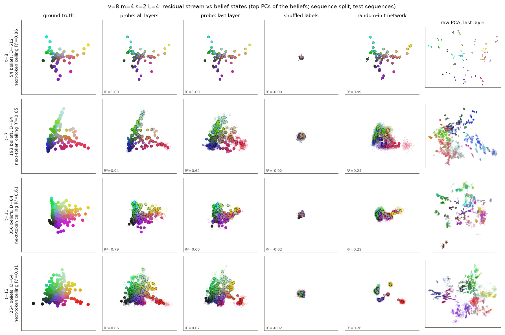
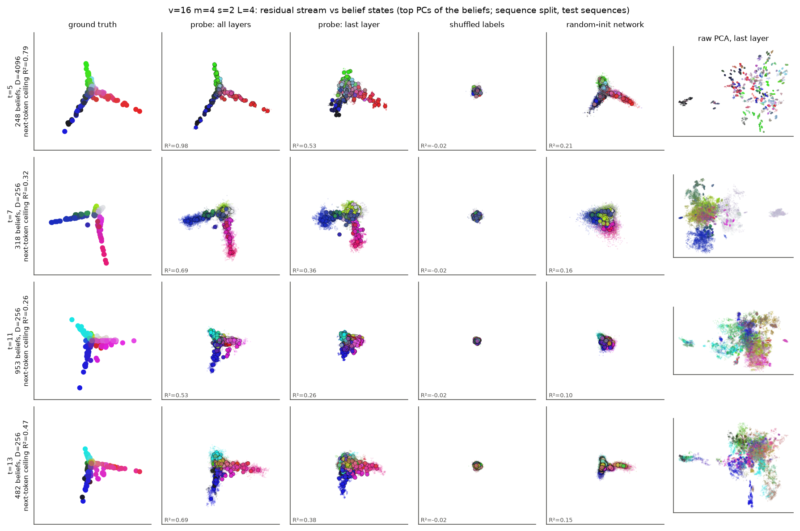
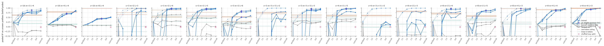
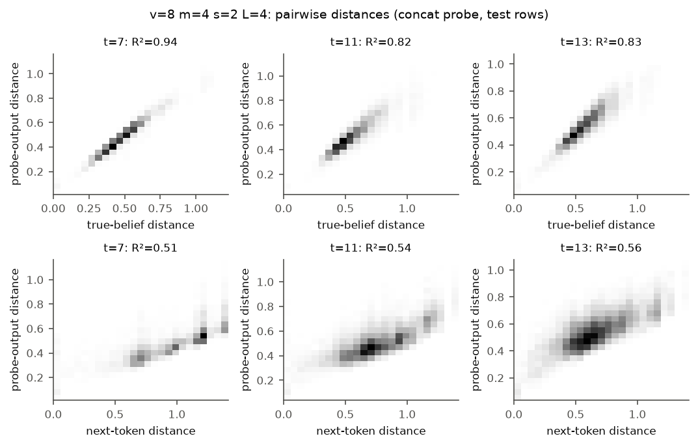
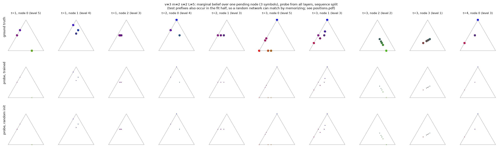
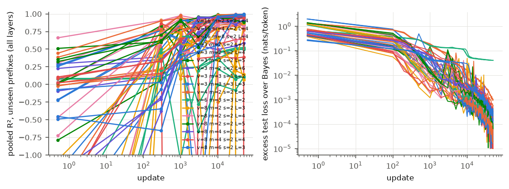

**Does a transformer lay out the belief state of the Random Hierarchy Model in its residual stream?**

*A research note on a replication of the Simplex belief-geometry result on a hierarchical process, and on what the probe score behind it can and cannot show.*

Shai et al. (2024) trained small transformers on next-token prediction for data from hidden Markov processes and reported that the Bayesian belief state over the hidden states can be read out of the residual stream by a linear map. Their main processes were Mess3, whose belief states form a fractal, and RRXOR, which has 36 discrete belief states. This note reports the same experiment on a process with hierarchical latent structure, the Random Hierarchy Model (RHM). Read left to right, the RHM is a hidden Markov process whose hidden state is a stack of unexpanded subtrees, and its belief state can be computed exactly, so the experiment can be repeated without approximation: train a transformer on RHM sequences, fit an affine probe from the residual stream to the exact belief, and score the probe on held-out data against controls.

The answer has two parts with different status. **The pre-registered hypothesis is supported: in 10 of the 12 grammars that the network learned and that could be tested, an affine probe on the last layer recovers the belief with $R^2 \ge 0.8$ on prefixes the probe never saw, in all three seeds, and it beats a randomly initialized network and a linear readout of the tokens by more than 0.21 in every run.** The two failures are the deepest grammar and a synonym-rich one, and one further grammar did not reach the learning threshold (excess 0.040 against 0.02). **A follow-up that was not pre-registered (five of the passing grammars, one seed each) then showed that the same probe fits a random relabelling of the belief states almost as well as the beliefs themselves, and does not extrapolate to beliefs it was not fit on.** So the run establishes that an affine probe on the trained last layer predicts the belief of an unseen prefix in 10 of 12 grammars, and the follow-up suggests, in five runs, that this mostly reflects linear identification of which belief state the prefix is in. It does not establish that the layer holds the geometry of the belief simplex as an affine code, which is the stronger claim of the Simplex work.

The note first defines the process, the belief and the probe, then states the pre-registered criteria, reports the results against them, describes the follow-up controls, and ends with what is and is not established.

**The RHM is a random context-free grammar of fixed depth.** A grammar is fixed by four integers: $v$ symbols per level, $m$ synonymous productions per symbol, branching $s$, and depth $L$. Levels run from the root at $\ell = 0$ to the observed tokens at $\ell = L$, and every level uses an alphabet of $v$ symbols (the code allows a different number of root symbols, and this experiment sets it to $v$). For each level $\ell \lt L$ and each symbol $a$, the grammar has $m$ productions $R^{(\ell)}_{a,1}, \dots, R^{(\ell)}_{a,m}$, each a tuple of $s$ symbols of level $\ell + 1$. The $vm$ productions of a level are distinct tuples drawn without replacement from the $v^s$ possible ones, so every tuple has at most one parent symbol and a sequence determines its tree. A sequence is sampled by drawing the root symbol uniformly and expanding every node with a production chosen uniformly. Writing $z^{(\ell)}_p$ for the symbol of the node at level $\ell$ and position $p$,

$$
\bigl(z^{(\ell+1)}_{sp}, \dots, z^{(\ell+1)}_{sp+s-1}\bigr) = R^{(\ell)}_{a,k} \quad \text{with } a = z^{(\ell)}_p, \qquad k \sim \mathrm{Uniform}\lbrace 1, \dots, m \rbrace .
$$

The tokens are the leaves, $x_p = z^{(L)}_p$ for $p = 0, \dots, T-1$, with $T = s^L$. A grammar is named `vVmMsSLL`, so `v8m4s2L4` has 8 symbols, 4 synonyms, binary branching, depth 4 and sequences of 16 tokens. The rules themselves are random and set by a seed.

**Read left to right, the hidden state after $t$ tokens is the stack of pending subtrees.** The node at level $\ell$ and position $p$ covers the leaves $p\,s^{L-\ell} \le i \lt (p+1)\,s^{L-\ell}$. After the prefix $x_{\lt t} = (x_0, \dots, x_{t-1})$ has been emitted, call a node pending when none of its leaves has been emitted while its parent, if it has one, has at least one emitted leaf (at $t = 0$ the root alone is pending). The pending nodes $\mathcal{S}_t$ are the maximal subtrees that lie entirely in the future. For $s = 2$ they are the right siblings of the nodes on the path from the root to leaf $t-1$. Their symbols were already fixed by the productions chosen above them, and the remaining tokens $x_t, \dots, x_{T-1}$ are generated by expanding them, so given the pending symbols the future is independent of the prefix. The hidden state is therefore

$$
S_t = \bigl(z_u\bigr)_{u \in \mathcal{S}_t}, \qquad P\bigl(x_t, \dots, x_{T-1} \mid S_t,\ x_{\lt t}\bigr) = P\bigl(x_t, \dots, x_{T-1} \mid S_t\bigr).
$$

Emitting $x_t$ expands the first pending node down its leftmost branch to a leaf and pushes the other children it creates on the way, which gives $S_{t+1}$. The shape of the stack depends only on $t$: the number of pending nodes is the sum of the digits of $T - t$ written in base $s$, so the state space has size

$$
D_t = v^{\lvert \mathcal{S}_t \rvert}, \qquad \lvert \mathcal{S}_t \rvert = \text{digit sum of } (T - t) \text{ in base } s .
$$

This formula is not in the code as such. It was checked against the dimensions stored for every analyzed position in all 51 analyses, and against the length of `pending_nodes` at every $t$.

A small case makes the stack concrete. Take a binary tree of depth 3, so $T = 8$, and $t = 5$. Then $T - t = 3$ is $011$ in binary and two nodes are pending: leaf 5, which is the next token itself, and the level-2 node above leaves 6 and 7. The hidden state is a pair of symbols and $D_5 = v^2$. At $t = 6$ only the level-2 node above leaves 6 and 7 is pending, and at $t = 7$ only leaf 7 is, so at the last position the hidden state is the next token.

**The belief state is the posterior over the pending symbols, and it is computed exactly.** The belief is

$$
b_t(\sigma) = P\bigl(S_t = \sigma \mid x_{\lt t}\bigr), \qquad \sigma \in \lbrace 1, \dots, v \rbrace^{\lvert \mathcal{S}_t \rvert},
$$

a point in the simplex over $D_t$ joint configurations of the stack. `grammar.stack_belief` computes it by one upward pass over the tree. For a node $u$ with symbol $a$, let $M_u(a, \phi)$ be the probability, given $z_u = a$, of the emitted leaves under $u$ together with the configuration $\phi$ of the pending nodes under $u$. An emitted leaf at position $p$ has $M_u(a) = \delta_{a, x_p}$, a pending node has $M_u(a, \phi) = \delta_{a, \phi}$, and a node at level $\ell$ with at least one emitted leaf combines its children $u_1, \dots, u_s$ under the uniform production prior:

$$
M_u\bigl(a, (\phi_1, \dots, \phi_s)\bigr) = \frac{1}{m} \sum_{k=1}^{m} \prod_{j=1}^{s} M_{u_j}\bigl(R^{(\ell)}_{a,k,j},\ \phi_j\bigr).
$$

Here $R^{(\ell)}_{a,k,j}$ is symbol number $j$ of production $k$, and $\phi_j$ is empty for a child with no pending node below it. At the root the uniform prior over the root symbol is applied and the result is normalized:

$$
b_t(\phi) = \frac{\sum_{a} M_{\mathrm{root}}(a, \phi)}{\sum_{a, \phi'} M_{\mathrm{root}}(a, \phi')} .
$$

The pre-training checks compare this against brute-force enumeration of all trees on two small grammars and find a maximum error of 0 in the belief and $3.3 \times 10^{-16}$ in the next-token distribution derived from it (`results/checks.json`). Positions with $D_t \gt 4096$ are skipped, which removes $t = 1$ in the three $v = 16$ grammars and in `v8m2s2L5`.

**The next-token distribution is a linear image of the belief, which is why the question is not trivial.** The next token is the leftmost leaf under the first pending node. If that node is at level $\ell_1$ and $b^{(1)}_t$ is the marginal of $b_t$ on it, then

$$
P\bigl(x_t = c \mid x_{\lt t}\bigr) = \sum_{a} b^{(1)}_t(a)\, E^{(\ell_1)}(a, c), \qquad E^{(L)} = I, \quad E^{(\ell)}(a, c) = \frac{1}{m} \sum_{k=1}^{m} E^{(\ell+1)}\bigl(R^{(\ell)}_{a,k,1},\ c\bigr),
$$

where $E^{(\ell)}(a, c)$ is the probability that the leftmost leaf under a symbol $a$ of level $\ell$ is the token $c$. A network that predicts at the Bayes loss must compute this linear image of $b_t$, which has only $v$ dimensions. It is not obliged to compute the rest of $b_t$, which describes the nodes further down the stack and matters only for later tokens. The Simplex result suggests that the network nevertheless carries the whole belief in a linear form. At some positions the two coincide: at the last position of a binary tree, $b_t$ is the next-token distribution. A probe that recovers $b_t$ there shows only that the network encodes its own output, and the method below includes a control for it.

**The model is a small causal transformer trained online to near the Bayes loss.** The network has 4 pre-LayerNorm blocks with width $d = 128$, 4 heads, an MLP of width 512 with GELU, and learned positions. Its input is $[\mathrm{BOS}, x_0, \dots, x_{T-2}]$ and its targets are $x_0, \dots, x_{T-1}$, so the residual stream at input position $t$ has seen exactly $x_{\lt t}$ and is compared with $b_t$. According to the definition this matches the Simplex RRXOR configuration except for the BOS token and GELU in place of ReLU. Each run trains for 50,000 Adam updates on batches of 512 freshly sampled sequences, with a peak learning rate of $10^{-3}$, 500 warmup updates and a cosine decay to a tenth of the peak. The learning rate was taken from CPU pilots and not swept. Learning is measured by the excess of the test loss, on 8,192 fixed sequences, over the exact Bayes loss, which follows from the prefix probabilities as

$$
\mathcal{L}^{\mathrm{Bayes}}_t = -\log P\bigl(x_t \mid x_{\lt t}\bigr) = \log P\bigl(x_{\lt t}\bigr) - \log P\bigl(x_{\le t}\bigr).
$$

**The probe is an affine least-squares map from one layer's activations to the belief, fit separately at each position.** Let $a_t \in \mathbb{R}^{128}$ be the output of the last block (called L4, before the final LayerNorm) at input position $t$. On a fit set of sampled sequences,

$$
\hat b_t = W_t\, a_t + c_t, \qquad (W_t, c_t) = \arg\min_{W, c} \sum_{i \in \mathrm{fit}} \bigl\lVert b^{(i)}_t - W a^{(i)}_t - c \bigr\rVert^2 ,
$$

with a ridge term of $10^{-8}$ relative to the mean diagonal of the Gram matrix, which only guards against rank deficiency. The probe has $128 + 1 = 129$ parameters per belief coordinate. A separate probe is needed at each $t$ because $D_t$ changes with $t$. The analysis set is 60,000 sequences sampled from the grammar with a fixed seed, and each sequence is one row, so prefixes are weighted by their probability. The score is

$$
R^2_t = 1 - \frac{\mathrm{SSE}_t}{\mathrm{SST}_t}, \qquad \mathrm{SSE}_t = \sum_{i \in \mathrm{test}} \bigl\lVert b^{(i)}_t - \hat b^{(i)}_t \bigr\rVert^2, \qquad \mathrm{SST}_t = \sum_{i \in \mathrm{test}} \bigl\lVert b^{(i)}_t - \bar b^{\,\mathrm{fit}}_t \bigr\rVert^2 ,
$$

where $\bar b^{\,\mathrm{fit}}_t$ is the mean belief over the fit rows, and positions are pooled as

$$
R^2 = 1 - \frac{\sum_t \mathrm{SSE}_t}{\sum_t \mathrm{SST}_t} .
$$

The sums run over all belief coordinates. Because the baseline is the fit mean and the probe is scored out of sample, $R^2$ can be negative, and for an underdetermined probe it can be very negative. The same probe is also fit to the embedding, to the outputs of blocks 1 to 3, to the final LayerNorm output, and to all six activation sets concatenated (768 dimensions), at every saved checkpoint.

**Two splits are used, because a random network fits small grammars when test prefixes repeat fit prefixes.** The sequence split, which is the Simplex convention, fits on the first 30,000 sequences and tests on the other 30,000. A test prefix can then also occur in the fit half. When a position has fewer distinct prefixes than the probe has features, any injective embedding of the prefix lets an affine probe interpolate any function of it, the belief included, and a randomly initialized network provides such an embedding. The CPU pilot recorded in the definition made this concrete: on `v3m2s2L3` the random-init network reached $R^2 = 0.976$ on the sequence split and $-4.9$ once test prefixes were held out. The prefix split is the remedy. At each position the distinct prefixes $x_{\lt t}$ are assigned at random to fit or test, so the probe is scored only on prefixes it never saw. Even then a probe with $p$ features is underdetermined when few distinct prefixes exist, so the criteria use only eligible positions, those with enough distinct fit prefixes:

$$
N^{\mathrm{fit}}_t \ge 10\,(d + 1) = 1290 .
$$

A grammar with no eligible position cannot be tested and is reported through its figures only. The prefix split and the eligibility rule entered the definition before launch, after the reviewer measured a random-init all-layer $R^2$ of 0.97 to 0.995 on the sequence split in the four smallest grammars. The sequence split is kept for the geometry figures.

**Three controls are scored on the same test rows and pooled over the same positions as the trained probe; a fourth checks the probe code.**

- **Random init.** The same probe on the network at checkpoint 0. It measures what the architecture and the probe give without training.
- **Linear in tokens.** The same least-squares fit applied to the one-hot encoding of the prefix ($t\,v$ features). Where it is high, the belief is a linear readout of the input and the network need not have computed anything.
- **Next-token ceiling.** The test $R^2$ of predicting $b_t$ by the mean belief of the fit rows that have the same exact next-token distribution (rounded to 9 decimals), with the fit mean for distributions that never occur in the fit set. It estimates how much of the belief any function of the network's Bayes-optimal output could carry. It is a lookup table and not a guaranteed upper bound on the prefix split, which matters for the second hypothesis below.
- **Shuffled labels.** The all-layer probe fit to belief rows permuted across sequences and scored against the true beliefs, on the sequence split and pooled over all positions. It should give $R^2 \approx 0$. It checks the probe code and is not compared with the trained probe on the eligible positions.

**The criteria were fixed before launch.** They are computed by `summary.py` at the final checkpoint, on the prefix split, pooled over the eligible positions, with seeds counted separately.

- **Learned grammar.** All three seeds have excess test loss below 0.02 nats per token. A grammar that fails this is reported as not learned and is not judged.
- **Testable grammar.** All three seeds have at least one eligible position.
- **H1 for a grammar.** In all three seeds, $R^2(\mathrm{L4}) \ge 0.8$, and $R^2(\mathrm{L4})$ exceeds the better of the random-init probe and the token readout by at least 0.1.
- **H1 overall.** Supported if at least 75% of the learned, testable grammars pass; not supported if at most 25% do; partly supported in between; inconclusive with fewer than 4 such grammars.
- **H2, descriptive.** Among eligible (grammar, seed, position) cases whose next-token ceiling is below 0.9, count those where $R^2(\mathrm{L4})$ exceeds the ceiling by more than 0.05. No verdict threshold was set.
- **Run failed.** The correctness checks fail, there is no GPU, fewer than 44 of 51 runs finish, or the shuffled-label $R^2$ exceeds 0.05 in any run.

Which layer carries the belief and how the probe score changes over training were declared descriptive. One part of the scale was not reviewed: after the review, the user enlarged the run from 13 grammars and 2 seeds to 17 grammars and 3 seeds, with 50,000 updates and 60,000 analysis sequences, and the definition records that this expansion scales the reviewed design without changing its logic.

**The run covered 17 grammars with 3 seeds each, and every run finished.** The seed sets both the grammar's rules and the network's initialization, so the three seeds of one grammar name are three different random grammars with the same parameters, each with its own initialization. All 51 runs trained and were analyzed on one 32 GB RTX PRO 4500 in 6.92 hours for about USD 4.98, against a cap of 8 hours and a budget of USD 20. The correctness checks passed (28 of 28, plus a check of the probe code on synthetic activations), and the shuffled-label $R^2$ was between $-0.023$ and $0.001$ in all 51 runs, so no run-failed criterion was triggered. Four analyses failed with GPU out-of-memory errors when two shared the card and were rerun with the same script, data and seeds. The amendments in `EXPERIMENT.md` record each rescheduling, and the write-up states that it changed only the order of the work.

**Sixteen of the 17 grammars were learned, and one was not.** In the 48 runs outside `v16m8s2L4` the final excess loss is at most 0.0011 nats per token. In `v16m8s2L4`, the grammar with 16 symbols and 8 synonyms, it is 0.040 in all three seeds after 50,000 updates. In seed 0 the excess was still falling, from 0.0407 to 0.0403 over the last 5,000 updates. The definition forbids retuning, so this grammar is reported as not learned and is not judged. Its probe numbers appear in the table for completeness.

**Thirteen grammars are testable, and H1 passes in 10 of the 12 that are both learned and testable.** That is 83%, above the pre-registered 75%, so H1 is supported. The table gives the last-layer probe on unseen prefixes at the final checkpoint, pooled over the eligible positions, as the median over the 3 seeds with the range in brackets. Every column is pooled over the same positions.

| grammar | learned | eligible positions | R², trained L4 | R², random init | R², linear in tokens | next-token ceiling | H1 (all 3 seeds) |
|---|---|---|---|---|---|---|---|
| v3m2s2L4 | yes | 5 | 0.98 [0.95, 0.98] | 0.63 [0.63, 0.77] | 0.51 [0.47, 0.65] | 0.61 [0.52, 0.89] | pass |
| v3m2s2L5 | yes | 21 | 0.94 [0.92, 0.97] | 0.54 [0.33, 0.57] | 0.45 [0.26, 0.50] | 0.60 [0.54, 0.77] | pass |
| v3m2s2L6 | yes | 53 | 0.79 [0.52, 0.84] | 0.24 [0.17, 0.29] | 0.22 [0.13, 0.29] | 0.52 [0.29, 0.53] | **fail** (passes in 1 of 3 seeds) |
| v3m3s3L3 | yes | 14 | 0.95 [0.92, 0.97] | 0.58 [0.50, 0.62] | 0.39 [0.36, 0.51] | 0.60 [0.51, 0.66] | pass |
| v4m2s2L5 | yes | 21–22 | 0.95 [0.94, 0.98] | 0.50 [0.47, 0.59] | 0.49 [0.46, 0.55] | 0.61 [0.60, 0.63] | pass |
| v8m2s2L4 | yes | 7 | 0.97 [0.94, 0.98] | 0.51 [0.50, 0.51] | 0.50 [0.45, 0.52] | 0.76 [0.71, 0.78] | pass |
| v8m2s2L5 | yes | 23 | 0.87 [0.87, 0.88] | 0.33 [0.32, 0.37] | 0.41 [0.37, 0.46] | 0.57 [0.56, 0.61] | pass |
| v8m4s2L3 | yes | 3 | 0.97 [0.97, 0.98] | 0.33 [0.30, 0.39] | 0.28 [0.27, 0.34] | 0.99 [0.99, 0.99] | pass |
| v8m4s2L4 | yes | 11 | 0.90 [0.84, 0.91] | 0.19 [0.17, 0.20] | 0.19 [0.16, 0.19] | 0.92 [0.91, 0.92] | pass |
| v8m6s2L3 | yes | 3 | 0.93 [0.92, 0.94] | 0.27 [0.26, 0.32] | 0.24 [0.23, 0.27] | 1.00 [1.00, 1.00] | pass |
| v16m2s2L4 | yes | 7 | 0.89 [0.88, 0.89] | 0.40 [0.39, 0.42] | 0.51 [0.46, 0.52] | 0.68 [0.67, 0.70] | pass |
| v16m4s2L4 | yes | 11 | 0.68 [0.68, 0.72] | 0.13 [0.13, 0.14] | 0.15 [0.14, 0.16] | 0.79 [0.79, 0.80] | **fail** (R² below 0.8) |
| v16m8s2L4 | **no** (excess 0.040) | 12 | 0.43 [0.42, 0.45] | 0.08 [0.08, 0.08] | 0.08 [0.08, 0.09] | 0.98 [0.98, 0.98] | not judged |

Both failures are failures of the 0.8 threshold. In `v3m2s2L6`, the depth-6 grammar with 64 tokens, the three seeds give 0.52, 0.79 and 0.84, so one seed passes and two do not, although all three have an excess loss of at most 0.0001. In `v16m4s2L4` all three seeds are between 0.68 and 0.72. The margin criterion is never the binding one: in all 36 runs of the 12 learned, testable grammars the trained probe exceeds the better control by 0.22 to 0.71, and 31 of those 36 runs pass H1 individually.

**Four grammars could not be tested, and their near-perfect scores carry no evidence of learning.** `v3m2s2L3`, `v3m3s3L2`, `v6m3s3L2` and `v8m2s2L3` have at most about 1,000 distinct prefixes at any position, so no position reaches 1,290 distinct fit prefixes. On the sequence split the trained all-layer probe reaches $R^2 = 1.00$ in these grammars, and the random-init all-layer probe reaches 0.95 to 1.00. This is the interpolation effect that the prefix split was introduced to remove, and the definition planned these grammars as figure-only for that reason.

**Figure 1 shows what the probe scores look like in one passing grammar.** Its rows are four positions of `v8m4s2L4` in seed 0, and its columns compare the true beliefs with the probe outputs on the same two axes.

*Figure 1. `v8m4s2L4`, seed 0, sequence split, test sequences ([PDF](figures/geometry_v8m4s2L4.pdf)). Rows are positions $t = 3, 7, 11, 13$, chosen by the plotting code to prefer a next-token ceiling below 0.9 and then the most distinct beliefs; the row labels give the number of distinct beliefs, $D_t$, and the per-position sequence-split ceiling (0.86, 0.65, 0.61, 0.81), which is not the pooled prefix-split ceiling of the table. Columns, left to right: the distinct true beliefs on the top two principal components of the beliefs; the all-layer probe's output on the same axes (small points are test rows, large points the mean per true belief); the last-layer probe; the shuffled-label control; the all-layer probe on the random-init network; and the top two principal components of the raw last-layer residual stream with no probe. Colour encodes the true belief and is the same in every panel of a row. What to look at: at $t = 3$ the all-layer, last-layer and random-init probes all score 0.99 to 1.00, because this position has only 220 distinct prefixes and is not eligible. At $t = 7, 11, 13$ the trained all-layer probe reproduces the arrangement ($R^2$ 0.94, 0.79, 0.86), the last-layer probe reproduces it more loosely (0.62, 0.60, 0.67), the random-init probe collapses into a blob or a few clusters (0.24, 0.23, 0.26), and shuffled labels give a point. The raw principal components in the last column show clusters of like-coloured points but not the layout of the first column.*

The three lower rows of Figure 1 are also the three eligible positions of this run where the last-layer probe is weakest on the prefix split (0.62, 0.60, 0.66, against a next-token ceiling of 0.65, 0.61, 0.81 at the same positions). The pooled 0.84 for this run comes mostly from the other eight eligible positions, where the last-layer probe scores 0.84 to 0.99. This matters for the follow-up below.

**Figure 2 shows a grammar that fails.** In `v16m4s2L4` the true beliefs at the plotted positions form three arms, and the last-layer probe output keeps a compressed version of the arms at $t = 5$ and $t = 7$ and is close to a blob at $t = 11$.

*Figure 2. `v16m4s2L4`, seed 0, same layout as Figure 1 ([PDF](figures/geometry_v16m4s2L4.pdf)). Rows are $t = 5, 7, 11, 13$ with 248, 318, 953 and 482 distinct beliefs. The all-layer probe scores 0.98, 0.69, 0.53, 0.69 and the last-layer probe 0.53, 0.36, 0.26, 0.38 on the sequence split, against 0.21, 0.16, 0.10, 0.15 for the random-init all-layer probe. The network's loss is within 0.0006 nats per token of Bayes in this run, so the low last-layer score is not a failure to learn the task.*

**The belief is read best from the last block, and better still from all layers together.** In the 36 runs of the 12 learned, testable grammars, the best single activation set is L4 in 24 runs and the final LayerNorm output in 12. On the L4-eligible positions, the concatenation of all six sets beats L4 in all 36 runs, by 0.01 to 0.18 in $R^2$. The gain is largest in `v16m4s2L4` (0.16 to 0.18), where the all-layer probe reaches 0.84 to 0.88. In `v3m2s2L6` it is 0.04 to 0.08, no more than in passing grammars such as `v8m2s2L5`, and the all-layer probe of seed 2 stays at 0.59. These comparisons are descriptive, and the all-layer probe has 769 parameters per output against 129. Figure 3 gives the by-layer scores for every grammar.

*Figure 3. Pooled $R^2$ on unseen prefixes by activation set, one panel per grammar and one line per seed ([PDF](figures/summary.pdf)). The image is a wide strip of 17 panels and needs to be opened at full size. The horizontal axis is the activation set (embedding, L1 to L4, final LayerNorm output, all six concatenated). Solid blue is the trained network, pooled over all positions in the prefix split, which includes ineligible ones, so these lines are not the table's numbers; the star marks L4 on the eligible positions, which is the H1 number. Dotted blue is the sequence split, grey the random-init network, dashed orange the next-token ceiling, dotted green the token readout, and the cross the shuffled-label control. The vertical axis is clipped at $-0.5$. What to look at: in the testable grammars the trained score at L4 is above the embedding in every run, though not monotonically: L1 often drops below the clipped axis, the grey random-init line lies below the trained one at L4 in every run, and in the four smallest grammars (`v3m2s2L3`, `v3m3s3L2`, `v6m3s3L2`, `v8m2s2L3`) there is no star because no position is eligible.*

Per-position scores for seed 0 of every grammar, with the ineligible positions shaded, are in [`figures/png/positions.png`](figures/png/positions.png) ([PDF](figures/positions.pdf)).

**In the run of Figure 1, distances between probe outputs track distances between beliefs more closely than distances between next-token distributions.** This is the analogue of Fig. 7D of Shai et al., computed for the all-layer probe on the sequence split, and it is shown for one run at three positions.

*Figure 4. `v8m4s2L4`, seed 0, all-layer probe, test rows of the sequence split ([PDF](figures/distances_v8m4s2L4.pdf)). Each panel is a density of pairs of test rows at one position ($t = 7, 11, 13$). The vertical axis is the Euclidean distance between the two probe outputs. The horizontal axis is the distance between the two true beliefs (top row) or between the two exact next-token distributions (bottom row). The $R^2$ in each title is the squared correlation: 0.94, 0.82, 0.83 against belief distances and 0.51, 0.54, 0.56 against next-token distances.*

**The triangle figures, which are the literal Simplex picture, do not separate a trained network from a random one.** Six grammars have $v = 3$, so the marginal belief over one pending node lives on a 2-simplex and can be drawn as a triangle.

*Figure 5. `v3m2s2L5`, seed 0, sequence split ([PDF](figures/triangles_v3m2s2L5.pdf)). Each column is one pending node at one early position ($t = 1$ to $4$). Top row: the true marginal belief over that node's 3 symbols. Middle row: the all-layer probe on the trained network. Bottom row: the same probe on the random-init network. What to look at: the bottom row matches the middle row. At these early positions a marginal takes only a few values and the test prefixes also occur in the fit half, so a random network matches by memorizing. The figure shows that the belief computation and the probe are consistent, and it is not evidence of learning.*

**The probe keeps improving after the loss is within 0.01 nats per token of Bayes.** In the same 36 runs, the median last-layer $R^2$ on eligible positions is 0.38 at initialization and then 0.56, 0.71, 0.73, 0.89, 0.92 and 0.93 at updates 300, 1,000, 3,000, 10,000, 30,000 and 50,000. The test loss first comes within 0.01 nats per token of Bayes at a median of update 2,000 (range 1,000 to 15,000).

*Figure 6. All 51 runs, coloured by grammar ([PDF](figures/training.pdf)). Left: pooled $R^2$ of the all-layer probe on unseen prefixes against update, over all positions in the prefix split, which includes ineligible positions where an underdetermined probe can score far below zero; this is a different quantity from the last-layer medians quoted in the text, and the legend overlaps the curves. Right: excess test loss over the Bayes loss. Update 0 is drawn at 0.5 on the logarithmic axis. What to look at: on the right, the three curves that flatten near 0.04 are `v16m8s2L4`, the grammar that was not learned, while every other run falls to about $10^{-3}$ or below. The left panel is crowded, and the medians in the text are the readable summary of how the probe score changes over training.*

**The probe score falls with depth and with the number of synonyms, as read from the table and not from a planned test.** At fixed $(v, m)$ the median is 0.98, 0.94 and 0.79 for `v3m2` at $L = 4, 5, 6$, and 0.97 and 0.87 for `v8m2` at $L = 4, 5$. At $v = 16$, $L = 4$ it is 0.89, 0.68 and 0.43 for $m = 2, 4, 8$, where the last value belongs to the grammar that was not learned. At $v = 8$, $L = 3$ the $m = 4$ and $m = 6$ grammars are both above 0.91, with only 3 eligible positions each.

**In the synonym-rich grammars an affine probe on the last layer recovers less of the belief than a lookup on the exact next-token distribution.** In `v8m4s2L3`, `v8m6s2L3`, `v8m4s2L4` and `v16m4s2L4` the pooled next-token ceiling (0.79 to 1.00 across runs) is above the last-layer probe (0.68 to 0.98) in all 12 runs, while the network's output is within 0.0011 nats per token of Bayes. The write-up reads this as the last layer holding the belief in a form that the unembedding and softmax decode but that is not fully affine in the belief. That reading is a suggestion and was not tested.

**H2 is reported as a count, and the count is uneven.** There are 414 eligible (grammar, seed, position) cases with a lookup ceiling below 0.9, and in 383 of them the last-layer probe exceeds the ceiling by more than 0.05. Of the 31 exceptions, 29 are in the three grammars with $m \ge 4$ that contribute cases, where the probe beats the ceiling in only 8 of 37. The total is dominated by one grammar: 148 of the 414 cases (146 of the 383) come from `v3m2s2L6`, and 6 cases come from the unlearned `v16m8s2L4`. Because the ceiling falls back to the global mean for any test distribution absent from the fit prefixes, it can understate what a smooth function of the next-token distribution would achieve, and the count may be inflated. H2 therefore stays descriptive.

**A follow-up asked what the high $R^2$ reflects, and it changes how H1 should be read.** The rationale for H1 in the definition was that if the network lays out the belief linearly, then prefixes with equal beliefs map to the same point and the probe generalizes to unseen prefixes. The converse does not hold. The prefix split holds out prefixes, not beliefs, and many prefixes share one belief: in the follow-up sample an eligible position has between 1,881 and 10,146 distinct fit prefixes and between 3 and 356 distinct beliefs. A held-out prefix can therefore share its belief with many prefixes the probe was fit on. If the layer merely places prefixes with the same belief in linearly separable groups, a probe with 129 parameters per output can send each group to its belief vector, or to any other vector, whenever the groups are few. Such a code identifies the belief state and satisfies H1 without representing how the states are arranged in the simplex. The follow-up, which was not part of the pre-registered criteria, measures this with two additional controls on the last-layer probe at the final checkpoint.

- **Scrambled target.** Each distinct belief at a position is replaced by an independent standard normal vector in 8 dimensions, and the same probe is fit and scored on the same prefix split. A probe that can tell the states apart fits this target whatever the geometry of the beliefs. The difference between the belief score and the scrambled score is what the geometry adds.
- **Belief split.** The distinct beliefs at a position are assigned at random to fit or test, so the probe must predict belief vectors it never saw; only positions with at least 20 distinct beliefs are used. An activation that is an affine image of the belief allows this extrapolation up to a ceiling, the test beliefs projected onto the affine span of the fit beliefs. A code that only identifies states does not.

The follow-up covers five grammars, seed 0 only, on 20,000 analysis sequences (a third of the experiment's sample, to fit the coordinator's memory). All five are grammars that passed H1. Its belief score on unseen prefixes reproduces the experiment's 60,000-sequence number for the same five runs to within 0.002. All numbers below are pooled $R^2$ over the eligible positions and come from `followups/controls_<grammar>_s0.json`.

| grammar | eligible positions | belief, unseen prefixes | scrambled, unseen prefixes | gap | belief, unseen beliefs | scrambled, unseen beliefs | ceiling | random init, unseen beliefs | belief-split positions |
|---|---|---|---|---|---|---|---|---|---|
| v8m4s2L3 | 3 | 0.973 | 0.958 | 0.015 | 0.30 | −1.22 | 0.99 | −11.5 | 3 |
| v8m4s2L4 | 11 | 0.842 | 0.696 | 0.147 | −0.11 | −1.80 | 0.96 | −0.02 | 10 |
| v8m2s2L4 | 7 | 0.941 | 0.920 | 0.021 | −2.2 | −2.31 | 0.27 | −24 | 4 |
| v4m2s2L5 | 21 | 0.940 | 0.917 | 0.023 | −1.5 | −3.08 | 0.80 | −468 | 4 |
| v3m2s2L5 | 21 | 0.915 | 0.862 | 0.053 | −63 | −64.1 | 0.77 | −25,494 | 4 |

**The probe fits a scrambled relabelling of the belief states almost as well as the beliefs.** The scrambled target scores 0.70 to 0.96 where the belief scores 0.84 to 0.97, a pooled gap of 0.015 to 0.15 (5 grammars, 1 seed each). Per position the gap runs from $-0.04$ to $0.32$ over the 63 eligible positions, and the scrambled target scores at or above the belief at 12 of them. The probe's 129 parameters per output exceed the number of distinct beliefs at 60 of the 63 positions, where there are 3 to 64 beliefs with a median of 14.5 (16 over all 63 positions), and the follow-up names this as the likely reason the scrambled target is fit so well; that explanation was not tested.

**At the three positions of `v8m4s2L4` where the distinct beliefs outnumber the probe's parameters, the belief score is lower and the gap is larger on average.** The three remaining positions are $t = 7, 11, 13$ of `v8m4s2L4`, with 193 to 356 distinct beliefs. There the belief scores 0.60 to 0.66 and the scrambled target 0.28 to 0.46, a gap of 0.16 to 0.32, against a gap of $-0.004$ to $0.26$ at the seven other positions of that grammar that have 37 to 64 beliefs. These are the lower three rows of Figure 1. The number of beliefs does not explain the gap on its own: the other four grammars have no position with more than 59 distinct beliefs, and their largest gaps (0.21 and 0.16, in `v3m2s2L5`) are at positions with 18 and 9 beliefs. This pattern was noticed after looking at the per-position numbers and is exploratory.

**The belief split gives little support for an affine code, and it is a noisy measure.** The pooled score on unseen beliefs is 0.30 in `v8m4s2L3` and negative in the other four grammars, against ceilings of 0.27 to 0.99. Six positions have a ceiling of 0.99 or more, with 21 to 44 distinct beliefs. At five of them (two in `v8m4s2L3`, three in `v8m4s2L4`) the trained network scores $-0.48$ to $0.35$ and the random-init network $-19$ to $-0.02$; at three of these five the trained network scores 0.33 to 0.35, which is above the random-init network there and above the negative score that a pure state-identity code gets in a synthetic check ($-0.06$ to $-0.55$ over six seeds, where an exact linear image of the belief scores 0.80 to 1.00). At the sixth, $t = 27$ of `v3m2s2L5`, the trained network scores $-119$ and the random-init network $0.00$. The trained network does not extrapolate better than the random-init one overall: per position it is better at 9 of the 25 belief-split positions, the very negative pooled random-init numbers are set by single positions, and in `v8m4s2L4` random init is better pooled ($-0.02$ against $-0.11$). In `v8m2s2L4` and `v3m2s2L5` the belief scores about the same as the scrambled target on this split ($-2.21$ against $-2.31$, and $-63.1$ against $-64.1$). At 22 of the 25 positions the probe is fit on about 10 to 30 distinct targets and then asked to extrapolate, which is the likely source of the large negative values, also untested. The pooled numbers therefore show that the probe does not extrapolate, and they do not measure by how much.

**A tabulation of the main run's saved results is consistent with this reading, with the same caveats.** This count was made for this note from the 60,000-sequence `analysis.json` files and involves no new run. Among the 539 eligible (grammar, seed, position) cases in the 36 runs of the 12 learned, testable grammars, 509 have at most 129 distinct beliefs. The other 30 all lie in `v8m4s2L4` (3 positions per seed) and `v16m4s2L4` (7 of 11 positions per seed). At those 30, the last-layer $R^2$ on unseen prefixes is 0.25 to 0.799 with a median of 0.61, and it reaches 0.8 at none; at the 509 it has a median of 0.94 and is at least 0.8 at 397. So the grammar that fails H1 at $v = 16$ is the one where most eligible positions have more distinct beliefs than the probe has parameters. The comparison is confounded with the grammar, since all 30 cases come from two grammars with $m = 4$, and it says nothing about the other failure: `v3m2s2L6` has at most 49 distinct beliefs at any eligible position and still fails in two of three seeds.

**Taken together, H1 stands as stated, and its interpretation narrows.** The criteria of H1 concern an $R^2$ threshold on unseen prefixes and a margin over two controls, and both were met as pre-registered. The Simplex reading of such a result, that the residual stream holds the belief geometry as an affine code, needs evidence that a state-identity code cannot produce, and in these five runs that evidence is weak: a pooled gap of 0.015 to 0.15 over a scrambled target, and little extrapolation to unseen beliefs. The same caution applies to Figures 1, 2, 4 and 5. They are drawn from the outputs of a probe fit to the beliefs, and the all-layer probe that most of them use has about six times the parameters of the last-layer probe. A probe that can fit an arbitrary target per state will reproduce the true arrangement whether or not the activations are arranged that way. The scrambled control was run only for the last-layer probe on the prefix split, so how much of those pictures a state-identity code would reproduce has not been measured.

**What the run establishes.** The following statements rest on the pre-registered analysis of 51 runs.

- A 4-layer transformer learns 16 of the 17 RHM grammars to within 0.0011 nats per token of the Bayes loss in 50,000 updates, and does not learn `v16m8s2L4` in that budget (excess 0.040, 3 seeds).
- In 10 of 12 learned, testable grammars, an affine probe on the last block's output predicts the exact belief on unseen prefixes with pooled $R^2 \ge 0.8$ in all three seeds. A randomly initialized network and a linear readout of the tokens are lower by 0.22 to 0.71 in all 36 runs.
- The probe fails the 0.8 threshold at depth 6 (`v3m2s2L6`: 0.52, 0.79, 0.84) and at 16 symbols with 4 synonyms (`v16m4s2L4`: 0.68 to 0.72), in networks whose loss is at Bayes.
- On the sequence split, which is the Simplex convention, a random network matches a trained one in the four smallest grammars and at the early positions of the triangle figures, where a position has few distinct prefixes.

**What the follow-up adds, at lower confidence.** These statements rest on five passing grammars, one seed each, a third of the analysis sample, and controls chosen after the results were seen.

- The last-layer probe fits a random relabelling of the belief states nearly as well as the beliefs (pooled gap 0.015 to 0.15), so in these runs the high $R^2$ mostly reflects linear identification of the belief state.
- The probe does not extrapolate to unseen beliefs, with weak positive signs at three well-posed positions and a noisy measure elsewhere.

**What is not established.**

- That the last layer, or the residual stream as a whole, represents the belief geometry as an affine code. The evidence that would distinguish this from state identification is weak where it was measured and absent for the all-layer probe, for the two grammars that failed H1, and for seeds 1 and 2.
- That the network represents more than its next-token output. The H2 count of 383 of 414 uses a lookup ceiling that may understate what the next-token distribution carries, and at the three positions of `v8m4s2L4` seed 0 with the most distinct beliefs the last-layer probe is at or below that ceiling.
- Why the probe degrades at depth 6. The spread across the three seeds of `v3m2s2L6` cannot be attributed to the grammar or to the initialization, because each seed changes both.
- Whether `v16m8s2L4` would be learned with longer training.
- Anything about other model sizes or optimizers. One architecture and one unswept learning rate were used.

**Checks that the two write-ups list as not yet done.**

- **A smooth next-token ceiling.** A kernel or nearest-neighbour regression from $P(x_t \mid x_{\lt t})$ to $b_t$ on the prefix split would decide whether the H2 count holds. The write-up estimates minutes of CPU on the saved data.
- **Seed against grammar.** Retraining one `v3m2s2L6` grammar under several initialization seeds would separate the two sources of the spread, at about an hour of GPU time per run.
- **Longer training of `v16m8s2L4`,** which would be a new experiment under the definition's rule against retuning.
- **The follow-up controls on seeds 1 and 2,** which take a minute or two of CPU per run.
- **The follow-up controls on the two grammars that failed H1.** The `v16m4s2L4` run was killed for memory on the 8 GB coordinator and `v3m2s2L6` was not run.
- **The follow-up on the full 60,000-sequence sample,** which would score each position on three times as many sequences. It would not add positions in these five runs.
- **A probe with fewer parameters,** for example on a low-dimensional projection of the layer, which would test the geometry more directly. It has not been designed.

The measurement that would move the main question is therefore one in which a state-identity code and an affine code give different numbers at the same position: a scrambled-target gap or a belief-split score at positions where the distinct beliefs outnumber the probe's parameters, on all three seeds and on the failing grammars. According to the follow-up write-up, the tree tensor network experiment (`rhm-ttn-belief-geometry`) and `rhm-belief-architectures` compute both controls with the same seeds on 60,000 sequences, so those two can be compared on equal terms, while the transformer numbers here come from 20,000 sequences and different held-out sets. For the transformer, the present evidence supports the probe result as pre-registered and leaves the geometric claim open.

**How this note was checked.** The main-run numbers quoted here were recomputed from `results/summary.json` and the per-run `analysis.json` files, and the follow-up numbers from `followups/controls_*.json`. A fact-checking pass then compared about 170 of the note's claims with the result files and the code, and 16 were reworded as a result. The three most substantive changes: the opening no longer says that the run establishes state identification, which only the five-run follow-up suggests; the shuffled-label control is described as a check of the probe code, since it is not pooled over the eligible positions like the other three; and the comparison with the next-token ceiling is stated as an affine probe against a lookup, not as what the layer holds.

**Sources and reading guide**

- Shai et al. (2024), "Transformers represent belief state geometry in their residual stream", [arXiv:2405.15943](https://arxiv.org/abs/2405.15943). The probe method follows its Section 2.3, and Figures 1 and 4 here correspond to its Fig. 7.
- The Random Hierarchy Model of Petrini, Cagnetta, Tomasini, Favero and Wyart (2023), as cited in [`../grammar.py`](../grammar.py), whose sampling code is adapted from [github.com/fracagnetta/random-hierarchy-model](https://github.com/fracagnetta/random-hierarchy-model). The left-to-right belief (`pending_nodes`, `stack_belief`, `next_token_from_belief`) is defined in the same file.
- [`README.md`](README.md): the fact-checked write-up of the experiment, which is the authority for the main-run numbers in this note. The numbers quoted here were also recomputed from `results/`.
- [`EXPERIMENT.md`](EXPERIMENT.md): the pre-registered definition, with the review history, the amendments and the outcome. [`SUPERVISOR.md`](SUPERVISOR.md): what ran and what it cost.
- [`followups/README.md`](followups/README.md) and `followups/controls_*.json`: the follow-up controls and their per-position numbers.
- [`analyze.py`](analyze.py), [`summary.py`](summary.py) and [`plot.py`](plot.py): the probe, the splits and controls, the criteria, and the figures. `results/summary.json` and `results/<grammar>_s<seed>/analysis.json` hold every number of the main run.
