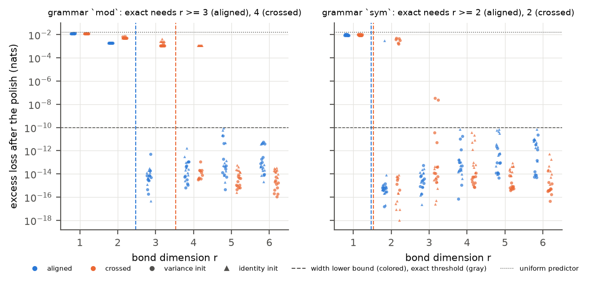
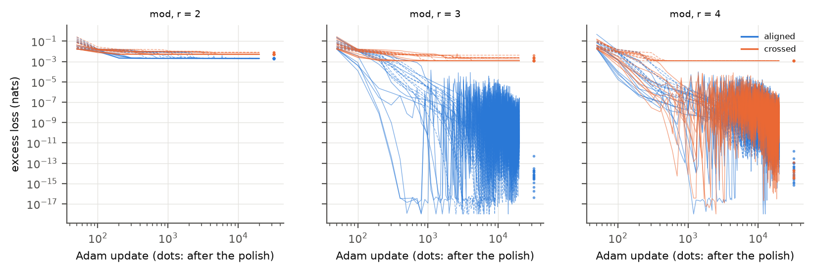

**What does it cost a tree tensor network to cross the grammar's pairs?**

*A research note on a rank bound for exact trees, a 3-symbol grammar where the aligned tree needs bond dimension 3 and a crossed tree needs 4, and what training finds on both sides of the bound.*

Earlier experiments in this repository ([`rhm-controls`](../rhm-controls/README.md), [`rhm-belief-architectures`](../rhm-belief-architectures/README.md)) trained tree tensor networks on the Random Hierarchy Model and found that a tree whose leaves follow the grammar ends closer to the Bayes loss than the same tree with permuted leaves, which in one of the two experiments did not learn two of four grammars. They could not say why. A permuted tree may lack the capacity at that bond dimension, or it may have the capacity and training may not find it. This note takes two grammars small enough that the capacity question has an exact answer, and then asks training the same question.

The answer has a proved part and a measured part, and the note keeps them apart. **Proved: for a fixed context the logits of a tree are linear in every bond, which bounds the rank of a matrix of Bayes logits by the bond dimension $r$. On the grammar `mod` this gives $r \ge 3$ for the tree aligned with the grammar and $r \ge 4$ for a tree that pairs $x_1$ with $x_3$ and $x_2$ with $x_4$; on the grammar `sym` both need only $r \ge 2$. Measured: over 480 trained trees (20 per grammar, grouping and width), training reaches the exact predictor in every cell at or above its bound and in no cell below it. The crossed bound of 4, for which no exact tree was known, is attained by 10 of 20 runs. Where the crossed tree has the capacity it is found less reliably than the aligned one, in a way that depends on the initialization.** The numbers are those of the write-up, [`README.md`](README.md), which has the full tables; a separate fact-check pass compared both documents with the result files and the code, and its corrections are applied here.

**Two grammars with the same target and different pair tables.** Both grammars have three symbols, 0, 1, 2, at every level, two productions per symbol, binary branching and three levels, so a sequence has 8 tokens $x_1, \dots, x_8$, and the root symbol is uniform. In `sym` every parent produces the other two symbols in either order, at every level:

$$
0 \to 12 \mid 21, \qquad 1 \to 02 \mid 20, \qquad 2 \to 01 \mid 10 .
$$

`mod` uses the same rules at the two upper levels and changes the bottom level to

$$
0 \to 12 \mid 21, \qquad 1 \to 02 \mid 22, \qquad 2 \to 01 \mid 11 .
$$

Read backwards, the bottom level assigns a symbol $c(b, c')$ to a token pair. In `sym`, $c(b, c') = -(b + c') \bmod 3$ for $b \ne c'$, the missing symbol. In `mod` the table is $c(1,2) = c(2,1) = 0$, $c(0,2) = c(2,2) = 1$, $c(0,1) = c(1,1) = 2$, and the pairs 00, 10, 20 never occur. In both grammars the two pair symbols $c_L = c(x_1, x_2)$ and $c_R = c(x_3, x_4)$ of a legal prefix differ, and the symbol of the first half is the third one, $A = -(c_L + c_R) \bmod 3$.

**The task is to predict $x_5$ from $x_1, \dots, x_4$, and its Bayes answer depends on the prefix only through $A$.** The symbol of the second half is one of the two symbols other than $A$, each with probability 1/2, and $x_5$ is reached from it by two first-child steps. In both grammars the first child of a symbol is uniform over the other two symbols, so each of the three steps applies the matrix $K = (\mathbf{1}\mathbf{1}^\top - I)/2$, and

```math
P(x_5 = y \mid x_1, \dots, x_4) = (K^3)_{A y} = \begin{cases} 1/4, & y = A, \\ 3/8, & y \ne A. \end{cases}
```

There are 24 legal prefixes in each grammar, each of probability 1/24, so the population loss is a sum of 24 terms and has no sampling noise. A softmax ignores a shift of the logits, so everything is compared after centering over the three outputs. Since $1/4 = (3/8)(2/3)$, the log-probabilities are $\log(3/8) + \log(2/3)\, \delta_{yA}$, and centering leaves

$$
F(A)_y = \log\tfrac{2}{3} \left( \delta_{yA} - \tfrac{1}{3} \right) .
$$

The three vectors $F(0), F(1), F(2)$ sum to zero and span a plane. A tree is exact when its centered logits equal $F(A(x))$ on every legal prefix. On the 57 prefixes that the grammar never produces, the tree is free.

**The model is multilinear, and the two groupings differ only in which tokens meet first.** The tree has 8 leaves; the last four always carry a mask token and contribute constants. Each leaf maps its token to a vector in $\mathbb{R}^r$, each internal node merges its children with a bilinear core, $z_u = W_u(z_{\mathrm{left}}, z_{\mathrm{right}})$, and the root core turns the two half vectors into three logits. In the aligned tree the first merges see $(x_1, x_2)$ and $(x_3, x_4)$, the pairs the grammar produced. In the crossed tree leaves 2 and 3 are swapped, so the first merges see $(x_1, x_3)$ and $(x_2, x_4)$. The parameter counts are equal.

**Theorem: every bond bounds a rank.** Fix a bond and let $S$ be the set of observed tokens in the subtree below it. The subtree computes a vector $u(x_S) \in \mathbb{R}^r$, and the rest of the network is linear in that vector, so the logits factor as

$$
\ell_y(x) = \sum_{k=1}^{r} u_k(x_S)\, v_k(x_{\bar S}, y),
$$

where $x_{\bar S}$ are the other observed tokens. Centering over $y$ acts on $v$ alone, so the centered logits factor in the same way. Arrange them in a matrix $\bar L$ with rows indexed by $x_S$ and columns by $(x_{\bar S}, y)$. It is a product of a matrix with $r$ columns and a matrix with $r$ rows, hence

$$
\operatorname{rank} \bar L \le r .
$$

An exact tree has $\bar L = F(A)$ on legal entries and anything at all on illegal ones. A submatrix of a matrix of rank at most $r$ has rank at most $r$, so every block of the target whose entries are all legal must have rank at most $r$:

$$
\boxed{\; r \;\ge\; \max_{\text{bonds}}\ \max_{\text{legal blocks}}\ \operatorname{rank}\, F\big|_{\text{block}} \;}
$$

The right-hand side is found by exhaustive search (`toy.cut_bound`, `toy.tree_bound`). One consequence is used below. The matrices of rank at most $r$ form a closed set, so a tree below its bound cannot approach the target on a full-rank legal block, and its excess loss is bounded away from zero. The theorem does not say by how much.

**On `sym` the bound is 2 for every bond, and width 2 is enough for any grouping.** With $r = 1$ every bond is a scalar and the centered logits of all prefixes lie on one line through the origin, which three vectors spanning a plane do not. So $r \ge 2$. For the other direction, substitute the pair rule into itself: $A = -(c_L + c_R) = x_1 + x_2 + x_3 + x_4 \bmod 3$. A sum can be accumulated in any order. Represent the symbol $a$ by the cube root of unity $z_a = e^{2\pi i a/3}$, as two real coordinates, and let every core be the real-bilinear map $(z, w) \mapsto \overline{zw}$. Two merges conjugate twice,

```math
\overline{\,\overline{z_{x_1} z_{x_2}}\;\overline{z_{x_3} z_{x_4}}\,} = z_{x_1} z_{x_2} z_{x_3} z_{x_4} = z_A ,
```

whichever tokens were paired first, and the readout

$$
\ell_y = \tfrac{2}{3} \log\tfrac{2}{3}\; \mathrm{Re}\left( \overline{z_y}\, z_A \right) = \tfrac{2}{3} \log\tfrac{2}{3} \cos\frac{2\pi (A - y)}{3}
$$

equals $F(A)_y$, because the cosine is 1 at $y = A$ and $-1/2$ otherwise. On `sym` the grouping costs nothing.

**On `mod` the aligned tree needs 3, because a leaf has to keep all three tokens apart.** Take the leaf $x_1$ as the bond, with rows $x_1 = 0, 1, 2$, and two contexts: $(x_2, x_3 x_4) = (1, 02)$ and $(2, 01)$. All six prefixes are legal, and their half symbols are

| | context $x_2 x_3 x_4 = 102$ | context $x_2 x_3 x_4 = 201$ |
|---|---|---|
| $x_1 = 0$ | $A = 0$ | $A = 0$ |
| $x_1 = 1$ | $A = 0$ | $A = 1$ |
| $x_1 = 2$ | $A = 2$ | $A = 0$ |

The rows of the block are $\rho_0 = [F(0), F(0)]$, $\rho_1 = [F(0), F(1)]$ and $\rho_2 = [F(2), F(0)]$. Suppose $a \rho_0 + b(\rho_1 - \rho_0) + c(\rho_2 - \rho_0) = 0$. The first three coordinates read $(a - c) F(0) + c F(2) = 0$, and $F(0), F(2)$ are independent, so $a = c = 0$; then the last three give $b = 0$. The block has rank 3. In `sym` no such block exists, because no value of $x_2$ is legal after all three values of $x_1$.

Width 3 is attained by the grammar's own message passing: each leaf sends the one-hot vector of its token, the first cores are the indicator of the pair table $c$, the next core is the indicator of "third symbol", and the root reads out $\log K^3$. Every bond of the aligned tree needs at most 3 (the bonds for $(x_1, x_2)$ and $(x_3, x_4)$ need only 2), so the aligned bound is exactly 3.

**On `mod` the crossed tree needs 4, because of one 4 × 4 block.** Now take the bond that holds $(x_1, x_3)$. Use the rows $(x_1 x_3) = 00, 01, 02, 10$ and the contexts $(x_2 x_4) = 12, 21$. All eight prefixes are legal. For example, row 01 with context 12 is the prefix $x_1 x_2 x_3 x_4 = 0112$, with $c_L = c(0,1) = 2$, $c_R = c(1,2) = 0$ and $A = 1$. The half symbols are

| $(x_1 x_3)$ | context $(x_2 x_4) = 12$ | context $(x_2 x_4) = 21$ |
|---|---|---|
| 00 | $A = 0$ | $A = 0$ |
| 01 | $A = 1$ | $A = 0$ |
| 02 | $A = 0$ | $A = 2$ |
| 10 | $A = 0$ | $A = 1$ |

Keep the outputs $y = 0, 1$ of each context, which gives four columns, and measure in units of $\log(2/3)/3$, in which $F(A)$ restricted to $y = 0, 1$ is $(2, -1)$, $(-1, 2)$, $(-1, -1)$ for $A = 0, 1, 2$:

```math
M = \begin{pmatrix} 2 & -1 & 2 & -1 \\ -1 & 2 & 2 & -1 \\ 2 & -1 & -1 & -1 \\ 2 & -1 & -1 & 2 \end{pmatrix}.
```

Subtracting the third row from the first and from the fourth leaves the determinant unchanged and gives

```math
\det M = \det \begin{pmatrix} 0 & 0 & 3 & 0 \\ -1 & 2 & 2 & -1 \\ 2 & -1 & -1 & -1 \\ 0 & 0 & 0 & 3 \end{pmatrix} = 3 \cdot \det \begin{pmatrix} -1 & 2 & -1 \\ 2 & -1 & -1 \\ 0 & 0 & 3 \end{pmatrix} = 3 \cdot 3 \cdot \det \begin{pmatrix} -1 & 2 \\ 2 & -1 \end{pmatrix} = 3 \cdot 3 \cdot (1 - 4) = -27 .
```

So $M$ has rank 4 and the crossed tree needs $r \ge 4$. The table shows why: each of the rows 01, 02, 10 departs from the row 00 in its own way, so the bond has to keep four values of $(x_1, x_3)$ linearly apart, and two tokens that the grammar never joined have no shared symbol to compress them into. The other bonds of the crossed tree need less (the leaves 3, 3, 2, 2 and the bond for $(x_2, x_4)$ only 2). The same search over every possible pair bond gives 4 for $(x_1 x_3)$, $(x_1 x_4)$ and $(x_2 x_3)$ and 2 for $(x_1 x_2)$, $(x_3 x_4)$ and $(x_2 x_4)$, so the other crossed pairing, $(x_1 x_4)(x_2 x_3)$, also needs 4.

The theory leaves two things to measurement. No exact crossed tree of width 4 was known for `mod`, so the bound of 4 might not be tight (width 9 is always enough, since the bond can then copy both tokens). And a bound says nothing about whether training finds a solution that exists.

**Measurement: training reaches the exact predictor exactly where the bounds allow.** Each of the 24 cells (grammar, grouping, width 1 to 6) has 20 runs: two initializations (the standard variance init, and an identity init that starts the tree near its additive part) and seeds 2000 to 2009, shared between the groupings. A run is 20,000 full-batch Adam updates on the exact loss followed by an L-BFGS polish, in float64. A run counts as exact if its excess loss, the mean KL divergence from the Bayes prediction, ends below $10^{-10}$ nats; a uniform predictor has 0.016417. Figure 1 shows every run.



*Figure 1. Excess loss after training against bond dimension, 20 runs per grammar, grouping and width (circles: variance init, triangles: identity init). The dashed vertical lines are the bounds; the gray dashed line is the $10^{-10}$ threshold and the dotted line the uniform predictor. Left of its bound, every run of a grouping sits above $10^{-3}$. Right of it, runs fall below $10^{-10}$, with the exceptions discussed in the text.*

The number of exact runs of 20 in each cell:

| grammar, grouping | bound | $r = 1$ | 2 | 3 | 4 | 5 | 6 |
|---|---|---|---|---|---|---|---|
| `mod` aligned | 3 | 0 | 0 | 20 | 20 | 20 | 20 |
| `mod` crossed | 4 | 0 | 0 | 0 | 10 | 20 | 20 |
| `sym` aligned | 2 | 0 | 19 | 20 | 20 | 20 | 20 |
| `sym` crossed | 2 | 0 | 14 | 18 | 20 | 20 | 20 |

The smallest exact width equals the bound in all four rows. In the 7 cells below their bound, the smallest excess loss of 140 runs is $1.15 \times 10^{-3}$ nats, 115 times the $10^{-5}$ that would have signalled an error in the bound or the code. On `mod` at width 3 the aligned tree is exact in 20 of 20 runs and the crossed tree in none, its best run ending at $1.15 \times 10^{-3}$, 7 % of the uniform predictor's excess. These were the criteria fixed before the run, and all were met. Of the 480 runs, 321 are exact, 157 end above $10^{-3}$, and 2 end in between (`sym` crossed at $r = 3$, at $2.3 \times 10^{-8}$ and $3.5 \times 10^{-8}$, both with a polish that stopped on its evaluation limit).

**The crossed bound of 4 is attained.** Ten of the 20 crossed runs at $r = 4$ on `mod` are exact. The best has an excess loss of $3.3 \times 10^{-15}$ nats, a largest centered-logit error of $1.8 \times 10^{-7}$ over the 24 prefixes and a largest weight of 2.73, and all ten have weights between 1.93 and 2.73 and logit errors of at most $2.0 \times 10^{-6}$. They are finite trees at the target to numerical precision, with no sign of the loss being driven down by growing weights. This is a numerical witness and not a construction: no closed form has been read off from these trees. Together with the theorem it gives the cost of crossing on `mod` as one bond dimension, 3 against 4.



*Figure 2. Excess loss during training on `mod` at widths 2, 3 and 4, one line per run (solid: variance init, dashed: identity init); dots at the right are the values after the polish. At width 3 the two groupings separate completely. At width 4 half of the crossed runs become exact and the other half stay on one plateau.*

**Where the crossed tree has the capacity, it is found less reliably, and the initialization decides.** The comparison fixed before the run puts each grouping at its own bound, with each at its best of four learning rates per init, and applies a two-sided Fisher exact test at 0.05. A rate arm of 240 further runs supplies the other rates. The exact runs of 10 seeds:

| cell | init | rate $10^{-3}$ | $3 \times 10^{-3}$ | $10^{-2}$ | $3 \times 10^{-2}$ |
|---|---|---|---|---|---|
| `sym` aligned, $r = 2$ | variance | 10 | 10 | 10 | 10 |
| | identity | 4 | 9 | 10 | 10 |
| `sym` crossed, $r = 2$ | variance | 5 | 4 | 4 | 5 |
| | identity | 9 | 10 | 10 | 9 |
| `mod` aligned, $r = 3$ | variance | 10 | 10 | 10 | 9 |
| | identity | 10 | 10 | 10 | 10 |
| `mod` crossed, $r = 4$ | variance | 10 | 10 | 10 | 10 |
| | identity | 0 | 0 | 0 | 7 |

By the rule, the crossed tree is harder to train at its bound on `sym` (15 of 20 against 20 of 20, $p = 0.047$) and shows no detectable difference on `mod` (17 of 20 against 20 of 20, $p = 0.23$). At the default rates ($10^{-2}$ for the variance init, $3 \times 10^{-3}$ for the identity init) the verdicts are the other way round: 14 against 19 on `sym` ($p = 0.091$) and 10 against 20 on `mod` ($p = 0.0004$). The `sym` verdict is one run away from $p = 0.106$, so the rule's output should be read as weak. The table itself is clearer than the test. On `sym` the crossed tree with the variance init is exact in 4 or 5 of 10 seeds at every rate, where the aligned tree with the same init is exact in 10 of 10. On `mod` the crossed tree with the variance init never fails, and with the identity init it fails in every seed at three rates. One width above the bound the failures are gone or nearly so: 18 of 20 on `sym` at $r = 3$ and 20 of 20 on `mod` at $r = 5$.

**Observed after the run: the crossed trees that miss at width 4 have converged to the width-3 solution.** The ten identity-init runs at $r = 4$ on `mod` all end at an excess loss of $1.149171 \times 10^{-3}$, which is the floor of the width-3 crossed cell to seven digits, with a polish that converged. A check written after seeing this compares their functions on legal prefixes. Their centered logits differ from those of the best width-3 crossed tree by at most $1.0 \times 10^{-6}$ on the 24 prefixes, and on the block $M$ their logits have singular values 4.190, 3.228, 1.381 and less than $10^{-6}$, against 4.602, 3.406, 1.824, 0.944 for the target (whose product is 27). So these trees carry three channels across the $(x_1, x_3)$ bond on legal prefixes and sit at a stationary point where the fourth is unused. This fits the identity init, which starts every bond near a constant channel plus pass-through channels, although the run does not test that explanation. In the width-3 cell 12 of 20 runs reach the same function and 8 end higher.

A second observation of the same kind qualifies the floors. At $r = 1$ a tree is a product of one scalar per token, so both groupings are the same set of functions and their true floors coincide. The measured floors agree on `sym` ($8.390 \times 10^{-3}$) and differ on `mod` ($1.2385 \times 10^{-2}$ crossed, $1.2499 \times 10^{-2}$ aligned), so 20 aligned runs missed the best width-1 tree. The floors reported for cells below their bound are the best of 20 runs and upper bounds on the true ones.

**What is established, and what is not.** The bounds are theorems, and they hold for any exact tree on these two grammars whatever the optimizer. That training finds an exact tree at every width the bounds allow, and that width 4 suffices for the crossed tree on `mod`, are measurements on 20 runs per cell. That the crossed tree is harder to train at its bound is supported in direction (fewer exact runs than the aligned tree in all four comparisons) and passes the pre-stated test on one grammar by one run. None of this shows that the permuted trees of the earlier, larger experiments fell short for lack of capacity. It shows that a capacity account is available, exact, and visible in training when the grammar is small enough to prove it.

**What would come next.** Two calculations and one experiment follow. The first is a closed-form width-4 crossed tree for `mod`, read off from the ten saved witnesses, which would turn "attained numerically" into a construction and show what the fourth channel encodes. The second is the same rank bound on the larger grammars of the earlier experiments, for the cuts whose legal blocks can be enumerated, to see whether the widths at which permuted trees fell short there lie below a bound. The experiment is a seed and init-scale grid on the two crossed cells at their bound, with the rule fixed in advance, to decide whether the identity init's width-3 basin on `mod` and the variance init's failures on `sym` are properties of the crossed tree or of these two inits.

**Sources.** The grammars, the targets, the bound search and the hand-built exact trees are in [`studies/rhm/toy.py`](../toy.py), and [`studies/rhm/toy_checks.py`](../toy_checks.py) verifies the targets, the four tree bounds, the determinant and the hand-built trees by enumeration (29 checks including the optimizer's, all passed before training); the bounds of the individual bonds are in [`results/posthoc.txt`](results/posthoc.txt). The definition with the criteria is [`EXPERIMENT.md`](EXPERIMENT.md); the measured numbers are in [`results/summary.txt`](results/summary.txt) and `results/posthoc.txt`.
