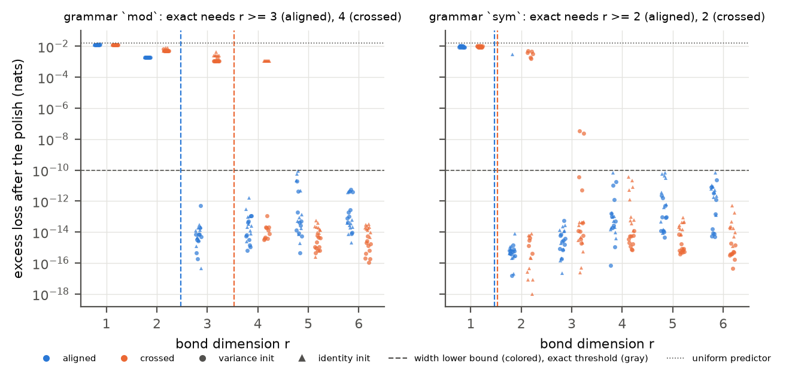
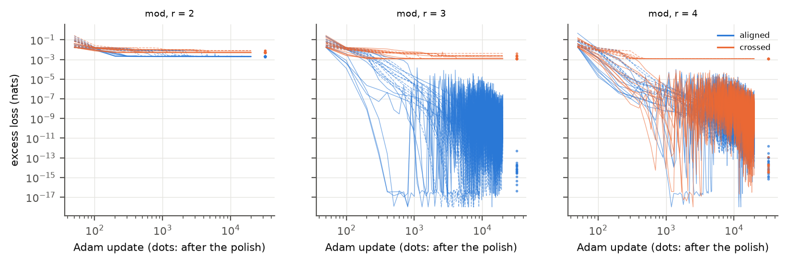

# rhm-crossed-rank: does aligning the tree with the grammar save bond dimension?

**Result: supported.** On a hand-built 3-symbol grammar (`mod`) a tree aligned with the grammar needs bond dimension
3 to be exact and a tree that pairs x_1 with x_3 and x_2 with x_4 needs 4. Both numbers are proved lower bounds for
any exact tree (3 is also attained by a hand-built tree; that 4 is enough for the crossed tree is a numerical finding
of this run), and training reproduced them without exception: the aligned tree reached the exact predictor in 20 of 20 runs
at width 3, and the crossed tree in 0 of 20 at width 3 (its best run stayed 1.15e-3 nats above the Bayes loss, 7 % of
a uniform predictor's excess) and in 10 of 20 at width 4. On the control grammar (`sym`), where both groupings need
width 2, both reached the exact predictor at width 2 (aligned 19 of 20 runs, crossed 14 of 20). Across all 24 cells
(grammar, grouping, width; 20 runs each), every cell at or above its bound has at least 10 exact runs and every cell
below its bound has none. So on `mod` crossing the tree costs one bond dimension, 3 against 4, and the crossed
tree's failure at width 3 is a capacity limit, not a training failure.

Whether the crossed tree is as easy to train where it has the capacity did not get one answer. By the rule fixed
before the run (each grouping at its own bound and its own best learning rate per initialization, two-sided Fisher
exact test at 0.05), the crossed tree is harder to train on `sym` (15 of 20 exact against 20 of 20, p = 0.047) and
shows no detectable difference on `mod` (17 of 20 against 20 of 20, p = 0.23). The `sym` verdict rests on one run:
with 16 of 20 the test gives p = 0.106. At the default rates the two verdicts swap (`sym` 14 against 19 of 20,
p = 0.091; `mod` 10 against 20 of 20, p = 0.0004). What is stable is that the crossed tree's failures sit in one
initialization at every rate (variance on `sym`, identity on `mod`); the aligned tree loses at most 1 of 10 seeds
except on `sym` with the identity init at the smallest rate, where 4 of 10 are exact. The table for this is below.

All criteria were fixed before the run in [`EXPERIMENT.md`](EXPERIMENT.md) and none was changed. 720 trees were
trained on the coordinator's 2 vCPUs in 112 minutes at no cost. The derivations are in [`NOTE.md`](NOTE.md).

*Excess loss after training of every run at the default learning rates (480 runs: 20 per grammar, grouping and
width; circles: variance init, triangles: identity init, 10 seeds each). Dashed vertical lines: the width lower
bound of each grouping. Gray dashed line: the threshold for "exact", 1e-10 nats. Dotted line: a uniform predictor,
0.016417 nats. Values are clipped at 1e-18. PDF: [`figures/capacity.pdf`](figures/capacity.pdf).*

## Two kinds of statement

- **Theorems** say what any exact tree must do: the width lower bounds, and the widths at which a hand-built exact
  tree exists. They are restated under "Theory in brief", derived in `NOTE.md`, and verified by enumeration in
  `studies/rhm/toy_checks.py` (29 of 29 checks passed before training). A training run cannot make them more true;
  it can catch an error in the bound or in the code (criterion H1).
- **Measurements** say what training found: whether it reaches the exact predictor where one exists, whether the
  crossed bound of 4 is attained at all (no hand-built crossed tree for `mod` was known), how often, and how far
  from exact the trees below their bound stay.

## The setup in brief

**Grammars.** Three symbols, 0, 1, 2, at every level, two productions per symbol, three levels, so a sequence has 8
tokens; the root is uniform. In `sym` every parent produces the other two symbols in either order at every level
(0 → 12 | 21, 1 → 02 | 20, 2 → 01 | 10). `mod` is the same at the two upper levels, and at the bottom level
0 → 12 | 21, 1 → 02 | 22, 2 → 01 | 11.

**Task.** The tree sees x_1 … x_4, the other four leaves carry a mask token, and it predicts x_5. Write A for the
symbol that produced the observed half. The Bayes prediction is P(x_5 = y) = 1/4 if y = A and 3/8 otherwise, in both
grammars. For example, in `mod` the prefix 0102 has pair symbols 2 (from 01) and 1 (from 02), so A = 0 and the target
is (1/4, 3/8, 3/8). There are 24 legal prefixes, each of probability 1/24, and the loss is computed exactly on all of
them, so there is no sampling noise. The **excess loss** is the mean KL divergence from the Bayes prediction in nats;
a uniform predictor has 0.016417.

**Model.** A binary tree tensor network over the 8 leaves with the same bond dimension r on every bond (`TreeTN` in
`ctn/tree.py`). Each leaf maps its token to an r-vector, each internal node merges its two children's vectors with a
bilinear core, and the root core gives three logits. **Aligned**: the leaves are in order, so the first merges see
(x_1, x_2) and (x_3, x_4), the pairs the grammar produced. **Crossed**: leaves 2 and 3 are swapped, so the first
merges see (x_1, x_3) and (x_2, x_4). Both have the same number of parameters (1,596 at r = 6).

**Runs.** A *cell* is one grammar, grouping and width r ∈ {1, …, 6}, with 20 runs: two initializations (the
standard variance init, and an "identity" init that starts the tree near its additive part) × seeds 2000–2009. Each
run is 20,000 full-batch Adam updates followed by an L-BFGS polish, in float64. A run is **exact** if its excess
loss ends below 1e-10 nats, and a cell is exact if any of its runs is, because reaching the exact predictor is an
existence statement. The two groupings share seeds, inits and learning rates and differ only in the leaf order. A
separate rate arm (240 runs) repeats the four cells where each grouping sits at its own bound at three more learning
rates; it enters only the trainability comparison.

Two typical runs, same seed and init, width 3 on `mod`: the aligned tree ended at 7.3e-15 nats and the crossed tree
at 1.15e-3.

## Theory in brief

For a fixed context the logits are linear in every bond. So if a bond's subtree holds the tokens x_S, the matrix of
centered logits with rows indexed by x_S and columns by (the other tokens, the output) has rank at most r. An exact
tree must equal the centered Bayes logits on every legal prefix, so every block of that matrix whose entries are all
legal must have rank at most r. The largest such rank over the tree's bonds is a lower bound on r
(`toy.tree_bound`, exhaustive).

| grammar | grouping | width lower bound | where it comes from | exact tree known before the run |
|---|---|---|---|---|
| `sym` | aligned | 2 | any bond | yes, width 2, built by hand |
| `sym` | crossed | 2 | any bond | yes, width 2, built by hand |
| `mod` | aligned | 3 | the leaves x_1 and x_3 | yes, width 3, built by hand |
| `mod` | crossed | 4 | the bond that holds (x_1, x_3) | no |

The bound of 4 comes from one 4 × 4 block: rows (x_1 x_3) = 00, 01, 02, 10 against columns (x_2 x_4, y) = (12, 0),
(12, 1), (21, 0), (21, 1). All 8 prefixes are legal, their half symbols are A = 0, 0 / 1, 0 / 0, 2 / 0, 1, and the
block has determinant −27 in units of log(2/3)/3, so it has rank 4. On `sym`, A = x_1 + x_2 + x_3 + x_4 mod 3, which
any grouping can add up with two real channels (symbols as cube roots of unity).

## Result against each criterion

All from [`results/summary.txt`](results/summary.txt), computed by `analyze.py` on the 480 runs at the default rates.

| criterion (fixed before the run) | observed | verdict |
|---|---|---|
| **H1** (a test of the code). In the 7 cells below their bound, no run ends below 1e-5 nats. | 140 runs; the smallest excess loss is 1.15e-3 nats (`mod` crossed, r = 3), 115 times the threshold. | supported |
| **H2**. On `mod` at r = 3 the aligned cell has an exact run and the crossed cell has none, with every crossed run above 1e-5. | aligned 20 of 20 exact; crossed 0 of 20, smallest 1.15e-3, largest 4.19e-3. | supported |
| **H3** (existence control). On `sym` at r = 2 both groupings have an exact run. | aligned 19 of 20; crossed 14 of 20. | supported |
| **H4**. On `mod` the crossed cell at r = 4 has an exact run whose largest centered-logit error is below 1e-4. | 10 of 20 exact (10 of 10 with the variance init, 0 of 10 with the identity init). Best run: excess 3.3e-15, largest logit error 1.8e-7, largest weight 2.73. | attained |
| **Overall**: supported if H1, H2 and H3 are. | | **supported** |

The per-cell table. "Exact" counts runs below 1e-10 nats, with the split (variance init, identity init) of 10 each;
"capped" counts runs whose polish stopped on its limit of 1,000 iterations or 1,250 evaluations and so may not have
converged (censored, none dropped). Cells below their bound are marked ✗.

| grammar, grouping | r | bound | exact of 20 (var, id) | capped | smallest excess | median | largest | smallest / uniform |
|---|---|---|---|---|---|---|---|---|
| `mod` aligned | 1 ✗ | 3 | 0 | 10 | 1.25e-2 | 1.28e-2 | 1.35e-2 | 0.761 |
| | 2 ✗ | | 0 | 20 | 1.96e-3 | 1.98e-3 | 1.99e-3 | 0.119 |
| | 3 | | 20 (10, 10) | 2 | 4.3e-17 | 5.9e-15 | 5.1e-13 | 0 |
| | 4 | | 20 (10, 10) | 2 | 6.7e-16 | 2.2e-14 | 1.6e-12 | 0 |
| | 5 | | 20 (10, 10) | 3 | 4.5e-16 | 5.1e-14 | 8.9e-11 | 0 |
| | 6 | | 20 (10, 10) | 3 | 2.1e-15 | 5.0e-14 | 5.5e-12 | 0 |
| `mod` crossed | 1 ✗ | 4 | 0 | 10 | 1.24e-2 | 1.28e-2 | 1.29e-2 | 0.754 |
| | 2 ✗ | | 0 | 2 | 4.89e-3 | 4.89e-3 | 7.96e-3 | 0.298 |
| | 3 ✗ | | 0 | 7 | 1.15e-3 | 1.15e-3 | 4.19e-3 | 0.070 |
| | 4 | | 10 (10, 0) | 0 | 3.3e-15 | 5.7e-4 | 1.15e-3 | 0 |
| | 5 | | 20 (10, 10) | 0 | 2.6e-16 | 5.3e-15 | 5.5e-14 | 0 |
| | 6 | | 20 (10, 10) | 0 | 1.1e-16 | 5.0e-15 | 3.3e-14 | 0 |
| `sym` aligned | 1 ✗ | 2 | 0 | 13 | 8.39e-3 | 1.01e-2 | 1.10e-2 | 0.511 |
| | 2 | | 19 (10, 9) | 1 | 1.6e-17 | 5.7e-16 | 3.12e-3 | 0 |
| | 3 | | 20 (10, 10) | 0 | 2.3e-17 | 2.7e-15 | 5.5e-14 | 0 |
| | 4 | | 20 (10, 10) | 0 | 7.1e-17 | 5.1e-14 | 6.6e-11 | 0 |
| | 5 | | 20 (10, 10) | 1 | 4.6e-15 | 2.4e-13 | 6.9e-11 | 0 |
| | 6 | | 20 (10, 10) | 3 | 5.0e-15 | 2.8e-12 | 6.7e-11 | 0 |
| `sym` crossed | 1 ✗ | 2 | 0 | 14 | 8.39e-3 | 1.01e-2 | 1.10e-2 | 0.511 |
| | 2 | | 14 (4, 10) | 6 | below 1e-17 | 3.5e-15 | 5.12e-3 | 0 |
| | 3 | | 18 (8, 10) | 2 | 2.4e-17 | 1.2e-14 | 3.5e-8 | 0 |
| | 4 | | 20 (10, 10) | 1 | 6.9e-16 | 1.2e-14 | 3.7e-11 | 0 |
| | 5 | | 20 (10, 10) | 0 | 3.9e-16 | 7.0e-15 | 8.9e-14 | 0 |
| | 6 | | 20 (10, 10) | 2 | 4.6e-17 | 1.6e-15 | 5.1e-13 | 0 |

Notes on the table:

- **The smallest exact width equals the bound in all four (grammar, grouping) pairs**: 2, 2, 3 and 4. The bounds are
  attained, the crossed bound of 4 numerically: no exact crossed tree was known before the run, and none has been
  written down in closed form since.
- **The gap between "exact" and "not exact" is wide.** Of the 480 runs, 321 are exact, 157 end above 1e-3 nats and 2
  end between the two thresholds (`sym` crossed at r = 3, variance init, seeds 2002 and 2009, at 3.5e-8 and 2.3e-8,
  both with a capped polish). Those two are counted as neither exact nor floor, as the definition says.
- **Adam did the work.** 318 of the 321 exact runs were already below 1e-6 nats when Adam stopped; the polish only
  refined them. Two of the other three were at 1.2e-6 and 1.3e-6. The third (`sym` aligned, r = 2, identity init,
  seed 2006) was at 3.1e-3 when Adam stopped and the polish took it to 2.2e-16, so one of that cell's 19 exact runs
  was found by L-BFGS. 17 exact runs have a capped polish; they are below the threshold regardless.
- **The floors below the bound** (best run of each cell, as a share of the uniform predictor's excess): `sym` at
  width 1, 51 % in both groupings; `mod` aligned 76 % at width 1 and 12 % at width 2; `mod` crossed 75 %, 30 % and
  7 % at widths 1, 2 and 3. These are the best of 20 runs, so they are upper bounds on what each width can reach.
  76 of the 140 runs below their bound have a capped polish, including all 20 of `mod` aligned at width 2, whose
  values agree to within 1.4 % (1.960e-3 to 1.986e-3).
- **In the median column of `mod` crossed at r = 4**, 5.7e-4 is the midpoint between 10 exact runs and 10 runs at
  1.15e-3; no run ended there.

*Excess loss during training on `mod` at widths 2, 3 and 4, one line per run (20 per grouping and width; solid:
variance init, dashed: identity init), logged every 100 Adam updates; the dots at the right are the values after the
polish. At width 3 every aligned run falls by many orders of magnitude and then fluctuates under Adam, and every
crossed run flattens above 1e-3; at width 4 half of the crossed runs join the aligned ones and the other half stay
on one plateau. PDF:
[`figures/curves.pdf`](figures/curves.pdf).*

## Trainability at the bound

The pre-stated comparison puts each grouping at its own bound, where both have the capacity: on `sym`, aligned and
crossed at r = 2; on `mod`, aligned at r = 3 against crossed at r = 4. Exact runs of 10 seeds per init and learning
rate (the default rate of each init is in bold):

| cell | init | 1e-3 | 3e-3 | 1e-2 | 3e-2 |
|---|---|---|---|---|---|
| `sym` aligned, r = 2 | variance | 10 | 10 | **10** | 10 |
| | identity | 4 | **9** | 10 | 10 |
| `sym` crossed, r = 2 | variance | 5 | 4 | **4** | 5 |
| | identity | 9 | **10** | 10 | 9 |
| `mod` aligned, r = 3 | variance | 10 | 10 | **10** | 9 |
| | identity | 10 | **10** | 10 | 10 |
| `mod` crossed, r = 4 | variance | 10 | 10 | **10** | 10 |
| | identity | 0 | **0** | 0 | 7 |

| grammar | comparison | aligned | crossed | Fisher p (two-sided) | reading |
|---|---|---|---|---|---|
| `sym` | best rate per init (carries the reading) | 20 / 20 | 15 / 20 | 0.047 | the crossed tree is harder to train at its bound |
| `sym` | default rates | 19 / 20 | 14 / 20 | 0.091 | no detectable difference |
| `mod` | best rate per init (carries the reading) | 20 / 20 | 17 / 20 | 0.23 | no detectable difference |
| `mod` | default rates | 20 / 20 | 10 / 20 | 0.0004 | the crossed tree is harder to train at its bound |

How far to trust this. The best rate is chosen on the same 10 seeds it is scored on, for both groupings alike, and
the aligned tree is at 20 of 20 under the rule on both grammars. The `sym` verdict is one run from the other side of 0.05. The test
treats the 20 runs of a cell as exchangeable, and they are not: the failures sit in one init. On `sym` the crossed
tree with the variance init is exact in 4 or 5 of 10 seeds at every one of the four rates, where the aligned tree
with the same init is exact in 10 of 10 at every rate; with the identity init it is exact in 9 or 10. On `mod` the pattern is reversed:
the crossed tree with the variance init is exact in 10 of 10 at every rate, and with the identity init in 0 of 10 at
three rates and 7 of 10 at the largest. No learning rate removes the `sym` failures; a larger one removes most of
the `mod` failures.

Two qualifications on the counts. The non-exact `sym` crossed runs with the variance init nearly all have a capped
polish (5 of 5, 6 of 6, 6 of 6 and 4 of 5 at the four rates), so by the definition they are censored. They ended at
1.6e-3 to 5.6e-3 nats, within 8 % of where Adam left them, which looks like a plateau and not like a polish cut
short on its way down, but the run cannot rule the second out. And the one non-exact run behind the "9" of `mod`
aligned at rate 3e-2 is a near miss, not a floor: it ended at 3.6e-10 with a capped polish (the rate arm's only run
between the two thresholds).

One width above its bound the crossed tree's failures are gone or nearly gone at the default rates: 18 of 20 exact
on `sym` at r = 3 (the other two are the runs between the thresholds), and 20 of 20 on `mod` at r = 5.

## Observed after the run

These were not planned and no criterion rests on them. They come from `posthoc.py`, written after the results were
seen, with output in [`results/posthoc.txt`](results/posthoc.txt).

- **The ten crossed width-4 trees that miss the exact predictor on `mod` compute the best width-3 function.** All
  ten identity-init runs at r = 4 end at an excess loss of 1.149171e-3, the floor of the width-3 crossed cell to
  seven digits, and none has a capped polish. On the 24 legal prefixes their centered logits differ from those of
  the best width-3 crossed tree by at most 1.0e-6. On the 4 × 4 block that forces width 4 their logits have singular
  values 4.190, 3.228, 1.381 and less than 1e-6 (in units of log(2/3)/3), against 4.602, 3.406, 1.824, 0.944 for
  the target and for the ten exact trees. So these runs did not stop on the way to the exact tree. They converged
  to the solution a width-3 tree has, with the fourth channel of the (x_1, x_3) bond unused on legal prefixes. In
  the width-3 cell itself 12 of 20 runs reach that same function (9 variance, 3 identity); the other 8 end higher.
- **The exact runs of the four cells at their bound are all finite trees, not only each cell's best.** Over all exact runs of the four cells at their
  bound, the largest weight is between 1.3 and 6.1 and the largest centered-logit error on the legal prefixes is at
  most 3.3e-6 (`mod` crossed at r = 4, 10 exact runs: weights 1.93 to 2.73, errors 1.8e-7 to 2.0e-6). The
  definition raised the possibility that a loss near zero is approached with diverging weights; that did not happen.
- **A measured floor is an upper bound, and width 1 shows it.** At r = 1 a tree is a product of one scalar per
  token, so the two groupings are the same set of functions and their true floors are equal. On `sym` the two
  measured floors agree (8.390e-3). On `mod` they do not: 1.2385e-2 crossed, reached by 4 of 20 runs, against
  1.2499e-2 aligned. So 20 aligned runs at width 1 did not find the best width-1 tree.
- **The bound of 4 is not special to the crossing chosen.** On `mod` the bonds (x_1 x_3), (x_1 x_4) and (x_2 x_3)
  each need width 4, and (x_1 x_2), (x_3 x_4), (x_2 x_4) each need 2; on `sym` every bond needs 2. The pairing the
  grid does not train, (x_1 x_4)(x_2 x_3), therefore also needs 4 on `mod`, as the review before launch had found.

## How it was checked

- **`toy_checks` before training: 29 of 29 passed** ([`results/toy_checks.txt`](results/toy_checks.txt)). They
  enumerate both grammars (384 sequences, 24 legal prefixes), compare the targets with an independent
  implementation of the grammar's belief propagation, recompute the four bounds and the determinant of the 4 × 4
  block, confirm that the hand-built trees are exact (`sym` at width 2 in both groupings, both grammars aligned at
  width 3) and that the width-2 `sym` tree is not exact on `mod`, and test the loss gradient and the polish. A
  failed check would have stopped the experiment.
- **H1 is the check of the bound against training.** A run below 1e-5 nats in a cell below its bound would have
  meant an error in the bound, the target or the code. None of 140 came within a factor of 100 of it.
- **The exact trees are checked on the logits, not only the loss**: the best run of every exact cell has a largest
  centered-logit error of at most 3.5e-7 over the 24 prefixes (`results/summary.txt`, last column), and the best
  tree of every cell is saved in `results/best_trees.pt`.
- **No run failed.** 720 of 720 runs finished; none raised, none ended with a non-finite loss, none was dropped.
- **Source snapshot.** The code the run used (`studies/rhm/toy.py`, `toy_checks.py`, `ctn/`, `run.py`,
  `analyze.py`, `lr_pilot.py`) is as it stood at commit `b960bb2`, made before the run, and `git diff b960bb2` on
  those paths is empty. `plot.py` was changed after the run (see "Judgement calls") and `posthoc.py` was added after
  it; both are committed with this write-up. `results/provenance.json` records the later commit `208a95d` and
  `dirty: true`: seven commits of other experiments landed during the run, `EXPERIMENTS.md` was modified during it,
  and `orch.toml` had carried an uncommitted change since 2026-11-15.
- **A rerun on a second machine gave the same files, byte for byte.** A separate experiment run by another session,
  [`rhm-toy-rerun`](../rhm-toy-rerun/README.md), ran this experiment's training and analysis commands on a rented
  CPU worker. Its `runs.json`, `summary.json`, `summary.txt`, `curves.json` and `best_trees.pt` have the same SHA-256
  as this folder's. So the results reproduce on other hardware; because the arithmetic came out identical, the
  rerun says nothing about how sensitive the counts are to numerical noise. The worker finished first (its results
  were committed at 23:40 UTC, 71 minutes before this run's last tree), so the complete results existed before this
  run ended. The criteria had been fixed and committed at 22:33 UTC, before either run started.
- **Fact check.** A separate pass compared this write-up and `NOTE.md` with the result files and the code; what it
  changed is listed at the end.

## Not yet checked

- **Whether the floors below the bound are the true floors.** They are the best of 20 runs, 76 of 140 with a capped
  polish, and the width-1 comparison above shows one cell that missed its optimum. More seeds or a longer polish in
  the 7 cells below their bound would tighten them (20 more runs per cell take about 3 minutes on the coordinator's
  two CPUs, at the 18.7 s per run measured here). No criterion
  depends on it: H1 needs only that no run is below 1e-5.
- **Why the crossed tree's failures depend on the init, in opposite directions on the two grammars.** The run
  measures it and does not explain it. A grid over the identity init's noise scale ε (0.1 here) and over more seeds
  for the two crossed cells at their bound, about 6 minutes per 40 runs, would say whether the identity init's 0 of
  10 on `mod` is a basin that a larger ε leaves. The trainability reading depends on this.
- **Whether the trainability gap survives more seeds.** With 20 runs per cell only large gaps are detectable, and
  the `sym` verdict is at p = 0.047. Forty more seeds per init in the two `sym` cells (160 runs, about 25 minutes)
  would settle whether 15 of 20 against 20 of 20 is real.
- **Whether any of this carries to the larger grammars** of the earlier experiments (`rhm-controls`,
  `rhm-belief-architectures`), where the permuted tree ended further from the Bayes loss than the aligned tree at a
  fixed width, and did not learn two of the four grammars of `rhm-belief-architectures`. The same bound can be computed
  there only for cuts whose legal blocks can be enumerated; it has not been tried.
- **The crossed exact tree was not turned into a construction.** Training found ten; nobody has read off a closed
  form from them. They are saved (`results/best_trees.pt` has the best one).

## Judgement calls

- **Existence is read from the best run of a cell, trainability from the count.** "Exact if any run is" was fixed
  before the run because the question is whether a solution exists at that width. It means a cell with 10 of 20
  exact runs counts the same as one with 20 of 20 for H2 to H4. The counts are in the tables.
- **The polish, and "exact" as 1e-10 after it.** Adam's endpoint fluctuates (median 1.1e-9 nats over the exact runs,
  85 of 321 already below 1e-10), so the threshold is read after L-BFGS. A run that Adam left short and the polish finished counts as exact; 3 of the 321
  exact runs were above 1e-6 nats when Adam stopped, one of them far above (see the notes on the table).
- **The trainability rule compares best rates chosen on the scoring seeds.** The alternative, the default rates
  alone, gives the opposite verdict on both grammars. Both are reported, and the pre-stated one carries the reading.
- **The `posthoc.py` checks were added by the run's supervisor after seeing the results**, because the ten stuck
  runs sat on the width-3 floor to seven digits and that asked for an explanation. They changed no verdict.
- **The capacity figure's legend was moved below the panels after the run** (it covered points in the `sym` panel),
  and `plot.py` gained an option to write PNG copies. The data plotted are unchanged.

## What this means and what to do next

For these two grammars the capacity question that `rhm-controls` and `rhm-belief-architectures` left open has an
exact answer and training agrees with it: a tree that crosses the grammar's pairs can need more bond dimension than
an aligned one (one more on `mod`, none on `sym`), a tree below its bound stays a fixed distance from the Bayes
loss, and one bond dimension more is enough. The earlier shortfalls of permuted trees at a fixed width are therefore
compatible with a pure capacity account, and this run shows what such an account looks like when it can be proved.
It does not show that those larger trees were capacity-limited.

The second reading, that a crossed tree with enough capacity is also harder to train, has support here but not a
clean test: the crossed tree had fewer exact runs than the aligned one in all four comparisons at the bound, the
difference passed the 0.05 rule in two of them (not the same one on the two grammars), and the failures moved with
the init. The cheapest next step is the ε and seed grid above on the two crossed cells at their bound, with the
rule fixed before it runs.

## Files

- [`EXPERIMENT.md`](EXPERIMENT.md): the definition, with the criteria, commands and outcome.
- `run.py`, `analyze.py`, `plot.py`, `lr_pilot.py`, `posthoc.py`; the grammars and the bounds are in
  `studies/rhm/toy.py`, the checks in `studies/rhm/toy_checks.py`.
- `results/summary.txt`, `summary.json`: per-cell table, verdicts and Fisher tests. `results/runs.json`: every run's
  final loss. `results/curves.json`: loss logs of the 480 default-rate runs. `results/best_trees.pt`: the best tree
  of every cell. `results/posthoc.txt`, `posthoc.json`: the checks made after the run. `results/lr_pilot.txt`: the
  learning-rate pilot made before launch. `results/provenance.json`, `results/toy_checks.txt`.
- `figures/capacity.pdf`, `figures/curves.pdf`, with PNG copies under `figures/png/`.
- The 720 trained trees are in `runs/rhm-crossed-rank/` on the coordinator, outside git; they can be regenerated
  from the seeds with the commands in the definition.

## Fact-check corrections

The fact-check pass recomputed the tables, counts, p-values and the note's derivations from the result files and the
code. It found no wrong verdict, count of exact runs, p-value or derivation, and it changed the following here:

- The capped count of `sym` crossed at r = 6 was 0 in the table and is 2; two cells were rounded twice
  (`mod` aligned r = 3 median, 5.9e-15; `mod` crossed r = 6 largest, 3.3e-14).
- The first paragraph called both widths "theorems" and the cost "exactly one"; the lower bounds are proved, and
  that width 4 is enough for the crossed tree is a numerical finding. "The bounds are tight" became "attained, the
  crossed bound numerically".
- "The aligned tree's failures hardly depend on the init" was too strong (`sym` aligned with the identity init is
  exact in 4 of 10 at the smallest rate); the sentences now give the counts.
- The source-snapshot paragraph wrongly said that all scripts of this folder were unchanged since `b960bb2` and that
  `orch.toml` was modified during the run.
- "Adam stops near 1e-10 because of its step floor" was an untested cause and is replaced by the measured spread.
- The description of the earlier experiments ("the permuted tree failed") was stronger than their write-ups.
- The time estimates under "Not yet checked" had no source and are now computed from the measured 18.7 s per run.
- Added on its suggestion: the byte-identical worker rerun, the capped polish of the non-exact `sym` crossed runs,
  and the rate arm's run between the thresholds.
