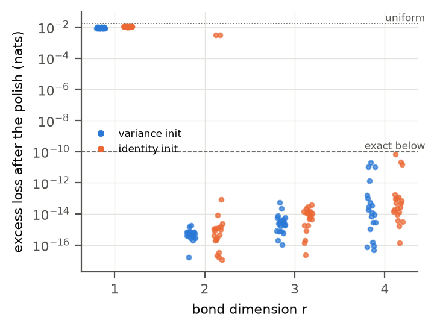
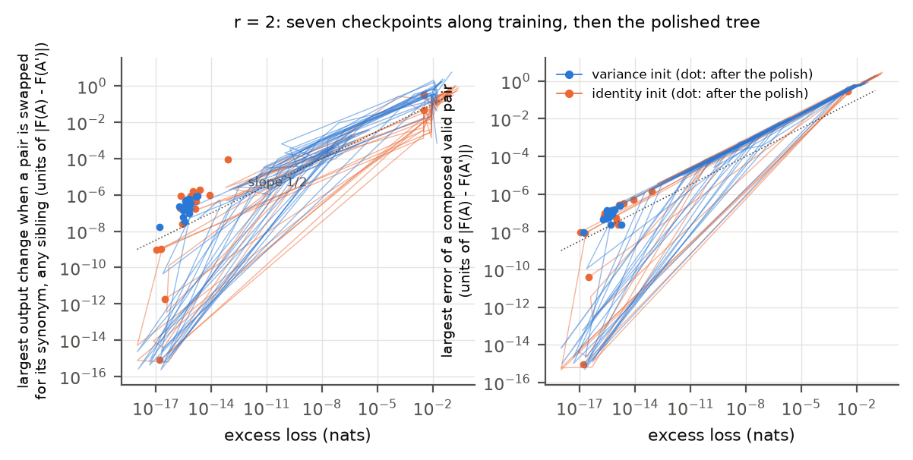
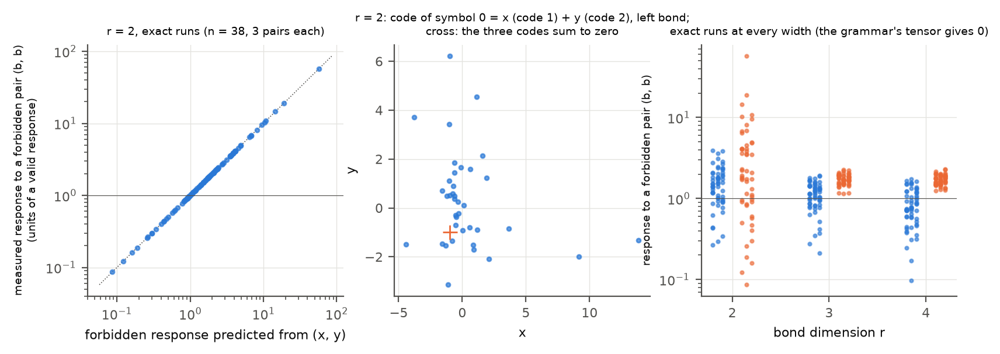
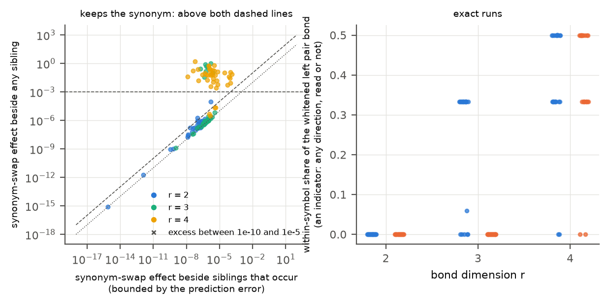

**What must a Bayes-optimal tree encode? Forced synonym collapse and forced forbidden responses on a 3-symbol grammar**

*A research note on a grammar small enough to prove what an exact width-2 tree tensor network does on its bonds, and on which of the allowed trees gradient descent finds.*

Two earlier experiments ([`rhm-ttn-messages`](../rhm-ttn-messages/NOTE.md), [`rhm-ttn-masks`](../rhm-ttn-masks/NOTE.md)) trained tree tensor networks (TreeTNs) on the Random Hierarchy Model and asked whether the trained cores implement the grammar's message passing. Neither found that they do (the second was inconclusive by its own rule), and in both, child pairs that the grammar forbids keep as much read-out mass as valid ones. Those experiments had no exact statement of what an optimal tree *must* encode, so a failed test could not be told apart from a wrong prediction. This note works on a grammar with three symbols, where that statement can be proved, and then measures it on 160 trained trees.

The note has two parts, and they have different standing. **The first part is a set of theorems about any width-2 tree that attains the Bayes loss: it must give synonymous token pairs the same bond, compose the pair codes as the grammar does, and respond to every forbidden pair with a size fixed by two numbers $(x, y)$ that describe its codes. The second part is a set of measurements: training (Adam, then an L-BFGS polish) reaches the Bayes loss in 38 of 40 width-2 runs, 37 of them by Adam alone; all 38 trees satisfy the theorems to within $10^{-4}$; the smallest forbidden response has a median of 0.83 of a valid response over the 37 exact runs that Adam found, while the 3 runs that Adam left short of the Bayes loss each have one response below $10^{-3}$; and at widths 3 and 4, where a zero response is an exact solution, none of 80 runs finds it.** The criteria were fixed before the run and all four were met. The numbers are those of the write-up, [`README.md`](README.md), which has the full tables; a separate fact-check pass compared both documents with the result files and the code, and its corrections, listed at the end of the write-up, are applied here.

**The grammar has three symbols, and each parent produces the other two.** At every level the productions are

$$
0 \to 12 \mid 21, \qquad 1 \to 02 \mid 20, \qquad 2 \to 01 \mid 10 ,
$$

applied three times from a uniform root, so a sequence has 8 tokens. The parent of a pair $(b, c)$ with $b \neq c$ is the missing symbol, which we write $\overline{bc}$. A pair $(b, b)$ is *forbidden*: no parent produces it. Each pair symbol has two *synonyms*, its two orders: the token pairs 12 and 21 both mean symbol 0.

**The task is to predict the fifth token from the first four.** Let $A$ be the symbol of the observed half. The fifth token is reached from $A$ by three steps, each to one of the two other symbols with probability $1/2$, which gives

```math
P(x_5 = y \mid x_1, \dots, x_4) = \begin{cases} 1/4 & y = A \\ 3/8 & y \neq A . \end{cases}
```

There are 24 legal prefixes, each of probability $1/24$, and the loss is computed exactly on all of them. Softmax ignores a constant shift of the logits, so we compare centered logits. The centered Bayes logits are

$$
F(A) = \log\tfrac{2}{3}\left(e_A - \tfrac{1}{3}\mathbf{1}\right), \qquad F(0) + F(1) + F(2) = 0, \qquad \langle F(A), F(A') \rangle = -\tfrac{1}{2}\lVert F \rVert^2 \quad (A \neq A') ,
$$

three vectors of equal length at 120 degrees in a plane.

**The model is bilinear at every node.** A TreeTN of width $r$ gives the pairs $(x_1 x_2)$ and $(x_3 x_4)$ bonds $h_L, h_R \in \mathbb{R}^r$, merges them with a bilinear core, $h_P = W(h_L, h_R)$, and computes logits that are linear in $h_P$ (the masked half contributes a constant bond). Write $\mathrm{read}(h) \in \mathbb{R}^3$ for the centered logits computed from a half bond $h$. The map $\mathrm{read}$ is linear, and a tree is exact when $\mathrm{read}(h_P) = F(A)$ on all 24 prefixes.

## Part 1. Theorems about exact trees

**Width 1 is not enough.** If $r = 1$, then $\mathrm{read}(h) = h\,v$ for one fixed vector $v$, and every output lies on a line. The three targets span a plane, so no width-1 tree is exact.

**At width 2 the read-out is injective, and that forces the synonyms to collapse.** Let $r = 2$ and let the tree be exact. The image of $\mathrm{read}: \mathbb{R}^2 \to \mathbb{R}^3$ contains $F(0), F(1), F(2)$, which span a plane, so $\mathrm{read}$ has rank 2 and is injective. Two prefixes with the same $A$ have the same read-out, so they have the same half bond: $h_P = p_A$, with $\mathrm{read}(p_A) = F(A)$ and

$$
p_0 + p_1 + p_2 = 0 .
$$

Now take a left symbol $b$, fix one realization of a right pair whose symbol $c$ differs from $b$, with bond $e$, and consider the linear map $h_L \mapsto \mathrm{read}(W(h_L, e))$ from $\mathbb{R}^2$ to $\mathbb{R}^3$. The two left symbols other than $c$ give two different parents, so the image of this map contains two independent targets and the map is injective. The two synonyms of $b$ both occur beside $e$ and give the same prediction there, so they have the same bond. The same argument applies on the right. The pair bonds are therefore functions of the pair's symbol alone,

$$
h_L = a_b, \qquad h_R = c_c ,
$$

and the core composes them as the grammar does on the six valid pairs:

$$
W(a_b, c_c) = p_{\overline{bc}} \qquad (b \neq c) .
$$

Nothing in this argument is a preference of the optimizer. A width-2 tree has no room for the synonym, because the read-out already uses both dimensions.

**The same injectivity forces a response to forbidden pairs.** Fix a left symbol $b$. The linear map $W(a_b, \cdot)$ sends the right codes of the two other symbols to two different parent codes, which are independent, so it is invertible on $\mathbb{R}^2$. The code $c_b$ is not zero, since $W(a_{b'}, c_b)$ is a parent code for $b' \neq b$. Hence $W(a_b, c_b) \neq 0$, and its read-out is not zero either. The grammar's own message passing sends a forbidden pair to zero; a width-2 tree cannot.

**The size of the response is fixed by two numbers.** The codes $a_1, a_2$ are independent, because $W(\cdot, c_0)$ sends them to $p_2$ and $p_1$, and likewise $c_1, c_2$, because $W(a_0, \cdot)$ sends them to $p_2$ and $p_1$. Write

$$
a_0 = x\,a_1 + y\,a_2, \qquad c_0 = u\,c_1 + w\,c_2 .
$$

Expanding two valid compositions that both equal $p_2$, and using $W(a_2, c_1) = W(a_1, c_2) = p_0$,

```math
\begin{aligned}
W(a_0, c_1) &= x\,W(a_1, c_1) + y\,p_0 = p_2 , \\
W(a_1, c_0) &= u\,W(a_1, c_1) + w\,p_0 = p_2 .
\end{aligned}
```

The first line gives $W(a_1, c_1) = (p_2 - y\,p_0)/x$; here $x \neq 0$, because $x = 0$ would make $a_0$ parallel to $a_2$, while $W(\cdot, c_1)$ sends them to the independent codes $p_2$ and $p_0$. Substituting into the second line and comparing coefficients of the independent $p_2$ and $p_0$ gives $(u, w) = (x, y)$: the left and right codes satisfy the same linear relation. The other two forbidden pairs follow in the same way:

$$
W(a_1, c_1) = \frac{p_2 - y\,p_0}{x}, \qquad
W(a_2, c_2) = \frac{p_1 - x\,p_0}{y}, \qquad
W(a_0, c_0) = x\,p_2 + y\,p_1 .
$$

Let $\rho_b = \lVert \mathrm{read}(W(a_b, c_b)) \rVert / \lVert F \rVert$ be the response to the forbidden pair $(b, b)$ in units of a valid response. Applying $\mathrm{read}$ and using $\langle F(A), F(A') \rangle = -\lVert F \rVert^2/2$, for example $\lVert x F(2) + y F(1) \rVert^2 = (x^2 + y^2 - xy)\lVert F \rVert^2$, gives

$$
\boxed{\;
\rho_0 = \sqrt{x^2 + y^2 - xy}, \qquad
\rho_1 = \frac{\sqrt{1 + y + y^2}}{\lvert x \rvert}, \qquad
\rho_2 = \frac{\sqrt{1 + x + x^2}}{\lvert y \rvert} .
\;}
$$

Conversely, take any $x \neq 0$ and $y \neq 0$, set $a_0 = x\,a_1 + y\,a_2$ and $c_0 = x\,c_1 + y\,c_2$, and define the core on the basis $(a_1, a_2) \times (c_1, c_2)$ by $W(a_1, c_2) = W(a_2, c_1) = p_0$ and the values of $W(a_1, c_1)$ and $W(a_2, c_2)$ above. Substitution shows that all six valid compositions hold. The same construction one level down produces any three pair codes from the leaf embeddings, since it does not use the sum-to-zero condition. So every nonzero $(x, y)$ is realized by an exact tree, and $(x, y)$ is a coordinate on a two-parameter family of them.

**At most one forbidden pair can be quiet.** Completing the square, $x^2 + y^2 - xy = (y - x/2)^2 + \tfrac{3}{4}x^2$ and $1 + y + y^2 = (y + \tfrac12)^2 + \tfrac34$, so $\rho_0 \geq \tfrac{\sqrt3}{2}\lvert x \rvert$ and $\rho_1 \geq \tfrac{\sqrt3}{2}/\lvert x \rvert$, and $\rho_0\rho_1 \geq 3/4$. The same holds for the other two pairs of responses (for $\rho_1\rho_2$, use $1 + y + y^2 \geq \tfrac34 y^2$ and $1 + x + x^2 \geq \tfrac34 x^2$). So in any exact width-2 tree,

$$
\rho_b\,\rho_{b'} \geq \tfrac{3}{4} \quad (b \neq b'), \qquad \text{and at most one } \rho_b \text{ is below } \tfrac{\sqrt 3}{2} \approx 0.87 .
$$

The smallest of the three is free. It can be made arbitrarily small, at the price of making the other two large, and it is at most 1.466, the positive root of $t^4 = t^2 + t + 1$, reached where all three are equal, for example at $x = y = t$. This maximum was found numerically and is not derived here. (The experiment's definition quotes 1.43 for this bound, which is too low; no criterion uses it.) The symmetric choice $x = y = -1$, where the three codes sum to zero, gives $\rho = (1, 1, 1)$.

**Two exact trees built by hand mark the two extremes.** At width 2, code symbol $a$ as the complex number $z_a = e^{2\pi i a/3}$ and let every core be $(z, w) \mapsto \overline{zw}$. A valid pair gives $\overline{z_b z_c} = z_{\overline{bc}}$ because $b + c + \overline{bc} \equiv 0 \pmod 3$, and a forbidden pair gives $\overline{z_b^2} = z_b$: it reads out as $b$ at full size, with $x = y = -1$. At width 3, one-hot codes with the production table as the core are the grammar's message passing, and forbidden pairs go to zero. So at width 3 both a zero and a nonzero response are exact, and at width 4 one can also build an exact tree that keeps the synonym in a direction read only beside a sibling that never occurs. What training does at those widths is not decided by any theorem here.

## Part 2. Measurements on trained trees

**The grid is 160 trees, trained on the exact population loss.** Widths $r \in \{1, 2, 3, 4\}$, two initializations (`variance`: Gaussian cores; `identity`: cores that start near a pass-through map), and seeds 2000 to 2019. Each run takes 20,000 full-batch Adam updates on the 24 prefixes and is then polished with L-BFGS, because Adam ends near $10^{-10}$ nats and the theorems are about exact solutions. A run is *exact* if its excess loss after the polish is below $10^{-10}$ nats, and *found by Adam* if Adam's own endpoint was already below $10^{-6}$. Every measure is taken through $\mathrm{read}$, except the within-symbol share of Figure 4, which first whitens the bond (rescales it so that every direction it uses has unit variance over the 24 prefixes); none depends on the basis of a bond. All 160 runs finished with a finite tree. The polish stopped at its iteration or evaluation limit in 31 runs, which may therefore not have converged: 28 at width 1 and 3 at width 2.

**Training reaches the Bayes loss wherever the width allows it.** No width-1 run gets below $8.39 \times 10^{-3}$ nats, 0.51 of the uniform predictor's 0.016417. At width 2, 38 of 40 runs are exact (20 of 20 with the variance init, 18 of 20 with the identity init), and all 80 runs at widths 3 and 4 are exact. Adam left three identity-init runs of width 2 on a plateau near $3.1 \times 10^{-3}$ nats. The polish took one of them to $2 \times 10^{-16}$; that run counts as exact but is not credited to Adam. The other two stayed there, with one forbidden response below $4 \times 10^{-4}$ and the other two above 230. At Adam's last update all three had one forbidden response between $2 \times 10^{-4}$ and $5 \times 10^{-4}$. They are not exact there and enter no criterion, but they show that the plateau lies where one forbidden pair is nearly silenced.



*Figure 1. Excess loss after the polish, one point per run, 20 per width and initialization. Dotted: the uniform predictor. Dashed: the threshold for an exact run. Width 1 stays at 0.51 to 0.67 of the uniform predictor's excess; the two points at width 2 near $3 \times 10^{-3}$ are the runs that stayed on the plateau.*

**The trained width-2 trees collapse synonyms and compose codes, as they must.** Over the 38 exact runs, swapping a pair for its synonym changes the output by a median of $1.7 \times 10^{-7}$ of the distance between two targets for the left pair and $1.8 \times 10^{-7}$ for the right, including beside the sibling bonds that never occur with it. The largest value is $9.0 \times 10^{-5}$, against a threshold of $10^{-3}$, and it comes from the one exact run whose polish stopped at its evaluation limit, which also has the most degenerate codes ($x = 0.017$). Without that run the largest is $1.9 \times 10^{-6}$. All six valid compositions read out as the right parent in all 38 runs, with an error of at most $1.4 \times 10^{-6}$. Along training the collapse arrives with the loss: the swap effect falls as the square root of the excess loss (Figure 2), as expected of a quantity that is linear in the distance to an exact tree while the loss is quadratic in it.



*Figure 2. The 40 width-2 runs at seven Adam checkpoints (lines) and after the polish (dots). Left: the largest change of the output when a pair is swapped for its synonym. Right: the largest error of a composed valid pair. The dotted line has slope 1/2.*

**The forbidden responses follow the formulas to six digits.** In the 38 exact runs, $(x, y)$ measured on the left bond equals $(x, y)$ measured on the right bond to $5.8 \times 10^{-6}$, and the 114 measured responses equal the boxed formulas to a relative $9.1 \times 10^{-7}$ (Figure 3, left). The responses range from 0.086 to 57.3, so the test covers almost three decades. The smallest product of two responses in one run is 0.774, above the bound of $3/4$. These agreements test the derivation and the analysis code; the theorems themselves do not depend on them.



*Figure 3. Left: measured response to each forbidden pair against the formula evaluated at the run's $(x, y)$; 38 exact width-2 runs, 3 pairs each. Middle: the $(x, y)$ of those runs; the cross is the symmetric tree $x = y = -1$. Right: every forbidden response of every exact run at widths 2 to 4 (blue: variance init, orange: identity init). The grammar's tensor would give 0.*

**Training picks asymmetric trees, and it does not silence the free response.** The theorems leave the smallest of the three responses free in $(0, 1.47]$. Over the 37 exact runs found by Adam, the median of the per-run smallest response is 0.83 (quartiles 0.43 and 0.96, range 0.086 to 1.30). The criterion fixed in advance was a median of at least 0.5 and no response below 0.01, and both hold. The margin is moderate: 12 of the 37 runs have one response below 0.5, and the identity init alone has a median of 0.57 (17 runs) against 0.88 for the variance init (20 runs). None of the 38 exact runs is within 0.1 of the symmetric tree; the nearest is 0.36 away. So the runs that reach the exact predictor land on a spread of asymmetric exact trees (Figure 3, middle), with $x$ from $-4.4$ to $13.8$, not on the symmetric tree and not near the boundary where a forbidden pair goes quiet. The 3 of 40 runs that Adam left on the plateau sit at that boundary, and they are not exact.

**At widths 3 and 4 the collapse is no longer universal, and the grammar's zero is still not found.** These widths carry no criterion; the reading was fixed in advance. A run *keeps the synonym* if a synonym swap beside some sibling moves the output by more than $10^{-3}$ and by more than 10 times its effect beside siblings that occur. By that reading the variance init keeps the synonym in 8 of 20 runs at width 3 and in 20 of 20 at width 4, and the identity init in 0 of 20 and 16 of 20. In every one of these runs the swap effect beside siblings that occur is below $1.4 \times 10^{-4}$, as exactness requires, so the synonym shows only beside the sibling that the data never pairs with it (Figure 4). None of the 240 forbidden responses at these widths is below 0.01; the smallest is 0.097. The one-hot tree, which is exact at width 3 and is the grammar's own message passing, was not found once.



*Figure 4. Left: for every exact run at widths 2 to 4, the synonym-swap effect beside any sibling against the effect beside siblings that occur in the data; runs above both dashed lines keep the synonym. Right: the within-symbol share of the whitened left pair bond, an indicator of whether any direction of the bond holds the synonym, read by the output or not (0 when the bond depends on the symbol alone).*

**Observed after the run: the identity init reads a forbidden pair opposite to its symbol.** With the identity init at widths 3 and 4, all 120 forbidden responses lie between 1.15 and 2.29, and each points opposite to the target of the repeated symbol, with a cosine to $F(b)$ between $-1$ and $-0.74$. The variance init shows no preferred direction. No prediction was stated for this, and we have no derivation of it.

**What the two parts say together.** The theorems turn one of the earlier negative findings into a requirement, in the one setting where they apply: a tree of the smallest sufficient width has to respond to forbidden pairs, by an amount that follows from its codes. The earlier trees had widths 16 and 32 on deeper or larger grammars, wider than the number of symbols, at which the message-passing tree is already exact, and are not covered. The measurements at widths 3 and 4 are the closer analogue, and they say that when the grammar's message passing is available as an exact solution, training from these two initializations does not select it, and that it keeps a synonym in 8 of 40 runs with one spare dimension and in 36 of 40 with two. On this grammar the synonym collapse is forced by a bond with no room to spare and becomes rarer as room appears, and the message-passing zero is one exact solution that training did not reach.

**What would sharpen this.** The distribution of $(x, y)$ is a statement about Adam at two learning rates and two initializations. The same 40 seeds under plain gradient descent would say whether the median of 0.83 belongs to the loss surface or to the optimizer. Starting widths 3 and 4 from a perturbed one-hot tree would say whether the grammar's zero is a stable endpoint that these initializations miss or one that training leaves. And the identity init's response opposite to $F(b)$ has a definite form that a short calculation on the pass-through core might explain. The companion experiment, [`rhm-crossed-rank`](../rhm-crossed-rank/EXPERIMENT.md), applies a rank bound of the same kind to a tree whose pairing does not match the grammar.
