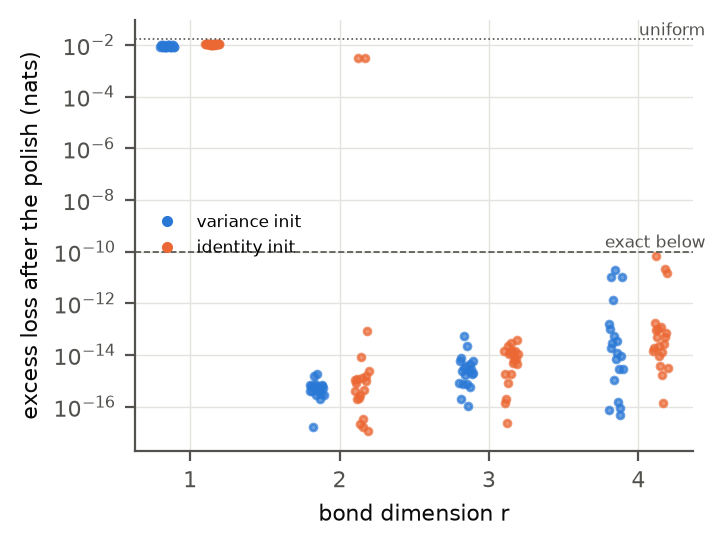
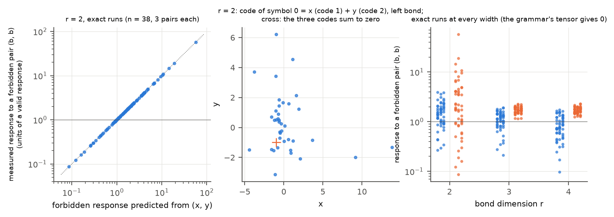
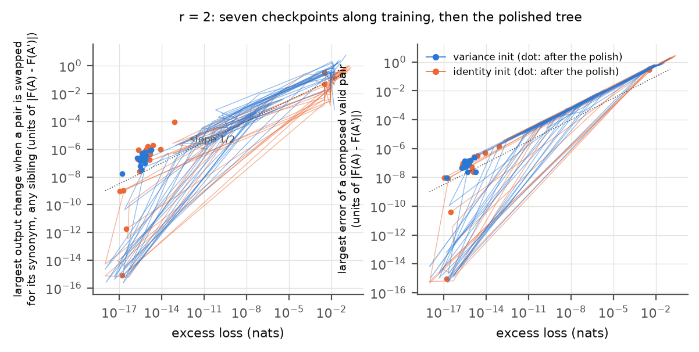
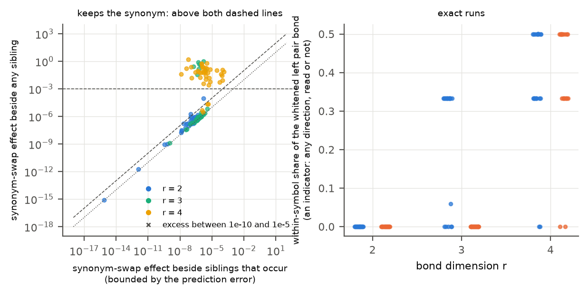

# rhm-forced-synonyms: what a Bayes-optimal width-2 tree must encode on a 3-symbol grammar, and what training finds

**Result: supported.** On a hand-built 3-symbol grammar small enough to prove what an exact tree must do, training
(Adam, then an L-BFGS polish) reaches the exact predictor in 38 of 40 width-2 runs, 37 of them by Adam alone. Every
one of those 38 trees has the three properties the theorems require: synonymous token pairs get the same bond, the
pair codes compose into the parent's code as the grammar does, and each forbidden pair gets a nonzero response of
exactly the size that two numbers describing the codes dictate (largest relative error 9.1e-7 over 114 responses).
The theorems leave one thing open: how small the smallest of a tree's three forbidden responses is. The grammar's own
message passing would make it zero. Training does not push it there in the runs that reach the exact predictor: over
the 37 exact runs that Adam found, the median of the per-run smallest forbidden response is 0.83 of a valid response
(criterion: at least 0.5) and the smallest single response is 0.086 (criterion: at least 0.01). That criterion passed
with less room than the others: 12 of the 37 runs have one response below 0.5, and the three width-2 runs that Adam
left short of the exact predictor, which the criterion excludes, each have one response below 0.001. At widths 3 and
4, where a zero response is an exact solution, no run found it: 0 of 240 responses are below 0.01.

All four criteria were fixed before the run, in [`EXPERIMENT.md`](EXPERIMENT.md), and none was changed. Everything ran
on the coordinator's CPUs in 24 m 54 s at no cost. A research note with the derivations is in [`NOTE.md`](NOTE.md).

## Two kinds of statement

The experiment mixes proofs and measurements, and they are kept apart throughout.

- **Theorems** say what *any* width-2 tree at the Bayes loss must do. They are proved in `EXPERIMENT.md` ("Theory",
  T1 to T5) and restated below. A measurement cannot make them more true; what a measurement on trained trees can do
  is catch an error in a proof or in the analysis code.
- **Measurements** say what training does: whether it reaches the Bayes loss at all, which of the allowed solutions
  it picks, and what happens at widths 3 and 4, where the theorems do not apply.

## The setup in brief

**Grammar.** Three symbols, 0, 1, 2, at every level. Each parent produces the other two symbols in either order
(0 → 12 | 21, 1 → 02 | 20, 2 → 01 | 10), three levels deep, so a sequence has 8 tokens. The parent of a pair (b, c)
with b ≠ c is the missing symbol. A pair (b, b) is **forbidden**: no parent produces it. Each pair symbol has two
**synonyms**, its two orders: the token pairs 12 and 21 both mean symbol 0.

**Task.** The tree sees x_1 … x_4 and predicts x_5. With A the symbol of the observed half, the Bayes prediction is
P(x_5 = y) = 1/4 if y = A and 3/8 otherwise. There are 24 legal prefixes, each of probability 1/24, and the loss is
computed exactly on all of them, so there is no sampling noise. The excess loss is the mean KL divergence from the
Bayes prediction, in nats; a uniform predictor has 0.016417.

**Model.** A binary tree tensor network of bond dimension (width) r. The pairs (x_1 x_2) and (x_3 x_4) have bonds
h_L, h_R in R^r; a bilinear core gives the half's bond h_P = W(h_L, h_R); the logits are linear in h_P. Every
measure below is taken through the read-out, as centered logits in R^3, except the within-symbol share, which first
whitens the bond (rescales it so that every direction it uses has unit variance over the 24 prefixes). None depends
on the basis of a bond.
Write F(A) for the centered Bayes logits of half symbol A: three vectors that sum to zero and span a plane.

**An example of the two things measured.** The prefix 1 2 0 2 has left pair 12 (symbol 0), right pair 02 (symbol 1)
and half symbol 2. *Swapping a synonym* replaces 12 by 21, giving 2 1 0 2, which has the same target; the swap effect
is how far the output moves, in units of the distance between two targets. The stricter version also swaps the left
pair beside a right pair of the *same* symbol (12 beside 12 or 21), an input that never occurs in the data and that no
loss term constrains. *The response to a forbidden pair* feeds the core the left code of symbol b and the right code
of symbol b and reports the size of the read-out, ρ_b, in units of the size of a valid response |F(A)|. The grammar's
own message passing gives ρ = 0.

## What is proved (any width-2 tree at the Bayes loss)

| | statement | why |
| --- | --- | --- |
| T1 | width 1 cannot reach the Bayes loss | the read-out is linear in the bond and must take three values that span a plane |
| T2 | synonyms get the same bond | a linear map from R² onto a plane is injective, so equal predictions force equal bonds |
| T3 | the codes compose: W(a_b, c_c) = p_missing(b, c) on the six valid pairs, and p_0 + p_1 + p_2 = 0 | follows from T2 and the injective read-out |
| T4 | every forbidden pair has a nonzero response | W(a_b, ·) is injective on R² and the code c_b is not zero |
| T5 | with a_0 = x a_1 + y a_2, the right codes satisfy the same relation, and ρ_0 = √(x² + y² − xy), ρ_1 = √(1 + y + y²)/\|x\|, ρ_2 = √(1 + x + x²)/\|y\| | expand the valid compositions |
| corollary | every two of the three responses have a product of at least 3/4, so at most one is below √3/2 ≈ 0.87 | complete the square in the three formulas |

Here a_b, c_c and p_A are the codes of pair symbols on the left and right bonds and of the half symbol. Any x ≠ 0
and y ≠ 0 is realized by an exact tree (`NOTE.md` gives the construction). The symmetric choice x = y = −1 gives ρ = (1, 1, 1), and the smallest of the three responses can be
made as close to 0 as one likes at the price of making the other two large.

**A correction to the definition's text.** `EXPERIMENT.md` says that the smallest response ranges over (0, 1.43]. The
upper end is 1.466, the positive root of t⁴ = t² + t + 1, reached where all three responses are equal, for example
at x = y = t. This maximum was found numerically (an optimizer from 400 starting points and a fine grid agree on it).
The definition's 1.43 is too low; the coarse grid in `analyze.py --check` reports 1.424 for the same quantity. No
criterion uses this number, and the largest value observed is 1.30.

Two exact trees were built by hand and pass through the same measures as the trained ones: a width-2 tree that codes
symbol a as the complex number e^(2πia/3), with x = y = −1 and ρ = 1, and the width-3 one-hot tree that is the
grammar's own message passing, with ρ = 0. So at width 3 both a zero and a nonzero forbidden response are exact
solutions, and which one training finds is an empirical question.

## What was measured

160 trees: widths 1 to 4, two initializations (`variance`: Gaussian cores; `identity`: channel 0 of every bond
carries a constant and the cores pass a signal through beside it, plus the Gaussian noise scaled by ε = 0.1), seeds
2000 to 2019. Each is trained by 20,000 full-batch Adam updates and then polished with L-BFGS, because
Adam stops near 1e-10 nats and the theorems are about exact solutions. A run is **exact** if its excess loss after
the polish is below 1e-10 nats, and **found by Adam** if Adam's own endpoint was already below 1e-6. All 160 runs
produced a finite tree; none raised and none diverged.

### Where training ends

*Excess loss after the polish, one point per run (n = 20 per width and initialization), logarithmic axis. Dotted: the
uniform predictor. Dashed: the 1e-10 threshold for "exact". No run lies between 1e-10 and 1e-5.*

| width | init | n | exact | found by Adam | excess loss after the polish, median (min, max) | polish stopped at its cap |
| --- | --- | --- | --- | --- | --- | --- |
| 1 | variance | 20 | 0 | 0 | 8.39e-3 (8.39e-3, 1.01e-2) | 8 |
| 1 | identity | 20 | 0 | 0 | 1.10e-2 (9.67e-3, 1.10e-2) | 20 |
| 2 | variance | 20 | 20 | 20 | 4.95e-16 (1.62e-17, 1.77e-15) | 0 |
| 2 | identity | 20 | 18 | 17 | 8.71e-16 (1.10e-17, 3.12e-3) | 3 |
| 3 | variance | 20 | 20 | 20 | 2.39e-15 (1.02e-16, 5.45e-14) | 0 |
| 3 | identity | 20 | 20 | 20 | 8.46e-15 (2.26e-17, 3.83e-14) | 0 |
| 4 | variance | 20 | 20 | 20 | 1.54e-14 (4.51e-17, 1.84e-11) | 0 |
| 4 | identity | 20 | 20 | 20 | 3.69e-14 (1.40e-16, 6.60e-11) | 0 |

**Censored runs.** 31 runs stopped at the polish's limit (1,000 iterations or 1,250 function evaluations) and may not
have converged: 28 at width 1, which no polish can make exact, and 3 at width 2 with the identity init (seeds 2005,
2014 and 2017). They are counted here and none is dropped.

**The three width-2 runs that Adam left on a plateau.** Adam ended three identity-init runs near 3.1e-3 nats (seeds
2005, 2006, 2014). The polish took seed 2006 to 2.2e-16; that run is exact but is not credited to Adam, and it is
excluded from H3 as the definition prescribes. Seeds 2005 and 2014 stayed at 3.12e-3 and 3.11e-3 and are the two
censored, non-exact width-2 runs. At Adam's last update each of the three has one forbidden response of 2e-4 to
5e-4, below the 0.01 that the definition calls silenced, and the other two above 60. After the polish, seeds 2005 and
2014 still have one response below 4e-4 and the other two above 230, and seed 2006, now exact, has a smallest
response of 0.12. These trees are not exact, so T5 does not describe them and they enter no criterion, but they show
where the plateau is: a tree in which one forbidden pair is nearly silenced.

### H1 (T1): no width-1 run reaches the Bayes loss. Supported.

The smallest excess loss of the 40 width-1 runs is 8.39e-3 nats, 0.51 of the uniform predictor's, against a
criterion of "none below 1e-5". The runs settle on a few levels: 8.39e-3 (12 runs), 9.67e-3 (7), 1.01e-2 (6) and
1.10e-2 (15).

### H2 (T2, T3): synonyms collapse and codes compose. Supported.

Over the 38 exact width-2 runs, with a threshold of 1e-3 for every measure:

| measure | median | largest | meaning |
| --- | --- | --- | --- |
| synonym-swap effect, left pair, beside all six sibling bonds | 1.7e-7 | 9.0e-5 | output change when a pair is swapped for its synonym |
| synonym-swap effect, right pair | 1.8e-7 | 4.6e-5 | the same for the right pair |
| within-symbol share of the whitened bond (left, right, half) | 4e-15, 1e-14, 2e-14 | 1.7e-12 | share of the bond's variance over the 24 prefixes that lies within a symbol class; 0 when the bond is a function of the symbol alone |
| error of a composed valid pair | 1.0e-7 | 1.35e-6 | distance of the read-out of W(a_b, c_c) from the parent's target |
| valid compositions read out as the right parent | 6 of 6 in all 38 runs | | |

The largest swap effects and the largest composition error all come from one run (identity init, seed 2017). It is
the censored exact run, with an excess loss of 8.0e-14 and the most degenerate codes of the set: x = 0.017, so one
forbidden response is 57. The definition anticipated this scaling, a swap effect that grows as the codes degenerate.
Without that run the largest swap effect is 1.9e-6.

### H4 (T5): the forbidden response is the one (x, y) dictates. Supported.

*Left: the measured response to each forbidden pair against the T5 formula evaluated at the run's (x, y); 38 exact
width-2 runs, 3 pairs each, with the diagonal dotted. Middle: the (x, y) of those runs; the cross marks x = y = −1,
where the three codes sum to zero. Right: every forbidden response of every exact run at widths 2 to 4 (blue:
variance init, orange: identity init); the grammar's own tensor would give 0.*

Over the 38 exact runs, (x, y) measured on the left bond equals (x, y) on the right bond to 5.8e-6, and the 114
measured responses equal the formulas to a relative 9.1e-7 (threshold 1e-3 for both). The responses span almost three
decades, from 0.086 to 57.3, so the formulas are tested well away from the symmetric point. The smallest product of
two responses in one run is 0.774, above the 3/4 of the corollary, and the middle response of every run is at least
0.94, above √3/2.

Two real runs, to show what one test looks like:

| run | (x, y), left bond | (x, y), right bond | predicted ρ_0, ρ_1, ρ_2 | measured |
| --- | --- | --- | --- | --- |
| variance init, seed 2000 | (−0.802773, −1.357003) | (−0.802773, −1.357003) | 1.181751, 1.517716, 0.676068 | 1.181751, 1.517716, 0.676068 |
| identity init, seed 2017 (the degenerate one) | (0.016717, −0.907750) | (0.016717, −0.907750) | 0.916223, 57.259793, 1.110947 | 0.916223, 57.259791, 1.110948 |

### H3 (empirical): in the exact runs, training does not silence a forbidden pair. Supported, with 12 of 37 runs below 0.5.

T4 and T5 force two of a run's three responses to be large and leave the smallest free between 0 and 1.47. H3 asks
what training does with that freedom, on the 37 exact width-2 runs that Adam found.

| runs | n | per-run smallest response: median (quartiles; min, max) | runs with smallest below 0.5 | smallest single response |
| --- | --- | --- | --- | --- |
| found by Adam, both inits (**the criterion**) | 37 | **0.826** (0.434, 0.960; 0.086, 1.30) | 12 | **0.086** |
| found by Adam, variance init | 20 | 0.879 (0.578, 1.02; 0.266, 1.30) | 5 | 0.266 |
| found by Adam, identity init | 17 | 0.572 (0.300, 0.910; 0.086, 1.06) | 7 | 0.086 |
| all exact | 38 | 0.799 (0.412, 0.953; 0.086, 1.30) | 13 | 0.086 |

The criterion was a median of at least 0.5 and no response below 0.01; both hold. The margin is moderate. The median
is 0.83, but a third of the runs keep one response below 0.5, and the identity init alone has a median of 0.57. None
of these 37 runs comes near silencing a pair: of the 111 responses, 1 is below 0.1 and 3 are below 0.2. The pooled
median of all 111 responses is 1.69, which the corollary already forces to be at least 0.87 and so carries no
information about training.

The criterion covers exact runs only. Adam's own endpoint in the three plateau runs (identity init, seeds 2005, 2006
and 2014, at 3.1e-3 nats) has one response of 2e-4 to 5e-4, below the 0.01 threshold. So 3 of the 40 width-2 runs, all
with the identity init, were left by Adam at a tree that nearly silences a forbidden pair and is not exact.

**Which solution training picks.** None of the 38 exact runs is within 0.1 of the symmetric point x = y = −1; the
closest is 0.36 away (variance init) and 1.02 away with the identity init. Over the 37 runs found by Adam, x has
median −0.51 (range −4.41 to 13.8) and y has median 0.25 (−3.14 to 6.21). Training lands on a spread of asymmetric
exact trees and not on the symmetric tree built by hand. The polish barely moved these numbers: (x, y) changed by a
median of 8.2e-6 and at most 6.8e-4 in the 37 runs, against 0.118 in the run that the polish itself made exact.

### Along training (width 2)

*The 40 width-2 runs at seven Adam checkpoints (lines) and after the polish (dots), logarithmic axes. Left: the
largest synonym-swap effect beside any sibling. Right: the largest error of a composed valid pair. The dotted line
has slope 1/2.*

The collapse comes with the loss and not before it. Over the 38 runs that end exact, the swap effect divided by the
square root of the excess loss has a median of 2.0 at initialization and of 1.1 at update 20,000 (33 runs above
1e-14 nats; range 0.1 to 9.2), so the two fall together along the slope-1/2 line. All six compositions read out as the
right parent in 0, 3, 18, 23, 31, 38 and 38 of the 38 runs at updates 0, 100, 300, 1,000, 3,000, 10,000 and 20,000.
The polished trees end at a median excess loss of 5.0e-16 nats, with swap effects near 1e-7.

### Widths 3 and 4, where nothing is forced (descriptive, no criterion)

*Left: for every run at widths 2 to 4 with an excess loss below 1e-5 (all are exact), the swap effect beside any
sibling against the swap effect beside siblings that occur in the data. A run above both dashed lines keeps the
synonym. Right: the within-symbol share of the whitened left pair bond, an indicator of whether any direction holds
the synonym, read by the output or not.*

All 80 runs are exact, all were found by Adam, and none was censored, so both widths count as answered (the rule
needed 5 exact runs each). The reading was fixed before the run: a run **keeps the synonym** if swapping a pair for
its synonym beside some sibling changes the output by more than 1e-3 and by more than 10 times the change beside
siblings that occur; a forbidden pair is **silenced** if its response is below 0.01.

| width | init | exact | keeps the synonym | swap effect of those runs, median (min, max) | forbidden responses: median (min, max) | silenced |
| --- | --- | --- | --- | --- | --- | --- |
| 3 | variance | 20 | 8 | 0.34 (0.036, 0.98) | 1.15 (0.21, 1.93) | 0 of 60 |
| 3 | identity | 20 | 0 | | 1.73 (1.15, 2.27) | 0 of 60 |
| 4 | variance | 20 | 20 | 0.16 (0.0056, 1.58) | 0.76 (0.097, 1.75) | 0 of 60 |
| 4 | identity | 20 | 16 | 0.042 (0.0026, 0.078) | 1.68 (1.25, 2.29) | 0 of 60 |

- **Where the width does not force it, the collapse is no longer universal.** With one spare dimension
  (width 3) the variance init keeps the synonym in 8 of 20 runs, and with two (width 4) in 20 of 20. The identity
  init collapses in all 20 runs at width 3 and keeps the synonym in 16 of 20 at width 4, with smaller effects. In
  every run the swap effect beside siblings that occur is at most 1.3e-4, as an exact tree requires; the synonym
  shows only beside the sibling that never occurs.
- **A direction can hold the synonym without the output reading it.** At width 3 with the variance init, 16 runs
  have a pair bond whose within-symbol share is above 1e-3, and 8 of those are collapsed by the reading above: the
  synonym is on the bond and no sibling reads it. The same holds for 4 of 20 runs at width 4 with the identity init.
- **No run found a zero response.** The smallest of the 240 forbidden responses is 0.097. The one-hot tree, which
  is exact at width 3 and sends forbidden pairs to zero, was not found by either init at either width.
- **Observed after the run, not a criterion.** With the identity init at widths 3 and 4, all 120 forbidden responses
  lie between 1.15 and 2.29 and point opposite to the target of the repeated symbol: the cosine with F(b) is between
  −1 and −0.74, with medians −0.996 and −0.998. The variance init shows no such direction (cosines from −1 to 1,
  medians 0.13 and 0.08). This was noticed in the summary table and has no stated prediction behind it.

## How it was checked

- **The grammar and the targets** (`studies/rhm/toy_checks.py`, run first): 29 of 29 checks passed. They enumerate
  the 384 sequences and 24 prefixes, recompute the Bayes targets independently, and confirm the uniform predictor's
  0.016417 nats.
- **The measures on trees with known answers** (`analyze.py --check`, run first): all 8 passed. The hand-built
  width-2 tree gives zero swap effect, 6 of 6 compositions, ρ = 1 and x = y = −1; the width-3 one-hot tree gives
  ρ = 0; a width-4 tree built to hide the synonym where only a forbidden sibling reads it gives a swap effect of 0
  beside siblings that occur and of 0.58 beside any sibling; a random tree fails; every measure reported here is
  unchanged by a random change of basis of all bonds; and the corollary's bound holds on a grid of (x, y).
- **Width 1 as a floor** (H1): if the target or the loss were wrong, a width-1 run could reach the Bayes loss. None
  came within a factor of 800 of the threshold.
- **Two initializations with the same seeds.** Every criterion holds for each init separately, and the descriptive
  results that differ by init are reported as such.
- **Exact runs only.** The 2 non-exact width-2 runs are counted and never enter H2 to H4.
- **The code that ran is the committed code.** `results/provenance.json` records commit `b960bb2` and `dirty: true`.
  The tracked files that differed from the commit were `orch.toml` and the project's experiment log; `git diff` showed
  no change under `studies/rhm` or `ctn` when the analysis finished.
- **Fact check.** A separate fact-checking pass compared this file and `NOTE.md` with the result files, the logs and
  the code. It found every number, count and verdict in agreement with the result files and returned 17 corrections
  of wording, scope and proof steps, which are applied and listed at the end of this file.

## Not yet checked

- **Whether the two stuck width-2 runs would converge with a longer polish.** Both stopped at the limit of 1,250
  function evaluations at 3.1e-3 nats. A rerun of those two seeds with a higher limit takes under a minute and would
  say whether the identity init reaches the exact predictor in 20 of 20 runs or 18. No criterion depends on it.
- **Whether H3's median depends on the optimizer.** The distribution of (x, y) is a property of Adam at these two
  learning rates and two inits. Plain gradient descent, or another learning rate, on the same 40 seeds takes about
  15 minutes and could move the median of the smallest response in either direction.
- **Whether a deliberately sparse solution is reachable.** No run at width 3 or 4 silenced a forbidden pair. Starting
  from a perturbed one-hot tree, or adding weight decay, would say whether a zero response is a stable endpoint
  that these inits do not reach or one that training leaves. This needs a new definition.
- **Why the identity init reads a forbidden pair opposite to its symbol's target at widths 3 and 4.** This was seen
  after the run and has no derivation.
- **Other prefix lengths and deeper grammars.** Every theorem here is for one prefix length of one grammar with three
  symbols; the experiment says nothing about the larger grammars of the earlier experiments.

## Judgement calls

- **The polish.** Criteria are read on L-BFGS-polished trees, because Adam alone ends near 1e-10 nats (median
  9.6e-11 over the 38 exact width-2 runs). The cost is that one run was made exact by the polish and not by Adam; the
  definition handles this by judging H3 on the 37 runs Adam found and reporting the other beside them.
- **The H3 statistic.** The median of the per-run smallest response was chosen in review because the corollary makes
  a pooled median uninformative. A stricter reading, "no run has a response below 0.5", would fail in 12 of 37 runs.
- **A script added after the run.** `tables.py` reads the saved results and prints the breakdowns quoted here that
  `summary.json` does not hold (`results/tables.txt`). `plot.py` gained an optional argument that also writes PNGs;
  the four PDFs are the ones the run produced, byte for byte.

## What this means

On this grammar a tree of the smallest sufficient width *cannot* implement the grammar's message passing on forbidden
pairs. T4 forces a nonzero response at width 2, and the trained trees show responses from 0.086 to 57 times a valid
one. The earlier experiments (`rhm-ttn-messages`, `rhm-ttn-masks`) found that forbidden pairs keep their read-out mass
in trees of width 16 and 32 on deeper or larger grammars. Those trees are wider than the number of symbols, at which
the message-passing tree is already exact, so the theorem does not cover them; the closer analogue is the width-3
and width-4 arm here. There a zero response to forbidden pairs is an exact solution, and training did not find it in
any of 80 runs. Synonym collapse was also no longer universal once there was room: 8 of 40 runs keep the synonym at
width 3 (32 still collapse) and 36 of 40 at width 4. On this grammar the message-passing tensor is one exact solution
among many, and neither init selects it.

The H2 and H4 measurements sit inside their thresholds by a factor of 11 for the synonym swap of the censored run
and by more than 100 for every other run and measure, which is evidence that the statements of T2 to T5 and the
analysis code are right. It does not check the proofs step by step: the definition's theory text carried the 1.43
error above and no measurement could have caught it. Whether the same happens on a grammar where the forced width is
larger than 2 is open; the other experiment of this batch, `rhm-crossed-rank`, uses rank bounds
of the same kind to ask whether a tree whose pairing does not match the grammar needs more width.

## Files

- `EXPERIMENT.md`: the definition, with the theory, the criteria and the review.
- `run.py`, `analyze.py`, `plot.py`, `tables.py`; the grammar, the training loop and the hand-built trees are in
  `studies/rhm/toy.py`.
- `results/summary.json`, `summary.txt`: the verdicts and the per-cell table. `results/runs.json`: every measure of
  every polished tree. `results/trajectories.json`: the measures at every checkpoint. `results/tables.txt`: the
  breakdowns quoted above. `results/polished_trees.pt`: the 160 polished trees. `results/toy_checks.txt`,
  `measure_checks.txt`: the checks. `results/diverged.json`: empty.
- `figures/*.pdf`, with PNG copies in `figures/png/`.
- The per-run checkpoints are in `runs/rhm-forced-synonyms/` (7 MB, not in git); they can be regenerated from the
  seeds with the definition's commands.

## Corrections from the fact check

The fact-checking pass changed no number. It changed these statements, here and in `NOTE.md`:

- The lead said that gradient descent reaches the exact predictor in 38 runs. Adam alone does so in 37; the 38th was
  made exact by the L-BFGS polish.
- "No run comes near silencing a pair" was true of the 37 exact runs only. Adam's endpoint in the three plateau runs
  has one response of 2e-4 to 5e-4; this is now stated in the lead, in the plateau paragraph and under H3.
- "The synonym collapse is a consequence of the width, not a preference of training" and "the collapse stops" at
  widths 3 and 4 said more than the counts: 32 of 40 runs still collapse at width 3. The text now gives the counts.
- The earlier experiments used widths 16 and 32, not 32 only, and no width bound was computed for their grammars.
  `rhm-ttn-masks` was inconclusive by its own rule, which the note's opening now says.
- The upper end of the smallest response, 1.466, is the positive root of its quartic, is reached at three points
  related by relabelling the symbols, and was found numerically. The text had "the root" and an unsupported account
  of where the definition's 1.43 came from.
- "Everything is measured through the read-out" left out the within-symbol share, which whitens the bond.
- Agreement on 38 trees is evidence for the statements of the theorems and the analysis code, not for each proof step.
- In `NOTE.md`: three proof steps were completed (the sibling in the collapse argument must have a different symbol;
  the right codes c_1, c_2 are independent; the converse construction needs the same relation on the right codes and
  the same construction one level down); the caption of Figure 1 and the median swap effect were made exact; the run
  with the largest swap effect "stopped at its evaluation limit" where the text had "did not converge".
- Names: the H1 heading now states the measurement, and "whitened", the two versions of the swap effect and the
  gauge-dependent measure are described where they appear.
