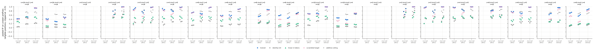
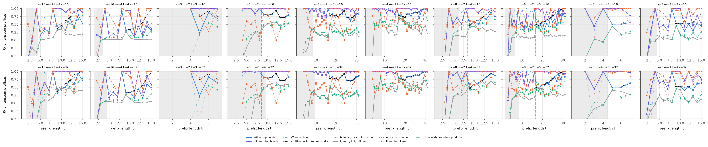
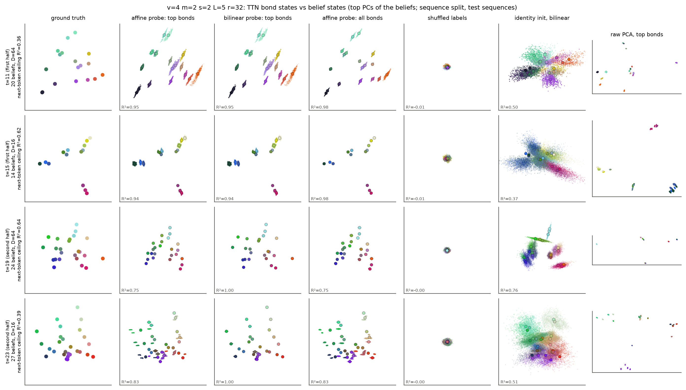
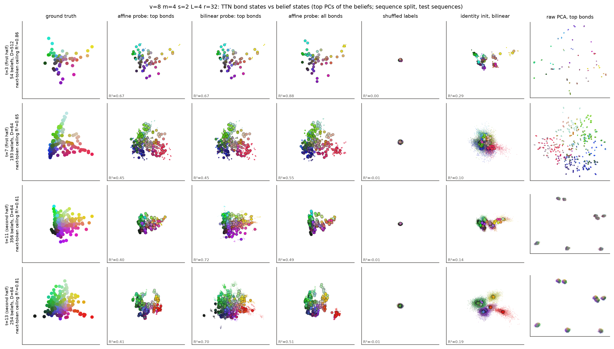
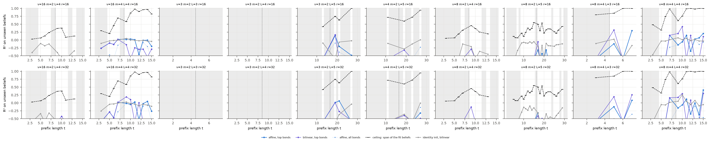
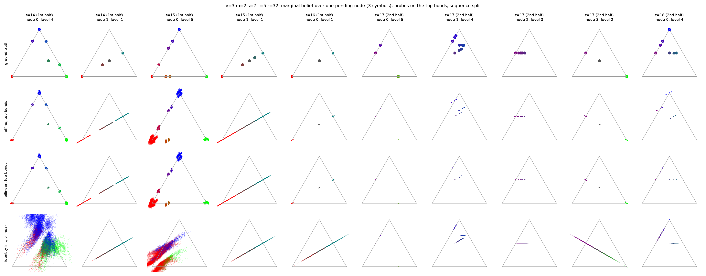
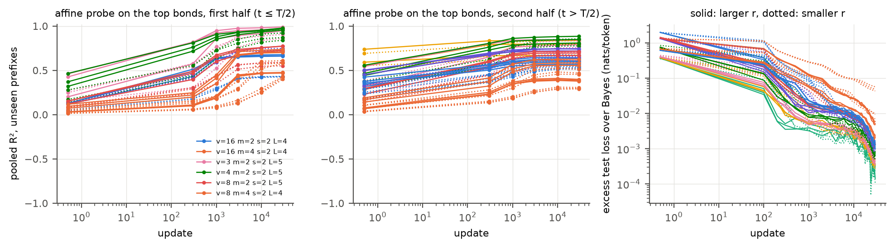

**Where does a tree tensor network keep its belief about the Random Hierarchy Model?**

*A research note on linear and bilinear probes of a tree tensor network's top bonds against exact belief states, and on the two bounds that decide what such probes can find.*

A companion experiment in this project asks whether a transformer trained on next-token prediction for the Random Hierarchy Model (RHM) lays out the exact belief state, the posterior over the pending subtree symbols given the prefix, linearly in its residual stream. This note asks the same of a tree tensor network (TreeTN). The question needs restating first, because a TreeTN has no residual stream. Its hidden states are bond vectors, each computed from the tokens under one node of a binary tree, so no single bond has seen an arbitrary prefix. The structure of the network then fixes in advance what a probe can find, and the experiment was designed around one exact statement of that kind, the additive ceiling for the second half. A second, the rank bound for the first half, was derived after the results.

The results have three parts with different status. **In the second half of the sequence, a bilinear probe on the two top bonds recovers the belief on unseen prefixes with pooled $R^2$ of 0.85 to 1.00 in 14 of the 16 learned, testable grammar-and-width cells. On the positions where no readout additive in the two halves can exceed 0.8, it scores 0.86 to 1.00 against a ceiling of 0.51 to 0.78. This criterion was fixed before the run and is supported at both widths.** **In the first half, the affine probe passes its fixed criterion in only 2 of 6 cells at each width.** A reading found after looking at the results, and not yet tested, is that the failures are positions whose beliefs span more dimensions than the bond has. **The probes give little evidence that the beliefs are laid out in their own geometry, and none outside the $m = 4$ grammars:** the same probes fit a random relabelling of the belief states about as well as the beliefs, and pooled over positions they do not extrapolate to beliefs they were not fit on. What the run establishes is that past the midpoint the product of the top bonds linearly determines which belief state an unseen prefix is in, and that in the first half the left bond does so only in the two small-alphabet grammars. Whether the other first-half failures are a capacity limit is untested.

The note defines the belief and the network, derives the two bounds, states the probes and their controls, and then reports the results against the criteria. The numbers are those of the write-up, [`README.md`](README.md), and both documents were checked against the result files.

**The belief state is a distribution over the symbols of the pending subtrees.** An RHM grammar has $v$ symbols per level, $m$ productions per symbol, binary branching and depth $L$, so a sequence has $T = 2^L$ tokens $x_0, \dots, x_{T-1}$. The productions of a level are distinct pairs, so every pair has at most one parent symbol and a sequence determines its parse tree. After the prefix $x_{\lt t} = (x_0, \dots, x_{t-1})$, the pending nodes $\mathcal{S}_t$ are the maximal subtrees that lie entirely at positions $\ge t$. Given their symbols $S_t$, the rest of the sequence is independent of the prefix, so $S_t$ is the hidden state of the process read left to right. Its size depends only on $t$:

$$
D_t = v^{\lvert \mathcal{S}_t \rvert}, \qquad \lvert \mathcal{S}_t \rvert = \text{number of ones in the binary expansion of } T - t .
$$

The belief state is the posterior over this hidden state,

$$
b_t(s) = P\bigl(S_t = s \mid x_{\lt t}\bigr), \qquad b_t \in \Delta^{D_t - 1},
$$

and it is computed exactly from the grammar. The next-token distribution is a linear function of it, $P(x_t = a \mid x_{\lt t}) = \sum_s b_t(s)\, P(x_t = a \mid S_t = s)$. Positions with $D_t \gt 4096$ are skipped. The companion note, [`../rhm-belief-geometry/NOTE.md`](../rhm-belief-geometry/NOTE.md), gives the full construction.

**The network is a binary tree of bilinear merges, trained on masked prefixes.** For prefix length $t$ the tree sees the tokens $x_{\lt t}$ with every position $\ge t$ replaced by a mask symbol, and predicts $x_t$. Each leaf maps its token to a vector in $\mathbb{R}^r$, and each internal node merges its two children,

$$
z_a = \sum_{b, c = 1}^{r} W_{abc}\, z^{\mathrm{left}}_b\, z^{\mathrm{right}}_c ,
$$

with its own core $W$ and no bias or nonlinearity. Write $h_L, h_R \in \mathbb{R}^r$ for the two bonds under the root, which summarize the left and right halves of the sequence. The root core contracts them into logits,

$$
o_y = \sum_{b, c = 1}^{r} C_{ybc}\, h_{L,b}\, h_{R,c} .
$$

The bond dimension is $r = 16$ or $32$. A bond is a function of the tokens under its node and of nothing else, and both bounds below follow from that fact.

**In the first half, an affine probe reads an $r$-dimensional vector, which bounds its score by the spectrum of the beliefs.** For $t \le T/2$ every leaf of the right half is a mask, so $h_R$ equals a constant vector $c$ on every sequence. The logits are then linear in $h_L$, $o_y = \sum_b \bigl(\sum_c C_{ybc}\, c_c\bigr) h_{L,b}$, and an affine probe on $[h_L, h_R]$ is an affine probe on $h_L$ alone,

$$
\hat b_t = G\, h_L + g .
$$

Its predictions lie in an affine subspace $\mathcal{A}$ of dimension at most $r$. Let $\lambda_1 \ge \lambda_2 \ge \dots$ be the eigenvalues of the covariance of $b_t$ over sequences, and let $\Pi_{\mathcal{A}}$ be the orthogonal projection onto $\mathcal{A}$. Then

$$
\begin{aligned}
\mathbb{E}\,\bigl\lVert b_t - \hat b_t \bigr\rVert^2
&\ge \mathbb{E}\,\bigl\lVert b_t - \Pi_{\mathcal{A}}\, b_t \bigr\rVert^2 \\
&\ge \sum_{i \gt r} \lambda_i .
\end{aligned}
$$

The first line holds because $\Pi_{\mathcal{A}} b_t$ is the point of $\mathcal{A}$ closest to $b_t$. The second is the optimality of principal components: among affine subspaces of dimension $r$, the one through the mean spanned by the top $r$ eigenvectors has the smallest expected squared distance to $b_t$, and that distance is the sum of the remaining eigenvalues. Dividing by the total variance $\sum_i \lambda_i$ gives

$$
\boxed{\,R^2_t \;\le\; \rho_r(t) = \frac{\sum_{i \le r} \lambda_i}{\sum_i \lambda_i}\,}
$$

for a probe fit and scored on the same distribution; on held-out prefixes the same bound holds with the spectrum of the test rows. The analysis saved one summary of this spectrum per position, $k_{99}(t) = \min\lbrace k : \rho_k(t) \ge 0.99 \rbrace$. The bound falls below 0.99 exactly when $r \lt k_{99}(t)$. The bound says nothing about how the network encodes the state. It limits the probe, whatever the encoding.

**In the second half, any affine probe on the bonds is additive in the two halves, which bounds it by an additive ceiling.** For $t \gt T/2$ the left half is fully observed and the right half partly. The unique parse makes the left half's symbol $s_L$ a function of its tokens, and makes the symbols $\sigma_R$ of the fully observed nodes inside the right half a function of the right prefix. The belief depends on the prefix only through these two variables: with $\pi(s_R \mid s_L)$ the distribution of the right half's symbol given the left one under the root's productions,

$$
b_t(s) = \frac{\sum_{s_R} \pi(s_R \mid s_L)\, P\bigl(S_t = s,\ \sigma_R \mid s_R\bigr)}{\sum_{s_R} \pi(s_R \mid s_L)\, P\bigl(\sigma_R \mid s_R\bigr)} = B(s_L, \sigma_R) .
$$

The normalization couples the two arguments, so $B$ is in general not a sum of a function of $s_L$ and a function of $\sigma_R$. An affine probe on bonds from disjoint spans is such a sum, because $h_L$ is a function of the left tokens $x_L$ and $h_R$ of the right prefix $x_R$:

$$
\hat b_t = U h_L + V h_R + u = F(x_L) + G(x_R) .
$$

Condition on $(s_L, \sigma_R)$. Given $s_L$, the left tokens are generated independently of everything outside the left subtree, and given $\sigma_R$ the observed right tokens are generated independently of $s_L$, so $\mathbb{E}[F(x_L) \mid s_L, \sigma_R] = f(s_L)$ and $\mathbb{E}[G(x_R) \mid s_L, \sigma_R] = g(\sigma_R)$. Since $b_t$ is a function of $(s_L, \sigma_R)$, Jensen's inequality gives $\mathbb{E}\lVert b_t - \hat b_t\rVert^2 \ge \mathbb{E}\lVert b_t - f(s_L) - g(\sigma_R)\rVert^2$, and therefore

$$
\boxed{\,R^2_t \;\le\; R^2_{\mathrm{add}}(t) = 1 - \frac{\min_{f, g}\ \mathbb{E}\,\bigl\lVert b_t - f(s_L) - g(\sigma_R) \bigr\rVert^2}{\mathbb{E}\,\bigl\lVert b_t - \mathbb{E}\, b_t \bigr\rVert^2}\,}
$$

for every affine probe on the top bonds, on all bonds, or on any other set of bonds each confined to one half. The right side is computed without the network, by least squares on the one-hot codes of $s_L$ and $\sigma_R$. Comparing a richer probe with the affine probe would mostly measure the grammar; comparing it with this ceiling measures the network.

**The interaction can live in the product of the top bonds, which is what the root contracts.** The bilinear probe adds the $r^2$ products to the features,

$$
\hat b_t = U h_L + V h_R + \sum_{b, c} M_{bc}\, h_{L,b}\, h_{R,c} + u , \qquad M_{bc} \in \mathbb{R}^{D_t} .
$$

If the indicator of each value of $s_L$ is a linear function of $h_L$ and the indicator of each value of $\sigma_R$ a linear function of $h_R$, then $B(s_L, \sigma_R) = \sum_{a, \sigma} B(a, \sigma)\, \mathbf{1}[s_L = a]\, \mathbf{1}[\sigma_R = \sigma]$ is exactly of this form. That is a sufficient condition, stated to show why the product is the natural place to look; the experiment tests the conclusion, not the condition.

**The probes are least-squares fits scored on prefixes they never saw.** For each position $t$ and feature map $\phi$ (affine: $\phi = [h_L, h_R]$ with $2r$ features; bilinear: $2r + r^2$ features), the probe minimizes $\sum_i \lVert b_t^{(i)} - W \phi^{(i)} - w \rVert^2$ over the fit sequences among 60,000, with a negligible ridge. The distinct prefixes at a position are split at random into a fit set and a test set, so a test sequence never shares its prefix with a fit sequence. Scores are pooled over positions as

$$
R^2 = 1 - \frac{\sum_t \mathrm{SSE}_t}{\sum_t \mathrm{SST}_t} ,
$$

over the eligible positions, those with at least $10\,(p + 1)$ distinct fit prefixes for a probe with $p$ features. A cell is one grammar at one width with three seeds, and a seed sets both the grammar's rules and the initialization. The criteria fixed before the run were, per cell and in all three seeds:

- **H1, first half:** affine $R^2 \ge 0.8$, and at least 0.1 above both the same probe on the identity-initialized tree and the best affine function of the one-hot tokens.
- **H2, second half:** bilinear $R^2 \ge 0.8$; at least 0.1 above the additive ceiling at the positions where that ceiling is below 0.8; at least 0.1 above the bilinear probe at initialization, the token readout, and a token readout with cross-half products where that one is eligible.

A hypothesis is supported at a width if at least 75% of the learned, testable cells pass, and partly supported between 25% and 75%.

**Two further controls separate identifying the belief state from representing its geometry.** A position has few distinct beliefs, between 3 and 1,036 at the pooled positions, against up to 1,088 probe features. If the features take affinely independent values on the $N$ states that occur, every function of the state is an exact affine function of the features, including functions that have nothing to do with the belief. The scrambled target tests this: each distinct belief is replaced by an independent draw $\tau(b) \sim \mathcal{N}(0, I_8)$, and the same probe is fit to $\tau(b_t)$. Selectivity is the difference

$$
\mathrm{Sel} = R^2\bigl[b_t\bigr] - R^2\bigl[\tau(b_t)\bigr] ,
$$

which is near zero when the probe fits any labelling as well as the belief. The belief split is the complementary test: the distinct beliefs at a position are divided at random, the probe is fit on sequences with beliefs in one part and scored on the other. A code that is affine in the belief extrapolates to unseen beliefs, up to the ceiling set by projecting the test beliefs on the span of the fit beliefs. A code that only identifies states does not.

**All 60 runs trained, and 19 of 20 cells learned the task.** The grid is 10 grammars, 2 widths and 3 seeds, each trained for 30,000 updates. Excess test loss over the exact Bayes loss is between 0.0001 and 0.0097 nats per token in 57 runs. The three runs of `v16m4s2L4` at $r = 16$ end at 0.043 to 0.057, above the 0.02 threshold, so that cell counts as not learned. Shuffling the labels of the fit half gives pooled $R^2$ between $-0.014$ and $0.004$ in every run. Sixteen of the $r = 16$ runs started after the definition's original 5 h cutoff for starting training runs, which was moved during the run because training was slower than estimated. Under the original rule the $r = 32$ verdicts are unchanged, and at $r = 16$ both hypotheses would be judged on three cells and read partly supported, 2 of 3. Figure 1 shows the pooled scores behind both hypotheses.

*Figure 1. Pooled $R^2$ on unseen prefixes, one panel per cell ($r = 16$ in the left half, $r = 32$ in the right), one point per seed. Each panel shows the affine probe in the first half, the affine probe in the second half, and the bilinear probe at the same second-half positions. Blue is the trained tree, gray the identity-initialized tree, green the affine readout of the tokens, pink crosses the scrambled target, black bars the additive ceiling. Notice that the bilinear points sit above the black bars in every learned cell, at 0.88 to 1.00 in the $m = 2$ grammars and 0.67 to 0.96 in the $m = 4$ ones. In the first-half and bilinear columns the pink crosses sit within 0.07 of the blue points in the $m = 2$ grammars and up to 0.21 below them in the $m = 4$ grammars; in the second-half affine column they sit 0.04 to 0.32 below. PDF: [`figures/summary.pdf`](figures/summary.pdf).*

**The second-half hypothesis is supported: the bilinear probe passes H2 in 7 of 8 cells at each width, and clears the additive ceiling by at least 0.13 in all 16.** In the passing cells the bilinear probe scores 0.85 to 1.00 over the eligible second-half positions, and at the positions where the additive ceiling is below 0.8 it exceeds that ceiling by 0.19 to 0.46 in every run. The affine probe on the same bonds stays at or below the ceiling, as the bound requires. The table gives the median over three seeds and the range.

| grammar | $r$ | affine | bilinear | bilinear where ceiling $\lt 0.8$ | additive ceiling there | H2 |
| --- | --- | --- | --- | --- | --- | --- |
| `v4m2s2L5` | 32 | 0.85 [0.81, 0.88] | 1.00 [0.99, 1.00] | 1.00 [1.00, 1.00] | 0.73 [0.71, 0.74] | yes |
| `v8m2s2L5` | 32 | 0.69 [0.67, 0.71] | 0.98 [0.97, 0.98] | 0.99 [0.99, 1.00] | 0.62 [0.61, 0.63] | yes |
| `v16m2s2L4` | 32 | 0.69 [0.66, 0.70] | 1.00 [0.99, 1.00] | 1.00 [1.00, 1.00] | 0.66 [0.58, 0.66] | yes |
| `v8m4s2L4` | 32 | 0.58 [0.55, 0.63] | 0.87 [0.85, 0.90] | 0.91 [0.89, 0.93] | 0.62 [0.58, 0.65] | yes |
| `v16m4s2L4` | 32 | 0.39 [0.38, 0.40] | 0.68 [0.67, 0.69] | 0.72 [0.71, 0.73] | 0.54 [0.53, 0.55] | no |
| `v8m2s2L5` | 16 | 0.59 [0.55, 0.61] | 0.88 [0.88, 0.91] | 0.91 [0.89, 0.95] | 0.62 [0.61, 0.63] | yes |
| `v8m4s2L4` | 16 | 0.47 [0.45, 0.51] | 0.70 [0.68, 0.73] | 0.76 [0.76, 0.78] | 0.62 [0.58, 0.65] | no |

The full table of 17 cells is in the README. The two failing cells miss the 0.8 threshold while still beating the additive ceiling by 0.13 to 0.19, and both are grammars with $m = 4$. Figure 2 shows the same comparison position by position: past the midpoint the affine probe stays at or below the additive ceiling at every position, close to it in the $v = 3$ and $v = 4$ grammars, and the bilinear probe stays above 0.85 in 14 of the 20 panels; it falls lowest, to 0.19, in `v16m4s2L4` at $r = 16$, the cell that did not learn.

*Figure 2. $R^2$ on unseen prefixes at each prefix length $t$, seed 0 of each cell ($r = 16$ above, $r = 32$ below). The dashed vertical line is the midpoint $T/2$, and gray bands mark positions not eligible for the affine probe. Blue: affine probe on the top bonds. Violet: bilinear probe. Black dashes: the additive ceiling. Pink: bilinear probe on the scrambled target. Gray: bilinear probe at initialization. Orange: the next-token ceiling. Green: token readouts. PDF: [`figures/positions.pdf`](figures/positions.pdf).*

**The first-half hypothesis is partly supported, and most low-scoring positions have $k_{99}$ above the bond dimension.** The affine probe passes in `v3m2s2L5` and `v4m2s2L5` at both widths, with 0.84 to 0.99, which is 0.20 to 0.48 above the best that any function of the exact next-token distribution achieves. It fails in the other four testable cells at each width, all grammars with $v = 8$ or $16$, with 0.43 to 0.77. Every failing cell still beats both baselines by more than 0.1, so only the threshold is missed.

| grammar | $r$ | trained | identity init | tokens | scrambled target | H1 |
| --- | --- | --- | --- | --- | --- | --- |
| `v3m2s2L5` | 32 | 0.97 [0.95, 0.99] | 0.43 [0.20, 0.46] | 0.45 [0.20, 0.48] | 0.94 [0.94, 0.97] | yes |
| `v4m2s2L5` | 32 | 0.97 [0.95, 0.98] | 0.37 [0.32, 0.46] | 0.45 [0.45, 0.52] | 0.95 [0.94, 0.95] | yes |
| `v8m2s2L5` | 32 | 0.77 [0.73, 0.77] | 0.15 [0.12, 0.15] | 0.35 [0.31, 0.38] | 0.72 [0.72, 0.75] | no |
| `v8m4s2L4` | 32 | 0.71 [0.70, 0.74] | 0.09 [0.07, 0.12] | 0.14 [0.11, 0.14] | 0.55 [0.54, 0.57] | no |
| `v16m2s2L4` | 32 | 0.66 [0.66, 0.68] | 0.13 [0.12, 0.13] | 0.42 [0.36, 0.43] | 0.65 [0.65, 0.67] | no |
| `v16m4s2L4` | 32 | 0.47 [0.47, 0.48] | 0.03 [0.03, 0.03] | 0.09 [0.09, 0.10] | 0.34 [0.31, 0.36] | no |

The passing grammars have 3 to 28 distinct beliefs at each pooled position, and the failing ones up to 356. This suggested reading the failures through the rank bound, after the results were in. Grouping the eligible first-half positions of seed 0 by $k_{99}$:

| width | positions with | number of positions | affine $R^2$ |
| --- | --- | --- | --- |
| $r = 32$ | $k_{99} \le 19$ | 20 | 0.88 to 1.00 |
| $r = 32$ | $28 \le k_{99} \le 33$ | 5 | 0.67 to 0.89 |
| $r = 32$ | $k_{99} \ge 42$ | 8 | 0.18 to 0.63 |
| $r = 16$ | $k_{99} \le 10$ | 19 | 0.73 to 1.00 |
| $r = 16$ | $12 \le k_{99} \le 19$ | 5 | 0.69 to 1.00 |
| $r = 16$ | $k_{99} \ge 28$ | 17 | 0.10 to 0.57 |

Where $k_{99} \le r$ the probe scores 0.80 or more at 41 of 47 positions, and where $k_{99} \gt r$ it scores below 0.80 at 26 of 27. Six positions with $k_{99} \le r$ score 0.67 to 0.74, which the bound cannot explain since it is at least 0.99 there. The $r = 16$ rows include the cell that did not learn, which contributes five positions, among them the 0.10 minimum; without it the last group is 14 positions at 0.14 to 0.57. This is an observation on one seed per cell with groups chosen after looking, and the bound $\rho_r(t)$ itself was not computed, so it is a hypothesis about the failures and not a result. Figures 3 and 4 show a passing and a failing grammar.

*Figure 3. `v4m2s2L5` at $r = 32$, seed 0. Each row is a position and each point a test sequence, projected on the top two principal components of the true beliefs at that position and coloured by its true belief. Columns: the true beliefs, the affine probe on the top bonds, the bilinear probe, the affine probe on all bonds, the shuffled-label control, the bilinear probe at initialization, and the raw top-2 principal components of the top bonds. In the two second-half rows the affine probe ($R^2$ 0.75 and 0.83) misplaces the states that the bilinear probe (1.00) recovers. The $R^2$ values in these panels are per position on a split by sequence, where test prefixes can repeat fit prefixes, so they can run higher than the held-out-prefix values; in this figure the two agree to 0.001, and neither is the pooled number of the tables. PDF: [`figures/geometry_v4m2s2L5_r32.pdf`](figures/geometry_v4m2s2L5_r32.pdf).*

*Figure 4. `v8m4s2L4` at $r = 32$, seed 0, laid out as Figure 3. This grammar fails H1 and passes H2. With 54 to 356 distinct beliefs at the positions shown, the probes recover the coarse arrangement of the states and blur the fine one. PDF: [`figures/geometry_v8m4s2L4_r32.pdf`](figures/geometry_v8m4s2L4_r32.pdf).*

**The probes identify the belief state; they give little evidence of its geometry, and none outside the $m = 4$ grammars.** The scrambled target is fit almost as well as the belief. For the bilinear probe the median selectivity per cell lies between $-0.02$ and $0.07$ over the 18 cells with eligible positions: on `v16m2s2L4` at $r = 32$, for example, the belief and the scrambled target both score 0.99 to 1.00. For the first-half affine probe selectivity is 0.01 to 0.06 in the $m = 2$ grammars and reaches 0.14 to 0.18 only in `v8m4s2L4` at both widths and `v16m4s2L4` at $r = 32$ (medians per cell), cells that fail H1. The belief split agrees. On beliefs they were not fit on, the trained probes score below zero in every run that has such positions, with medians per cell from $-7.31$ to $-0.08$ for the affine probe and from $-5.23$ to $-0.40$ for the bilinear one (14 cells, the $-0.40$ being the cell that did not learn), where the ceiling from the span of the fit beliefs is 0.30 to 0.98 (Figure 5).

*Figure 5. $R^2$ on distinct beliefs the probe never saw, per position, seed 0 of each cell, clipped at $-0.6$. Black dashes are the ceiling: the test beliefs projected on the span of the fit beliefs. Pooled over positions the trained probes (blue, violet) are below zero in every run. At single positions they are above zero at 40 of the 284 points shown, up to 0.42, in the three $m = 4$ grammars and `v3m2s2L5`. The ceiling is 0.9 or more at 28 of the 142 positions, with median 0.42. PDF: [`figures/beliefsplit.pdf`](figures/beliefsplit.pdf).*

The belief split is weak evidence taken alone. It fits on 7 to 505 distinct beliefs per position (median 23) with 32 to 1,088 features, and the identity-initialized tree scores as low as $-902$ in single runs, so a negative number shows that an over-parameterized fit does not extrapolate, which is less than showing that no affine code exists. The scrambled target is the firmer of the two: it shows directly that the scores behind H1 and H2 would be earned by any labelling of the states. Figure 6 shows what the readout of a single pending node looks like for a three-symbol grammar, where its marginal lives on a triangle.

*Figure 6. `v3m2s2L5` at $r = 32$, seed 0: the marginal belief over one pending node, drawn on the 2-simplex. Rows: the true marginal, the affine probe on the top bonds, the bilinear probe, and the bilinear probe at initialization. Columns are positions and nodes, five from each half. The trained probes place the points at the true locations, with some predictions falling outside the simplex. PDF: [`figures/triangles_v3m2s2L5_r32.pdf`](figures/triangles_v3m2s2L5_r32.pdf).*

**The probe scores grow with learning and with width.** Figure 7 shows the affine probe over training. Its first-half score is within 0.03 of its final value by 10,000 updates in 12 of the 13 cells that have first-half positions (medians over seeds), the exception being the cell that did not learn. The first-half affine probe and the bilinear probe score lower at $r = 16$ than at $r = 32$ in every grammar that has pooled positions at both widths, for example 0.88 against 0.98 for the bilinear probe on `v8m2s2L5`. The second-half affine probe does too except on `v3m2s2L4` (median 0.79 against 0.77), and the probes on lower levels are about equal at the two widths. The eligible positions differ between widths, so the comparison is not paired.

*Figure 7. Left and middle: pooled $R^2$ of the affine probe on the top bonds over training, for the first and second half, one line per run, coloured by grammar, solid for $r = 32$ and dotted for $r = 16$. Right: excess test loss over the exact Bayes loss. PDF: [`figures/training.pdf`](figures/training.pdf).*

**What is established, and what is not.** Two statements rest on criteria fixed before the run, and a third on a control that the definition fixed in advance as descriptive, with no criterion. First, past the midpoint the top bonds of a trained TreeTN determine the belief through their product: the bilinear probe recovers it on unseen prefixes beyond what any additive readout can reach, in 14 of 16 learned, testable cells. Second, in the first half the affine probe reaches the threshold only in the two small-alphabet grammars. Third, wherever the probes score well, a random relabelling of the states scores about as well, so the scores show identification of the belief state. Two statements are hypotheses. The reading of the first-half failures as a capacity limit rests on a grouping chosen after the fact. And the absence of an affine code of the belief is suggested by the scrambled target and the belief split, without a test that could have confirmed such a code had it been there at these feature counts.

**The next calculation is the rank ceiling $\rho_r(t)$.** It needs only the belief spectra, which the analysis already computes at each position, and it turns the capacity reading into a test: if the affine probe's score tracks $\rho_r(t)$ across positions, with the spectrum taken over the test rows, the first-half result says that the bond holds as much of the belief as an $r$-dimensional affine code can, and the criterion should be stated against that ceiling as H2 is stated against the additive one. The second step is the comparison this experiment was designed for, position by position against the transformer on the same held-out prefixes, including the same selectivity control with probes restricted to as many features as the belief has dimensions.

**Sources and reading guide**

- A. Shai et al. (2024), "Transformers represent belief state geometry in their residual stream", [arXiv:2405.15943](https://arxiv.org/abs/2405.15943). The belief-state probe this experiment adapts.
- The Random Hierarchy Model of Petrini, Cagnetta, Tomasini, Favero and Wyart (2023), as cited in [`../grammar.py`](../grammar.py), which also defines the pending nodes and the exact belief (`pending_nodes`, `stack_belief`, `next_token_from_belief`).
- [`../rhm-belief-geometry/NOTE.md`](../rhm-belief-geometry/NOTE.md): the companion experiment on a transformer, with the full definition of the process and the belief. This experiment imports its probe, splits and belief targets.
- [`README.md`](README.md): the write-up, with the full tables, the checks, what was not checked and the judgement calls, including the cutoff that was moved during the run.
- [`EXPERIMENT.md`](EXPERIMENT.md): the definition fixed before the run, its review and its amendments. [`SUPERVISOR.md`](SUPERVISOR.md): what ran and what it cost.
- [`ttn_run.py`](ttn_run.py), [`ttn_analyze.py`](ttn_analyze.py), [`ttn_summary.py`](ttn_summary.py), [`ttn_plot.py`](ttn_plot.py), [`ttn_table.py`](ttn_table.py): training, the probes and controls, the criteria, the figures, and the tables of this note. `results/summary.json` and `results/<run>/analysis.json` hold every number.
