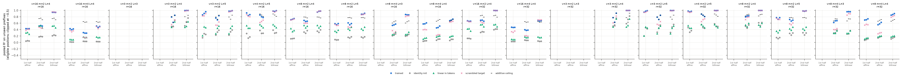
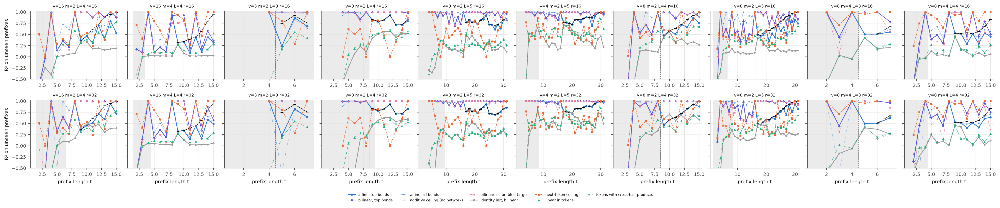
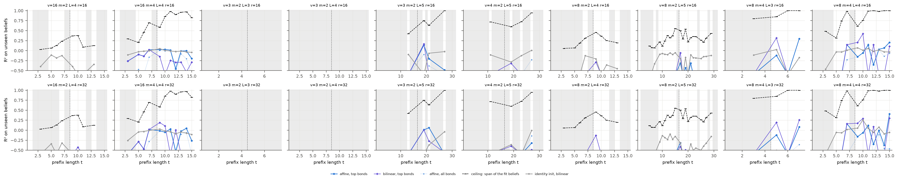
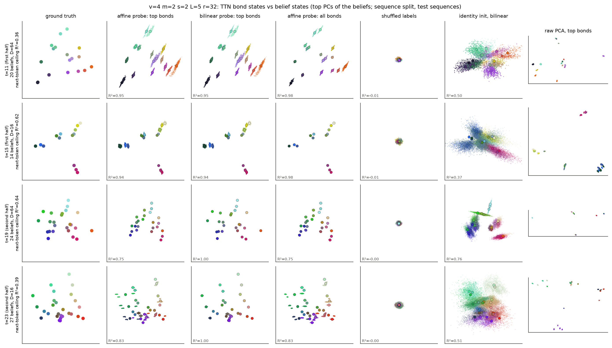

# Belief-state geometry of the RHM in a tree tensor network's bond states

In a tree tensor network (TreeTN) trained on next-token prediction for the Random Hierarchy Model (RHM), a linear readout of the two top bonds recovers the exact belief state b_t = P(pending subtree symbols | x_<t) on unseen prefixes in the second half of the sequence when it is given the product h_L ⊗ h_R (7 of 8 judged cells at each width), and in the first half in 2 of 6 cells at each width. The controls give little evidence that the bonds lay the beliefs out in their own geometry.

- **Second half of the sequence (H2): supported at both widths.** A bilinear probe on the top bonds, [h_L, h_R, h_L ⊗ h_R], recovers the belief with pooled R² 0.85–1.00 on held-out prefixes in 7 of 8 learned, testable grammars at each of r = 16 and r = 32. On the positions where the additive ceiling, the best any function additive in the two halves can do, is below 0.8, it scores 0.86–1.00 against ceilings of 0.51–0.78.
- **First half (H1): partly supported, 2 of 6 grammars at each width.** The affine probe on the top bonds reaches 0.84–0.99 in the two grammars with small alphabets (v = 3, 4) and 0.43–0.77 in the other four testable cells at each width, all with v = 8 or 16, below the 0.8 threshold. Found after looking, on seed 0 only: positions whose beliefs need far more principal components than the bond has coordinates score low (0.18–0.63 at r = 32, 0.10–0.57 at r = 16), and positions that need far fewer score high (0.88–1.00 and 0.73–1.00). An affine probe on an r-dimensional vector cannot fit beliefs that span more than r dimensions, but the exact bound was not computed, so this is a likely reading of the failures and not a tested one.
- **Geometry: little evidence for it, and none outside the m = 4 grammars.** The bilinear probe fits a scrambled target (a random vector per distinct belief) as well as the belief itself (median difference −0.02 to 0.07 per cell), and the first-half affine probe fits it within 0.06 except in three m = 4 cells (0.14–0.18). Both probes score below zero on distinct beliefs they were not fit on, in every run that has such positions. So H1 and H2 show that the bonds linearly identify the belief state; they do not show an affine code of the belief.

All 60 planned runs trained and were analyzed (10 grammars × 2 widths × 3 seeds), the correctness checks passed, and the run cost about $4.39 over 6 h 06 m on one GPU. The definition, with its amendments, is [EXPERIMENT.md](EXPERIMENT.md); a longer note with the mathematics is [NOTE.md](NOTE.md).

## Verdict against the criteria

Criteria were fixed before the run and are applied by `ttn_summary.py` to `results/*/analysis.json` at the final checkpoint, on prefixes held out from the probe fit. A cell is one grammar at one width, with three seeds; a cell counts for a hypothesis only if all three seeds pass every part of it.

| criterion | verdict | evidence |
| --- | --- | --- |
| Checks pass, CUDA present | yes | 28 of 28 RHM checks, the probe check and 8 of 8 TreeTN checks passed before training |
| At least 51 of 60 runs trained and analyzed | yes, 60 of 60 | every run reached 30,000 updates with status `finished`; no cell is censored |
| Shuffled-label pooled R² ≤ 0.05 in every run | yes | −0.014 to 0.004 over the 60 runs |
| Learned (excess test loss < 0.02 nats/token in all three seeds) | 19 of 20 cells | 0.0001–0.0097 in 57 runs; `v16m4s2L4` at r = 16 did not learn (0.043, 0.049, 0.057) |
| H1 at r = 32 | partly supported, 2 of 6 cells | passes: `v3m2s2L5`, `v4m2s2L5`; fails: `v8m2s2L5`, `v8m4s2L4`, `v16m2s2L4`, `v16m4s2L4` |
| H1 at r = 16 | partly supported, 2 of 6 cells | passes: `v3m2s2L5`, `v4m2s2L5`; fails: `v8m2s2L4`, `v8m2s2L5`, `v8m4s2L4`, `v16m2s2L4` |
| H2 at r = 32 | supported, 7 of 8 cells | fails: `v16m4s2L4` (bilinear R² 0.67–0.69) |
| H2 at r = 16 | supported, 7 of 8 cells | fails: `v8m4s2L4` (bilinear R² 0.68–0.73) |

The overall rule was: supported at 75% of the judged cells or more, not supported at 25% or fewer, partly supported in between. Grammars are named vVmMsSLL: v symbols per level, m productions per symbol, branching s = 2, depth L, so a sequence has T = 2^L tokens.

Every failing cell fails on the 0.8 threshold alone; each still beats the identity-init network and the token readouts by more than the 0.1 margin, and the failing H2 cells beat the additive ceiling by 0.13–0.19.

*[figures/summary.pdf](figures/summary.pdf): pooled R² on held-out prefixes, one panel per cell (r = 16 on the left, r = 32 on the right), one point per seed (n = 3). In each panel: the affine probe on the first-half positions, the affine probe on the second-half positions, and the bilinear probe on the same second-half positions. Blue is the trained tree, gray the identity-init tree, green the best affine function of the one-hot prefix tokens, pink crosses the same probe fit to the scrambled target, black bars the additive ceiling. Empty panels have no eligible position.*

## First half: the affine probe passes in the two small-alphabet grammars

For t ≤ T/2 the right top bond sees only masks and is constant, so the affine probe on [h_L, h_R] is an affine probe on the r coordinates of h_L. The table gives the median over three seeds with the range in brackets, pooled over the eligible first-half positions (at least 10 × (2r + 1) distinct fit prefixes).

| grammar | r | positions | trained | identity init | linear in tokens | next-token ceiling | scrambled target | H1 |
| --- | --- | --- | --- | --- | --- | --- | --- | --- |
| `v3m2s2L5` | 32 | 7 | 0.97 [0.95, 0.99] | 0.43 [0.20, 0.46] | 0.45 [0.20, 0.48] | 0.49 [0.48, 0.77] | 0.94 [0.94, 0.97] | yes |
| `v4m2s2L5` | 32 | 8 | 0.97 [0.95, 0.98] | 0.37 [0.32, 0.46] | 0.45 [0.45, 0.52] | 0.57 [0.55, 0.61] | 0.95 [0.94, 0.95] | yes |
| `v8m2s2L5` | 32 | 8 | 0.77 [0.73, 0.77] | 0.15 [0.12, 0.15] | 0.35 [0.31, 0.38] | 0.46 [0.43, 0.50] | 0.72 [0.72, 0.75] | no |
| `v8m4s2L4` | 32 | 4 | 0.71 [0.70, 0.74] | 0.09 [0.07, 0.12] | 0.14 [0.11, 0.14] | 0.83 [0.83, 0.83] | 0.55 [0.54, 0.57] | no |
| `v16m2s2L4` | 32 | 2 | 0.66 [0.66, 0.68] | 0.13 [0.12, 0.13] | 0.42 [0.36, 0.43] | 0.59 [0.59, 0.60] | 0.65 [0.65, 0.67] | no |
| `v16m4s2L4` | 32 | 4 | 0.47 [0.47, 0.48] | 0.03 [0.03, 0.03] | 0.09 [0.09, 0.10] | 0.65 [0.64, 0.66] | 0.34 [0.31, 0.36] | no |
| `v3m2s2L5` | 16 | 8 | 0.91 [0.86, 0.96] | 0.25 [0.15, 0.27] | 0.46 [0.21, 0.49] | 0.50 [0.47, 0.76] | 0.83 [0.83, 0.90] | yes |
| `v4m2s2L5` | 16 | 8 | 0.87 [0.84, 0.92] | 0.17 [0.14, 0.28] | 0.45 [0.45, 0.52] | 0.57 [0.55, 0.61] | 0.82 [0.80, 0.87] | yes |
| `v8m2s2L4` | 16 | 2 | 0.72 [0.71, 0.75] | 0.12 [0.12, 0.13] | 0.37 [0.34, 0.43] | 0.65 [0.63, 0.68] | 0.72 [0.70, 0.73] | no |
| `v8m2s2L5` | 16 | 10 | 0.59 [0.55, 0.59] | 0.08 [0.08, 0.09] | 0.35 [0.32, 0.38] | 0.48 [0.47, 0.51] | 0.53 [0.53, 0.56] | no |
| `v8m4s2L4` | 16 | 4 | 0.58 [0.58, 0.61] | 0.05 [0.04, 0.05] | 0.14 [0.11, 0.14] | 0.83 [0.83, 0.83] | 0.40 [0.40, 0.41] | no |
| `v16m2s2L4` | 16 | 4 | 0.43 [0.43, 0.43] | 0.05 [0.04, 0.05] | 0.30 [0.26, 0.31] | 0.48 [0.48, 0.50] | 0.40 [0.37, 0.42] | no |
| `v16m4s2L4` | 16 | 5 | 0.42 [0.40, 0.43] | 0.01 [0.01, 0.02] | 0.09 [0.09, 0.09] | 0.68 [0.67, 0.69] | 0.36 [0.33, 0.37] | not learned |

The other cells have no eligible first-half position and cannot be judged for H1: both T = 8 grammars and `v3m2s2L4` at both widths, and `v8m2s2L4` at r = 32. Position counts differ between widths because the eligibility rule scales with r, so the r = 16 and r = 32 rows of a grammar are not pooled over the same positions.

In the two passing grammars the trained probe is 0.20–0.48 above the next-token ceiling, the best any function of the exact next-token distribution can do, so the top bond carries more of the belief than the next token requires. In the two m = 4 grammars at both widths, and in `v16m2s2L4` at r = 16, the probe sits below that ceiling.

**Why the v = 8 and v = 16 grammars fail (exploratory, found after seeing the results).** An affine map of the r coordinates of h_L produces predictions in an affine subspace of dimension at most r. If the beliefs at a position spread over more than r dimensions, no such probe can fit them, however the network encodes the state. The analysis saved, for each position, k99: the number of principal components holding 99% of the belief variance. Sorting the eligible first-half positions of seed 0 by k99 (`ttn_table.py`, last table):

| width | positions with | n | affine R² |
| --- | --- | --- | --- |
| r = 32 | k99 ≤ 19 | 20 | 0.88–1.00 |
| r = 32 | k99 28–33 | 5 | 0.67–0.89 |
| r = 32 | k99 ≥ 42 | 8 | 0.18–0.63 |
| r = 16 | k99 ≤ 10 | 19 | 0.73–1.00 |
| r = 16 | k99 12–19 | 5 | 0.69–1.00 |
| r = 16 | k99 ≥ 28 | 17 | 0.10–0.57 |

This covers one seed per cell (33 positions at r = 32, 41 at r = 16), the grouping was chosen after looking, and the exact ceiling (the share of belief variance in the top r components) was not computed. The r = 16 rows include the cell that did not learn, where a low score can come from not learning: it contributes 5 of the 41 positions, 3 of them in the last group, which without them is 14 positions at 0.14–0.57. The grouping is also not clean in the middle: on `v8m2s2L5` at r = 32, two positions whose beliefs have rank 31 and 32 score 0.73 and 0.67. It is a likely reading of the H1 failures, not an established one. The passing grammars have 3–28 distinct beliefs per position; the failing ones have up to 356.

*[figures/positions.pdf](figures/positions.pdf): R² on held-out prefixes at each prefix length t, seed 0 of each cell (r = 16 top row, r = 32 bottom row). The dashed vertical line is the midpoint T/2; gray bands are positions not eligible for the affine top probe. Blue: affine probe on the top bonds. Violet: bilinear probe. Black dashes: the additive ceiling. Pink: bilinear probe on the scrambled target. Gray: bilinear probe on the identity-init tree. Orange: next-token ceiling. Green: token readouts.*

## Second half: the belief is in the product of the top bonds

Past the midpoint the belief depends jointly on the left half and on the right half's partial evidence, and each top bond has seen only one half. The additive ceiling is the best fit of the form f(left-half symbol) + g(right-half parse state), computed without the network; every affine probe on bonds from disjoint spans is bounded by it. Medians over three seeds with ranges; "all h2b" pools the second-half positions eligible for the bilinear probe, and "ceiling < 0.8" pools the subset where the additive ceiling leaves room.

| grammar | r | affine, all h2b | bilinear, all h2b | scrambled target | bilinear, ceiling < 0.8 | additive ceiling there | H2 |
| --- | --- | --- | --- | --- | --- | --- | --- |
| `v3m2s2L5` | 32 | 0.79 [0.72, 0.85] | 1.00 [0.99, 1.00] | 0.99 [0.99, 1.00] | 1.00 [0.99, 1.00] | 0.74 [0.69, 0.77] | yes |
| `v4m2s2L5` | 32 | 0.85 [0.81, 0.88] | 1.00 [0.99, 1.00] | 1.00 [0.99, 1.00] | 1.00 [1.00, 1.00] | 0.73 [0.71, 0.74] | yes |
| `v8m2s2L4` | 32 | 0.83 [0.80, 0.83] | 1.00 [1.00, 1.00] | 1.00 [0.99, 1.00] | 1.00 [1.00, 1.00] | 0.67 [0.66, 0.78] | yes |
| `v8m2s2L5` | 32 | 0.69 [0.67, 0.71] | 0.98 [0.97, 0.98] | 0.98 [0.98, 0.98] | 0.99 [0.99, 1.00] | 0.62 [0.61, 0.63] | yes |
| `v8m4s2L3` | 32 | 0.67 [0.62, 0.68] | 0.96 [0.96, 0.96] | 0.89 [0.85, 0.90] | 0.96 [0.96, 0.96] | 0.73 [0.67, 0.74] | yes |
| `v8m4s2L4` | 32 | 0.58 [0.55, 0.63] | 0.87 [0.85, 0.90] | 0.81 [0.79, 0.84] | 0.91 [0.89, 0.93] | 0.62 [0.58, 0.65] | yes |
| `v16m2s2L4` | 32 | 0.69 [0.66, 0.70] | 1.00 [0.99, 1.00] | 1.00 [0.99, 1.00] | 1.00 [1.00, 1.00] | 0.66 [0.58, 0.66] | yes |
| `v16m4s2L4` | 32 | 0.39 [0.38, 0.40] | 0.68 [0.67, 0.69] | 0.70 [0.70, 0.71] | 0.72 [0.71, 0.73] | 0.54 [0.53, 0.55] | no |
| `v3m2s2L4` | 16 | 0.79 [0.63, 0.85] | 1.00 [0.99, 1.00] | 0.99 [0.98, 1.00] | 1.00 [1.00, 1.00] | 0.72 [0.63, 0.77] | yes |
| `v3m2s2L5` | 16 | 0.76 [0.70, 0.84] | 0.97 [0.97, 0.99] | 0.97 [0.95, 0.99] | 0.98 [0.97, 1.00] | 0.74 [0.69, 0.77] | yes |
| `v4m2s2L5` | 16 | 0.80 [0.78, 0.85] | 0.98 [0.97, 0.99] | 0.97 [0.95, 0.98] | 0.99 [0.99, 1.00] | 0.73 [0.71, 0.74] | yes |
| `v8m2s2L4` | 16 | 0.66 [0.65, 0.69] | 0.97 [0.94, 0.98] | 0.98 [0.95, 0.98] | 0.99 [0.95, 1.00] | 0.65 [0.63, 0.65] | yes |
| `v8m2s2L5` | 16 | 0.59 [0.55, 0.61] | 0.88 [0.88, 0.91] | 0.88 [0.86, 0.89] | 0.91 [0.89, 0.95] | 0.62 [0.61, 0.63] | yes |
| `v8m4s2L3` | 16 | 0.55 [0.53, 0.57] | 0.86 [0.86, 0.87] | 0.83 [0.81, 0.83] | 0.86 [0.86, 0.87] | 0.65 [0.61, 0.67] | yes |
| `v8m4s2L4` | 16 | 0.47 [0.45, 0.51] | 0.70 [0.68, 0.73] | 0.65 [0.63, 0.66] | 0.76 [0.76, 0.78] | 0.62 [0.58, 0.65] | no |
| `v16m2s2L4` | 16 | 0.51 [0.51, 0.53] | 0.94 [0.94, 0.94] | 0.94 [0.94, 0.95] | 0.97 [0.96, 0.97] | 0.56 [0.51, 0.57] | yes |
| `v16m4s2L4` | 16 | 0.29 [0.29, 0.31] | 0.50 [0.47, 0.51] | 0.48 [0.43, 0.49] | 0.56 [0.52, 0.56] | 0.54 [0.53, 0.55] | not learned |

Not testable for H2: `v3m2s2L3` at both widths (no position eligible for the bilinear probe), and `v3m2s2L4` at r = 32, where seed 2 has no position with an additive ceiling below 0.8 (the bilinear probe scores 1.00 at its two eligible positions in all three seeds). The numbers of pooled positions per run are in `results/summary.txt`: 1 to 15 for the bilinear probe and 1 to 13 for the ceiling < 0.8 subset.

The affine probe on the top bonds stays at or under the additive ceiling, as it must, and the bilinear probe clears that ceiling by 0.19–0.46 in every run of the passing cells. The bilinear probe on the identity-init tree scores 0.03–0.72 and the affine readout of the tokens 0.16–0.55 (medians per cell, 18 cells), both at least 0.1 below the trained tree in every seed of every passing cell. Where the token readout with cross-half products is eligible (10 of the 14 passing cells), it scores 0.11–0.71 against 0.86–1.00 for the bilinear probe on the same positions (ranges over those 30 runs).

## What the probes do and do not show about geometry

A position has few distinct beliefs (3 to 1,036 at the pooled positions) compared with the probe's features (2r for the affine probe, 2r + r² for the bilinear one). A probe that linearly identifies the state can then fit any labelling of the states. Two descriptive numbers, fixed before the run, separate identification from geometry.

**Selectivity** is the probe's R² on the belief minus its R² on the scrambled target, on the same positions. For the bilinear probe it is between −0.02 and 0.07 (median per cell, 18 cells), so the scrambled target is fit as well as the belief. For the first-half affine probe it is 0.01–0.06 in the m = 2 grammars and 0.14–0.18 in `v8m4s2L4` at both widths and `v16m4s2L4` at r = 32, the three cells where the belief is fit clearly better than an arbitrary labelling, though all three are under the H1 threshold.

**The belief split** fits the probe on half of the distinct beliefs at a position and scores it on the other half, which a code affine in the belief would pass and a code that only identifies states would not. Medians per cell over the seeds that have such positions:

| probe | trained tree | identity-init tree | ceiling (span of the fit beliefs) |
| --- | --- | --- | --- |
| affine, top bonds | −7.31 to −0.08 | −64.70 to 0.00 | 0.30 to 0.98 |
| bilinear, top bonds | −5.23 to −0.40 | −93.15 to −0.01 | 0.30 to 0.98 |

Every trained cell is below zero, across 14 cells (the two `v3m2s2L5` cells have such positions in only two seeds, and those four runs are also negative; `v3m2s2L3` and `v3m2s2L4` have none). This is weak evidence on its own, as the reviewer of the definition warned: the split fits on 7 to 505 distinct beliefs per position (median 23) with 32 to 1,088 features, the identity-init values range down to −902 in single runs, and a negative score from an over-parameterized fit does not show the absence of an affine code. Together with the selectivity it gives little support for one, and none outside the m = 4 grammars: at single positions of seed 0 the belief-split score is above zero at 40 of 284 points, up to 0.42, in the three m = 4 grammars and `v3m2s2L5`, while every pooled score is negative. The bilinear range in the table has the cell that did not learn at its −0.40 end; over learned cells it is −5.23 to −0.55.

*[figures/beliefsplit.pdf](figures/beliefsplit.pdf): R² on distinct beliefs the probe never saw, per position, seed 0 of each cell, clipped at −0.6. Black dashes are the ceiling, the test beliefs projected on the span of the fit beliefs. Gray bands are positions outside the pooled set.*

*[figures/geometry_v4m2s2L5_r32.pdf](figures/geometry_v4m2s2L5_r32.pdf): one of 20 such figures, seed 0. Each row is a position, each point a test sequence projected on the top two principal components of the true beliefs at that position and coloured by its true belief. Columns: the true beliefs, the affine probe on the top bonds, the bilinear probe, the affine probe on all bonds, the shuffled-label control, the bilinear probe on the identity-init tree, and the raw top-2 PCA of the top bonds (which depends on the bond gauge). R² values in these panels are per position on the sequence split, where test prefixes can repeat fit prefixes. Here they are within 0.001 of the held-out-prefix values at the same positions; they are not the pooled numbers in the tables.*

## Other descriptive results

- **Width.** The two criterion probes score lower at r = 16 than at r = 32 in every grammar that has pooled positions at both widths (first-half affine, 6 of 6; second-half bilinear, 9 of 9, cell medians): for example the bilinear probe on `v8m2s2L5` is 0.88 against 0.98, and on `v8m4s2L4` 0.70 against 0.87, which moves that cell across the H2 threshold. The lower-level and observed-node probes do not show this; they are about equal at the two widths. The eligible positions differ between widths, so these are not paired comparisons.
- **Levels.** Pooled over all positions eligible for the affine top probe, the affine probe on the bonds of the lowest probed level scores 0.22–0.58, on the top bonds 0.31–0.88, on all bonds together 0.42–0.89, and on the fully observed nodes 0.32–0.65 (medians per cell, 18 cells with eligible positions).
- **Training.** The affine top probe rises with learning; its first-half score is within 0.03 of its final value by 10,000 updates in 12 of the 13 cells with first-half positions (medians over seeds), the exception being `v16m4s2L4` at r = 16, the cell that did not learn (0.26 at 10,000, 0.42 at 30,000); on `v4m2s2L5` at r = 32 the first-half score goes 0.37, 0.76, 0.88, 0.93, 0.95, 0.97 at updates 0, 300, 1,000, 3,000, 10,000 and 30,000 ([figures/training.pdf](figures/training.pdf)). `v8m4s2L4` at r = 16 gets there late, going from 0.29 at 3,000 to 0.57 at 10,000.
- **v = 3 triangles.** `figures/triangles_<grammar>_r<r>.pdf` show a pending node's marginal on the 2-simplex for the six v = 3 cells.
- **Comparison with the transformer.** Not made here. The definition leaves it to the planning session; `ttn_plot.py` takes the transformer's results folder as a third argument and writes `compare.pdf`.

## How it was done

- **Model.** `ctn.tree.TreeTN` on the grammar's leaf order, untied, no biases or nonlinearities, identity init with eps = 0.1, bond dimension r = 16 or 32 (26 thousand to 1.0 million parameters). Each merge is z_a = Σ_bc W_abc zL_b zR_c, and the root core contracts the two top bonds h_L, h_R into logits.
- **Task.** For each prefix length t the tree sees x_<t with positions ≥ t replaced by a mask token and predicts x_t. One update uses every prefix of 512 fresh sequences. Adam, peak LR 1e-3, 30,000 updates, float32. The seed sets both the grammar's rules and the init, so the three seeds of a cell are three grammars of the same shape.
- **Probes.** Least squares with a negligible ridge, a separate fit per position, on 60,000 analysis sequences. Scores are on prefixes held out from the fit, pooled over eligible positions (at least 10 × (features + 1) distinct fit prefixes). Grammars, seeds, belief targets, analysis sequences and held-out prefixes are those of `rhm-belief-geometry`, whose functions are imported.
- **Controls, all in the same run:** the identity-init tree (checkpoint 0), the affine readout of the one-hot tokens, the token readout with cross-half products, the additive ceiling, the scrambled target, shuffled labels, the next-token ceiling, and excess test loss over the exact Bayes loss.

## How it was checked

- **Correctness checks before training** (`results/checks.json` and the job log): belief states against brute-force enumeration, the affine probe on synthetic activations, and the TreeTN-specific facts the hypotheses rely on (h_R constant for t ≤ T/2; each top bond blind to the other half; a bilinear target recovered only by the bilinear probe). All passed.
- **Shuffled labels.** Pooled R² between −0.014 and 0.004 in all 60 runs, so the probe pipeline does not manufacture fit.
- **CPU against GPU.** 49 of the 60 analyses ran on the worker's CPU and 11 on its GPU (`results/analyze_devices.txt`), because analysis ran alongside training. One run, `v8m4s2L4_r32_s0`, was analyzed on both: all non-metric fields are identical, the pooled R² values of the affine and bilinear top probes, which are the criterion numbers, differ by at most 1e-6, and the largest difference among all 2,885 metric values is 6.5e-4 on an RMSE of 4.65. One run was compared, not all.
- **Plot script.** Tested on 40 runs before the final step; the final figures come from the same script on all 60.
- **Fact check.** A separate fact-checking pass compared this write-up with the result files, logs and code. The tables and verdicts held. It changed 15 statements, none of which affects a verdict, and the fact check of the research note changed a few more here. The main ones: the opening and the first-half heading had stated the bond-dimension reading as a result and now state it as untested; the count of cells in the belief split was 16 and is 14; the claim that every probe is lower at r = 16 held only for the two criterion probes; the number of beliefs the belief split fits on had been taken from the pilots; and the note on r = 64 had the wrong learning rate.

## Not yet checked

- **The rank ceiling for H1.** The exact bound on an affine probe of an r-dimensional bond, the share of belief variance in the top r principal components at each position, would turn the exploratory reading above into a test. It needs the belief spectra, which the analysis computes but does not save beyond k99: by estimate a few CPU minutes per run, and 12–13 GB of RAM for the largest belief targets (v = 16 and `v8m2s2L5`). The claim that H1 fails for lack of bond dimension depends on it.
- **Whether a wider tree passes H1.** r = 64 would test the same reading directly. `rhm-dynamics` found r = 64 trees unstable at peak LR 3e-3 (3 of 6 runs collapsed) and stable at 1e-3, the rate used here (0 of 6, on its root and last-token tasks).
- **CPU and GPU agreement on the large grammars.** The equivalence check covered one T = 16 run.
- **Selectivity with fewer features.** The scrambled target shows that these probes can fit any labelling; a probe restricted to as many features as there are belief dimensions would say more about geometry. It was not part of the definition.

## Judgement calls

These were made by the supervising session while the run was unattended; the first four are recorded with their reasons under Amendments in [EXPERIMENT.md](EXPERIMENT.md), and the k99 table was added while writing up.

- **The cutoff for starting training runs was moved from 5 h to 5.7 h.** Training took 5.7 h against an estimated 1.5–2.5 h. Under the definition's rule (no new runs after 5 h) 16 runs would not have started, leaving 44, below the 51 the definition requires. All 16 are at r = 16: `v8m2s2L5` seed 2 and every seed of `v16m2s2L4`, `v8m2s2L4`, `v3m2s2L4`, `v8m4s2L3` and `v3m2s2L3` (`results/run_times.tsv`). The r = 32 verdicts do not depend on them. At r = 16 they do: with those runs censored, 3 cells could be judged, and both H1 and H2 would read "partly supported, 2 of 3". The time cap and budget were not exceeded, and the user later authorized moving such cutoffs.
- **Analysis ran alongside training, mostly on the CPU,** to fit inside the 8 h cap. The method is unchanged; the device differs, and the check above covers one run.
- **One analysis was killed by the worker's memory limit and rerun alone,** as the definition prescribes. Three more died of GPU memory in the first concurrent batch and were rerun on the CPU. No training run was affected.
- **Projection files (2.9 GB) are in `runs/rhm-ttn-belief-geometry/proj/`,** not in `results/`, so that only the JSON results and figures are in git.
- **The k99 table is exploratory.** It was made after seeing which cells failed H1.

## What this means and what to do next

For the question the experiment asked: the TreeTN's top bonds determine the RHM belief state linearly, through h_L in the first half in the two small-alphabet grammars (2 of 6 cells at each width; whether the other four fail for lack of bond dimension is untested), and through the product h_L ⊗ h_R in the second half, where no single bond has seen enough. In the second half this was tested against the bound on every additive readout and holds in 14 of 16 learned, testable cells. What the bonds hold is an identification of the belief state. The scrambled-target control and the belief split give no sign that the belief simplex is embedded affinely, which is the stronger property the transformer experiment is after.

The next steps are the position-by-position comparison with the transformer on the same held-out prefixes, and the rank ceiling for H1, which decides whether "partly supported" reflects the network or the probe's capacity.

## Files

- `results/summary.txt`, `results/summary.json`: the per-run tables and verdicts. `results/<run>/analysis.json`: every probe score per position and checkpoint.
- `results/run_times.tsv`, `results/analyze_devices.txt`, `results/checks.json`: when each run trained, which device analyzed it, and the checks.
- `figures/*.pdf` (30 files) from `ttn_plot.py`; `figures/png/` from `ttn_figures_png.py`; the tables above from `ttn_table.py results`.
- `runs/rhm-ttn-belief-geometry/` (data folder, not in git): checkpoints, logs, projection files.
