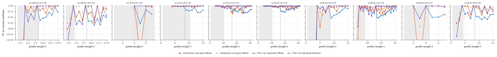

# Follow-up: the transformer and the tree tensor network, position by position

Both experiments probed their model for the same exact belief state on the same 60,000 sequences with the same
held-out prefixes, so their scores can be laid side by side. In the second half of the sequence, the tree's bilinear
probe on its two top bonds scores at least as high as the transformer's last-layer affine probe in all 9 grammars
(median R² per grammar 0.87–1.00 against 0.72–0.99), while the tree's affine probe is lower in all 9 (0.34–0.86). In
the first half, the transformer's affine probe is the higher one in 4 of the 5 grammars that have eligible positions
(0.75–0.99 against 0.36–0.99 for the tree's affine probe). This is one seed per grammar, the tree at bond dimension
32, and it was not part of either experiment's pre-registered criteria.

*R² on held-out prefixes at each prefix length t, seed 0, final checkpoints. Orange: the transformer's affine probes
(solid: last layer; dotted: all layers). Blue: the tree's affine probe on its two top bonds. Violet: the tree's
bilinear probe on the same bonds. The dashed line is the midpoint T/2, after which the tree's right top bond is no
longer constant. Gray marks positions with too few distinct prefixes for one of the two primary probes; scores there
are not comparable. The figure is a ten-panel strip, so open [compare.pdf](compare.pdf) at full size.*

| grammar | half | eligible positions | transformer, last layer (affine) | tree, top bonds (affine) | tree, top bonds (bilinear) |
|---|---|---|---|---|---|
| v16m2s2L4 | second | 7 | 0.90 [0.67, 1.00] | 0.60 [0.36, 0.94] | 1.00 [0.99, 1.00] |
| v16m4s2L4 | first | 4 | 0.75 [0.36, 0.99] | 0.36 [0.18, 1.00] | 0.36 [0.18, 1.00] |
| v16m4s2L4 | second | 7 | 0.72 [0.26, 0.98] | 0.34 [0.15, 0.59] | 0.87 [0.34, 1.00] |
| v3m2s2L4 | second | 5 | 0.98 [0.95, 1.00] | 0.82 [0.71, 0.93] | 1.00 [1.00, 1.00] |
| v3m2s2L5 | first | 6 | 0.99 [0.74, 1.00] | 0.98 [0.88, 1.00] | 0.98 [0.88, 1.00] |
| v3m2s2L5 | second | 15 | 0.92 [0.66, 1.00] | 0.77 [0.70, 0.93] | 1.00 [0.99, 1.00] |
| v4m2s2L5 | first | 6 | 0.97 [0.92, 1.00] | 0.99 [0.94, 1.00] | 0.99 [0.94, 1.00] |
| v4m2s2L5 | second | 15 | 0.95 [0.83, 1.00] | 0.86 [0.72, 0.99] | 1.00 [0.99, 1.00] |
| v8m2s2L4 | second | 7 | 0.96 [0.77, 1.00] | 0.72 [0.46, 0.93] | 1.00 [0.99, 1.00] |
| v8m2s2L5 | first | 8 | 0.93 [0.76, 1.00] | 0.85 [0.55, 1.00] | 0.85 [0.55, 1.00] |
| v8m2s2L5 | second | 15 | 0.89 [0.64, 1.00] | 0.69 [0.47, 0.93] | 1.00 [0.94, 1.00] |
| v8m4s2L3 | second | 3 | 0.99 [0.95, 1.00] | 0.50 [0.50, 0.62] | 1.00 [0.96, 1.00] |
| v8m4s2L4 | first | 4 | 0.99 [0.62, 0.99] | 0.70 [0.45, 1.00] | 0.70 [0.45, 1.00] |
| v8m4s2L4 | second | 7 | 0.90 [0.60, 0.94] | 0.52 [0.40, 0.64] | 0.95 [0.70, 1.00] |

Each cell is the median over the eligible positions of that half, with the minimum and maximum in brackets. A position
is eligible when it has enough distinct fit prefixes for both primary probes: 1,290 for the transformer's last layer
(129 parameters per output) and 650 for the tree's affine top-bond probe (65 parameters). Grammar names read vVmMsSLL:
v symbols per level, m synonymous productions per symbol, branching s, depth L. In the first half the tree's right top
bond is constant, so its bilinear probe has nothing to add and equals the affine one.

Position by position, the tree's bilinear probe is at or above the transformer's last layer at 68 of the 81 eligible
second-half positions, and the tree's affine probe is at or above it at 7 of 81. In the first half, the tree's affine
probe is at or above the transformer's at 8 of 28 positions.

## How to read it

- **The transformer's last layer has seen the whole prefix, and no single bond of the tree has.** Past the midpoint
  the belief depends jointly on the two halves, which the tree holds in two separate bonds. An affine probe on the two
  bonds cannot express that dependence; a probe that is given their product can. The transformer's one vector needs no
  product. That is the structural reading the tree experiment set out to test, and this figure shows it against the
  transformer on equal data.
- **The probes differ in size.** The bilinear probe has 1,088 parameters per output at bond dimension 32, against 129
  for the transformer's last layer. It is eligible by the experiment's rule (10,890 distinct fit prefixes) at only
  part of the positions used here, so some of its scores come from an underdetermined fit. A higher bilinear score is
  therefore not evidence that the tree represents the belief better than the transformer.
- **None of these scores shows belief geometry.** In both experiments the probes fit a scrambled relabelling of the
  belief states about as well as the beliefs, and do not extrapolate to unseen beliefs (the tree experiment's README,
  and `../../rhm-belief-geometry/followups/README.md` for the transformer). So this figure compares how linearly the
  two models identify the belief state of a prefix, not how they lay beliefs out.

## How it was done and checked

`compare.py` in this folder reads the two experiments' saved analyses (`results/<grammar>_r32_s0/analysis.json` here
and `results/<grammar>_s0/analysis.json` in `rhm-belief-geometry`), draws the figure with the tree experiment's own
`ttn_plot.compare`, and writes the plotted numbers to `compare.json`, from which the table and the counts above were
tabulated by script. Nothing was recomputed from checkpoints. The numbers were not independently fact-checked.

## Not yet checked

- **Seeds 1 and 2, and the tree at bond dimension 16.** Their analyses exist; the script reads seed 0 at r = 32 only.
- **A like-for-like probe size.** Giving the transformer a probe with as many parameters as the bilinear one, or
  restricting the comparison to positions where the bilinear probe is itself eligible, would make the second-half
  comparison fairer.
