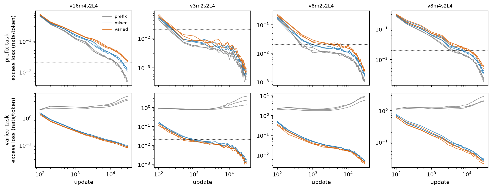
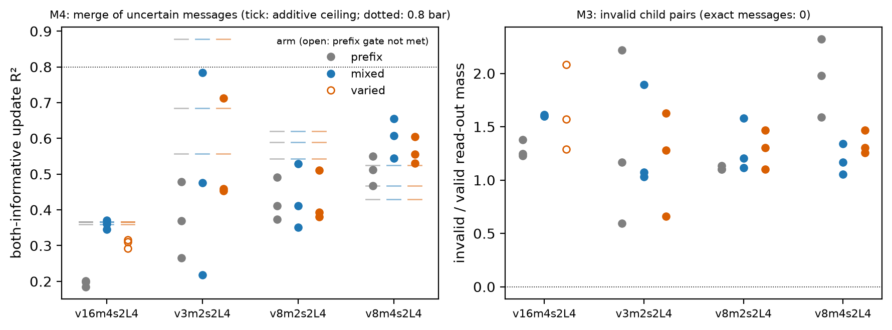
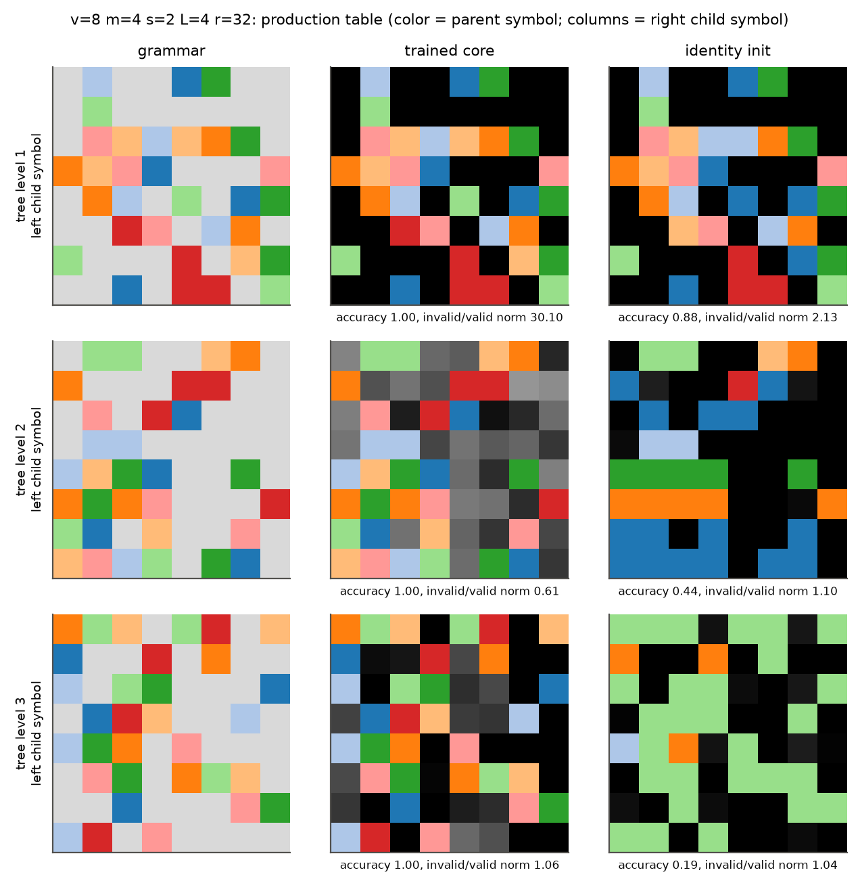

**Do varied observation masks teach a tree tensor network the grammar's message update?**

*A research note on one explanation for a negative result: that a tree trained on prefixes never sees two uncertain children at one node, so nothing in its loss asks for the bilinear part of the update.*

An earlier experiment ([`rhm-ttn-messages`](../rhm-ttn-messages/NOTE.md)) trained tree tensor networks (TreeTNs) on next-token prediction for the Random Hierarchy Model (RHM) and tested whether their merges reproduce the grammar's message update on uncertain inputs. They did not, in any of 9 learned cells. This note tests the simplest explanation, that the prefix task never exercises the product of two uncertain messages, by changing only the observation masks seen in training and repeating the same test.

The result is inconclusive by the rule fixed before the run, and the numbers lean negative. **Three statements rest on criteria fixed in advance. In the `mixed` arm, which trains on prefix and varied masks in equal parts, the merge still fails the test in every run: its $R^2$ against the exact update on pairs of informative child messages is 0.22 to 0.78 over 12 runs, against a threshold of 0.8 and against 0.18 to 0.55 for the prefix-trained trees. The run cannot be read as evidence against the explanation, because the tree learned the varied task to within 0.02 nats per token of the Bayes loss in only 2 of 4 grammars, and the rule required 3. Child pairs that the grammar forbids keep their read-out mass: the ratio to an allowed pair is 1.03 to 1.89 in the `mixed` arm, where exact message passing gives 0.** Two further observations were made after looking at the results and are marked as such below. The numbers are those of the write-up, [`README.md`](README.md), which has the full tables; a separate fact-check pass compared both documents with the result files and the code, and its corrections are applied here.

**The grammar's update multiplies the two child messages.** An RHM grammar has $v$ symbols per level, $m$ productions per symbol, binary branching and depth $L$, so a sequence has $T = 2^L$ tokens; `v8m4s2L4` has $v = 8$, $m = 4$ and $T = 16$. Write $Z_u$ for the symbol at node $u$ and $T_{abc} = P(Z_{\mathrm{left}} = b, Z_{\mathrm{right}} = c \mid Z_u = a)$ for the production tensor, which is $1/m$ on the productions of $a$ and zero elsewhere. The upward message of a node is the likelihood of the observed leaves in its span, $\lambda_u(a) = P(\text{observed leaves under } u \mid Z_u = a)$, and it obeys

$$
\lambda_u(a) = \sum_{b, c} T_{abc}\, \lambda_{\mathrm{left}}(b)\, \lambda_{\mathrm{right}}(c).
$$

A fully observed subtree has a point mass on its symbol, a fully masked subtree has the all-ones message, and a partially observed subtree can have a genuine distribution. A TreeTN merges two child bonds with a learned bilinear core, $z_u = W_u(z_{\mathrm{left}}, z_{\mathrm{right}})$, so it can represent this update exactly if each bond is a linear image of its message.

**Under prefix masks, one of the two factors is always trivial.** A prefix row observes tokens $0, \dots, q - 1$ and masks the rest. Take a parent whose left child covers positions $[s, c)$ and whose right child covers $[c, e)$. The right child has an observed leaf only if $q > c$, and then every leaf of the left child is observed. So in every training row either $\lambda_{\mathrm{left}}$ is a point mass $e_{b^\ast}$, and the update reduces to a function linear in the right message,

$$
\lambda_u(a) = \sum_{c} T_{a b^\ast c}\, \lambda_{\mathrm{right}}(c),
$$

or $\lambda_{\mathrm{right}}$ is the all-ones vector, and the update is linear in the left message. The loss never evaluates the core on two inputs that are both mixtures, and the entries $T_{abc}$ with $(b, c)$ forbidden by the grammar are constrained only through such one-sided inputs. This is the training-distribution explanation: the earlier trees were never asked for the product.

**Varied masks put two uncertain children in the same row.** Each arm of this experiment trains the same tree on the same sequences and differs only in the masks. A row is a sequence and a query position $q$; positions before $q$ are observed, $q$ is masked and predicted. In the `prefix` arm every later position is masked. In the `varied` arm each later position is masked independently with probability $u$, with $u \sim U(0, 1)$ drawn per row. In the `mixed` arm a row is of either kind with probability 1/2. The prefix rows are the $u = 1$ case of the varied rows, so the input format, the model and the read-out are the same in all arms, and every arm can be scored on the prefix task. In a varied row the subtree that contains $q$ is partially observed while subtrees to its right can hold observed leaves, so a parent can receive two uncertain children, and the Bayes prediction requires their product. The exact posterior under an arbitrary mask is computed by the same message passing, which gives the Bayes loss of the varied task.

**The test builds uncertain inputs by hand and asks whether the core merges them as the grammar does.** For each parent above the first level, take the mean bond $\mu_b$ of a fully observed child with symbol $b$, form the mixtures $\sum_b \lambda_{\mathrm{left}}(b)\, \mu_b$ and $\sum_c \lambda_{\mathrm{right}}(c)\, \mu_c$ for pairs of messages drawn from the children's empirical messages, merge them with the learned core, and decode the result with a projective probe fit on the parent's own bonds. The score is the $R^2$ against the normalized exact update. The pairs that matter are the both-informative ones: a partially observed left child and a partially or fully observed right child. Two controls give the score to beat: the same tree before training, and the additive ceiling, which is the best least-squares fit of the target from $[\lambda_{\mathrm{left}}, \lambda_{\mathrm{right}}]$ with no product term. A run passes if it reaches 0.8 on all pairs and on the both-informative pairs and leaves at most half of the shortfall of the better control.

**The varied task is harder for this tree, and it was learned in two grammars of four.** The trees have bond dimension $r = 32$ and are trained for 30,000 updates, as before. On the prefix task every `mixed` run is within 0.014 nats per token of the Bayes loss. On the varied task the `mixed` arm ends within 0.006 nats per token in the two grammars with $m = 2$ and at 0.025 to 0.030 (`v8m4s2L4`) and 0.090 to 0.098 (`v16m4s2L4`) in the two with $m = 4$, with the loss still falling as the learning-rate schedule ended. A prefix-trained tree is 1.4 to 9.2 nats per token above the Bayes loss on varied masks, so the composition the varied task needs does not come for free with the prefix task.

*Excess loss over training on the prefix task (top) and the varied task (bottom) for the four grammars; one line per run, three seeds per arm, logarithmic axes; the dotted line is the 0.02 nats per token gate.*

**The merge improves in two grammars and passes in none.** The figure below shows the both-informative $R^2$ of every run. In `v16m4s2L4` mixed masks raise it by 0.15 to 0.18 in all three seeds, to within 0.02 of the additive ceiling of those pairs (0.35 to 0.37 against 0.36 to 0.37). In `v8m4s2L4` the three differences are $+0.19$, $+0.10$ and $-0.01$, and the `mixed` arm ends above its additive ceiling (0.54 to 0.65 against 0.43 to 0.53), as the `prefix` arm already did by 0.02 to 0.04. In `v8m2s2L4` they are within $\pm 0.04$, and in `v3m2s2L4` they are $+0.21$, $+0.41$ and $-0.26$. The best run of the `mixed` arm scores 0.78, below the 0.88 that a fit with no product term reaches on the same pairs. Over the 12 pairs of runs the `mixed` arm is higher in 8, with a median difference of $+0.12$.

*One point per run at update 30,000, three seeds per grammar and arm, over parents of tree level 2 and above. Left: $R^2$ of the decoded merge on both-informative pairs, with the 0.8 threshold dotted and the additive ceiling of each run as a short tick. Right: read-out mass of forbidden child pairs relative to allowed ones; exact messages give 0. Open markers miss the prefix gate.*

**Observed after the run: the gain is not where the varied task was learned.** The two grammars in which the `mixed` arm meets the 0.02 gate on varied masks (0.001 to 0.005 nats per token above the Bayes loss) are the two with $m = 2$, and there the merge does not move (`v8m2s2L4`) or moves in both directions (`v3m2s2L4`). The two grammars where it gains are the ones where the varied task was not learned to the gate. With four grammars this is a pattern to test, not a result. A second observation concerns the pairs with a fully masked left child, where the exact update is linear in the right message and the additive ceiling is 0.92 to 1.00. Such pairs occur in varied rows and never in prefix rows, and the decoded merge scores $-0.30$ to 0.52 on them in the `mixed` arm, about as far from the ceiling as the `prefix` arm ($-0.64$ to 0.52; `mixed` is higher in 7 of 12 runs, with a median difference of $+0.02$).

**Forbidden pairs keep their read-out mass.** Under exact message passing the core vanishes on a pair $(b, c)$ that no production joins. Pushing the class means of such a pair through the learned core and decoding gives a nonnegative read-out mass, and its ratio to the mass of an allowed pair is 1.03 to 1.89 in the `mixed` arm and 0.59 to 2.32 in the `prefix` arm. The ratio is lower under mixed masks in 6 of 12 pairs of runs, with a median paired ratio of 1.10, against a criterion of 10 of 12 and at most 0.5. It falls in all three seeds of `v8m4s2L4` (to 0.53 to 0.73 of the prefix value) and rises in all three seeds of `v16m4s2L4`.

*`v8m4s2L4`, `mixed` arm, seed 0, node 0 of each tree level. Left: the grammar's production table (color = parent symbol, light gray = no production). Middle: the table read from the trained core, with allowed pairs colored by the decoded parent and forbidden pairs shaded by the norm of the merged bond relative to the median allowed pair (white = 0, black at 1 or more). Right: the same before training. The allowed pairs are decoded correctly and the forbidden pairs are not suppressed.*

**Why a failed test here is weak evidence.** Three limits were stated before the run. First, the test never reads a bond from a varied row: its inputs are mixtures of class means of fully observed children, decoded by a probe fit on prefix-pattern rows, so a tree that composes real uncertain bonds correctly in another code would fail it. Second, the varied loss does not ask exactly for the message code. The logits are multilinear in every bond, and the Bayes log-odds are log-ratios of linear forms in an uncertain message, so a softmax read-out may be unable to hold exact messages and reach the Bayes loss on varied rows; a calculation made during the review, with no network, put the least excess loss of an affine read-out of the right half's message at up to 0.011 nats per row for the normalized message. Third, the tree has to learn the varied task for the test to bear on composition, and here it did so in two grammars.

**What would settle it.** The definition fixed one follow-up and its reading: a projective probe from a bond to its normalized message, fit on bonds collected from varied-pattern inputs at nodes to the right of the query and scored on held-out patterns. If it reaches 0.8 in the `mixed` arm where the `prefix` arm does not, the mixed tree carries uncertain messages even though the mixture test fails. It needs only the checkpoints saved by this run. A longer schedule or a wider tree in the two $m = 4$ grammars would say whether the varied task is learnable at all by this architecture, which the main criterion needs before it can return a negative.
