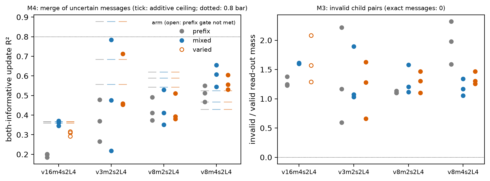
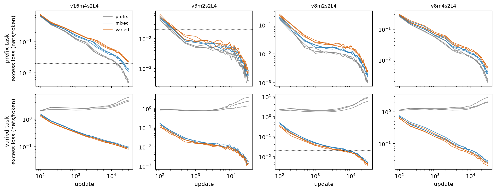
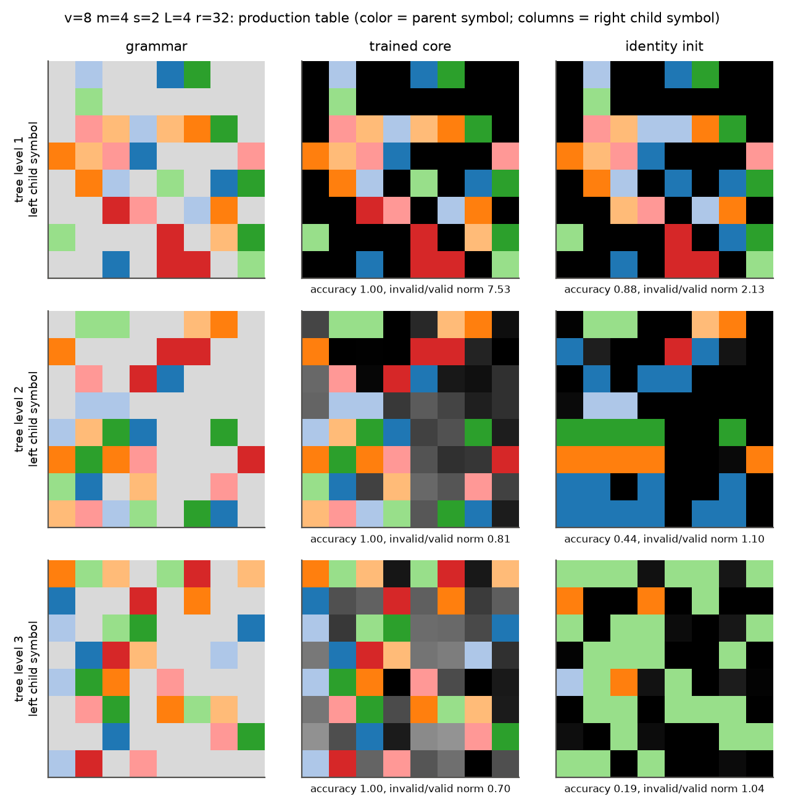
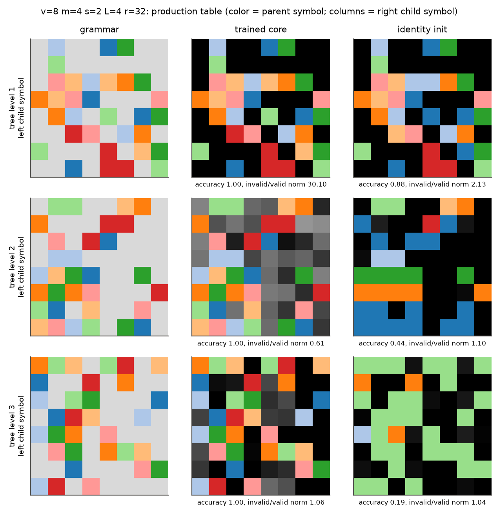

# Does training a tree tensor network on varied observation masks make its merges compose uncertain messages?

The run does not settle it, and what it shows leans negative. A tree tensor network (TreeTN) trained on Random Hierarchy Model (RHM) sequences with a mix of prefix masks and varied masks reproduces the grammar's message update no better, by the criterion fixed before the run, than the same tree trained on prefix masks alone: 0 of 12 runs pass in either arm. By the definition's rule that is **inconclusive**, not a negative, because the mixed-mask tree learned the varied task itself in only 2 of the 4 grammars, and it required 3.

- **Primary hypothesis (mixed masks give the grammar's update): inconclusive.** On pairs of child messages that are both informative, the decoded merge of the mixed-mask tree matches the exact update with R² 0.22–0.78 over 12 runs (per-grammar medians 0.36–0.61), against a bar of 0.8; the prefix-mask tree scores 0.18–0.55. The mixed-mask tree is higher in 8 of 12 runs (median difference +0.12, range −0.26 to +0.41) and closes half of the remaining gap in 1 run.
- **Secondary hypothesis (invalid child pairs are suppressed): not supported.** Exact message passing gives a child pair that no production joins zero read-out mass. The ratio of that mass to a valid pair's is 1.03–1.89 in the mixed-mask tree and 0.59–2.32 in the prefix-mask tree. It is lower under mixed masks in 6 of 12 pairs, against a required 10, and the median paired ratio is 1.10, against a required 0.5 at most.
- **The varied task is harder for this tree than the prefix task.** After 30,000 updates the mixed-mask tree is within 0.006 nats/token of the Bayes loss on varied masks in the two grammars with 2 productions per symbol, and 0.025–0.098 away in the two with 4.

All 36 planned runs trained and were analysed (4 grammars × 3 mask distributions × 3 seeds), every check passed, and the prefix arm repeats the earlier experiment's prefix loss to 10⁻⁸ nats/token. The run took 5 h 26 m on one NVIDIA A40 and cost about $3.21 of a $10 budget. The definition, with the criteria and the reasons a negative would be weak evidence, is [EXPERIMENT.md](EXPERIMENT.md); a shorter note with the mathematics is [NOTE.md](NOTE.md).

## Verdict against the criteria

The criteria were fixed before the run and are applied by `mask_summary.py` at the final checkpoint (update 30,000).

| criterion | verdict | evidence |
| --- | --- | --- |
| Checks pass, CUDA present | yes | 28 of 28 RHM checks, the message-passing check (38 lines, all `PASS`) and the mask check passed before training |
| At least 31 of 36 runs trained | yes, 36 of 36 | every run reached 30,000 updates with status `finished` |
| At least 86% of the runs of the arms analysed are analysed | yes, 36 of 36 | the `varied` arm was not censored for time |
| Prefix arm within 0.005 nats/token of `rhm-ttn-messages` on prefix excess loss | yes | largest difference over the 12 shared runs: 1.1 × 10⁻⁸ |
| Prefix gate (prefix excess loss < 0.02 nats/token, all three seeds) | 4 of 4 grammars in `prefix` and `mixed`, 3 of 4 in `varied` | `varied` misses it in `v16m4s2L4` (0.022, 0.024, 0.023 in seeds 0, 1, 2) |
| H_A supported: `mixed` passes H4 in 3 of 4 grammars and `prefix` does not | no | `mixed` passes H4 in 0 of 4 grammars (0 of 12 runs); `prefix` in 0 of 4 |
| H_A partly supported: `mixed` passes H4 in 1 or 2 grammars, or closes the gap over `prefix` in all three seeds of 3 grammars | no | closes the gap in 0 grammars (1 run of 12, `v3m2s2L4` seed 1) |
| H_A not supported: neither, and `mixed` learned the varied task in at least 3 grammars | no | `mixed` learned the varied task in 2 grammars (`v3m2s2L4`, `v8m2s2L4`) |
| **H_A, the verdict by the definition's rule** | **inconclusive** | H4 not met, and the varied task learned in fewer than 3 grammars |
| H_B supported: invalid read-out mass lower in `mixed` in 10 of 12 pairs, median paired ratio ≤ 0.5 | **not supported** | lower in 6 of 12; median ratio 1.10, range 0.53 to 1.74 |

Terms used below. A grammar named vVmMsSLL has V symbols per level, M productions per symbol, branching S = 2 and depth L, so a sequence has 2^L = 16 tokens. The three arms differ only in the masks seen in training: `prefix` (everything after the predicted token is masked), `varied` (each later token is masked independently with a probability drawn uniformly per row) and `mixed` (half the rows of each kind). H4 is the fourth hypothesis of the earlier experiment [`rhm-ttn-messages`](../rhm-ttn-messages/README.md): a run passes it if the decoded merge matches the exact update with R² ≥ 0.8 on all sampled message pairs and on the both-informative pairs, and closes the gap there over the identity-init tree and the additive ceiling. One measure "closes the gap" over another when 1 − measure ≤ 0.5 × (1 − max(other, 0)).

*[figures/summary.pdf](figures/summary.pdf): one point per run, n = 3 seeds per grammar and arm, at update 30,000, over parents of tree level ≥ 2. Left: R² of the decoded merge against the exact update on both-informative message pairs; the dotted line is the 0.8 bar and each short tick is the additive ceiling of that run's pairs. Right: read-out mass of invalid child pairs over that of valid pairs; exact messages give 0 (dotted). Open markers are runs that miss the prefix gate (the `varied` arm in `v16m4s2L4`). No point reaches 0.8 on the left, and no arm is near 0 on the right.*

## The three arms learned different tasks to different depths

| grammar | arm | prefix excess loss | varied excess loss | prefix gate | varied gate |
| --- | --- | --- | --- | --- | --- |
| `v3m2s2L4` | prefix | 0.0004 [0.0004, 0.0005] | 2.400 [1.378, 3.842] | yes | no |
| `v3m2s2L4` | mixed | 0.0006 [0.0006, 0.0008] | 0.002 [0.001, 0.002] | yes | yes |
| `v3m2s2L4` | varied | 0.0007 [0.0007, 0.0010] | 0.001 [0.001, 0.001] | yes | yes |
| `v8m2s2L4` | prefix | 0.0010 [0.0010, 0.0013] | 8.567 [5.774, 9.198] | yes | no |
| `v8m2s2L4` | mixed | 0.0016 [0.0016, 0.0017] | 0.005 [0.005, 0.005] | yes | yes |
| `v8m2s2L4` | varied | 0.0022 [0.0021, 0.0025] | 0.004 [0.003, 0.005] | yes | yes |
| `v8m4s2L4` | prefix | 0.0021 [0.0021, 0.0024] | 2.045 [1.974, 2.811] | yes | no |
| `v8m4s2L4` | mixed | 0.0039 [0.0038, 0.0045] | 0.028 [0.025, 0.030] | yes | no |
| `v8m4s2L4` | varied | 0.0059 [0.0052, 0.0064] | 0.023 [0.021, 0.025] | yes | no |
| `v16m4s2L4` | prefix | 0.0052 [0.0048, 0.0059] | 4.934 [4.472, 6.189] | yes | no |
| `v16m4s2L4` | mixed | 0.0124 [0.0107, 0.0134] | 0.091 [0.090, 0.098] | yes | no |
| `v16m4s2L4` | varied | 0.0231 [0.0221, 0.0239] | 0.082 [0.081, 0.088] | no | no |

Every cell in this and the following tables is the median over three seeds with the range in brackets, at update 30,000. Excess loss is the test loss minus the exact Bayes loss, in nats per token: the prefix loss on 8,192 test sequences with every prefix, the varied loss on the first 2,048 of them with fixed varied masks. A gate is met when all three seeds are below 0.02.

- **A prefix-trained tree does not transfer to varied masks.** Its varied excess loss is 1.4–9.2 nats/token at the end of training and rises during training (figure below), so the composition the varied task needs is not a by-product of the prefix task.
- **Adding varied masks costs prefix loss.** The prefix excess of the `mixed` arm is 1.6 to 2.4 times that of the `prefix` arm (ratio of the medians, per grammar), and of the `varied` arm 1.9 to 4.5 times, which puts `varied` above the 0.02 gate in `v16m4s2L4`.
- **The varied gate is missed in the two grammars with 4 productions per symbol.** The `mixed` arm ends at 0.025–0.030 in `v8m4s2L4` and 0.090–0.098 in `v16m4s2L4`. The learning rate follows a cosine decay that ends at update 30,000, and the varied loss was still falling as it ended (`v16m4s2L4`: 0.106–0.115 at update 20,000 and 0.090–0.098 at 30,000), so this run does not separate a tree that cannot learn the task at r = 32 from one that needed a longer schedule.

*[figures/training.pdf](figures/training.pdf): excess loss over training on the prefix task (top) and the varied task (bottom), one line per run, n = 3 seeds per arm; both axes logarithmic; the dotted line is the 0.02 nats/token gate. The `prefix` arm (gray) is lowest on the prefix task, and on the varied task it ends 50 to 2,200 times above the other two arms (ratio of the medians, per grammar).*

## H_A: the merge on uncertain messages

The test is the earlier experiment's, unchanged. For each parent of tree level ≥ 2, child bonds are built as mixtures of class-mean bonds, Σ_b λ_L(b) μ_b and Σ_c λ_R(c) μ_c, where μ_b is the mean bond of a fully observed child with symbol b and (λ_L, λ_R) are 8,000 pairs of messages drawn independently from the children's empirical messages. The mixtures are merged with the learned core and decoded with the parent's probe. The target is the exact update λ_u(a) = Σ_bc P(b, c | a) λ_L(b) λ_R(c), normalized. The both-informative pairs have a partially observed left child and a partially or fully observed right child; under prefix masks they never occur in training, and under varied masks they do. The additive ceiling is the least-squares fit of the same target on [λ_L, λ_R], with no product term.

| grammar | both-informative R²: prefix (seeds 0, 1, 2) | mixed | varied | mixed − prefix | seeds closing the gap | additive ceiling | identity init |
| --- | --- | --- | --- | --- | --- | --- | --- |
| `v3m2s2L4` | 0.27, 0.37, 0.48 | 0.48, 0.78, 0.22 | 0.45, 0.71, 0.46 | +0.21, +0.41, −0.26 | 1/3 | 0.56, 0.88, 0.68 | −0.25, 0.16, 0.42 |
| `v8m2s2L4` | 0.41, 0.49, 0.37 | 0.41, 0.53, 0.35 | 0.39, 0.51, 0.38 | −0.00, +0.04, −0.02 | 0/3 | 0.59, 0.54, 0.62 | 0.21, 0.16, 0.13 |
| `v8m4s2L4` | 0.47, 0.51, 0.55 | 0.65, 0.61, 0.54 | 0.60, 0.56, 0.53 | +0.19, +0.10, −0.01 | 0/3 | 0.43, 0.47, 0.53 | 0.04, 0.15, 0.12 |
| `v16m4s2L4` | 0.20, 0.18, 0.20 | 0.37, 0.36, 0.35 | 0.29, 0.32, 0.31 | +0.17, +0.18, +0.15 | 0/3 | 0.37, 0.36, 0.37 | 0.08, 0.05, 0.05 |

The sequences, the initial tree and the optimizer are the same in the three arms of a row, so the differences within a seed come from the masks. The identity-init tree and the additive ceiling do not depend on the arm.

| grammar | arm | both-informative | all sampled pairs | left-masked | combinations seen under prefix masks | runs passing H4 |
| --- | --- | --- | --- | --- | --- | --- |
| `v3m2s2L4` | prefix | 0.37 [0.27, 0.48] | 0.31 [0.30, 0.61] | 0.03 [−0.64, 0.38] | 0.50 [0.33, 0.77] | 0/3 |
| `v3m2s2L4` | mixed | 0.48 [0.22, 0.78] | 0.44 [0.32, 0.73] | −0.27 [−0.30, 0.52] | 0.59 [0.55, 0.77] | 0/3 |
| `v3m2s2L4` | varied | 0.46 [0.45, 0.71] | 0.51 [0.44, 0.68] | 0.40 [−0.63, 0.54] | 0.62 [0.58, 0.70] | 0/3 |
| `v8m2s2L4` | prefix | 0.41 [0.37, 0.49] | 0.49 [0.34, 0.52] | 0.08 [−0.05, 0.08] | 0.62 [0.45, 0.73] | 0/3 |
| `v8m2s2L4` | mixed | 0.41 [0.35, 0.53] | 0.40 [0.27, 0.47] | 0.07 [−0.09, 0.10] | 0.49 [0.32, 0.53] | 0/3 |
| `v8m2s2L4` | varied | 0.39 [0.38, 0.51] | 0.39 [0.35, 0.43] | 0.03 [−0.01, 0.06] | 0.48 [0.43, 0.49] | 0/3 |
| `v8m4s2L4` | prefix | 0.51 [0.47, 0.55] | 0.64 [0.60, 0.67] | 0.50 [0.42, 0.52] | 0.75 [0.71, 0.77] | 0/3 |
| `v8m4s2L4` | mixed | 0.61 [0.54, 0.65] | 0.65 [0.62, 0.72] | 0.47 [0.44, 0.47] | 0.72 [0.70, 0.80] | 0/3 |
| `v8m4s2L4` | varied | 0.56 [0.53, 0.60] | 0.61 [0.60, 0.70] | 0.41 [0.39, 0.46] | 0.69 [0.68, 0.78] | 0/3 |
| `v16m4s2L4` | prefix | 0.20 [0.18, 0.20] | 0.29 [0.27, 0.30] | 0.20 [0.20, 0.21] | 0.39 [0.37, 0.41] | 0/3 |
| `v16m4s2L4` | mixed | 0.36 [0.35, 0.37] | 0.43 [0.42, 0.43] | 0.25 [0.23, 0.27] | 0.53 [0.52, 0.53] | 0/3 |
| `v16m4s2L4` | varied | 0.31 [0.29, 0.32] | 0.39 [0.36, 0.39] | 0.22 [0.18, 0.24] | 0.51 [0.47, 0.51] | 0/3 |

- **No run of any arm passes H4.** The best `mixed` run is `v3m2s2L4` seed 1, with 0.78 on the both-informative pairs and 0.73 on all sampled pairs; its additive ceiling is 0.88, so a fit with no product term does better on the same pairs.
- **Mixed masks raise the both-informative R² in the two grammars with 4 productions per symbol, and not in `v8m2s2L4`.** The gain is +0.15 to +0.18 in all three seeds of `v16m4s2L4`, where it brings the tree to within 0.02 of its additive ceiling (0.35–0.37 against 0.36–0.37), and +0.19, +0.10 and −0.01 in `v8m4s2L4`, where the `mixed` arm ends above its additive ceiling in all three seeds (0.54–0.65 against 0.43–0.53), as the `prefix` arm already did by 0.02 to 0.04. Over the 12 runs of an arm, the both-informative R² exceeds the additive ceiling in 5 `mixed`, 3 `prefix` and 3 `varied` runs. In `v8m2s2L4` the three differences are within ±0.04. In `v3m2s2L4` they have both signs (+0.21, +0.41, −0.26), and seed 2 of the `mixed` arm ends below its own identity-init tree (0.22 against 0.42).
- **The gain is not where the varied task was learned.** The two grammars in which the `mixed` arm meets the varied gate are `v3m2s2L4` and `v8m2s2L4`. There, 0 of 6 runs pass H4 and 1 of 6 closes the gap over the `prefix` arm. This per-grammar reading was made after seeing the results; the criterion fixed in advance needed three such grammars.
- **Left-masked pairs stay far below their ceiling in every arm (noticed after the run).** With a fully masked left child the exact update is linear in the right message before normalization, and the additive ceiling of these pairs is 0.92–1.00 over the 12 runs of an arm. The decoded merge scores −0.30 to 0.52 over the 12 `mixed` runs and −0.64 to 0.52 over the 12 `prefix` runs; `mixed` is the higher of the two in 7 of 12 runs, with a median difference of +0.02. A masked left child beside an informative right child occurs in varied rows and never in prefix rows.
- **The `varied` arm behaves like the `mixed` arm, slightly lower.** It is higher than `prefix` on the both-informative pairs in 9 of 12 runs (median +0.07, range −0.02 to +0.34), and 0 of its 3 judged grammars pass H4.

The measures at update 3,000, which the definition asked for, show the same picture: no run reaches 0.8 on the both-informative pairs, where the R² is 0.25–0.79 in the `mixed` arm and 0.19–0.58 in the `prefix` arm. The per-arm tables are in `results/<arm>/summary.txt`.

## H_B: invalid child pairs keep their read-out mass

For each parent, the class-mean bonds of every pair of child symbols are merged with the learned core and decoded. A pair that no production joins is invalid, and exact message passing sends it to the zero message. The measure is the median nonnegative read-out mass of the invalid pairs over that of the valid pairs.

| grammar | arm | invalid / valid read-out mass | identity init | invalid / valid bond norm | accuracy on valid pairs | paired ratio mixed / prefix (seeds 0, 1, 2) |
| --- | --- | --- | --- | --- | --- | --- |
| `v3m2s2L4` | prefix | 1.17 [0.59, 2.22] | 2.55 [2.16, 4.43] | 19.48 [5.51, 35.98] | 1.00 [1.00, 1.00] |  |
| `v3m2s2L4` | mixed | 1.07 [1.03, 1.89] | 2.55 [2.16, 4.43] | 107.01 [63.79, 114.84] | 1.00 [1.00, 1.00] | 0.85, 1.74, 0.92 |
| `v3m2s2L4` | varied | 1.28 [0.66, 1.63] | 2.55 [2.16, 4.43] | 71.80 [58.77, 103.27] | 1.00 [1.00, 1.00] |  |
| `v8m2s2L4` | prefix | 1.10 [1.10, 1.13] | 1.00 [0.99, 1.29] | 1.14 [1.03, 1.15] | 0.95 [0.92, 0.97] |  |
| `v8m2s2L4` | mixed | 1.21 [1.12, 1.58] | 1.00 [0.99, 1.29] | 1.18 [1.11, 1.56] | 0.93 [0.92, 0.97] | 0.98, 1.10, 1.44 |
| `v8m2s2L4` | varied | 1.30 [1.10, 1.47] | 1.00 [0.99, 1.29] | 1.19 [1.15, 1.39] | 0.95 [0.92, 0.97] |  |
| `v8m4s2L4` | prefix | 1.98 [1.59, 2.32] | 1.00 [0.95, 1.11] | 0.64 [0.56, 0.68] | 1.00 [0.98, 1.00] |  |
| `v8m4s2L4` | mixed | 1.17 [1.06, 1.34] | 1.00 [0.95, 1.11] | 0.63 [0.62, 0.77] | 1.00 [0.97, 1.00] | 0.53, 0.58, 0.73 |
| `v8m4s2L4` | varied | 1.30 [1.25, 1.47] | 1.00 [0.95, 1.11] | 0.67 [0.58, 0.72] | 1.00 [0.97, 1.00] |  |
| `v16m4s2L4` | prefix | 1.25 [1.23, 1.38] | 1.01 [1.00, 1.01] | 0.58 [0.56, 0.59] | 0.87 [0.86, 0.89] |  |
| `v16m4s2L4` | mixed | 1.60 [1.60, 1.61] | 1.01 [1.00, 1.01] | 0.63 [0.62, 0.65] | 0.95 [0.92, 0.96] | 1.28, 1.17, 1.30 |
| `v16m4s2L4` | varied | 1.57 [1.29, 2.08] | 1.01 [1.00, 1.01] | 0.66 [0.66, 0.68] | 0.94 [0.91, 1.00] |  |

- **No arm brings the ratio near zero.** It is 1.03–1.89 over the 12 `mixed` runs, so an invalid pair is read out with at least as much mass as a valid one in every run.
- **The direction depends on the grammar.** Mixed masks lower the ratio in all three seeds of `v8m4s2L4` (to 0.53–0.73 of the `prefix` value), raise it in all three seeds of `v16m4s2L4` (1.17–1.30 times), and leave the other two grammars split.
- **The reported median is the upper of the two middle values.** `mask_summary.py` takes the seventh of the twelve sorted ratios, 1.10; the mean of the sixth and seventh is 1.04. Both are far from the 0.5 the criterion requires.

*[figures/prefix/prodtable_v8m4s2L4_r32.pdf](figures/prefix/prodtable_v8m4s2L4_r32.pdf) and [figures/mixed/prodtable_v8m4s2L4_r32.pdf](figures/mixed/prodtable_v8m4s2L4_r32.pdf): `v8m4s2L4`, seed 0, node 0 of each tree level, `prefix` arm above and `mixed` arm below. Rows are the left child's symbol and columns the right child's. Left: the grammar's table (color = parent symbol, light gray = no production). Middle: the table read from the trained core; a valid pair is colored by its decoded parent, and an invalid pair is shaded by the norm of its merged bond relative to the median valid pair (white = 0, the value under exact message passing; black ≥ 1). Right: the identity-init tree. Both arms decode every valid pair of these nodes correctly, and in both the invalid pairs are gray to black, never white. This grammar is the one where mixed masks lowered the read-out ratio most.*

## The other measures of the earlier experiment, per arm

These carry no criterion here. M1 is the R² of a projective probe from a bond to its node's normalized message on held-out local prefixes; M2 is the share of whitened bond variance explained by grouping rows that share the quantity the prefix task needs from the subtree (the extended message) and the number of observed leaves; M3 is the accuracy of the production table read from the cores. All bonds are collected on prefix-pattern inputs in every arm.

| grammar | arm | M1: partial message | M1: fully observed rows | M2: extended message | M3: accuracy | H1 | H2 | H3 |
| --- | --- | --- | --- | --- | --- | --- | --- | --- |
| `v3m2s2L4` | prefix | 0.76 [0.40, 0.86] | 0.99 [0.98, 1.00] | 0.82 [0.68, 0.86] | 1.00 [1.00, 1.00] | 1/3 | 2/3 | 3/3 |
| `v3m2s2L4` | mixed | 0.30 [−0.17, 0.43] | 0.99 [0.99, 0.99] | 0.87 [0.74, 0.89] | 1.00 [1.00, 1.00] | 0/3 | 2/3 | 3/3 |
| `v3m2s2L4` | varied | 0.07 [0.07, 0.28] | 0.99 [0.99, 1.00] | 0.86 [0.73, 0.89] | 1.00 [1.00, 1.00] | 0/3 | 2/3 | 3/3 |
| `v8m2s2L4` | prefix | 0.36 [0.36, 0.43] | 0.93 [0.89, 0.94] | 0.86 [0.81, 0.87] | 0.95 [0.92, 0.97] | 0/3 | 3/3 | 2/3 |
| `v8m2s2L4` | mixed | 0.59 [0.59, 0.60] | 0.95 [0.92, 0.97] | 0.96 [0.96, 0.97] | 0.93 [0.92, 0.97] | 0/3 | 3/3 | 1/3 |
| `v8m2s2L4` | varied | 0.64 [0.61, 0.67] | 0.94 [0.92, 0.98] | 0.97 [0.96, 0.97] | 0.95 [0.92, 0.97] | 0/3 | 3/3 | 2/3 |
| `v8m4s2L4` | prefix | 0.24 [0.12, 0.25] | 0.93 [0.91, 0.98] | 0.96 [0.95, 0.96] | 1.00 [0.98, 1.00] | 0/3 | 3/3 | 3/3 |
| `v8m4s2L4` | mixed | 0.37 [0.32, 0.40] | 0.99 [0.94, 0.99] | 0.97 [0.97, 0.97] | 1.00 [0.97, 1.00] | 0/3 | 3/3 | 3/3 |
| `v8m4s2L4` | varied | 0.41 [0.37, 0.44] | 0.99 [0.95, 0.99] | 0.97 [0.96, 0.97] | 1.00 [0.97, 1.00] | 0/3 | 3/3 | 3/3 |
| `v16m4s2L4` | prefix | 0.11 [0.10, 0.11] | 0.66 [0.62, 0.68] | 0.93 [0.92, 0.93] | 0.87 [0.86, 0.89] | 0/3 | 3/3 | 0/3 |
| `v16m4s2L4` | mixed | 0.25 [0.24, 0.25] | 0.90 [0.90, 0.92] | 0.96 [0.95, 0.96] | 0.95 [0.92, 0.96] | 0/3 | 3/3 | 2/3 |
| `v16m4s2L4` | varied | 0.27 [0.26, 0.28] | 0.87 [0.85, 0.92] | 0.95 [0.95, 0.95] | 0.94 [0.91, 1.00] | 0/3 | 3/3 | 1/3 |

- **The verdicts of H1–H3 are the same in the `prefix` and `mixed` arms**: H1 holds in 0 of 4 grammars, H2 in 3 of 4 and H3 in 2 of 4. The `varied` arm has 3 judged grammars: 0, 2 and 2.
- **The partial message becomes more readable in three grammars and stays below 0.8 in all.** The M1 median rises from 0.36 to 0.59 in `v8m2s2L4`, from 0.24 to 0.37 in `v8m4s2L4` and from 0.11 to 0.25 in `v16m4s2L4`. It falls from 0.76 to 0.30 in `v3m2s2L4`, where the probe has a single eligible node with 6 to 14 distinct messages.
- **The bond follows the extended message more closely under mixed masks in all 12 runs**, most in `v8m2s2L4` (0.86 to 0.96).
- **`v16m4s2L4` gains most on fully observed subtrees**: the symbol of a complete subtree is decoded with R² 0.90 in the `mixed` arm against 0.66, and the production-table accuracy rises from 0.87 to 0.95.

## How it was done

- **Model and training.** The aligned, untied TreeTN of the earlier experiment at bond dimension r = 32 with identity init: every query position of 512 fresh sequences per update, Adam at peak learning rate 10⁻³, 30,000 updates. A row is a sequence and a query position q; tokens before q are observed, q is masked and predicted, and the arm decides the masks after q. Seeds 0, 1, 2 set the grammar's rules and the init, and the sequence stream is the same in the three arms.
- **Runs.** 4 grammars × 3 arms × 3 seeds = 36, on one NVIDIA A40. Training took 4 h 08 m with four runs at a time (21 to 29 minutes per run, median 28.5), the analysis of the `prefix` and `mixed` arms with its summary and figures 47 minutes, and the `varied` arm 24 minutes.
- **Analysis.** `rhm-ttn-messages/msg_analyze.py` and `msg_summary.py`, unchanged, per arm, on 20,000 analysis sequences with prefix-pattern inputs; `mask_summary.py` for the comparison and the verdicts; `mask_table.py` for the tables above.

## How it was checked

- **Correctness checks before training, all passed.** The 28 RHM checks; the message-passing check, in which a hand-built exact tree scores the ideal value on every measure and a random-core tree fails M3 and M4; and `mask_run.py --check`, which compares the exact posterior under arbitrary masks with the Bayes prefix loss and with the grammar's posterior when only the query is hidden, and the prefix arm's rows with the earlier training script's.
- **The prefix arm repeats the earlier experiment.** Its 12 runs have the same script arguments and seeds as 12 runs of `rhm-ttn-messages`, and the prefix excess loss agrees to 1.1 × 10⁻⁸ nats/token. The analysis of these runs does not agree as closely: the both-informative R² differs by up to 0.027 and the invalid read-out ratio by up to 0.11, both in `v3m2s2L4`, and by at most 0.007 and 0.043 in the other three grammars. The cause was not investigated. It means that a difference between arms of up to about 0.03 in R² is no larger than the largest difference between this run and the earlier one on the same configuration (0.027, in `v3m2s2L4`); in `v8m2s2L4` that difference was at most 0.007, against −0.00, +0.04 and −0.02 between arms.
- **Prediction gates.** A grammar counts for an arm only if all three seeds reach prefix excess loss below 0.02, which removed `v16m4s2L4` from the `varied` arm's verdicts.
- **Fact check.** A separate agent compared this write-up and the note with the result files, the logs and the code, and recomputed the tables from the per-run files. The tables held. It returned 11 items in the prose of the two documents that did not fully hold, and all are corrected: among them, that the merge "does not improve" in the two grammars where the varied task was learned (it is unchanged in one and changes with both signs in the other), that the gain stops at the additive ceiling (true of `v16m4s2L4`, not of `v8m4s2L4`), and that small differences in `v8m2s2L4` are within the repeat difference of the analysis (one of the three is not).

## Not yet checked

- **Whether the mixed-mask tree carries uncertain messages in bonds that the test never looks at.** The M4 test feeds the cores mixtures of class-mean bonds and decodes with a probe fit on prefix-pattern rows; it never sees a bond from a varied row. The definition fixed a follow-up and its reading: the projective probe from a bond to its normalized message, on bonds collected from varied-pattern inputs at nodes to the right of the query, scored on held-out patterns. If it reaches R² ≥ 0.8 in the `mixed` arm where the `prefix` arm does not, the mixed tree carries uncertain messages even though M4 fails. It needs a new analysis script and the saved checkpoints, and no training.
- **Whether the varied gate is reachable in the two grammars with 4 productions per symbol.** The `mixed` arm's varied loss was still falling when the learning-rate schedule ended. A longer schedule or a wider tree for `v8m4s2L4` and `v16m4s2L4` (6 runs; one 30,000-update `mixed` run of these grammars took 28 to 29 minutes on the A40, four at a time) would decide whether the primary hypothesis can be judged, or stays inconclusive.
- **Why this run and the earlier one differ by up to 0.03 in R² on runs with the same prefix loss.** The two differ in the training script, the GPU type and the number of checkpoints analysed (three against six). Until the cause is known, differences between arms of that size should not be read.
- **Whether a softmax-readout tree can hold exact messages and reach the Bayes loss on varied rows.** The review before the run computed, with no network and for seed 0 of three of the grammars, the least excess loss of any readout affine in the right half's message on rows with an uncertain right half: 0.000–0.011 nats per row for the normalized message and 0.001–0.027 for the unnormalized one. The run does not test whether that conflict is what limits the tree.

## Judgement calls

- **The result is recorded as inconclusive, as the definition prescribes, although H4 fails in every run.** The alternative, "not supported", would have needed the varied gate in three grammars; it was met in two, and missed in a third by 0.005 to 0.010 nats/token (`v8m4s2L4`, 0.025–0.030 against 0.02).
- **The run used an A40**, the third GPU type of the definition's list. At launch the launcher reported the RTX PRO 4500 as out of stock outside the coordinator's own data center, and three attempts to place an RTX A6000 were refused (its output is quoted in [SUPERVISOR.md](SUPERVISOR.md)). Training took 1.5 times the estimated time and the analysis about a third of it (71 minutes against 3 to 4 hours), so the `varied` arm was analysed with 5.0 hours left before the cap, above the 4 hours the definition requires on this GPU.
- **`figures/summary.pdf` and `figures/training.pdf` were regenerated on the coordinator from the saved results.** The worker's `training.pdf` had overlapping axis labels and no gate line in the varied row; `mask_plot.py` now breaks the labels over two lines, draws the 0.02 line in both rows and can also write PNGs. `summary.pdf` has the same content as the worker's. The figures under `figures/<arm>/` are the worker's.

## What this means

The earlier experiment found that a prefix-trained tree does not compose uncertain messages the way the grammar does, and one explanation was that prefix masks never show a parent two uncertain children. This run shows that changing the masks is not enough to make the existing test pass: with both-informative combinations in training, the decoded merge improves in two grammars: in `v16m4s2L4` to the level of a fit with no product term, and in `v8m4s2L4` to 0.54–0.65, above that fit (0.43–0.53) as the prefix arm already was (0.47–0.55), and below the 0.8 bar. In the two grammars where the tree learned the varied task it is unchanged (`v8m2s2L4`) or changes with both signs (`v3m2s2L4`: +0.21, +0.41, −0.26). The run does not show that the explanation is wrong, for the reasons the definition gave in advance: the test never reads a bond from a varied row, and the tree did not learn the varied task in half of the grammars. The follow-up probe on varied-pattern bonds is the cheapest next step, since it needs only the checkpoints saved here (`runs/rhm-ttn-masks/`, also published to the project's global volume).
