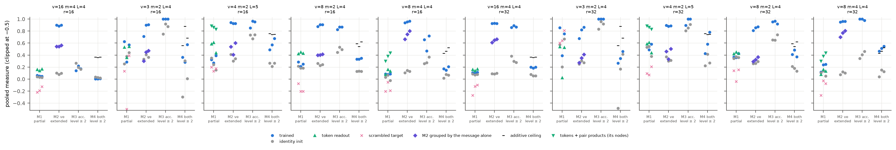
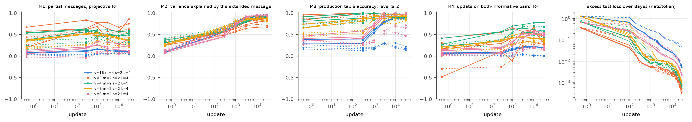
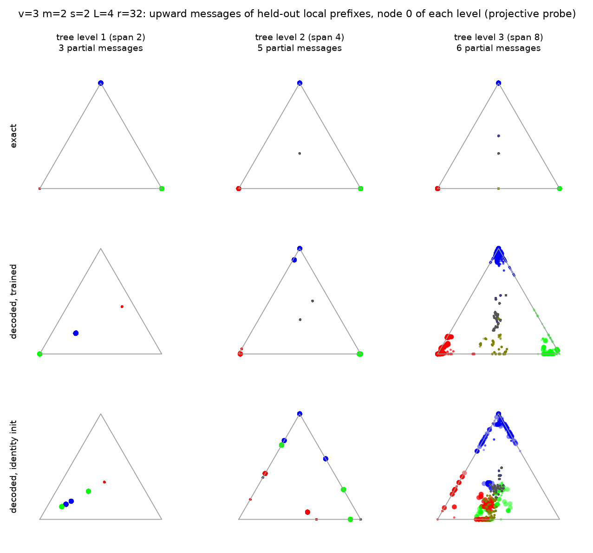
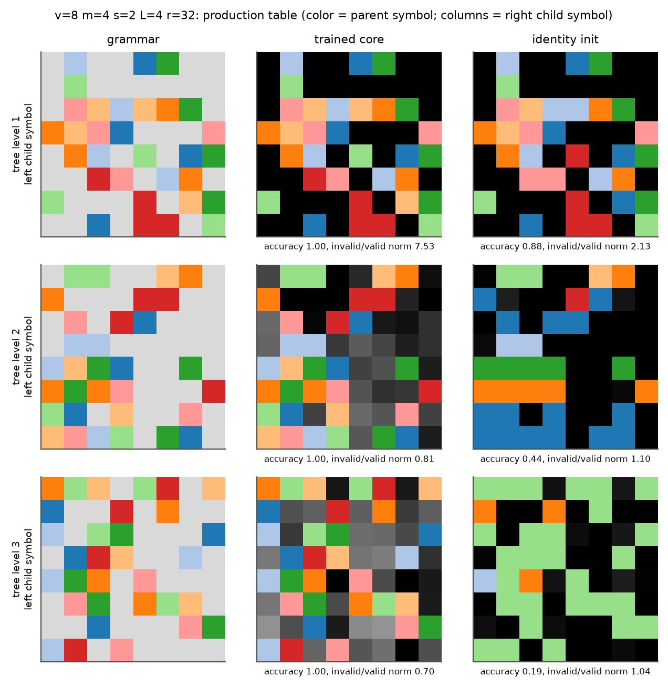
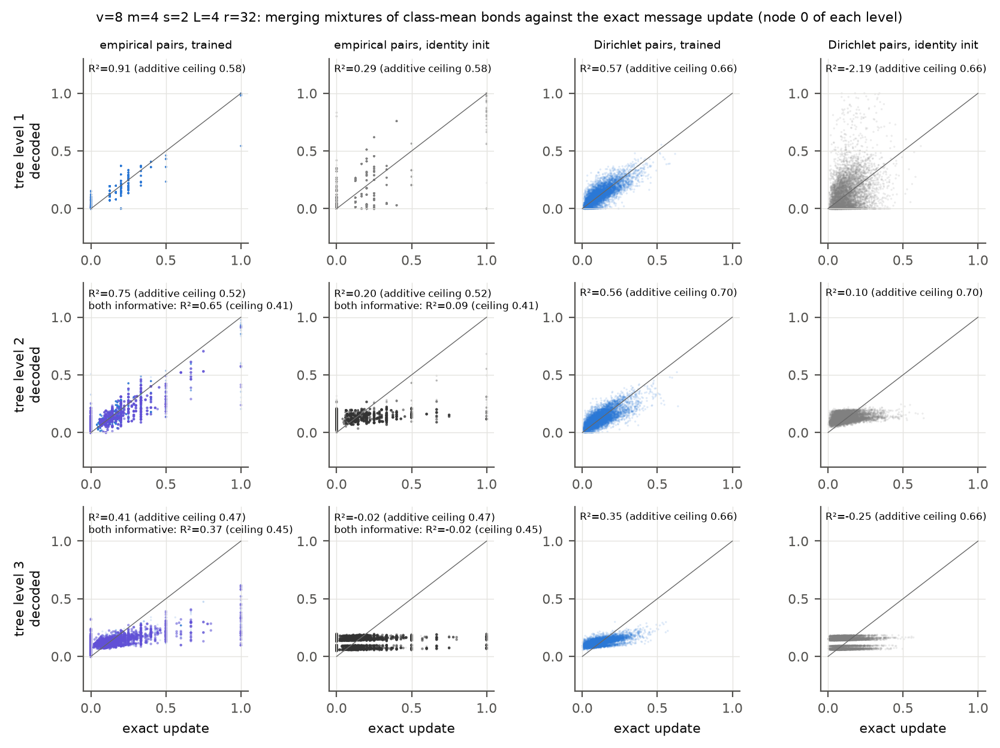

**Does a tree tensor network learn the Random Hierarchy Model's message passing?**

*A research note on four tests of whether the bonds and cores of a trained tree tensor network are the grammar's upward messages and production tensors, up to a change of basis.*

Exact inference on the Random Hierarchy Model (RHM) passes a message up a binary tree, and the update at each node is bilinear in the two child messages. A tree tensor network (TreeTN) is a binary tree of learned bilinear maps. The two computations have the same form, so the grammar makes a concrete prediction about a TreeTN trained on next-token prediction: each bond holds its node's message, and each core is the grammar's production tensor, in some basis. This note states that prediction, corrects it for the task the tree is trained on, derives what each of four tests can and cannot show, and reports the results of 30 trained trees.

The answer is mostly negative, and the parts have different status. **Four statements rest on criteria fixed before the run. A bond is close to a function of the quantity the task needs from its subtree: that quantity explains 0.81 to 0.96 of the whitened bond variance in 25 of 27 learned runs, against 0.08 to 0.41 before training. A linear probe does not read the grammar's message from the bond: its $R^2$ is 0.08 to 0.75 per cell against a threshold of 0.8, and it scores below a probe on the raw tokens in 7 of 9 cells. The cores send the allowed child pairs to the right parent often enough to pass in 2 of 5 cells at $r = 32$ and 1 of 4 at $r = 16$. The learned merge does not reproduce the grammar's update on uncertain inputs in any cell.** A fifth statement is descriptive and was reported without a threshold: the cores give child pairs that the grammar forbids as much read-out mass as pairs it allows, where exact message passing gives zero. An exploratory calculation made after the run, on Dirichlet pairs at one node per level, finds that setting this mass to zero raises the median $R^2$ of the merge by 0.25 to 0.91 at $r = 32$, more than equalizing the mass of the valid pairs does. The last section proposes a reading of these results that the run does not test.

The numbers are those of the write-up, [`README.md`](README.md), which has the full tables. A separate fact-check pass compared both documents with the result files and the code, and its corrections are applied here.

**The grammar generates a sequence from a tree of symbols, and each parent picks one of $m$ productions.** An RHM grammar has $v$ symbols per level, $m$ productions per symbol, binary branching and depth $L$, so a sequence has $T = 2^L$ tokens. A symbol $a$ at one level produces a pair $(b, c)$ of symbols at the next, chosen uniformly from its $m$ productions, and the leaves are the tokens. The productions of a level are distinct pairs, so a pair $(b, c)$ has at most one parent. Of the $v^2$ pairs at a level, $mv$ are valid and the rest are produced by no symbol. Write $Z_u$ for the symbol at node $u$ and

$$
T_{abc} = P\bigl(Z_{\mathrm{left}} = b,\ Z_{\mathrm{right}} = c \mid Z_u = a\bigr) =
\begin{cases} 1/m & \text{if } (b, c) \text{ is a production of } a, \\ 0 & \text{otherwise,} \end{cases}
$$

for the production tensor. Grammars are named `vVmMsSLL`; `v8m4s2L4` has $v = 8$, $m = 4$ and $T = 16$, with 32 valid pairs out of 64 at each level.

**Exact inference passes one message per node, and the update is bilinear.** The network sees a prefix: the first $t$ tokens are observed and the rest are masked. The upward message of node $u$ is the likelihood of the observed leaves in its span, as a function of its symbol,

$$
\lambda_u(a) = P\bigl(\text{observed leaves under } u \mid Z_u = a\bigr).
$$

At a leaf, $\lambda$ is the indicator of the observed token, or the all-ones vector if the leaf is masked. Given $Z_u = a$, the two subtrees are independent once the child symbols are fixed, so summing over the child symbols gives

$$
\lambda_u(a) = \sum_{b, c} T_{abc}\, \lambda_{\mathrm{left}}(b)\, \lambda_{\mathrm{right}}(c)
= \frac{1}{m} \sum_{(b, c) \in \mathcal{P}(a)} \lambda_{\mathrm{left}}(b)\, \lambda_{\mathrm{right}}(c),
$$

where $\mathcal{P}(a)$ is the set of productions of $a$. Three cases occur under the masked prefix task. A fully observed node has a point mass on its symbol, a fully masked node has the all-ones message, and a partially observed node can have a genuine distribution over symbols. The partially observed case is what makes the tests below discriminating, because decoding the symbol of a complete subtree only ever asks for point masses. Messages are defined up to scale, so the target throughout is the normalized message $\hat\lambda_u = \lambda_u / \sum_a \lambda_u(a)$.

**The network is a binary tree of bilinear merges.** Each leaf maps its token, or the mask, to a vector in $\mathbb{R}^r$, and each internal node merges its children with its own core $W_u$,

$$
z_u = W_u\bigl(z_{\mathrm{left}}, z_{\mathrm{right}}\bigr), \qquad
z_{u, a} = \sum_{b, c = 1}^{r} W_{u, abc}\, z_{\mathrm{left}, b}\, z_{\mathrm{right}, c},
$$

with no bias and no nonlinearity. The root core contracts the two top bonds into logits for the next token, and the tree is trained by cross-entropy on every masked prefix. The bond dimension is $r = 16$ or $32$, larger than $v$ in all but one cell ($v = r = 16$). A bond is a function of the tokens in its span and of how many of them are observed, which we call the local prefix of the node.

**If the tree passed the grammar's messages, the bond would be linear in the message and the core would vanish on invalid pairs.** Suppose that at every node there is a matrix $G_u \in \mathbb{R}^{r \times v}$ of full column rank with $z_u = G_u \lambda_u$, the scale absorbed into $G_u$. Two consequences follow. First, a left inverse $G_u^{+}$ recovers the message, so the normalized message is a ratio of two linear functions of the bond,

$$
\hat\lambda_u = \frac{G_u^{+} z_u}{\mathbf{1}^{\top} G_u^{+} z_u}.
$$

This is why the probe below is projective and not affine: an affine probe would have to fit the normalization, which varies from one local prefix to the next. Second, the core restricted to the images of the children must be the production tensor in the new basis. Applying $z_u = G_u \lambda_u$ to both sides of the update with point-mass child messages $e_b$ and $e_c$ gives

$$
W_u\bigl(G_{\mathrm{left}}\, e_b,\ G_{\mathrm{right}}\, e_c\bigr) = G_u\, T_{\cdot bc} =
\begin{cases} \tfrac{1}{m}\, G_u\, e_{a(b, c)} & (b, c) \text{ valid, with parent } a(b, c), \\ 0 & (b, c) \text{ invalid.} \end{cases}
$$

The second line is the part that training never tests directly: a jointly inconsistent pair of fully observed children does not occur in a sequence drawn from the grammar. The core is still not free there. The merge is bilinear, so its value on an invalid pair enters every training input whose child bonds have components along the two class means, for example a complete left child beside a masked or partially observed right child, and under $z_u = G_u \lambda_u$ those inputs constrain the invalid entries.

**The task asks a partially observed bond for more than its message.** When node $u$ is partially observed, the token to predict lies inside its span, and everything the output learns about that span passes through $z_u$. Conditioning on $Z_u$ separates the inside of the span from the outside, so the Bayes prediction is

$$
P\bigl(x_t = c \mid x_{\lt t}\bigr) \propto \sum_a \rho_u(a)\, M_u(a, c), \qquad
M_u(a, c) = P\bigl(\text{observed leaves under } u,\ x_t = c \mid Z_u = a\bigr),
$$

where $\rho_u(a) = P(\text{observed leaves outside } u,\ Z_u = a)$ depends only on tokens outside the span. We call $M_u$ the extended message. It refines the message, since

$$
\sum_c M_u(a, c) = \lambda_u(a),
$$

and two local prefixes with the same $\lambda_u$ can have different $M_u$. A tree at the Bayes loss must then give them different bonds whenever some outside context tells them apart. The experiment's first review measured that 12 to 33% of the pairs with equal $\lambda_u$ at one prefix length have different Bayes predictions. So "the bond holds $\lambda_u$" can be true only up to this extra content, and the test of what a bond forgets has to group local prefixes by $M_u$ and the number of observed leaves, not by $\lambda_u$. A hand-built tree that holds exactly $\lambda_u$ passes exact messages and does not solve the training task.

**Four measures test four consequences, each against controls that see the same inputs.** A cell is one grammar at one width with three seeds, and a cell supports a hypothesis only if all three seeds pass. A measure $s$ closes the gap over a control $s_0$ when $1 - s \le \tfrac{1}{2}\bigl(1 - \max(s_0, 0)\bigr)$, a form that can be met whatever the level of the control.

**M1, the message is decodable.** The projective probe fits $q = A z_u + c$ so that $q / \sum_a q_a$ matches $\hat\lambda_u$, on half of a node's distinct local prefixes, and is scored on partially observed rows of the other half. Messages are nonnegative, so a bond is decoded as the normalized nonnegative part of $q$, $\max(q, 0) / \sum_a \max(q_a, 0)$, which equals $q / \sum_a q_a$ for a true message code. H1 requires $R^2 \ge 0.8$ and the gap closed over the identity-init tree, over a probe on the one-hot tokens of the span and, where it can be fit, over a token readout with all pairwise products.

**M2, the bond forgets what the task lets it forget.** Whiten the bonds of a node, $\tilde z = \Sigma^{-1/2}(z - \bar z)$, so that distances do not depend on the basis of the bond. Let $(i, i')$ be a pair of rows that differ as local prefixes and share the extended message and the number of observed leaves, and $(i, j)$ a random pair of rows with different local prefixes. The share of bond variance that the grouping explains is

$$
\mathrm{ve} = 1 - \frac{\mathbb{E}\, \lVert \tilde z_i - \tilde z_{i'} \rVert^2}{\mathbb{E}\, \lVert \tilde z_i - \tilde z_j \rVert^2}.
$$

It is computed among the rows that have such a partner, 0.77 to 0.94 of the rows per cell, at nodes with at least $10(r + 1)$ distinct local prefixes. H2 requires $\mathrm{ve} \ge 0.8$ and the gap closed over the identity-init tree. Whitening gives every direction of the bond the same weight, so token detail kept in low-variance directions counts in full.

**M3, the cores reproduce the production table.** With $\mu^{\mathrm{left}}_b$ and $\mu^{\mathrm{right}}_c$ the mean bonds of fully observed children with symbols $b$ and $c$, form $z_{bc} = W_u(\mu^{\mathrm{left}}_b, \mu^{\mathrm{right}}_c)$ and decode it with the parent's probe. H3 requires the right parent for at least 95% of the valid pairs, over parents of tree level 2 and above, and the gap closed over the identity-init tree.

**M4, the merge is the grammar's update.** Build child bonds as mixtures of class means, merge them and decode. H4 requires $R^2 \ge 0.8$ against the exact update over all pairs of empirical child messages and over the pairs where both children are informative, with the gap closed there over the identity-init tree and over the additive ceiling, the least-squares fit of the exact update on $[\lambda_{\mathrm{left}}, \lambda_{\mathrm{right}}]$ with no product term.

**M4 is a statement about a $v \times v$ table of read-outs, and three properties of that table decide it.** The merge is bilinear, so the merge of two mixtures is a mixture of merges,

$$
W_u\Bigl(\sum_b \lambda_{\mathrm{left}}(b)\, \mu^{\mathrm{left}}_b,\ \sum_c \lambda_{\mathrm{right}}(c)\, \mu^{\mathrm{right}}_c\Bigr)
= \sum_{b, c} \lambda_{\mathrm{left}}(b)\, \lambda_{\mathrm{right}}(c)\, z_{bc}.
$$

The probe's read-out $q(z) = A z + c_0$ is affine, and the two normalized messages give weights $\lambda_{\mathrm{left}}(b)\lambda_{\mathrm{right}}(c)$ that sum to 1, so the constant passes through the sum:

$$
\begin{aligned}
q\Bigl(\sum_{b, c} \lambda_{\mathrm{left}}(b)\, \lambda_{\mathrm{right}}(c)\, z_{bc}\Bigr)
&= \sum_{b, c} \lambda_{\mathrm{left}}(b)\, \lambda_{\mathrm{right}}(c)\, A z_{bc} + c_0 \\
&= \sum_{b, c} \lambda_{\mathrm{left}}(b)\, \lambda_{\mathrm{right}}(c)\, \bigl(A z_{bc} + c_0\bigr)
= \sum_{b, c} \lambda_{\mathrm{left}}(b)\, \lambda_{\mathrm{right}}(c)\, q_{bc},
\end{aligned}
$$

with $q_{bc} = q(z_{bc})$ the read-out of the pair $(b, c)$. The exact update is the same sum with $T_{\cdot bc}$ in place of $q_{bc}$. The decoded message therefore equals the exact one for every pair of messages when

$$
\boxed{\, q_{bc} = \kappa\, T_{\cdot bc} \quad \text{for all } (b, c) \,}
$$

with one positive constant $\kappa$. That is three requirements on the table: a valid pair reads out as its parent symbol, every valid pair reads out with the same mass, and an invalid pair reads out as zero. M3 reports the first as its accuracy. It reports the other two without a threshold, as the coefficient of variation of the mass $\sum_a \max(q_{bc}(a), 0)$ over valid pairs and as the ratio of its median over invalid pairs to its median over valid pairs. Both are 0 for exact message passing.

The both-informative pairs have a partially observed left child and a partially or fully observed right child. In training the right child sees tokens only once the left child is complete, so this combination never occurs. By the identity above it still decomposes into fully observed class means, and the terms that never occur as training inputs are the invalid pairs.

**The runs.** Five grammars (`v3m2s2L4`, `v8m2s2L4`, `v8m4s2L4`, `v16m4s2L4` with $T = 16$ and `v4m2s2L5` with $T = 32$), two widths and three seeds give 30 trees, each trained for 30,000 updates on fresh sequences and analyzed on 20,000 sequences. Nine of the ten cells reach an excess test loss below 0.02 nats per token over the exact Bayes loss in all three seeds (0.0003 to 0.0097 in those 27 runs). `v16m4s2L4` at $r = 16$ does not (0.043 to 0.057) and is not judged. A hand-built tree whose cores are the production tensors returns the ideal value of every measure, also after a random change of basis of every bond, and a tree with random cores fails M3 and M4, which validates the analysis code.

Table 1 gives the four criterion measures per cell. Each trained entry is the median over three seeds with the range in brackets, and each control is a median.

| grammar | $r$ | M1 trained | identity init | token readout | M2 trained | identity init | M3 trained | identity init | M4 trained | additive ceiling |
| --- | --- | --- | --- | --- | --- | --- | --- | --- | --- | --- |
| `v16m4s2L4` | 32 | 0.11 [0.10, 0.11] | 0.08 | 0.18 | 0.93 [0.92, 0.93] | 0.09 | 0.87 [0.86, 0.89] | 0.30 | 0.20 [0.18, 0.20] | 0.37 |
| `v3m2s2L4` | 32 | 0.75 [0.39, 0.86] | 0.57 | 0.56 | 0.82 [0.68, 0.86] | 0.27 | 1.00 [1.00, 1.00] | 0.92 | 0.34 [0.27, 0.46] | 0.68 |
| `v4m2s2L5` | 32 | 0.53 [0.49, 0.58] | 0.53 | 0.61 | 0.89 [0.88, 0.90] | 0.31 | 1.00 [0.90, 1.00] | 0.85 | 0.58 [0.42, 0.78] | 0.74 |
| `v8m2s2L4` | 32 | 0.37 [0.36, 0.42] | 0.36 | 0.57 | 0.86 [0.81, 0.87] | 0.26 | 0.95 [0.92, 0.97] | 0.65 | 0.41 [0.37, 0.48] | 0.59 |
| `v8m4s2L4` | 32 | 0.24 [0.12, 0.25] | 0.11 | 0.16 | 0.96 [0.95, 0.96] | 0.10 | 1.00 [0.98, 1.00] | 0.41 | 0.51 [0.46, 0.55] | 0.47 |
| `v16m4s2L4` (not learned) | 16 | 0.05 [0.05, 0.06] | 0.03 | 0.18 | 0.90 [0.88, 0.90] | 0.10 | 0.17 [0.14, 0.22] | 0.20 | 0.01 [0.00, 0.01] | 0.37 |
| `v3m2s2L4` | 16 | 0.57 [0.28, 0.63] | 0.38 | 0.60 | 0.90 [0.71, 0.91] | 0.36 | 1.00 [1.00, 1.00] | 0.88 | 0.37 [0.28, 0.58] | 0.68 |
| `v4m2s2L5` | 16 | 0.33 [0.27, 0.39] | 0.24 | 0.61 | 0.93 [0.92, 0.94] | 0.34 | 0.95 [0.85, 0.97] | 0.74 | 0.57 [0.49, 0.68] | 0.74 |
| `v8m2s2L4` | 16 | 0.25 [0.21, 0.28] | 0.18 | 0.57 | 0.91 [0.88, 0.91] | 0.24 | 0.87 [0.83, 0.87] | 0.49 | 0.33 [0.33, 0.35] | 0.59 |
| `v8m4s2L4` | 16 | 0.08 [0.08, 0.08] | 0.03 | 0.16 | 0.95 [0.94, 0.96] | 0.13 | 0.66 [0.47, 0.72] | 0.27 | 0.17 [0.15, 0.21] | 0.47 |

*Table 1. M1: projective $R^2$ on partially observed rows of held-out local prefixes. M2: ve for the extended message. M3: production-table accuracy at parents of level 2 and above. M4: $R^2$ on the both-informative pairs at those parents, next to the additive ceiling of the same pairs.*

*Figure 1 ([PDF](figures/summary.pdf)). The four measures of Table 1, one panel per cell with $r = 16$ on the left and $r = 32$ on the right, one point per seed. Blue is the trained tree and gray the identity-init tree; green triangles are token readouts, pink crosses the scrambled target, violet diamonds M2 grouped by the message alone, black dashes the additive ceiling. Look at the M2 column, the only one above 0.65 in every panel, and at the blue M1 points, which sit among their controls.*

**H2 is supported: the bond is close to a function of the extended message.** In the 25 learned runs that pass, ve is 0.81 to 0.96, and the identity-init tree scores 0.08 to 0.41. The criterion holds in 4 of 5 learned cells at $r = 32$ and 3 of 4 at $r = 16$; the failing grammar at both widths is `v3m2s2L4`, on seed 0 only (0.68 and 0.71). Grouping by the message alone gives 0.27 to 0.80, as the argument above predicts: the task forces some of those pairs apart. One caveat limits how far the margin over 0.8 can be trusted. The random partner is drawn across all prefix lengths of the node, so the bond's dependence on the number of observed leaves counts as explained variance. On the pilot checkpoints the experiment's second review measured that drawing it at the same number of observed leaves lowered ve from 0.64 to 0.56 and from 0.55 to 0.50. The run did not compute that stricter version, and the cells near the threshold could fall below it. Over training ve rises in every run, mostly in the first 3,000 updates, and dips by up to 0.04 between later checkpoints in 8 of the 27 learned runs. The M1 probe shows no comparable trend (Figure 2).

*Figure 2 ([PDF](figures/training.pdf)). The four measures at the six checkpoints, and the excess test loss, for all 30 runs; color is the grammar, solid lines $r = 32$ and dotted lines $r = 16$. The second panel (M2) ends above its start in every run. The first (M1) has no such trend: it ends within 0.1 of its initial value in 21 of 30 runs.*

**H1 is not supported: a projective probe does not read the message.** No cell passes, and one run of 27 does. The trained probe's median exceeds the identity-init tree's by 0.00 to 0.19 and is below the one-hot token readout in 7 of the 9 learned cells. At the three nodes where a readout with all pairwise token products can be fit, that readout scores 0.86 (`v4m2s2L5`) and 0.38 (`v8m4s2L4`) against 0.48 and 0.17 for the bond at $r = 32$. The same probe on fully observed rows scores 0.93 to 0.99 per cell at $r = 32$ in four grammars and 0.66 in `v16m4s2L4`; at $r = 16$ it scores 0.47 to 0.97 in the learned cells. So at $r = 32$ the symbol of a complete subtree is linearly readable in four of the five grammars, and the distribution over symbols of an incomplete one is not. The probe to the normalized extended message does separate from its controls in every learned run (0.10 to 0.70 per cell at $r = 32$, against at most 0.26 for either control) and still stays below 0.8.

Where the probe scores highest it tests the identity of the message, not its code. A probe with $r + 1$ parameters per coordinate can fit any labelling of up to $r + 1$ points in general position. In `v3m2s2L4` the eligible nodes have 6 to 14 distinct partially observed messages (and 40 to 43 distinct extended messages), and at $r = 32$ the probe fits a scrambled target, an independent random vector per distinct message, about as well as the message (0.64 against 0.75). At $r = 16$ it does not (0.13 against 0.57). Figure 3 shows the one run that passes.

*Figure 3 ([PDF](figures/triangles_v3m2s2L4_r32.pdf)). `v3m2s2L4`, $r = 32$, seed 0, node 0 of each tree level. Each point is a held-out local prefix placed at its message on the 2-simplex and colored by the exact message; large points are fully observed rows and small points partially observed ones. Top: exact. Middle: decoded from the trained tree. Bottom: decoded from the identity-init tree. Only the level-3 node has enough distinct local prefixes (938) for a held-out probe. There the trained tree's points cluster near the six exact messages with visible scatter ($R^2 = 0.86$, identity init 0.57).*

**H3 is partly supported at $r = 32$: valid pairs decode to the right parent, and invalid pairs are not sent to zero.** At $r = 32$ the cores map valid class-mean pairs to the right parent for 0.87 to 1.00 of the pairs per cell, against 0.30 to 0.92 for the identity-init tree, and 2 of 5 cells reach 0.95 in all three seeds. At $r = 16$ one cell of 4 does. This is the first of the three requirements on the read-out table, and it holds in part. The other two fail. The mass of the read-out varies over valid pairs with a coefficient of variation of 0.17 to 0.75 over the learned runs. An invalid pair reads out with 1.10 to 1.94 times the mass of a valid pair per learned cell, where exact message passing gives 0; the ratio is at least 0.98 in 26 of the 27 learned runs. The norm of the merged bond of an invalid pair, in the metric of the parent's own bonds, falls below 0.8 of a valid pair's only in the two $m = 4$ grammars at $r = 32$ (0.56 to 0.68); the next lowest cell is `v8m2s2L4` at $r = 16$, at 0.83 to 0.89.

*Figure 4 ([PDF](figures/prodtable_v8m4s2L4_r32.pdf)). `v8m4s2L4`, $r = 32$, seed 0, node 0 of each tree level; rows are the left child's symbol and columns the right child's. Left: the grammar's table, with color for the parent symbol and light gray for no production. Middle: the trained core; a valid pair is colored by its decoded parent and an invalid pair is shaded by the norm of its merged bond relative to the median valid pair, white for 0 and black for 1 or more. Right: the identity-init tree. The trained core gets all 32 valid pairs right at each level. Its invalid pairs are black at level 1 and dark to mid gray at levels 2 and 3 (smallest relative norm 0.42), never white.*

**H4 is not supported: the merge of two uncertain bonds does not decode to the grammar's update.** On the both-informative pairs the decoded merge scores 0.17 to 0.58 per learned cell, the best single run reaches 0.78, and no run reaches 0.8 there or on all empirical pairs. It exceeds the additive ceiling in 4 of 27 runs: all three seeds of `v8m4s2L4` at $r = 32$ (0.46, 0.51, 0.55 against 0.43, 0.47, 0.53) and one seed of `v4m2s2L5` at $r = 32$. Where the left child is masked the exact update is linear in the right message before normalization, the additive ceiling of the normalized target is 0.97 to 0.99 per cell, and the decoded merge scores between $-0.24$ and 0.50 per cell. Combinations of observation cases that do occur in training come closest in `v4m2s2L5`, which reaches 0.82 and 0.87 in two of its three seeds at $r = 32$ and 0.56 in the third; the other four grammars stay at 0.32 to 0.77 there.

A probe that misread the mixture bonds themselves would also produce this failure, and a separate measure argues against that explanation in four of the five grammars at $r = 32$. Decoding the mixture $\sum_b \lambda(b)\mu_b$ with the node's own probe and comparing it with $\lambda$ gives $R^2$ of 0.86 to 0.94 per cell at nodes of level 2 and above in four grammars, all of which have a merge score of 0.31 to 0.66 over all empirical pairs, and 0.61 in `v16m4s2L4`. At $r = 16$ it is lower, 0.43 to 0.87 in the learned cells. This measure uses mixtures of class means and no real partially observed bond. It says that each parent's probe reads mixtures of that parent's own class means, the bonds that a correct merge would return, and it says nothing about whether real bonds are linear in the message. That question is M1, which fails.

**An exploratory calculation, made after the run, locates a large part of the shortfall on Dirichlet pairs in the invalid pairs: more than half in three of the five grammars at $r = 32$.** The identity above makes the decoded update a function of the read-out table alone, and the analysis saved $q_{bc}$ for node 0 of each level. Recomputing the update on Dirichlet pairs from the saved table reproduces the saved scores of that node to within 0.08, and the table can then be edited. Table 2 gives $R^2$ pooled over node 0 of each level 2 and above.

| grammar | $r$ | as saved | invalid pairs set to zero | valid pairs given equal mass | both |
| --- | --- | --- | --- | --- | --- |
| `v16m4s2L4` | 32 | 0.22 [0.20, 0.23] | 0.51 [0.42, 0.52] | 0.24 [0.21, 0.24] | 0.55 [0.46, 0.62] |
| `v3m2s2L4` | 32 | -0.15 [-0.66, 0.59] | 0.76 [0.72, 0.84] | 0.08 [-0.19, 0.56] | 0.99 [0.99, 1.00] |
| `v4m2s2L5` | 32 | 0.25 [-0.47, 0.32] | 0.73 [0.09, 0.90] | 0.33 [-0.17, 0.41] | 0.91 [0.61, 0.99] |
| `v8m2s2L4` | 32 | 0.10 [0.05, 0.15] | 0.61 [0.48, 0.63] | 0.09 [0.05, 0.19] | 0.66 [0.65, 0.71] |
| `v8m4s2L4` | 32 | 0.47 [0.46, 0.49] | 0.71 [0.65, 0.89] | 0.53 [0.53, 0.58] | 0.93 [0.80, 0.97] |

*Table 2. Exploratory. $R^2$ of the update decoded from the read-out table against the exact update, on 8,000 Dirichlet pairs per node, at $r = 32$; median over three seeds with the range. From [`msg_readout_ablation.py`](msg_readout_ablation.py), which also prints $r = 16$.*

Setting the invalid pairs to zero raises the median in every cell of Table 2, by 0.25 to 0.91. Equalizing the mass of the valid pairs alone changes little. With both edits the median is 0.91 to 0.99 in three grammars and 0.55 and 0.66 in `v16m4s2L4` and `v8m2s2L4`. What remains there is the read-out of the valid pairs themselves, which the accuracy of the decoded parent does not capture: at these nodes seed 1 of `v16m4s2L4` decodes every valid pair to the right parent and still scores 0.62. By the identity the three requirements account for the whole failure of M4 on these pairs, and the zeros carry 37 to 79% of the shortfall from 1 per cell, more than half in three of the five grammars. The calculation covers Dirichlet pairs at node 0 of each level, because the empirical message pairs were not saved, and node 0 is not always typical of its level.

*Figure 5 ([PDF](figures/m4_v8m4s2L4_r32.pdf)). `v8m4s2L4`, $r = 32$, seed 0, node 0 of each tree level: every component of the decoded message against the exact update, for mixtures of class-mean bonds. Columns are empirical pairs in the trained and identity-init trees, then Dirichlet pairs in each; darker points are the both-informative pairs. This is the cell with the best margin over the additive ceiling. The fit degrades with depth, from $R^2 = 0.91$ at level 1 to 0.41 at level 3, where the decoded values stay well below 1 when the exact value is 1.*

**What is established, and what is not.** Four results rest on criteria fixed before the run. The trained bond is nearly constant across local prefixes that share the extended message and the number of observed leaves, with the caveat about prefix length above. The normalized message of a partially observed node is not a projective-linear function of the bond on held-out local prefixes. The cores send at least 95% of the valid class-mean pairs to the right parent in every seed in 3 of the 9 learned cells. The learned cores do not carry the grammar's update to mixtures of class-mean bonds. Two results are descriptive or exploratory: invalid pairs keep their read-out mass, and removing that mass from the saved read-out tables raises the median $R^2$ on Dirichlet pairs from between $-0.15$ and 0.47 to between 0.51 and 0.76 at $r = 32$. One limit applies to the last two. M3 and M4 feed the cores synthetic bonds, class means and their mixtures. The tree's loss is near the Bayes loss, so its merges are right on the bonds it actually produces, and what H4 rejects is the extension of the cores to the grammar's algebra off those bonds.

A reading that fits the four results is that a bond stores a code for the identity of the extended message, not a vector that is linear in it. Under that reading a linear probe fails wherever there are more distinct extended messages than bond dimensions, which is every eligible node (at least 40 against $r + 1 \le 33$), variance within one extended message is small, valid class-mean pairs decode correctly because they are training inputs or close to them, and nothing in training presents an invalid pair as an input. The run does not test this reading. The definition anticipated the possibility and named H4 as the hypothesis most likely to fail: the tree outputs logits through a softmax, and a multilinear network that passed exact messages would output probabilities, so exact messages are not the only solution of the task.

**The next test is a decoder that is not linear in the bond.** Assign each held-out local prefix the extended message of the nearest class mean among the fit prefixes, in the whitened metric of M2. If the bond identifies the extended message, this decoder should score near 1 where the projective probe scores 0.1 to 0.7, and H1 and H2 would then be two views of one code. If it does not, the high ve comes from the dependence on prefix length, and the stricter M2 with the random partner at the same number of observed leaves will show that directly. Both need only the saved checkpoints. If the identity reading survives, the direct test of whether the tree's computation is compositional in the grammar's sense is at the output: replace one child's bond with a donor's and compare the tree's next-token distribution with the exact posterior of the spliced prefix.

**Sources and reading guide**

- The Random Hierarchy Model of Petrini, Cagnetta, Tomasini, Favero and Wyart (2023), as cited in [`../grammar.py`](../grammar.py), which also computes the exact upward messages used here (`likelihoods`).
- [`../rhm-ttn-belief-geometry/NOTE.md`](../rhm-ttn-belief-geometry/NOTE.md): the sibling experiment, which asks whether beliefs about the future can be read from the same trees' top bonds. This experiment retrains 30 of its runs with the same script and seeds.
- [`README.md`](README.md): the write-up, with every table, the checks, what was not checked and the judgement calls.
- [`EXPERIMENT.md`](EXPERIMENT.md): the definition fixed before the run, its two reviews and its amendments. [`SUPERVISOR.md`](SUPERVISOR.md): what ran and what it cost.
- [`msg_analyze.py`](msg_analyze.py), [`msg_check.py`](msg_check.py), [`msg_summary.py`](msg_summary.py), [`msg_plot.py`](msg_plot.py), [`msg_table.py`](msg_table.py), [`msg_readout_ablation.py`](msg_readout_ablation.py): the measures and controls, the exact reference tree, the criteria, the figures, the tables and the exploratory calculation of Table 2. `results/summary.json` and `results/<run>/analysis.json` hold every number.
