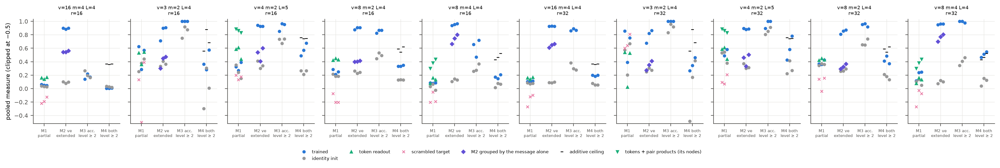
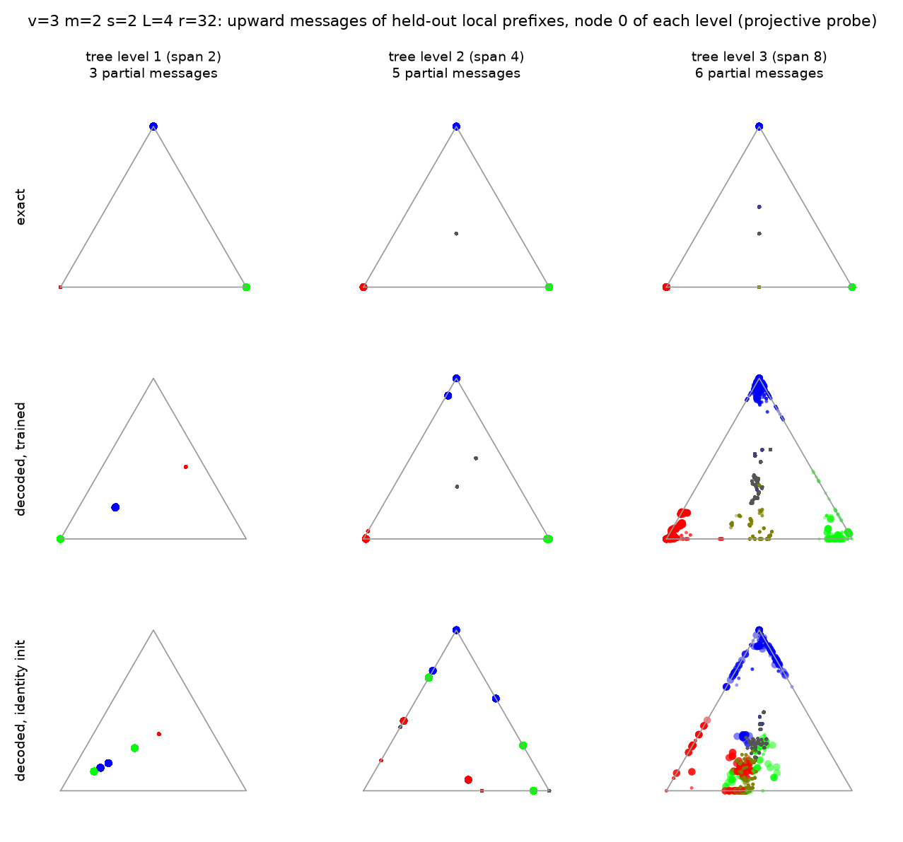
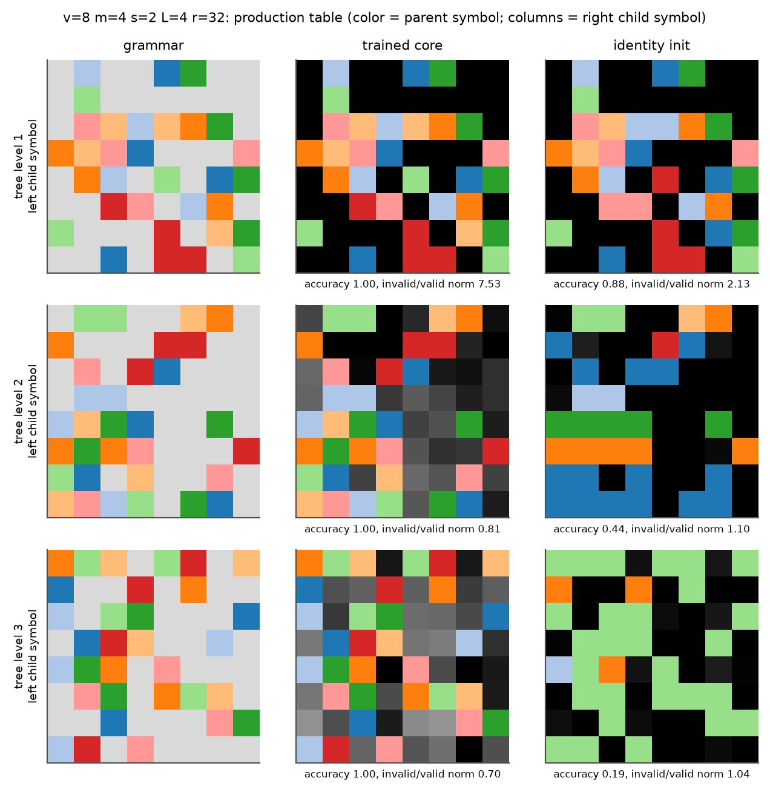
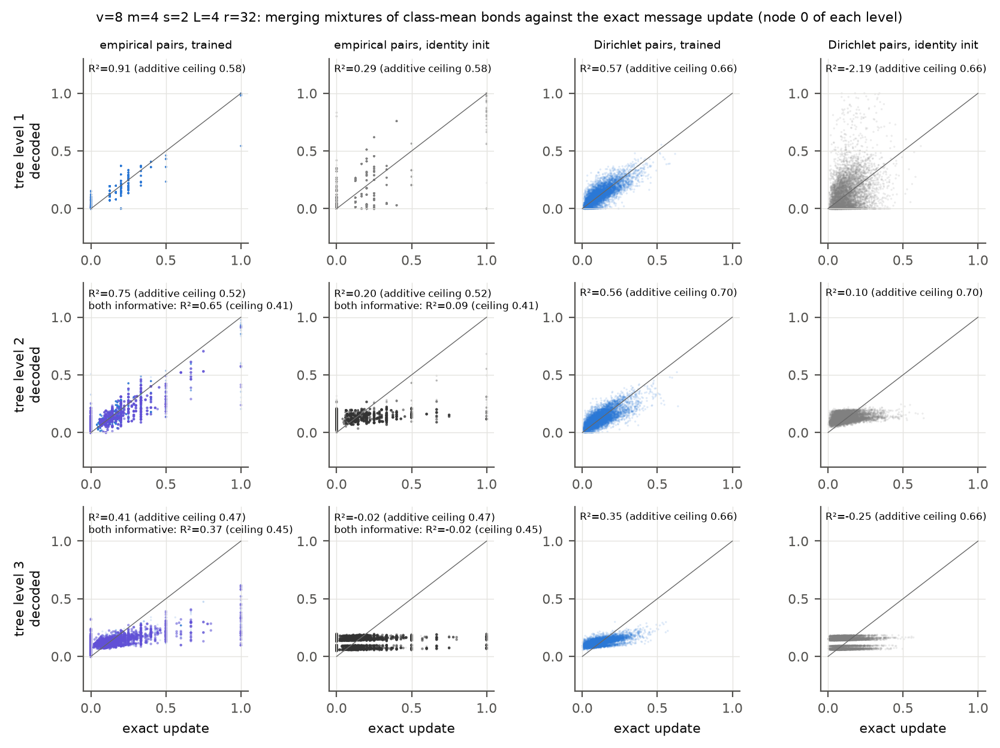

# Do a tree tensor network's bonds and merges implement the RHM's message passing?

Mostly no. A tree tensor network (TreeTN) trained on next-token prediction for the Random Hierarchy Model (RHM) learns bonds that are close to a function of what the task needs from each subtree, but a linear probe does not read the grammar's upward message from those bonds, and the learned merge does not reproduce the grammar's message update on uncertain inputs. Of the four hypotheses fixed before the run, one is supported at both widths, one in a minority of cells, and two in no cell.

- **The bond keeps what the task needs and little else (H2): supported at both widths**, in 4 of 5 learned grammars at r = 32 and 3 of 4 at r = 16. Among bonds that share the exact extended message and the number of observed leaves, the grouping explains 0.81–0.96 of the whitened bond variance in the 25 passing runs, against 0.08–0.41 in the identity-init tree. The one failing grammar, `v3m2s2L4`, fails on one seed at each width (0.68 and 0.71).
- **The bond holds the message of a partially observed node (H1): not supported, 0 of 9 learned cells.** The projective probe recovers the normalized message on held-out local prefixes with a per-cell median R² of 0.08–0.75, against a threshold of 0.8. One run of 27 passes. In 7 of the 9 cells the bond probe scores below a probe on the one-hot tokens of the same span.
- **The cores reproduce the production rules (H3): partly supported at r = 32 (2 of 5 cells), not supported at r = 16 (1 of 4).** At r = 32 the cores map the class-mean bonds of a valid child pair to the right parent symbol for 0.87–1.00 of the pairs (median per cell; identity init 0.30–0.92), and three cells miss the 0.95 threshold in at least one seed.
- **The merge is the grammar's update on uncertain messages (H4): not supported, 0 of 9 learned cells.** On pairs where both children are informative, the decoded merge matches the exact update with a per-cell median R² of 0.17–0.58, against a threshold of 0.8, and it exceeds the best additive fit of the same pairs in 4 of 27 runs.

All 30 planned runs trained and were analyzed (5 grammars × 2 widths × 3 seeds), the correctness checks passed, and the run cost about $5.26 over 7 h 18 m on one GPU. The definition, with its amendments, is [EXPERIMENT.md](EXPERIMENT.md); a longer note with the mathematics is [NOTE.md](NOTE.md).

## Verdict against the criteria

The criteria were fixed before the run and are applied by `msg_summary.py` to `results/*/analysis.json` at the final checkpoint. A cell is one grammar at one width, with three seeds; a cell counts for a hypothesis only if all three seeds pass every part of it. A measure "closes the gap" over a control when 1 − measure ≤ 0.5 × (1 − max(control, 0)).

| criterion | verdict | evidence |
| --- | --- | --- |
| Checks pass, CUDA present | yes | 28 of 28 RHM checks and all 38 lines of the message-passing check passed before training |
| At least 26 of 30 runs trained and analyzed | yes, 30 of 30 | every run reached 30,000 updates with status `finished`; no cell is censored |
| Shuffled-label R² ≤ 0.05 at every eligible node | yes | the worst node per run is between −0.001 and 0.011 over the 30 runs |
| Learned (excess test loss < 0.02 nats/token in all three seeds) | 9 of 10 cells | 0.0003–0.0097 in 27 runs; `v16m4s2L4` at r = 16 did not learn (0.043, 0.049, 0.057) |
| H1 at r = 32 | not supported, 0 of 5 cells | one run passes (`v3m2s2L4` seed 0) |
| H1 at r = 16 | not supported, 0 of 4 cells | no run passes |
| H2 at r = 32 | supported, 4 of 5 cells | fails: `v3m2s2L4` (seed 0, ve 0.68) |
| H2 at r = 16 | supported, 3 of 4 cells | fails: `v3m2s2L4` (seed 0, ve 0.71) |
| H3 at r = 32 | partly supported, 2 of 5 cells | passes: `v3m2s2L4`, `v8m4s2L4`; fails: `v16m4s2L4` (0.86–0.89), `v4m2s2L5` (seed 0, 0.90), `v8m2s2L4` (seed 2, 0.92) |
| H3 at r = 16 | not supported, 1 of 4 cells | passes: `v3m2s2L4`; fails: `v4m2s2L5` (seed 0, 0.85), `v8m2s2L4` (0.83–0.87), `v8m4s2L4` (0.47–0.72) |
| H4 at r = 32 | not supported, 0 of 5 cells | no run passes; best both-informative R² 0.78 |
| H4 at r = 16 | not supported, 0 of 4 cells | no run passes; best both-informative R² 0.68 |

The overall rule was: supported at 75% of the judged cells or more, not supported at 25% or fewer, partly supported in between. Grammars are named vVmMsSLL: v symbols per level, m productions per symbol, branching s = 2, depth L, so a sequence has T = 2^L tokens.

*[figures/summary.pdf](figures/summary.pdf): the four pooled measures behind H1–H4, one panel per cell (r = 16 on the left, r = 32 on the right), one point per seed (n = 3), clipped below at −0.5. Blue is the trained tree and gray the identity-init tree. In the M1 column, green triangles are the token readouts and pink crosses the scrambled target; in the M2 column, violet diamonds are the grouping by the message alone; in the M4 column, black dashes are the additive ceiling. Only the M2 column is above 0.65 in every panel (0.68–0.96 over the 30 runs), and the blue M1 points sit among their controls.*

## H2: a bond is close to a function of the extended message

When a node is partially observed, the token to predict lies inside its span, so the task needs more from its bond than the message λ_u(a) = P(observed leaves under u | Z_u = a). It needs the extended message M_u(a, c) = P(observed leaves under u, next token = c | Z_u = a) and the number of observed leaves. Two local prefixes are synonymous here when they differ as token strings and agree on both. The measure is ve = 1 − (mean squared distance between whitened bonds of synonymous rows) / (the same for random pairs of rows with different local prefixes). For example, at node 0 of level 3 in `v8m4s2L4`, r = 32, seed 0, the mean squared distance is 0.098 for synonymous rows and 1.110 for random pairs, in units of twice the bond dimension, so ve = 0.91.

| grammar | r | extended message: trained | identity init | share of rows with a partner | message alone: trained | identity init | H2 |
| --- | --- | --- | --- | --- | --- | --- | --- |
| `v16m4s2L4` | 32 | 0.93 [0.92, 0.93] | 0.09 [0.08, 0.10] | 0.77 [0.77, 0.77] | 0.65 [0.61, 0.66] | 0.00 [0.00, 0.03] | yes (3/3 seeds) |
| `v3m2s2L4` | 32 | 0.82 [0.68, 0.86] | 0.27 [0.25, 0.31] | 0.86 [0.86, 0.86] | 0.35 [0.27, 0.41] | 0.15 [0.14, 0.17] | no (2/3 seeds) |
| `v4m2s2L5` | 32 | 0.89 [0.88, 0.90] | 0.31 [0.30, 0.37] | 0.89 [0.89, 0.94] | 0.46 [0.33, 0.50] | 0.20 [0.17, 0.22] | yes (3/3 seeds) |
| `v8m2s2L4` | 32 | 0.86 [0.81, 0.87] | 0.26 [0.26, 0.29] | 0.86 [0.86, 0.86] | 0.33 [0.30, 0.37] | 0.12 [0.11, 0.13] | yes (3/3 seeds) |
| `v8m4s2L4` | 32 | 0.96 [0.95, 0.96] | 0.10 [0.08, 0.12] | 0.80 [0.80, 0.80] | 0.77 [0.70, 0.80] | 0.06 [0.03, 0.07] | yes (3/3 seeds) |
| `v16m4s2L4` | 16 | 0.90 [0.88, 0.90] | 0.10 [0.08, 0.10] | 0.77 [0.77, 0.77] | 0.54 [0.54, 0.56] | 0.03 [0.02, 0.05] | not learned |
| `v3m2s2L4` | 16 | 0.90 [0.71, 0.91] | 0.36 [0.33, 0.41] | 0.86 [0.86, 0.86] | 0.45 [0.30, 0.47] | 0.22 [0.21, 0.26] | no (2/3 seeds) |
| `v4m2s2L5` | 16 | 0.93 [0.92, 0.94] | 0.34 [0.30, 0.41] | 0.89 [0.89, 0.94] | 0.54 [0.40, 0.60] | 0.23 [0.19, 0.27] | yes (3/3 seeds) |
| `v8m2s2L4` | 16 | 0.91 [0.88, 0.91] | 0.24 [0.23, 0.26] | 0.86 [0.86, 0.86] | 0.40 [0.40, 0.41] | 0.13 [0.13, 0.16] | yes (3/3 seeds) |
| `v8m4s2L4` | 16 | 0.95 [0.94, 0.96] | 0.13 [0.11, 0.15] | 0.77 [0.77, 0.77] | 0.74 [0.67, 0.80] | 0.08 [0.07, 0.10] | yes (3/3 seeds) |

Every measure in this and the following cell tables is the median over three seeds with the range in brackets; the per-level table further down gives medians only. M2 is pooled over nodes with at least 10 × (r + 1) distinct local prefixes, M1 over nodes with at least 10 × (r + 1) distinct fit prefixes, M3 and M4 over parents of tree level ≥ 2 whose two children have a fully observed case, and M4a over all internal nodes unless a column says otherwise. The share of rows that have a synonymous partner is 0.77–0.94, so the measure covers most of the rows.

- **The bond separates extended messages far more than realizations of one extended message.** In the 25 passing runs ve is 0.81–0.96, and the identity-init tree scores 0.08–0.41 over all learned runs.
- **Grouping by the message alone explains much less, as the definition predicted.** It gives 0.27–0.80 over the learned runs. Prefixes with the same λ_u often need different predictions, so a tree at the Bayes loss cannot reach 1 on that grouping, and this number carries no verdict.
- **ve includes variance between prefix lengths.** The random partner is drawn across all prefix lengths of the node, so the bond's dependence on the number of observed leaves counts as explained. On the pilot checkpoints the experiment's second review measured that drawing the random partner at the same number of observed leaves lowers ve from 0.64 to 0.56 and from 0.55 to 0.50 for the trained tree, and from 0.32–0.33 to 0.19–0.21 for the identity-init tree. The control carries the same inflation, but a drop of the pilots' size (0.05–0.08) would put `v8m2s2L4` at r = 32 (0.81–0.87) below 0.8 and would bring `v4m2s2L5` at r = 32 (0.88–0.90) and one seed of `v8m2s2L4` at r = 16 (0.88) to the threshold. This run did not compute the stricter version.

## H1: the message is not linearly readable from the bond

The probe is projective: it fits q = Wz + c so that q / Σq matches the normalized message λ̂_u = λ_u / Σ_a λ_u(a), on half of a node's distinct local prefixes, and is scored on the other half. A node is eligible with at least 10 × (r + 1) distinct fit prefixes.

| grammar | r | eligible nodes | distinct partial messages per node | trained | identity init | token readout | scrambled target | fully observed rows | H1 |
| --- | --- | --- | --- | --- | --- | --- | --- | --- | --- |
| `v16m4s2L4` | 32 | 6 | 92-339 | 0.11 [0.10, 0.11] | 0.08 [0.07, 0.09] | 0.18 [0.17, 0.19] | -0.12 [-0.27, -0.10] | 0.66 [0.62, 0.68] | no (0/3 seeds) |
| `v3m2s2L4` | 32 | 1 | 6-14 (identity test) | 0.75 [0.39, 0.86] | 0.57 [0.20, 0.67] | 0.56 [0.45, 0.63] | 0.64 [0.60, 0.81] | 0.99 [0.98, 1.00] | no (1/3 seeds) |
| `v4m2s2L5` | 32 | 6 | 12-33 (identity test) | 0.53 [0.49, 0.58] | 0.53 [0.38, 0.54] | 0.61 [0.52, 0.74] | 0.09 [0.07, 0.21] | 0.96 [0.95, 0.98] | no (0/3 seeds) |
| `v8m2s2L4` | 32 | 2 | 31-34 (identity test) | 0.37 [0.36, 0.42] | 0.36 [0.34, 0.37] | 0.57 [0.47, 0.58] | 0.14 [-0.04, 0.16] | 0.93 [0.89, 0.94] | no (0/3 seeds) |
| `v8m4s2L4` | 32 | 5 | 48-174 | 0.24 [0.12, 0.25] | 0.11 [0.05, 0.14] | 0.16 [0.15, 0.18] | -0.07 [-0.27, -0.03] | 0.93 [0.91, 0.98] | no (0/3 seeds) |
| `v16m4s2L4` | 16 | 6 | 92-339 | 0.05 [0.05, 0.06] | 0.03 [0.03, 0.04] | 0.18 [0.17, 0.19] | -0.19 [-0.22, -0.13] | 0.01 [0.01, 0.04] | not learned |
| `v3m2s2L4` | 16 | 2 | 6-14 (identity test) | 0.57 [0.28, 0.63] | 0.38 [0.25, 0.44] | 0.60 [0.49, 0.65] | 0.13 [-0.65, 0.39] | 0.97 [0.96, 0.99] | no (0/3 seeds) |
| `v4m2s2L5` | 16 | 6 | 12-33 (identity test) | 0.33 [0.27, 0.39] | 0.24 [0.15, 0.35] | 0.61 [0.52, 0.74] | 0.18 [0.13, 0.20] | 0.85 [0.81, 0.91] | no (0/3 seeds) |
| `v8m2s2L4` | 16 | 2 | 31-34 | 0.25 [0.21, 0.28] | 0.18 [0.18, 0.22] | 0.57 [0.47, 0.58] | -0.20 [-0.20, -0.07] | 0.72 [0.71, 0.90] | no (0/3 seeds) |
| `v8m4s2L4` | 16 | 5 | 48-174 | 0.08 [0.08, 0.08] | 0.03 [-0.02, 0.07] | 0.16 [0.15, 0.18] | -0.19 [-0.20, -0.05] | 0.47 [0.37, 0.60] | no (0/3 seeds) |

- **The trained bond probe barely separates from its controls.** Its median exceeds the identity-init tree's by 0.00–0.19 and is below the one-hot token readout in 7 of the 9 learned cells; the two exceptions are `v3m2s2L4` and `v8m4s2L4` at r = 32. One of the 27 learned runs closes the gap over the better control, and it is also the only one above 0.8.
- **The symbol of a complete subtree is readable, the distribution over symbols of an incomplete one is not.** The same probe on fully observed rows, where the message is a point mass on the node's symbol, scores 0.93–0.99 at r = 32 in four grammars and 0.66 in `v16m4s2L4` (median per cell). At r = 16 it scores 0.47–0.97 in the learned cells.
- **Where the probe scores highest, it is a test of message identity.** The cells marked "identity test" have, in at least half of their eligible nodes in some seed, no more distinct partially observed messages than the probe has parameters per coordinate (r + 1). In `v3m2s2L4` at r = 32, the probe fits a scrambled target, an independent random vector per distinct message, about as well as the message (0.64 [0.60, 0.81] against 0.75 [0.39, 0.86]); at r = 16 it does not (0.13 against 0.57). The one passing run is in this cell, at a node with 6 distinct messages.

| grammar | r | nodes with pairwise readout | bond probe there | pairwise token readout | M1x trained | M1x identity init | M1x token readout |
| --- | --- | --- | --- | --- | --- | --- | --- |
| `v16m4s2L4` | 32 | 0 | - | - | 0.10 [0.09, 0.10] | 0.01 [0.01, 0.01] | -0.03 [-0.03, -0.02] |
| `v3m2s2L4` | 32 | 0 | - | - | 0.70 [0.54, 0.76] | 0.16 [0.14, 0.18] | 0.18 [-0.06, 0.23] |
| `v4m2s2L5` | 32 | 2 | 0.48 [0.40, 0.55] | 0.86 [0.83, 0.89] | 0.61 [0.56, 0.64] | 0.22 [0.08, 0.22] | 0.26 [0.12, 0.27] |
| `v8m2s2L4` | 32 | 0 | - | - | 0.32 [0.30, 0.32] | 0.09 [0.02, 0.10] | 0.08 [0.07, 0.10] |
| `v8m4s2L4` | 32 | 1 | 0.17 [0.13, 0.31] | 0.38 [0.30, 0.44] | 0.27 [0.26, 0.31] | -0.05 [-0.08, 0.00] | -0.05 [-0.08, -0.01] |
| `v16m4s2L4` | 16 | 0 | - | - | 0.06 [0.05, 0.06] | -0.00 [-0.01, -0.00] | -0.03 [-0.03, -0.02] |
| `v3m2s2L4` | 16 | 0 | - | - | 0.62 [0.52, 0.62] | 0.12 [-0.13, 0.14] | 0.12 [0.11, 0.26] |
| `v4m2s2L5` | 16 | 2 | 0.22 [0.22, 0.36] | 0.86 [0.83, 0.89] | 0.46 [0.41, 0.49] | 0.07 [0.01, 0.08] | 0.26 [0.12, 0.27] |
| `v8m2s2L4` | 16 | 0 | - | - | 0.21 [0.20, 0.22] | 0.02 [0.01, 0.04] | 0.08 [0.07, 0.10] |
| `v8m4s2L4` | 16 | 1 | 0.06 [0.06, 0.16] | 0.38 [0.30, 0.44] | 0.17 [0.13, 0.18] | -0.03 [-0.23, -0.01] | -0.05 [-0.08, -0.01] |

- **A readout with all pairwise token products beats the bond probe on the same nodes.** It is eligible at two nodes of `v4m2s2L5` and one of `v8m4s2L4`, and scores 0.86 and 0.38 there against 0.48 and 0.17 for the bond at r = 32 (median per cell; the order holds in every seed).
- **The extended message separates from its controls, and stays below 0.8 (M1x, descriptive).** The projective probe to the normalized extended message scores 0.10–0.70 at r = 32 (median per cell) and is above both the identity-init tree and the token readout in every learned run, which the probe to the message alone is not.

*[figures/triangles_v3m2s2L4_r32.pdf](figures/triangles_v3m2s2L4_r32.pdf): `v3m2s2L4`, r = 32, seed 0, node 0 of each tree level; held-out local prefixes, colored by the exact message, with large points for fully observed rows and small points for partially observed ones. Top row: exact messages. Middle: decoded from the trained tree. Bottom: decoded from the identity-init tree. Only the level-3 node (938 distinct local prefixes) is eligible; the level-1 and level-2 nodes have 10 and 50 distinct local prefixes, too few for a held-out probe of 33 parameters per coordinate. This is the one run that passes H1 (R² 0.86 at the level-3 node, identity init 0.57): the trained tree's partially observed points cluster near the six exact messages, with visible scatter.*

## H3: the cores map valid child pairs to the right parent, and do not zero the invalid pairs

For every parent whose two children have a fully observed case, the class-mean bond of each child symbol is pushed through the learned core, pair by pair, and decoded with the parent's probe. The criterion uses parents of tree level ≥ 2. Level-1 parents are reported separately, because their merged bonds are rows the decoder was fit on.

| grammar | r | valid pairs | accuracy: trained | identity init | invalid/valid bond norm: trained | identity init | invalid/valid read-out mass: trained | identity init | level 1 accuracy: trained | identity init | H3 |
| --- | --- | --- | --- | --- | --- | --- | --- | --- | --- | --- | --- |
| `v16m4s2L4` | 32 | 256 | 0.87 [0.86, 0.89] | 0.30 [0.28, 0.38] | 0.58 [0.56, 0.59] | 1.03 [1.02, 1.04] | 1.25 [1.23, 1.38] | 1.01 [1.00, 1.01] | 0.98 [0.96, 1.00] | 0.62 [0.60, 0.67] | no (0/3 seeds) |
| `v3m2s2L4` | 32 | 24 | 1.00 [1.00, 1.00] | 0.92 [0.83, 0.96] | 19.48 [5.51, 35.98] | 2.85 [1.55, 3.56] | 1.17 [0.61, 2.33] | 2.54 [2.09, 4.57] | 1.00 [1.00, 1.00] | 1.00 [1.00, 1.00] | yes (3/3 seeds) |
| `v4m2s2L5` | 32 | 87-88 | 1.00 [0.90, 1.00] | 0.85 [0.80, 0.91] | 6.92 [3.14, 7.15] | 1.58 [1.44, 2.00] | 1.21 [1.14, 1.27] | 1.53 [1.45, 2.45] | 0.89 [0.88, 1.00] | 0.90 [0.89, 1.00] | no (2/3 seeds) |
| `v8m2s2L4` | 32 | 60-61-63 | 0.95 [0.92, 0.97] | 0.65 [0.65, 0.74] | 1.14 [1.03, 1.15] | 1.27 [1.21, 1.27] | 1.10 [1.10, 1.13] | 1.00 [0.93, 1.30] | 0.89 [0.88, 0.93] | 0.89 [0.88, 0.93] | no (2/3 seeds) |
| `v8m4s2L4` | 32 | 128 | 1.00 [0.98, 1.00] | 0.41 [0.34, 0.46] | 0.64 [0.56, 0.68] | 1.09 [1.06, 1.10] | 1.94 [1.59, 2.31] | 1.00 [0.95, 1.11] | 0.99 [0.98, 0.99] | 0.86 [0.85, 0.90] | yes (3/3 seeds) |
| `v16m4s2L4` | 16 | 256 | 0.17 [0.14, 0.22] | 0.20 [0.16, 0.27] | 0.99 [0.99, 0.99] | 1.01 [1.01, 1.01] | 1.01 [1.00, 1.01] | 0.98 [0.98, 1.02] | 0.80 [0.76, 0.81] | 0.40 [0.38, 0.42] | not learned |
| `v3m2s2L4` | 16 | 24 | 1.00 [1.00, 1.00] | 0.88 [0.75, 0.92] | 1.43 [0.92, 2.14] | 1.32 [1.27, 1.91] | 1.23 [0.99, 2.29] | 5.08 [1.31, 7.98] | 1.00 [1.00, 1.00] | 1.00 [1.00, 1.00] | yes (3/3 seeds) |
| `v4m2s2L5` | 16 | 87-88 | 0.95 [0.85, 0.97] | 0.74 [0.67, 0.74] | 0.97 [0.95, 1.02] | 1.17 [1.15, 1.20] | 1.39 [1.07, 1.63] | 1.21 [1.10, 2.88] | 0.89 [0.88, 1.00] | 0.90 [0.88, 1.00] | no (2/3 seeds) |
| `v8m2s2L4` | 16 | 60-61-63 | 0.87 [0.83, 0.87] | 0.49 [0.44, 0.53] | 0.84 [0.83, 0.89] | 1.07 [1.06, 1.14] | 1.18 [0.98, 1.21] | 1.08 [0.93, 1.16] | 0.84 [0.81, 0.88] | 0.72 [0.71, 0.74] | no (0/3 seeds) |
| `v8m4s2L4` | 16 | 128 | 0.66 [0.47, 0.72] | 0.27 [0.26, 0.37] | 0.92 [0.88, 0.97] | 1.01 [0.98, 1.02] | 1.86 [1.01, 2.22] | 1.03 [0.97, 1.03] | 1.00 [0.99, 1.00] | 0.62 [0.59, 0.72] | no (0/3 seeds) |

- **Accuracy on valid pairs rises above the identity-init tree at levels ≥ 2 and reaches 0.95 in every seed in three cells** (15 of the 27 learned runs pass). The level-1 numbers show why they carry no verdict: the identity-init tree is as accurate as the trained one in `v3m2s2L4`, `v4m2s2L5` and, at r = 32, `v8m2s2L4`.
- **Invalid pairs keep their read-out mass.** Exact message passing sends a child pair that no production joins to the zero message. Training never shows the tree such a pair, and the merged bond of an invalid pair is read out with 1.10–1.94 times the nonnegative mass of a valid pair (median per learned cell; 0.98–2.33 in 26 of the 27 learned runs and 0.61 in the other).
- **The bond norm of invalid pairs shrinks most in the two m = 4 grammars at r = 32**, to 0.56–0.68 of the valid pairs' norm (identity init 1.02–1.10). In the other learned cells it is 0.83 or more (0.83–0.89 in `v8m2s2L4` at r = 16, identity init 1.06–1.14), and it reaches 5.5–36 in `v3m2s2L4` at r = 32.

*[figures/prodtable_v8m4s2L4_r32.pdf](figures/prodtable_v8m4s2L4_r32.pdf): `v8m4s2L4`, r = 32, seed 0, node 0 of each tree level. Rows are the left child's symbol and columns the right child's. Left: the grammar's table (color = parent symbol, light gray = no production). Middle: the table read from the trained core; a valid pair is colored by its decoded parent, and an invalid pair is shaded by the norm of its merged bond relative to the median valid pair (white = 0, the value under exact message passing; black ≥ 1). Right: the same for the identity-init tree. The trained core decodes all 32 valid pairs correctly at each level. Its invalid pairs are black at level 1 and dark to mid gray at levels 2 and 3, never white (median norm ratios 7.53, 0.81 and 0.70 at the three levels; the smallest single pair is at 0.42).*

## H4: the merge is not the grammar's update on uncertain messages

Child bonds are built as mixtures of class means, Σ_b λ_L(b) μ_b and Σ_c λ_R(c) μ_c, merged with the learned core and decoded. The exact update is λ_u(a) = Σ_bc P(b, c | a) λ_L(b) λ_R(c), normalized. Each parent gets 8,000 pairs of messages drawn independently from its children's empirical messages. The both-informative pairs (left child partially observed, right child partially or fully observed) never occur in training and need the product of the two messages. The additive ceiling is the least-squares fit of the exact update on [λ_L, λ_R], fit and scored on the same subset.

| grammar | r | all empirical pairs | both-informative: trained | identity init | additive ceiling | left-masked: trained | additive ceiling | seen in training: trained | additive ceiling | H4 |
| --- | --- | --- | --- | --- | --- | --- | --- | --- | --- | --- |
| `v16m4s2L4` | 32 | 0.29 [0.27, 0.30] | 0.20 [0.18, 0.20] | 0.06 [0.05, 0.08] | 0.37 [0.36, 0.37] | 0.20 [0.20, 0.21] | 0.98 [0.96, 0.98] | 0.39 [0.37, 0.41] | 0.50 [0.48, 0.53] | no (0/3 seeds) |
| `v3m2s2L4` | 32 | 0.31 [0.28, 0.59] | 0.34 [0.27, 0.46] | 0.17 [-0.49, 0.41] | 0.68 [0.56, 0.88] | -0.02 [-0.64, 0.36] | 0.97 [0.93, 1.00] | 0.51 [0.32, 0.76] | 0.82 [0.63, 0.86] | no (0/3 seeds) |
| `v4m2s2L5` | 32 | 0.66 [0.41, 0.74] | 0.58 [0.42, 0.78] | 0.27 [0.22, 0.41] | 0.74 [0.74, 0.76] | -0.10 [-0.50, 0.28] | 0.99 [0.99, 0.99] | 0.82 [0.56, 0.87] | 0.83 [0.71, 0.95] | no (0/3 seeds) |
| `v8m2s2L4` | 32 | 0.47 [0.34, 0.51] | 0.41 [0.37, 0.48] | 0.18 [0.13, 0.21] | 0.59 [0.54, 0.62] | 0.05 [-0.05, 0.06] | 0.98 [0.96, 0.99] | 0.60 [0.45, 0.72] | 0.80 [0.76, 0.82] | no (0/3 seeds) |
| `v8m4s2L4` | 32 | 0.64 [0.60, 0.67] | 0.51 [0.46, 0.55] | 0.12 [0.04, 0.15] | 0.47 [0.43, 0.53] | 0.50 [0.41, 0.52] | 0.97 [0.95, 0.98] | 0.75 [0.71, 0.77] | 0.51 [0.51, 0.52] | no (0/3 seeds) |
| `v16m4s2L4` | 16 | 0.01 [0.00, 0.01] | 0.01 [0.00, 0.01] | 0.03 [0.02, 0.04] | 0.37 [0.36, 0.37] | -0.00 [-0.00, 0.00] | 0.98 [0.96, 0.98] | 0.01 [0.01, 0.02] | 0.50 [0.48, 0.53] | not learned |
| `v3m2s2L4` | 16 | 0.42 [0.35, 0.66] | 0.37 [0.28, 0.58] | 0.01 [-0.30, 0.30] | 0.68 [0.56, 0.88] | -0.24 [-0.49, 0.51] | 0.97 [0.93, 1.00] | 0.62 [0.55, 0.77] | 0.82 [0.63, 0.86] | no (0/3 seeds) |
| `v4m2s2L5` | 16 | 0.66 [0.49, 0.67] | 0.57 [0.49, 0.68] | 0.27 [0.21, 0.27] | 0.74 [0.74, 0.76] | 0.02 [-0.22, 0.19] | 0.99 [0.99, 0.99] | 0.77 [0.62, 0.89] | 0.83 [0.71, 0.95] | no (0/3 seeds) |
| `v8m2s2L4` | 16 | 0.40 [0.39, 0.44] | 0.33 [0.33, 0.35] | 0.13 [0.13, 0.13] | 0.59 [0.54, 0.62] | 0.10 [0.05, 0.11] | 0.98 [0.96, 0.99] | 0.56 [0.53, 0.61] | 0.80 [0.76, 0.82] | no (0/3 seeds) |
| `v8m4s2L4` | 16 | 0.31 [0.22, 0.35] | 0.17 [0.15, 0.21] | 0.07 [0.02, 0.08] | 0.47 [0.43, 0.53] | 0.19 [0.18, 0.25] | 0.97 [0.95, 0.98] | 0.40 [0.28, 0.46] | 0.51 [0.51, 0.52] | no (0/3 seeds) |

- **No run reaches 0.8 on the both-informative pairs or on all empirical pairs** (best runs 0.78 and 0.74, both `v4m2s2L5` at r = 32, seed 2).
- **The decoded merge is mostly below a fit with no product term.** It exceeds the additive ceiling of the both-informative pairs in all three seeds only in `v8m4s2L4` at r = 32 (0.46, 0.51, 0.55 against 0.43, 0.47, 0.53) and in one seed of `v4m2s2L5` at r = 32 (0.78 against 0.74).
- **The left-masked pairs fail most clearly.** With a uniform left message the exact update is linear in the right message before normalization, so the additive ceiling of the normalized target is 0.97–0.99, and the decoded merge scores −0.24 to 0.50 (medians per learned cell; 0.93–1.00 and −0.64 to 0.52 over runs).
- **Combinations of observation cases that occur in training come closest in `v4m2s2L5`.** The median per cell at r = 32 is 0.39–0.82, with additive ceilings of 0.50–0.83. `v4m2s2L5` reaches 0.82 and 0.87 in two of its three seeds at r = 32 and 0.56 in the third (additive ceilings 0.71, 0.95 and 0.83), and the other four grammars stay at 0.32–0.77. This subset has no criterion.

| grammar | r | Dirichlet pairs: trained | identity init | additive ceiling | M4a, all internal nodes: trained | identity init | M4a, nodes of level >= 2: trained | level 1, all empirical pairs: trained | identity init |
| --- | --- | --- | --- | --- | --- | --- | --- | --- | --- |
| `v16m4s2L4` | 32 | 0.16 [0.14, 0.16] | -0.02 [-0.13, 0.02] | 0.70 [0.69, 0.71] | 0.79 [0.76, 0.79] | 0.38 [0.38, 0.42] | 0.61 [0.56, 0.63] | 0.68 [0.67, 0.68] | 0.50 [0.48, 0.50] |
| `v3m2s2L4` | 32 | -0.07 [-0.28, 0.39] | -0.42 [-0.73, 0.31] | 0.84 [0.70, 0.84] | 0.95 [0.93, 0.95] | 0.88 [0.83, 0.89] | 0.87 [0.79, 0.89] | 0.90 [0.88, 0.93] | 0.83 [0.79, 0.92] |
| `v4m2s2L5` | 32 | 0.32 [-0.65, 0.37] | -1.18 [-1.51, 0.20] | 0.77 [0.76, 0.83] | 0.95 [0.83, 0.97] | 0.76 [0.69, 0.93] | 0.94 [0.73, 0.95] | 0.73 [0.63, 0.82] | 0.58 [0.30, 0.75] |
| `v8m2s2L4` | 32 | -0.43 [-0.84, -0.05] | -0.64 [-0.93, -0.10] | 0.73 [0.73, 0.75] | 0.90 [0.85, 0.91] | 0.67 [0.52, 0.78] | 0.89 [0.82, 0.90] | 0.64 [0.61, 0.71] | -0.23 [-0.33, 0.14] |
| `v8m4s2L4` | 32 | 0.45 [0.42, 0.45] | -0.05 [-0.06, 0.08] | 0.71 [0.69, 0.74] | 0.79 [0.75, 0.85] | 0.48 [0.43, 0.50] | 0.86 [0.86, 0.94] | 0.83 [0.77, 0.84] | 0.30 [-0.02, 0.41] |
| `v16m4s2L4` | 16 | -0.07 [-0.07, -0.06] | -0.12 [-0.23, -0.07] | 0.70 [0.69, 0.71] | 0.26 [0.25, 0.31] | 0.16 [0.14, 0.19] | 0.02 [0.02, 0.03] | 0.41 [0.40, 0.41] | 0.23 [0.21, 0.26] |
| `v3m2s2L4` | 16 | 0.16 [-0.05, 0.53] | -0.43 [-0.75, 0.06] | 0.84 [0.70, 0.84] | 0.92 [0.90, 0.96] | 0.81 [0.80, 0.83] | 0.75 [0.74, 0.90] | 0.88 [0.83, 0.93] | 0.81 [0.78, 0.83] |
| `v4m2s2L5` | 16 | 0.23 [-0.25, 0.43] | -0.67 [-1.02, 0.09] | 0.77 [0.76, 0.83] | 0.93 [0.80, 0.96] | 0.70 [0.61, 0.83] | 0.87 [0.75, 0.93] | 0.72 [0.51, 0.82] | 0.57 [0.19, 0.62] |
| `v8m2s2L4` | 16 | -0.02 [-0.13, 0.11] | -0.50 [-0.83, -0.20] | 0.73 [0.73, 0.75] | 0.64 [0.52, 0.69] | 0.27 [0.08, 0.44] | 0.75 [0.75, 0.77] | 0.27 [0.21, 0.36] | -0.70 [-0.76, -0.00] |
| `v8m4s2L4` | 16 | 0.17 [0.08, 0.18] | -0.05 [-0.09, 0.00] | 0.71 [0.69, 0.74] | 0.65 [0.60, 0.65] | 0.38 [0.30, 0.47] | 0.43 [0.31, 0.45] | 0.74 [0.70, 0.76] | 0.32 [0.31, 0.50] |

- **In four of the five grammars at r = 32, the probe reads mixture bonds well, so most of the failure arises at the merge.** M4a decodes the mixture bond Σ_b λ(b) μ_b with the node's own probe and compares it with λ. At nodes of level ≥ 2, where M4 is judged, it scores 0.86–0.94 at r = 32 in four grammars (median per cell), all of which have an M4 of 0.31–0.66 over all empirical pairs, and 0.61 in `v16m4s2L4`. Pooled over all internal nodes, most of which are level-1 nodes, it is 0.79–0.95. M4a decodes mixtures of a node's own class means, the bonds that a correct merge would return, and uses no real partially observed bond. So it does not say whether real bonds are linear in the message; that is M1, which fails.
- **Level-1 parents look better, and are an in-sample fit.** Over all empirical pairs they score 0.64–0.90 at r = 32, against 0.29–0.66 for parents of level ≥ 2 (medians per cell). Their child bonds are leaf embeddings and their pairs are training inputs.

*[figures/m4_v8m4s2L4_r32.pdf](figures/m4_v8m4s2L4_r32.pdf): `v8m4s2L4`, r = 32, seed 0, node 0 of each tree level; every component of the decoded message (vertical) against the exact update (horizontal), for mixtures of class-mean bonds. Columns: empirical pairs in the trained tree and in the identity-init tree, then Dirichlet(1) pairs in each. Darker points are the both-informative pairs. This is the cell with the best margin over the additive ceiling, and the fit still degrades with depth: R² over the empirical pairs is 0.91 at level 1, 0.75 at level 2 and 0.41 at level 3, where the decoded values stay below about 0.6 when the exact value is 1.*

### Exploratory: the read-out table, with the invalid pairs set to zero

This was computed after the run, prompted by the fact-check, and has no criterion. The merge is bilinear and the read-out affine, so for normalized child messages the read-out of a merged mixture is exactly Σ_bc λ_L(b) λ_R(c) q_bc, where q_bc is the read-out of the merged class means of the pair (b, c). The decoded update equals the exact one for all message pairs when q_bc is a positive constant times the production tensor: a valid pair reads out as its parent, all valid pairs with the same mass, an invalid pair as zero. The analysis saved q_bc for node 0 of each level, so `msg_readout_ablation.py` recomputes the update from the table alone on 8,000 Dirichlet(1) pairs per node, edits the table, and pools R² over node 0 of each level ≥ 2. "As saved" reproduces the saved M4 scores on Dirichlet pairs at node 0 to within 0.08. These differ from the "Dirichlet pairs" column of the table above, which pools all parents of level ≥ 2: for `v8m2s2L4` at r = 32 that column's median is −0.43 against 0.10 at node 0.

| grammar | r | as saved | invalid pairs set to zero | valid pairs given equal mass | both |
| --- | --- | --- | --- | --- | --- |
| `v16m4s2L4` | 32 | 0.22 [0.20, 0.23] | 0.51 [0.42, 0.52] | 0.24 [0.21, 0.24] | 0.55 [0.46, 0.62] |
| `v3m2s2L4` | 32 | -0.15 [-0.66, 0.59] | 0.76 [0.72, 0.84] | 0.08 [-0.19, 0.56] | 0.99 [0.99, 1.00] |
| `v4m2s2L5` | 32 | 0.25 [-0.47, 0.32] | 0.73 [0.09, 0.90] | 0.33 [-0.17, 0.41] | 0.91 [0.61, 0.99] |
| `v8m2s2L4` | 32 | 0.10 [0.05, 0.15] | 0.61 [0.48, 0.63] | 0.09 [0.05, 0.19] | 0.66 [0.65, 0.71] |
| `v8m4s2L4` | 32 | 0.47 [0.46, 0.49] | 0.71 [0.65, 0.89] | 0.53 [0.53, 0.58] | 0.93 [0.80, 0.97] |
| `v16m4s2L4` (not learned) | 16 | -0.06 [-0.09, -0.03] | -0.05 [-0.08, -0.02] | -0.06 [-0.09, -0.03] | -0.05 [-0.08, -0.02] |
| `v3m2s2L4` | 16 | 0.48 [-0.14, 0.67] | 0.76 [0.23, 0.86] | 0.63 [0.47, 0.68] | 0.96 [0.96, 0.99] |
| `v4m2s2L5` | 16 | 0.42 [0.03, 0.49] | 0.86 [0.22, 0.87] | 0.45 [0.17, 0.52] | 0.88 [0.43, 0.96] |
| `v8m2s2L4` | 16 | 0.12 [-0.16, 0.27] | 0.43 [0.30, 0.51] | 0.17 [-0.05, 0.28] | 0.59 [0.57, 0.60] |
| `v8m4s2L4` | 16 | 0.23 [0.21, 0.23] | 0.42 [0.22, 0.44] | 0.25 [0.24, 0.26] | 0.49 [0.43, 0.52] |

- **Setting the invalid pairs to zero raises the median R² in every learned cell**, by 0.25–0.91 at r = 32 and by 0.19–0.44 at r = 16.
- **Equalizing the mass of the valid pairs alone changes little** (at most 0.23 in the median).
- **With both edits the median R² is 0.91–0.99 at r = 32 in three grammars, and 0.55 and 0.66 in `v16m4s2L4` and `v8m2s2L4`.** What remains is the read-out of the valid pairs themselves, which the accuracy of the decoded parent does not capture: at these nodes seed 1 of `v16m4s2L4` decodes every valid pair to the right parent and scores 0.62.
- **Zeroing alone removes 37–79% of the shortfall from 1 at r = 32** (median per cell), more than half in three of the five grammars.
- **Limits.** Dirichlet pairs only, because the empirical message pairs were not saved, and node 0 of each level, which is not always typical of its level. The table uses the grammar's valid pairs, a few of which have a child symbol that never occurs at the node (in `v8m2s2L4` and one seed of `v4m2s2L5`); the fact-check reported that excluding them moves `v8m2s2L4` at r = 32 from 0.66 to 0.73 with both edits and leaves the other medians unchanged.

## Other descriptive results

| grammar | r | level | M1 trained (nodes) | M3 accuracy | M3 invalid/valid norm | M3 invalid/valid read-out mass | M4 all empirical | M4 both-informative | its additive ceiling |
| --- | --- | --- | --- | --- | --- | --- | --- | --- | --- |
| `v16m4s2L4` | 32 | 1 | - (0) | 0.98 | 1.55 | 1.67 | 0.68 | - | - |
| `v16m4s2L4` | 32 | 2 | 0.14 (4) | 0.85 | 0.57 | 1.38 | 0.33 | 0.23 | 0.35 |
| `v16m4s2L4` | 32 | 3 | 0.08 (2) | 0.88 | 0.59 | 1.05 | 0.17 | 0.14 | 0.39 |
| `v3m2s2L4` | 32 | 1 | - (0) | 1.00 | 3.49 | 1.09 | 0.90 | - | - |
| `v3m2s2L4` | 32 | 2 | - (0) | 1.00 | 22.92 | 1.16 | 0.40 | 0.50 | 0.81 |
| `v3m2s2L4` | 32 | 3 | 0.75 (1) | 1.00 | 1.16 | 1.20 | 0.51 | 0.38 | 0.84 |
| `v4m2s2L5` | 32 | 1 | - (0) | 0.89 | 2.92 | 1.16 | 0.73 | - | - |
| `v4m2s2L5` | 32 | 2 | - (0) | 1.00 | 7.82 | 1.21 | 0.63 | 0.56 | 0.74 |
| `v4m2s2L5` | 32 | 3 | 0.63 (4) | 1.00 | 1.23 | 1.28 | 0.69 | 0.71 | 0.73 |
| `v4m2s2L5` | 32 | 4 | 0.48 (2) | 1.00 | 0.80 | 0.96 | 0.68 | 0.66 | 0.77 |
| `v8m2s2L4` | 32 | 1 | - (0) | 0.89 | 3.62 | 1.34 | 0.64 | - | - |
| `v8m2s2L4` | 32 | 2 | - (0) | 0.98 | 1.17 | 1.12 | 0.44 | 0.37 | 0.56 |
| `v8m2s2L4` | 32 | 3 | 0.37 (2) | 0.88 | 0.74 | 0.95 | 0.56 | 0.55 | 0.65 |
| `v8m4s2L4` | 32 | 1 | - (0) | 0.99 | 7.53 | 1.17 | 0.83 | - | - |
| `v8m4s2L4` | 32 | 2 | 0.25 (3) | 1.00 | 0.58 | 1.99 | 0.67 | 0.53 | 0.47 |
| `v8m4s2L4` | 32 | 3 | 0.17 (2) | 1.00 | 0.70 | 1.57 | 0.53 | 0.46 | 0.45 |
| `v16m4s2L4` | 16 | 1 | - (0) | 0.80 | 0.90 | 2.46 | 0.41 | - | - |
| `v16m4s2L4` | 16 | 2 | 0.09 (4) | 0.21 | 0.97 | 1.01 | 0.01 | 0.01 | 0.35 |
| `v16m4s2L4` | 16 | 3 | 0.02 (2) | 0.06 | 1.04 | 1.00 | -0.00 | -0.00 | 0.39 |
| `v3m2s2L4` | 16 | 1 | - (0) | 1.00 | 3.59 | 1.12 | 0.88 | - | - |
| `v3m2s2L4` | 16 | 2 | - (0) | 1.00 | 1.66 | 1.14 | 0.37 | 0.24 | 0.81 |
| `v3m2s2L4` | 16 | 3 | 0.57 (2) | 1.00 | 0.81 | 0.77 | 0.53 | 0.48 | 0.84 |
| `v4m2s2L5` | 16 | 1 | - (0) | 0.89 | 4.12 | 1.30 | 0.72 | - | - |
| `v4m2s2L5` | 16 | 2 | - (0) | 0.96 | 1.10 | 1.39 | 0.67 | 0.66 | 0.74 |
| `v4m2s2L5` | 16 | 3 | 0.41 (4) | 0.83 | 0.78 | 1.05 | 0.58 | 0.58 | 0.73 |
| `v4m2s2L5` | 16 | 4 | 0.22 (2) | 1.00 | 0.79 | 1.40 | 0.51 | 0.49 | 0.77 |
| `v8m2s2L4` | 16 | 1 | - (0) | 0.84 | 2.32 | 1.80 | 0.27 | - | - |
| `v8m2s2L4` | 16 | 2 | - (0) | 0.84 | 0.87 | 1.22 | 0.39 | 0.29 | 0.56 |
| `v8m2s2L4` | 16 | 3 | 0.25 (2) | 0.88 | 0.80 | 1.10 | 0.42 | 0.38 | 0.65 |
| `v8m4s2L4` | 16 | 1 | - (0) | 1.00 | 1.46 | 1.54 | 0.74 | - | - |
| `v8m4s2L4` | 16 | 2 | 0.11 (3) | 0.79 | 0.80 | 2.52 | 0.40 | 0.28 | 0.47 |
| `v8m4s2L4` | 16 | 3 | 0.06 (2) | 0.25 | 1.04 | 1.01 | 0.01 | 0.00 | 0.45 |

- **By tree level.** The invalid pairs' bond norm is above the valid pairs' at level 1 in every cell at r = 32 (1.55–7.53) and below it at levels 2 and 3 of the two m = 4 grammars (0.57–0.70). The M1 probe is lower at the higher of two eligible levels in every learned cell that has two.
- **Over training.** The M1 probe moves little from the identity-init tree to the trained one (per-cell medians at r = 32: 0.08 → 0.11, 0.57 → 0.75, 0.53 → 0.53, 0.36 → 0.37, 0.11 → 0.24), while M2 rises from 0.09–0.31 to 0.82–0.96. [figures/training.pdf](figures/training.pdf) has the four criterion measures and the excess loss at the six checkpoints.
- **Width.** r = 32 gives a higher M1 than r = 16 in all five grammars, a higher M3 and M4 in most, and a lower M2 in three of the five. `v16m4s2L4` learns only at r = 32.
- **The cell that did not learn.** `v16m4s2L4` at r = 16 ended 0.043–0.057 nats/token above the Bayes loss. Its M2 is 0.88–0.90, its production-table accuracy 0.14–0.22 and the probe on its fully observed rows 0.01–0.04. It is in the tables and carries no verdict.

## How it was done

- **Runs.** Five grammars (`v3m2s2L4`, `v8m2s2L4`, `v8m4s2L4`, `v16m4s2L4` with T = 16, and `v4m2s2L5` with T = 32), widths r = 16 and 32, seeds 0–2, 30 runs. The model and training are the sibling experiment's `ttn_run.py`, unchanged: the aligned untied TreeTN with identity init, every masked prefix of 512 fresh sequences per update, Adam at peak learning rate 1e-3, 30,000 updates.
- **Analysis.** 20,000 analysis sequences per run. A bond depends only on its span's tokens and on how many are observed, so each node is collected at every prefix length that leaves it masked, partially observed or fully observed. Exact messages and extended messages come from the grammar.
- **Controls.** The identity-init tree (checkpoint 0) through the same code; probes on the one-hot local tokens, with all pairwise products where eligible; a scrambled target; shuffled fit targets; the additive ceiling for M4.

## How it was checked

- **A hand-built exact tree returns the ideal value of every criterion measure.** `msg_check.py` builds a tree with bond dimension v whose cores are the production tensors, so its bonds equal the exact messages. The M1–M4 code returned R² = 1, ve = 1, accuracy 1 and zero norm and read-out on invalid pairs, also after a random change of basis and rescaling of every bond, and a tree with random cores failed M3 and M4 (accuracy 0.39 and 0.56, R² below 0). Its M1x is 0.29–0.36, as the check requires, because it holds the message and not the extended message. All 38 lines passed on the worker before training, on two small grammars.
- **The RHM checks** (`studies.rhm.checks`) passed 28 of 28.
- **Shuffled fit targets** give the affine probe an R² between −0.001 and 0.011 at the worst eligible node of each run, so that probe does not fit noise. The projective probe was not given shuffled targets.
- **The figures embedded here** were rendered as PNGs on the coordinator by the same `msg_plot.py` from the collected result files; the PDFs are the worker's.
- **Two fact-check passes** by separate agents compared every claim and number in this write-up and in the note with the result files, the code and the logs. The tables matched `msg_table.py` line for line. They changed 16 statements here and 13 in the note: one wrong number (an additive ceiling of 0.74 given as 0.75), the pooling rule stated for the tables, several ranges that were cell medians without saying so, and claims worded more strongly than the runs support. Three changes matter for the conclusions. The code-linearity measure M4a had been quoted pooled mostly over level-1 nodes and read as ruling out a nonlinear code; it is now quoted at level ≥ 2 and read as what it tests, the probe on mixtures of a node's own class means. The statement that training does not constrain the cores on invalid pairs is now the weaker statement that such pairs never occur as inputs. And the claim that invalid pairs' read-out mass explains M4's failure was untested; the exploratory calculation above tests it on Dirichlet pairs. That section was added after the two passes. A third, narrower pass checked it and the rewritten sentences, confirmed its numbers and the script, and changed 11 more wordings, most of them in that section, where "most of the shortfall" became the measured 37–79%.

## Not yet checked

- **M2 with the random partner at the same number of observed leaves.** It would say how much of ve is the bond's dependence on prefix length. It needs the M2 part of the analysis rerun on the saved checkpoints (the checkpoints are in `runs/rhm-ttn-messages/`; the full analysis took 4 h 41 m on one GPU for all measures). The H2 verdicts of the cells near 0.8 depend on it.
- **A decoder that is not linear in the bond**, such as the nearest class mean over distinct extended messages. H2 says that bonds sharing an extended message are close together, and H1 says a projective probe does not read the message; a nonlinear decoder on held-out local prefixes would say whether the bond also identifies the extended message. It needs new analysis code and no new training.
- **The merge on real bonds.** H4 feeds the cores mixtures of class means, which are synthetic inputs. The tree's loss is near the Bayes loss, so its merges are right on the bonds it actually produces; H4 says the cores do not extend to the grammar's update off those bonds. Replacing a child's bond with a donor's and comparing the output with the exact posterior is listed under "What is not tested" in the definition.
- **Whether training leaves the cores free on invalid pairs.** The merge is bilinear, so a core's value on an invalid pair of class means enters every training input whose child bonds have components along both. The fact-check pass ran its own computation on seed 0 and reported that the child-bond pairs occurring on training prefixes span all r² dimensions at some nodes (for example the level-3 node of `v8m4s2L4` at r = 32), where the core's value on invalid pairs would then be fixed by training inputs. That computation is not part of this folder's code and was not repeated here. It bears on the reading in the last section.
- **More seeds.** With three seeds per cell, five of the H2 and H3 verdicts turn on a single seed.

## Judgement calls

- **Six analyses in parallel instead of two.** The first two analyses took about 25.7 minutes each against an estimated 5–10, which projected past the 8 h cap. Raising the parallelism by signalling the running `xargs` raised the throughput by about 1.4 times without restarting anything (2 analyses in 25.7 minutes before, the other 28 in 4 h 15 m after, across different grammars). Each analysis is its own process with fixed seeds, so the results should not depend on it; no analysis was rerun at another setting to confirm that. The alternative was to stop at the cut-off and report the last runs as censored.
- **The analysis order was left as it ran.** The command's single `ls` sorts both width globs together, so the order was by grammar name with r = 16 before r = 32, where the definition intended r = 32 first. Restarting in the intended order would have discarded two nearly finished analyses, and it mattered only if runs were left unanalyzed, which did not happen.
- **The overall result is recorded as not supported.** The question is whether the tree implements the grammar's message passing, and the definition names H4 as the test that only the message algebra passes. H4 fails in every cell and H1 in every cell; H2, which any code that identifies the extended message can pass, holds. Recording "inconclusive" was the alternative, and the criteria were met or missed cleanly enough that it would understate the result.
- **Three code changes were made after the run**: an optional PNG output added to `msg_plot.py`, a new `msg_table.py`, which prints the tables above from `results/summary.json` and the analysis files, and a new `msg_readout_ablation.py` for the exploratory calculation. None changes a criterion result.

The user raised the budget ceiling to $15 and allowed the time cut-offs to move while the run was in progress; the definition's Amendments record this. The run ended inside the original $10 budget and 8 h cap.

## What this means and what to do next

The tree comes within 0.01 nats/token of the Bayes loss in 9 of 10 cells, with bonds that are nearly a function of the extended message and the number of observed leaves, and with cores that, at r = 32, send 0.87–1.00 of the valid class-mean pairs to the right parent (median per cell; 2 of 5 cells pass the 0.95 criterion in every seed). It does this without holding the message in a form that a projective map reads, and without the zeros that make the grammar's update what it is: the cores assign invalid child pairs as much read-out mass as valid ones, and the exploratory calculation finds that zeroing this mass removes 37–79% of the merge's shortfall on Dirichlet pairs at r = 32 (median per cell, one node per level). The definition anticipated this possibility and named H4 as the hypothesis most likely to fail, since the tree outputs logits through a softmax and a multilinear network that passed exact messages would output probabilities. A reading that fits all four results, and that this run does not test, is that a bond stores a code for the identity of the extended message and not a vector that is linear in it, and that nothing in training presents an invalid pair to a core as an input.

The two cheapest next steps are the stricter M2 and the nonlinear decoder from "Not yet checked", both from the saved checkpoints. If the bond identifies the extended message under a nonlinear decoder, the output-level patching experiment is the direct test of whether the tree's computation is compositional in the grammar's sense. The analysis should also be made faster before it is reused: it took 4 h 41 m against an estimated 1.5–2.5 h, and tripling the parallelism raised the throughput only about 1.4 times.

## Files

- `EXPERIMENT.md`: the definition, its review and amendments.
- `msg_analyze.py`, `msg_check.py`, `msg_summary.py`, `msg_plot.py`, `msg_table.py`, `msg_readout_ablation.py`: analysis, correctness check, verdict, figures, tables and the exploratory read-out calculation (`results/readout_ablation.json`).
- `results/summary.json`, `results/summary.txt`: the verdicts and every pooled number per run; `results/<run>/analysis.json` and `arrays_ckpt*.npz`: every measure per node and checkpoint; `results/checks.json`, `results/msg_check.txt`: the checks.
- `figures/*.pdf`: 24 figures (production tables and merge scatter plots for seed 0 of each cell, simplex plots for v = 3, the summary and the training curves); `figures/png/`: the five used here and in the note.
- `runs/rhm-ttn-messages/` (not in git): checkpoints, training and analysis logs of the 30 runs.
